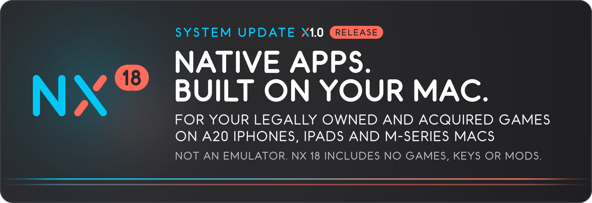
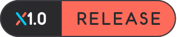
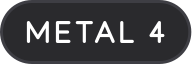
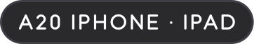
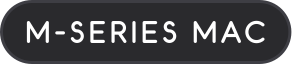
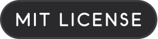

Your legally owned and acquired Switch and Switch 2 games, as native apps for your iPhone, iPad and Mac. 
Built on your Mac. Not an emulator. The game's code runs natively on the Apple chip, and Metal 4 draws every frame. 
<b>NX 18 includes no games, no keys and no mods, and is not affiliated with Nintendo.</b>

<a href="docs/getting-started.md"><b>Getting started</b></a> · <a href="https://github.com/kencalx/NX18/releases"><b>Releases</b></a> · <a href="docs/settings.md"><b>Settings</b></a> · <a href="#reporting-a-problem"><b>Report a problem</b></a> · <a href="#acknowledgements"><b>Acknowledgements</b></a>

## System update X1.0

- **More frames.** Ready-made pipelines now ship in the app, so a first start compiles far less, and fewer are built while you play.
- **More efficient.** About 0.5 W of CPU power for a 3D platformer at 60 fps on an iPhone 18 Pro Max, and fewer CPU wakeups in lock-heavy games.
- **More responsive.** On iPhone and iPad, a frame that waits too long for the screen is skipped, so the picture keeps up with your input. On the iPhone, game-to-display time fell from about 43–49 ms to about 25–33 ms.
- **More screen.** Fit, Fill or Stretch the picture, and match a taller screen in games that support it. Your own Ultrawide mod becomes an option in the launcher, which now shows its frame-rate cost where it was measured.
- **More console.** NX 18's own in-game menu and a refreshed launcher, with touch, a controller or VoiceOver.
- **More to come.** X2.0 is planned, with lower power use among its goals. Plans, not promises.

Power figures are CPU power: the game's own process, not the GPU or the display. The full release notes, with how each figure was measured, are on the [Releases](https://github.com/kencalx/NX18/releases) page.

## What you need

- **Your legally owned and acquired games**, dumped from your own Switch or Switch 2, and your own `prod.keys` for `.nsp` and `.xci` games. NX 18 includes no games, keys or firmware.
- **A Mac** with Apple silicon (M-series) and Metal 4, on macOS 27.3 or later. To build: Xcode 27.3, [Homebrew](https://brew.sh) and Python 3.12 or newer.
- **To play on iPhone or iPad:** a device with an Apple A20 chip, on iOS or iPadOS 27.3 or later. NX 18 is built for the A20 and tested on the iPhone 18 Pro Max. The iPhone 18 Pro, iPhone Duo and iPad mini 8 should work too, but aren't tested yet.
- **A sideloading tool** for iPhone and iPad, such as AltStore, SideStore, Sideloadly or LiveContainer. A paid Apple Developer account is recommended, not required.

Every detail, down to the Metal compiler: [Requirements](#requirements).

## Get started

1. **Get your Mac ready.** Download `nx18-setup.sh` and `nx18-build.sh` from the [latest release](https://github.com/kencalx/NX18/releases/latest) and run `bash ~/Downloads/nx18-setup.sh`. It asks before every install or download.
2. **Build your game.** Copy `nx18-build.sh` to your home folder, set your game, your keys and the target (`iphone`, `ipad` or `mac-app`) at its top, and run it. It says where the IPA or Mac app is. Your keys stay on your Mac.
3. **Play.** On the Mac, open the app. On iPhone or iPad, sideload the IPA, then make sure the game gets the [Increased Memory Limit](#increased-memory-limit).

New to this? [Getting started](docs/getting-started.md) goes one step at a time, from a new Mac to playing. Rather build in an app than in Terminal? [Build with NX Play instead](docs/getting-started.md#build-with-nx-play-instead): NX Play, a community Mac app, builds with your NX 18 folder. Every command and option: [Building](docs/building.md).

## About NX 18

NX 18 is built on [NXNative](https://github.com/seedds/nxnative) by seedds and its contributors. It aims NXNative at the newest Apple hardware: the Apple A20 chip and M-series Macs, drawing through Metal 4 only. NX 18 adds its own in-game menu, a refreshed launcher, ready-made pipelines and release scripts, and keeps taking in NXNative's fixes ([Acknowledgements](#acknowledgements)).

This repository holds no game code, art or files. NX 18 is an unofficial fan project, not affiliated with Nintendo, Apple or any game publisher.

## Games

Each game has its own note, with the devices it was tested on, its frame rate and what still goes wrong. For original Switch games, see the [tested games table](dm/games/README.md#games): each row gives the build, the engine and the graphics API.

These Switch 2 games were tested by playing them on the Mac. Four were also played on an iPhone 18 Pro Max.

| Switch 2 game | Played on |
| --- | --- |
| [Donkey Kong Bananza](dm/games/040074A01BF12000/README.md) | Mac · iPhone 18 Pro Max |
| [Fire Emblem Fortune's Weave](dm/games/04007EF01F8AE000/README.md) | Mac, up to 120 fps |
| [Hyrule Warriors: Age of Imprisonment](dm/games/04003F40232DE000/README.md) | Mac |
| [Kirby Air Riders](dm/games/040077201BE50000/README.md) | Mac |
| [Mario Kart World](dm/games/0400C3F00006E000/README.md) | Mac · iPhone 18 Pro Max |
| [Mario Tennis Fever](dm/games/0400D4201C6EA000/README.md) | Mac |
| [Pokémon Pokopia](dm/games/0400A3A01EE4C000/README.md) | Mac |
| [PRAGMATA](dm/games/0400C76024710000/README.md) | Mac |
| [Splatoon Raiders](dm/games/0400380020056000/README.md) | Mac |
| [Star Fox](dm/games/0400E88025B1A000/README.md) | Mac · iPhone 18 Pro Max |
| [The Legend of Zelda: Ocarina of Time](dm/games/0400486024DEC000/README.md) | Mac · iPhone 18 Pro Max |
| [Yoshi and the Mysterious Book](dm/games/0400245021D2C000/README.md) | Mac |

- **Switch 2 games** build from your legally owned and acquired game files: a `.nup` or `.nx` file, or a dump folder ([Switch 2 games](docs/building.md#switch-2-games)).
- **NVN games.** NX 18 runs games that draw with NVN, the Switch's own graphics API. Games that draw with OpenGL or Vulkan were set aside in the 0.5 pre-release. They are planned to return in X2.0 with a Metal 4 port ([What's next](#whats-next)).
- **A new game?** One without a profile gets a survey and a provisional build, which may not start ([Port another game](docs/development.md#port-another-game)).

## Settings and the console feel

Every game app opens like a console game: its art, its settings, then **Play**.

- **Launcher.** The game's art and logo, when you last played, and three presets: **Battery**, **Balanced** and **Quality**. **Game guide**, the manual and **About this game** are read from the app, never from the internet. Touch or a controller both work: **+** starts the game, **Y** opens the guide. Home Screen shortcuts (**Game**, **Launcher**, **Guide**) and **Skip this screen next time** get you in faster. The Mac shows the same screen as a settings window. [Presets, the guide and a controller](docs/settings.md#presets-the-guide-and-a-controller)
- **In-game menu.** Tap the ring button at the top centre (double-tap to show it), or press a controller's **Home** button. A wide, low panel opens over the game, and the game keeps running. It works with touch, a controller or VoiceOver, and holds **Cheats** and **Share log**. [In-game menu](docs/settings.md#in-game-menu)
- **Console mode.** **Handheld** is lighter on the device. **Docked** renders at the Switch's TV resolution. A Switch 2 game starts in Handheld on iPhone and iPad, and in Docked on the Mac. A Switch game starts in Docked. On a TV, the game stays Docked. [Console mode](docs/settings.md#console-mode)
- **TV.** Connect a cable or start Screen Mirroring. The game fills the TV in 16:9, at up to 1080p, and the device keeps the controls. [TV](docs/settings.md#tv)
- **Picture.** **Fit**, **Fill** or **Stretch**, and **Match screen** for a taller picture in games that support it. [Picture](docs/settings.md#picture)
- **Your mods and cheats, as options.** Your own High frame rate or Ultrawide mod becomes an option in the launcher. Your own cheats turn on and off in the in-game menu, or in the Cheats window on the Mac. NX 18 includes no mods or cheats. [Mods and patches](docs/playing.md#mods-and-patches) · [Cheats](docs/playing.md#cheats)
- **Cloud saves.** One save, shared by your iPhone, iPad and Mac through iCloud Drive. When both changed, **Play** asks which to keep, and the other is kept as a backup. [Cloud saves](docs/settings.md#cloud-saves)
- **Acknowledgements.** Every game app lists the code and art it is built with, and their licenses. On iPhone and iPad it's at the bottom of the settings. On the Mac it's the settings window's last row, and in the app menu.

Every setting: [Settings](docs/settings.md). Controls and saves: [Playing](docs/playing.md).

## Requirements

- **Mac:** Apple silicon with Metal 4, macOS 27.3 or later (NX 18 draws through Metal 4 only; a virtual Mac, whose GPU has no Metal 4, is not supported). Building games requires Xcode 27.3.
- **iPhone:** A20 chip (iPhone 18 family, iPhone Duo, iPad mini 8) or later, with iOS 27 or later, for upstream's builds; this fork's is built for the A20 Pro and needs iOS 27.3 or later (below).
- **iPad:** M4 chip or later, with iPadOS 27 or later, for upstream's builds; this fork's is built for the A20 Pro and needs iPadOS 27.3 or later (below).

NX 18's iPhone and iPad builds are made for the Apple A20 chip and need iOS or iPadOS 27.3 or later. They don't run on older chips or older systems.

- **Tested** on the iPhone 18 Pro Max.
- **Should work, not tested yet:** the iPhone 18 Pro, iPhone Duo and iPad mini 8.
- **Switch 2 games:** all were tested on the Mac, and four were also played on the iPhone 18 Pro Max. iPad builds are untested. Each game's note lists the devices it was tested on.
- **To build:** [Xcode](https://developer.apple.com/download/all/?q=Xcode%2027.3) 27.3, the beta build 27C5020n with Metal Toolchain 27C5020k (Metal compiler 32023.925.6). The shaders were tested with that compiler, and the build check refuses another one unless you allow it: [Xcode and the Metal compiler](docs/building.md#xcode-and-the-metal-compiler).

## Increased Memory Limit

The bigger games need more memory than iOS gives an app by default. Without the **Increased Memory Limit**, iOS may close the game in busy scenes.

Every app NX 18 builds asks for it, and for Extended Virtual Addressing. Whether iOS grants it depends on your sideloading tool and your Apple account:

- **Xcode, with a paid Apple Developer account** (or a tool that builds through Xcode, such as NX Play): nothing to do. Xcode adds the capability to the app's App ID as it signs the app. A free account's Personal Team can't get it this way, so those builds go without it: use one of the ways below.
- **AltStore 2.2 or later, and Sideloadly:** when the tool offers the choice, keep the entitlement. If the check below shows clearly less room, add it with GetMoreRam, as for SideStore.
- **SideStore with a free Apple ID:** add the entitlement to the game's App ID, once. GetMoreRam does it: a small app by [hugeBlack](https://github.com/hugeBlack/GetMoreRam), a LiveContainer developer. [ClientQUI's fork](https://github.com/ClientQUI/GetMoreRam/releases) uses SideStore's local anisette server, and it's the version tested with NX 18.
  1. Install the game with SideStore (or AltStore). Sideload GetMoreRam the same way.
  2. In GetMoreRam's settings, sign in with the Apple ID that signed the game.
  3. Open **App IDs** and tap **Refresh**. Pick the game's App ID and tap **Add Increased Memory Limit**.
  4. Reinstall the game from SideStore or AltStore. A plain refresh may not pick it up. After that, it stays through the weekly refreshes.
  5. GetMoreRam takes one of a free Apple ID's three app slots. Delete it afterwards to free the slot, and install it again for the next game.

  No GetMoreRam? Open Xcode, signed in with the same Apple ID. Add the **Increased Memory Limit** capability to the game's App ID, then do step 4.
- **LiveContainer:** your game runs inside LiveContainer, so LiveContainer is the app that needs the entitlement. Install LiveContainer with Impactor, and it's added for you. With SideStore, add it to LiveContainer's App ID as above. Install any helper app the same way as LiveContainer, or the entitlement won't apply.

These steps come from the tools' own docs and community guides. New versions of the tools or of iOS can change them.

**Check that it worked.** Start a game and share its log: in-game menu › **Share log**. Near the start, find the `[mem] guest memory` line. Its `room to the memory limit` is how much the game can use. On an iPhone 18 Pro Max with the entitlement, that's about 7.9–8.0 GB. A clearly lower number most likely means the entitlement wasn't granted.

## Community front ends

Prefer an app to Terminal? These community Mac apps build your legally owned and acquired games with NX 18, and some keep a game library too. Each is its own project, so ask its makers on its page. NX 18's own Mac app is planned for X2.0.

- [NX2Apple](https://github.com/LNPANDY/NX2Apple): builds on the Mac, with one game library for iPhone and iPad.
- [NX Play](https://github.com/varyform/nx-native-wrapper), by varyform: a Mac game library that installs to your devices and syncs saves. It points at NXNative by default, so choose your NX 18 folder in its settings ([steps](docs/getting-started.md#build-with-nx-play-instead)).
- [LumaNX](https://github.com/Xc1Ym/LumaNX): builds games on the Mac and exports IPAs.
- [GameCase](https://github.com/Tiaoge-tou/GameCase): a game library on iOS that runs your games through LiveContainer.

## Reporting a problem

Open an issue in NX 18's [Issues](https://github.com/kencalx/NX18/issues), with the game's log attached. Questions and ideas are welcome there too.

- **iPhone or iPad:** in-game menu › **Share log**. It sends `log.txt` and `log.prev.txt`: this run's log and the one before.
- **Mac:** `python3 scripts/bug_report.py <title ID>` gathers the logs, versions and settings into one file to attach. Or attach `~/Library/Logs/nxnative/<title ID>.log` yourself.

Never attach game files, keys or anything extracted from a game. Logs never contain keys or game files. A Mac log can show your folder names; `bug_report.py` replaces your home folder with `~`.

How each game runs on NX 18 (frame rate, resolution, devices tested) is in its [game note](dm/games/README.md#games).

## What's next

Plans, not promises. Nothing here has a date. X2.0 is planned with:

- **More room for games.** Less memory and storage use, Switch 2 games first. A one-time notice when a game seems to run without the Increased Memory Limit.
- **Lower power use.** More efficiency work, on top of X1.0's.
- **New ways to play.** Portrait on iPhone. A Play on TV row that guides you through AirPlay, and turns the phone into the controller. A companion screen with guides and quick settings. Per-game button mapping, frame generation and a Performance preset.
- **NX 18's own Mac app.** It builds and installs your legally owned and acquired games, with mods, cheats, artwork and guides in one place, and step-by-step help with sideloading, LiveContainer included.
- **Games and fixes.** OpenGL and Vulkan games come back with a Metal 4 port. The Nintendo Switch Sports Resort shader fix. More ready-made pipeline lists. A steadier 60 fps in the heaviest Switch 2 games. Newer fixes from NXNative. A Switch 2 mode for games that carry their Nintendo Switch 2 Edition, when your copy includes it. A fit check for the iPhone Duo.

## For developers

How NX 18 works, every build option, and how to bring up a game:

[Building](docs/building.md) · [How it works](docs/development.md) · [Game notes](dm/games/README.md#games) · [Bring-up and debugging](docs/agents/README.md) · [Front ends](docs/frontends.md) · [Contributing](CONTRIBUTING.md)

## Acknowledgements

NX 18 stands on other people's work. Their licenses: [dm/third_party](dm/third_party/README.md).

- **[NXNative](https://github.com/seedds/nxnative)** by seedds and its contributors (MIT): the project NX 18 is built on. The changes NX 18 ported, with their authors, are in [Changes ported from upstream](docs/development.md#changes-ported-from-upstream).
- **[d2r-mobile](https://github.com/jhaizhou-ops/d2r-mobile)** (MIT): it worked out this way of running a game natively, for Diablo II: Resurrected. NXNative grew from the parts of it that suit any game: its iOS app shell, NSO rewriter, NVN-on-Metal layer and Horizon stand-in host. The two projects still trade fixes.
- **Ryujinx** (MIT): its shader translator brings the games' shaders to SPIR-V. NX 18 keeps a lightly patched copy (`Ryujinx.Graphics.Shader`, `Ryujinx.Common`, `Spv.Generator` 1.3.2) in `dm/third_party/ryujinx`; [its README](dm/third_party/ryujinx/README.md) lists the patches. When it's unclear how the host should behave, NX 18 also looks at how Ryujinx emulates the kernel and system services.
- **[Atmosphère](https://github.com/Atmosphere-NX/Atmosphere)**: NX 18 follows mesosphère, its kernel, for how Horizon synchronizes threads (address arbiter, condition variables), and dmnt, its cheat VM, for the cheat engine in `dm/host/hle_cheats.c`.
- **[LibHac 0.19.0](https://www.nuget.org/packages/LibHac/0.19.0)** by Alex Barney (MIT): `dm/tools/nx_extract` uses it to read NSPs and lay updates over the base game.
- **[SPIRV-Cross](https://github.com/KhronosGroup/SPIRV-Cross)** (Apache-2.0): turns SPIR-V into Metal Shading Language.
- **[MacNativeGames](https://github.com/ly05010419/MacNativeGames)** (MIT): in `dm/gfx/nvn/nvn_mtl.m`, 8-bit indices widened on the GPU and clears inside a pass; in the shader translator, the visibility-counter lowering.
- **Switch Button Icons and Controls** by Zacksly: Button Icons and Controls by Zacksly (CC BY 3.0 Licensed | zacksly.itch.io), modified: recoloured. The button glyphs of the iPhone and iPad app's controller hints (the settings screen's "Press A to play", the guide's Y, B to close, the in-game menu's A and B), in [`dm/ios/Resources/ButtonIcons`](dm/ios/Resources/ButtonIcons/README.md) with the licence.
- **[CMAA2](https://github.com/GameTechDev/CMAA2)** (Intel, Apache-2.0): the edge smoothing behind the Anti-aliasing setting, ported to Metal in `dm/gfx/msl/cmaa2.metal`. **[FidelityFX FSR 1](https://github.com/GPUOpen-Effects/FidelityFX-FSR)** (AMD, MIT): the RCAS sharpening behind the Sharpening setting, in `dm/gfx/msl/present.metal`.
- **[FPSLocker-Warehouse](https://github.com/masagrator/FPSLocker-Warehouse)** by masagrator: the frame-rate addresses and patch sites behind 60 fps in Monster Hunter Rise, Need for Speed: Hot Pursuit Remastered (one instruction found by theboy181), NieR:Automata and Tears of the Kingdom. NX 18 re-implements them in `dm/host/hle_fpslock.c` and the games' `patches.py`.
- **[AstralChain-Dynamic-FPS](https://github.com/yogesh1239/AstralChain-Dynamic-FPS)** v1.1.1 by yogesh1239 (MIT): the timer and camera helpers in `dm/games/01007300020FA000/patches.py`.
- **[TypeTreeDumps](https://github.com/AssetRipper/TypeTreeDumps)** by AssetRipper: the layouts of Unity's `Shader` and `ComputeShader` objects in `dm/gfx/tools/unityfs.py`.
- **[NUP](https://github.com/a55uka/nup)** by a55uka and **[NXFormat](https://github.com/fab918/nxformat)** by fab918: the container formats that `scripts/pack_nup.py` and `scripts/pack_nx.py` read, with their own code. NXFormat's conformance fixtures are test data in `dm/tools/tests/fixtures/nx`.
- Other included code, each part with its license listed in [dm/third_party](dm/third_party/README.md): dav1d, libvpx, stb_vorbis, deko3d's texture layout (fincs), `nvn.h` (h1k421) and MiniEngine's pixel packing.

## License

NX 18 is MIT licensed, as NXNative is ([LICENSE](LICENSE), copyright seedds). Code from other projects keeps the license it came with ([dm/third_party](dm/third_party/README.md)).
