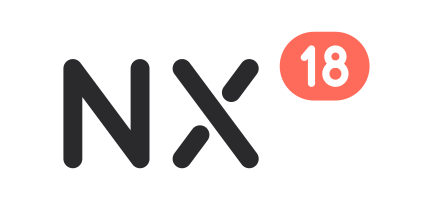

<p align="center"><picture><source media="(prefers-color-scheme: dark)" srcset="docs/images/nx18/nx18-lockup-dark.svg"></picture></p>

# NX 18

A fork of [nxnative](https://github.com/seedds/nxnative) for the iPhone 18 Pro Max ([what this fork changes](#requirements)).

Play your own Nintendo Switch and Switch 2 games natively on Apple silicon Macs, iPhone and iPad. One script packs your game into a Mac app or an unsigned IPA that you sideload.

It is not an emulator: the game's own code runs directly on the Apple chip, with Switch graphics rebuilt on Metal. Nothing from any game is in this repository, and the project is not affiliated with Nintendo or any game publisher.

[Games](#games) · [Community front ends](#community-front-ends) · [Requirements](#requirements) · [How to play](#how-to-play) · [Discussions](#discussions) · [For developers](#for-developers)

## Games

The full [tested games table](dm/games/README.md#games) includes original Switch games, tested builds, engines and graphics APIs. Each game's note records its tested platforms, progress and known issues.

These Switch 2 games have passed Mac gameplay testing. Build them from a [`.nup` or `.nx` file or a dump folder](#switch-2-games):

- [Donkey Kong Bananza](dm/games/040074A01BF12000/README.md)
- [Fire Emblem Fortune's Weave](dm/games/04007EF01F8AE000/README.md) — up to 120 fps
- [Hyrule Warriors: Age of Imprisonment](dm/games/04003F40232DE000/README.md)
- [Kirby Air Riders](dm/games/040077201BE50000/README.md)
- [Mario Kart World](dm/games/0400C3F00006E000/README.md)
- [Mario Tennis Fever](dm/games/0400D4201C6EA000/README.md)
- [Pokémon Pokopia](dm/games/0400A3A01EE4C000/README.md)
- [PRAGMATA](dm/games/0400C76024710000/README.md)
- [Splatoon Raiders](dm/games/0400380020056000/README.md)
- [Star Fox](dm/games/0400E88025B1A000/README.md)
- [The Legend of Zelda: Ocarina of Time](dm/games/0400486024DEC000/README.md)
- [Yoshi and the Mysterious Book](dm/games/0400245021D2C000/README.md)

## Community front ends

Community projects build on nxnative with tools to turn your games into apps for your iPhone, iPad or Mac without the command line, and libraries to organize and launch them. They are separate projects: questions and bugs about them go to their own pages.

- [NX2Apple](https://github.com/LNPANDY/NX2Apple) — Mac builder with a shared iPhone/iPad game library.
- [NX Play](https://github.com/varyform/nx-native-wrapper) — Mac library with device installs and save sync.
- [NxNative Launcher](https://github.com/rennan101/nxnative_Launcher) — Mac launcher with guided builds and controller mapping.
- [LumaNX](https://github.com/Xc1Ym/LumaNX) — Mac game builder with IPA export.
- [GameCase](https://github.com/Tiaoge-tou/GameCase) — iOS game library based on LiveContainer.

## Requirements

- **Mac:** Apple silicon with Metal 4, macOS 27.3 or later (NX 18 draws through Metal 4 only; a virtual Mac, whose GPU has no Metal 4, is not supported). Building games requires Xcode 27.3.
- **iPhone:** A17 Pro chip or later, with iOS 26 or later, for upstream's builds; this fork's is built for the A20 Pro and needs iOS 27.3 or later (below).
- **iPad:** M1 chip or later, with iPadOS 26 or later, for upstream's builds; this fork's is built for the A20 Pro and needs iPadOS 27.3 or later (below).

**This fork (NX 18)** builds its iOS app for one chip, the iPhone 18 Pro Max's A20 Pro, on iOS 27.3 (`dm/ios/project.yml`: deployment target 27.3, `-mcpu=apple-a20`; the app still declares the iPad family), with Xcode 27.3, whose Metal compiler (32023.925) is the one `dm/gfx/tools/dmsh_chain.lock` records, so `--allow-other-metal` is not needed. The lock's exact compiler, 32023.925.6, is the Xcode 27.3 beta's (build 27C5020n, Metal Toolchain 27C5020k), the one the shaders were tested with; a released Xcode 27.3 whose Metal compiler reports another version is refused by the build check until the lock is raised, or needs `--allow-other-metal`; its game shaders are MSL 4.1 on both platforms (`-std=metal4.1`). An IPA from this tree needs iOS 27.3 or later and does not run on the older devices or systems listed above, which are upstream's.

The games' textures are BC-compressed, which older iPhones cannot read. Switch 2 builds are tested on the Mac; check each game's note for device-specific validation.

For a game without a profile, the script writes a survey and tries a provisional build with guessed settings. That build may not start; see [Port another game](docs/development.md#port-another-game).

## How to play

Switch 2 games are built from one `.nup` or `.nx` file or a folder of their files, not from NSPs, and are tested on the Mac only: see [Switch 2 games](#switch-2-games).

### Quick start with the release scripts

Two scripts come with each [release](https://github.com/kencalx/NX18/releases) (and are in [`scripts/release`](scripts/release)). They do the steps of [Build from the command line](#build-from-the-command-line) for you:

- **`nx18-setup.sh`** gets the Mac ready. It checks macOS, Xcode 27.3 (which you download from Apple yourself; it says which and how to select it) and its Metal toolchain, installs xcodegen, zstd and the Python modules (into a virtualenv, `.venv` in the NX 18 folder), and clones or updates NX 18 in `~/NX18`. It asks before each install or download and never runs `sudo`, and it leaves a folder with your own changes in it alone. `--check` only reports what is missing; `--yes` answers every question; `--dir <folder>` and `--ref <tag>` choose another folder or a release.
- **`nx18-build.sh`** builds a game. Set your game (its folder of NSPs, a dump folder, or a `.nup` or `.nx` file), your `prod.keys` and the target (`iphone`, `ipad` or `mac-app`) in the settings at its top, then run it. It checks the settings, selects Xcode 27.3 by itself, runs the build and says where the IPA or app is. It never prints or copies your keys.

```
bash ~/Downloads/nx18-setup.sh
cp -n ~/Downloads/nx18-build.sh ~/nx18-build.sh   # -n keeps a copy you already edited; then edit the settings at its top
bash ~/nx18-build.sh
```

Each setting can also be given as an environment variable (`NX18_GAME`, `NX18_KEYS`, `NX18_TARGET`, ...: the comment beside it names it), and other options of the packing script go after the script's name: `bash ~/nx18-build.sh --language ja`. Keep your copy of `nx18-build.sh` outside the NX 18 folder: `nx18-setup.sh` does not update a folder with changed files in it.

### Build from the command line

You need an Apple silicon Mac with macOS 27.3 or later, [Xcode](https://developer.apple.com/download/all/?q=Xcode%2027.3) 27.3, [Homebrew](https://brew.sh) and Python 3.12 or newer (an arm64 one, not an Intel Homebrew's). An iPhone build also needs Xcode's iOS platform (Xcode → Settings → Components).

The shaders are built with Xcode 27.3's Metal compiler. Select it before step 1: `sudo xcode-select -s /Applications/Xcode.app`. With several Xcode versions installed, name this one `Xcode-27.3.app` and select it with `sudo xcode-select -s /Applications/Xcode-27.3.app`.

**1. Install the tools** (only once), in Terminal:

```
xcodebuild -downloadComponent MetalToolchain   # required: without it the build stops with an error
git clone https://github.com/kencalx/NX18.git && cd NX18   # this fork; upstream's nxnative tree has other requirements (its own Xcode and Metal compiler lock)
brew install xcodegen zstd
python3 -m pip install lz4 "capstone>=5,<6" fonttools nsz zbic "backports.zstd; python_version < '3.14'"
```

**2. Put your game in a folder**: the game, plus its update and DLC if you have them (`.nsp`, `.xci`, `.nsz` or `.xcz`):

```
~/Games/MarioWonder/
  Super Mario Bros. Wonder [010015100B514000][v0].nsp
  Super Mario Bros. Wonder [010015100B514800][v327680].nsp
```

**3. Build**, with your game folder and your `prod.keys`:

```
python3 scripts/build_ipa_from_nsp.py ~/Games/MarioWonder -k ~/keys/prod.keys
```

Mods: put the game's cheats (`cheats` folders) and a High frame rate or Ultrawide mod (`.ips`, `.pchtxt`, in a folder named for it, such as `60FPS` or `Ultrawide`) in a folder named `mods` inside the game's folder, as Atmosphère, yuzu or Ryujinx lay them out: the cheats are packed into the app and the mod becomes a switch in the launcher ([Mods and patches](docs/playing.md#mods-and-patches)). Other code patches and replacement files (`romfs` folders) are left out.

Launcher art: the screen before the game shows the game's key art, downloaded from titledb, else from SteamGridDB when you set a `STEAMGRIDDB_KEY` environment variable to your SteamGridDB API key. With a key it also shows the game's logo in place of its name, over SteamGridDB's textless art. `--art <image>` gives your own art, `--logo <image>` your own logo (a PNG or WebP with transparency), `--manual <file.pdf>` adds the game's manual, and `--no-art-online` keeps the build off the network ([Launcher art](docs/development.md#launcher-art-about-this-game-and-the-manual)).

UI font: `--ui-font <file.ttf>` (a TTF, OTF or TTC of your own) puts one font into the app for all of NX 18's own text: the launcher, the in-game prompts and progress screens, and the Mac banner and Cheats window. The file goes only into the app built on your Mac, never into the repository (so keep that app to your own devices); without it the system font is used ([UI font](docs/development.md#ui-font)).

The IPA appears in the game's folder. The first build takes 30–60 minutes and needs free disk space of about twice the game's size plus 10 GB; building again is much faster.

To play on the Mac instead, add `--platform mac-app`: you get a Mac app of the game to open from Finder. All options: [The packing script in detail](docs/development.md#the-packing-script-in-detail).

### Install

Install the IPA on your iPhone or iPad with a sideloading tool such as AltStore, SideStore, Sideloadly or LiveContainer. Then make sure the game gets the [Increased Memory Limit](#increased-memory-limit).

Game too big to install? Build again with `--romfs separate`, and run the command the script prints once to copy the game files to your phone ([Quick reinstalls](docs/development.md#quick-reinstalls)). With AltServer, also add `--shader-files`: it cannot install a file of 2 GiB or more.

Controls, saves and settings: [Playing](docs/playing.md).

#### Increased Memory Limit

The bigger games, and Switch 2 games above all, need the higher memory limit iOS gives an app with the Increased Memory Limit entitlement. Without it iOS may close the game in busy scenes. Every app NX 18 builds already asks for it (and for Extended Virtual Addressing), but whether iOS grants it depends on your sideloading tool and Apple account:

- **Installed from Xcode with a paid Apple Developer account** (or with a tool that builds through Xcode, such as NX Play): nothing to do. Xcode adds the capability to the app's App ID when it signs the app. A free account's Personal Team cannot get it this way, so such tools build without it; use one of the ways below.
- **AltStore** (2.2 or later) and **Sideloadly**: keep the entitlement when the tool offers the choice. Nothing else to do.
- **SideStore with a free Apple ID**: the entitlement has to be added to the app's App ID once. The easiest way is **GetMoreRam**, a small app by [hugeBlack](https://github.com/hugeBlack/GetMoreRam) (a LiveContainer developer). [ClientQUI's fork](https://github.com/ClientQUI/GetMoreRam/releases) uses SideStore's local anisette server and is the one tested with NX 18:
  1. Install the game with SideStore (or AltStore), then sideload GetMoreRam the same way.
  2. In GetMoreRam's settings, sign in with the Apple ID that signed the game.
  3. Open **App IDs**, tap **Refresh**, pick the game's App ID and tap **Add Increased Memory Limit**.
  4. Reinstall the game from SideStore or AltStore (a plain refresh may not pick it up). It stays through the weekly refreshes after that.
  5. GetMoreRam takes one of a free Apple ID's three app slots: delete it afterwards to get the slot back, and install it again for the next game.

  Without GetMoreRam: open Xcode signed in with the same Apple ID, add the **Increased Memory Limit** capability to the game's App ID, then do step 4.
- **LiveContainer**: the game runs inside LiveContainer, so LiveContainer itself needs the entitlement. Installing LiveContainer with Impactor adds it automatically; with SideStore, add it to LiveContainer's App ID as above. Install any helper app the same way as LiveContainer, or the entitlement does not apply.

These steps come from the sideloading tools' own docs and community guides, and can change with new versions of the tools or of iOS.

To check that it worked, start a game, share its log (the in-game menu › **Share log**) and find the `[mem] guest memory` line near the start. Its `room to the memory limit` is how much the game can use: on an iPhone 18 Pro Max with the entitlement it is about 7.9–8.0 GB. A clearly lower number most likely means the entitlement was not granted.

### Switch 2 games

A Switch 2 game is built from one [NUP](https://github.com/a55uka/nup) container (a `.nup` file), one [NX](https://github.com/fab918/nxformat) archive (a `.nx` file) or a folder of its files, not from NSPs. None of them needs `prod.keys`. A game this project has no profile for is surveyed and gets a provisional profile, as NSPs do ([Port another game](docs/development.md#port-another-game)), which may not boot. You get a Mac app; iPhone and iPad are untested.

**From a `.nup` file**, which holds the base game, its updates and DLC in one file. Give the file, or a folder that holds it:

```
python3 scripts/build_ipa_from_nsp.py ~/Games/DonkeyKongBananza.nup --platform mac-app
```

[Hyrule Warriors: Age of Imprisonment](dm/games/04003F40232DE000/README.md) is played this way: its 47 GB NUP unpacks in under five minutes. A NUP that carries the game's control data (its NACP) and icon gives the app the game's name and icon; otherwise the name comes from the game's profile and the app gets the NX 18 icon (`docs/images/nx18/nx18-icon-square-1024.png`) unless you give it one with `--icon <image>` (`ICON` in Spyder; a JPEG or PNG of any size). The `nup` tool numbers a NUP's metadata one too low since 2026-11-04 (its PR #20); the script reads such a NUP correctly and says so.

A NUP without the base game also works, when its base package is empty or it has none and its updates are marked `standalone_update`: the update is taken as the whole game, and the script says so. If the game then stops on missing files, that update holds only what changed: pack a NUP with the base game. The newest update is selected by default; `--package v<N>` selects another version in the container. Such a container has no `v0` (base game) to select.

**From a `.nx` file**, an NX archive ([NXFormat](https://github.com/fab918/nxformat) 1.0.x, by fab918), which also holds the base game, updates and DLC in one file, for Switch 1 and Switch 2 games alike. Its NXConvert makes one from a NUP (`nxconvert pack-nup game.nup game.nx --platform switch2`) or from extracted folders (`nxconvert pack-tree`). Give the file, or a folder that holds it:

```
python3 scripts/build_ipa_from_nsp.py ~/Games/DonkeyKongBananza.nx --platform mac-app
```

Every version in an NX is the whole game, so a newer update needs no base game beside it; `--package v<N>` selects a version, the newest by default. Each version carries its own NACP and icon when the archive has them, and DLC converted from a NUP or folders comes along. A version without a NACP takes the archive's title as the app's name (the title given to `nxconvert --fallback-title` or typed in NXConvert's sidebar), else the profile's. An icon set in NXConvert's sidebar becomes the app's icon, also for an NX made from NSPs or XCIs. Every file is checked against its SHA-256 as it is unpacked, and a damaged archive stops the build with the file it failed on; `python3 scripts/pack_nx.py game.nx --list` lists what an archive holds and `--verify` checks all of it. An NX that holds several games needs `--title-id`. An NX made from decrypted NSPs or XCIs (`nxconvert pack game.dnsp`, Switch 1 games) holds the decrypted NCA files themselves: it builds too, still with no `prod.keys`. The repository's `nx_extract` reads them and lays an update over its base game, as it does for NSPs. It needs temporary space for the NCA files of the version it extracts (an update's base and patch NCAs together, deleted after each), and a repeat build reuses the extraction without staging them again. Its base game alone cannot be packed when that base is sparse (the decrypter left out data its update carries); pack the update version. An NX of a newer format version than 0.2 or 0.3 is refused with a line saying a newer NX 18 is needed. Keep one `.nup` or `.nx` per folder.

**From a folder of files**. The script expects this layout (`updates` and `dlc` are optional):

```
~/Games/DonkeyKongBananza/
  base/exefs/                     main, main.npdm, sdk, rtld
  base/romfs/
  updates/458752/exefs/           the update's version, as a decimal number
  updates/458752/romfs/           the patched RomFS, not a patch
  dlc/040074a01bf13001/0/romfs/   the DLC's title ID
```

```
python3 scripts/build_ipa_from_nsp.py ~/Games/DonkeyKongBananza --platform mac-app
```

An update's folder alone will do (no `base/`), and so will `exefs/` and `romfs/` directly in the folder, as `nup extract` writes them, which count as `base/`. The folder holds no icon, so the app gets the NX 18 icon; `--icon <image>` (`ICON` in Spyder) gives it the game's. To turn such a folder into a NUP: `nup pack ~/Games/DonkeyKongBananza game.nup`.

## Discussions

Questions, how a game runs on your Mac or iPhone, and ideas go in [Discussions](https://github.com/seedds/nxnative/discussions); [Issues](https://github.com/seedds/nxnative/issues) are for bugs, with the log. Ocarina of Time's performance (frame rate, resolution, which Macs hold 60 fps) is followed in [Ocarina of Time: state on main](https://github.com/seedds/nxnative/discussions/1789).

## For developers

[How it works](docs/development.md) · [Game notes](dm/games/README.md#games) · [Bring-up and debugging](docs/agents/README.md) · [Front ends](docs/frontends.md) · [Contributing](CONTRIBUTING.md)

## Acknowledgements

This project is built on other people's work ([licenses](dm/third_party/README.md)):

- **[d2r-mobile](https://github.com/jhaizhou-ops/d2r-mobile)** (MIT) developed this native-execution approach, for Diablo II: Resurrected. nxnative started as a copy of its generic parts: the NSO rewriter, the host that stands in for Horizon, the NVN-on-Metal layer and the iOS app shell. Fixes go both ways.
- **Ryujinx** (MIT): its shader translator (`Ryujinx.Graphics.Shader`, `Ryujinx.Common` and `Spv.Generator` 1.3.2, in `dm/third_party/ryujinx` with a few fixes listed in [its README](dm/third_party/ryujinx/README.md)) turns the games' shaders into SPIR-V. Its emulation of the kernel and system services is also a reference when the host's behaviour is in doubt.
- **[Atmosphère](https://github.com/Atmosphere-NX/Atmosphere)**: its kernel, mesosphère, is the reference for Horizon's synchronization semantics (address arbiter, condition variables).
- **[LibHac](https://github.com/Thealexbarney/LibHac)**: reads NSPs and layers updates over the base game in `dm/tools/nx_extract`.
- **[SPIRV-Cross](https://github.com/KhronosGroup/SPIRV-Cross)**: SPIR-V to Metal Shading Language.
- **[MacNativeGames](https://github.com/ly05010419/MacNativeGames)** (MIT): the GPU widening of 8-bit indices and in-pass clears in `dm/gfx/nvn/nvn_mtl.m`, and the visibility-counter lowering in the shader translator.
- **Switch Button Icons and Controls** by Zacksly: Button Icons and Controls by Zacksly (CC BY 3.0 Licensed | zacksly.itch.io), modified: recoloured. The button glyphs of the iPhone and iPad app's controller hints (the settings screen's "Press A to play", the guide's Y, B to close, the in-game menu's A and B), in [`dm/ios/Resources/ButtonIcons`](dm/ios/Resources/ButtonIcons/README.md) with the licence.
- **[CMAA2](https://github.com/GameTechDev/CMAA2)** (Intel, Apache-2.0): the edge smoothing of the present's Anti-aliasing setting, ported to Metal in `dm/gfx/msl/cmaa2.metal`. **[FidelityFX FSR 1](https://github.com/GPUOpen-Effects/FidelityFX-FSR)** (AMD, MIT): the RCAS sharpening of its Sharpening setting, in `dm/gfx/msl/present.metal`.

## License

MIT ([LICENSE](LICENSE)). Third-party code keeps its own license ([dm/third_party](dm/third_party/README.md)).
