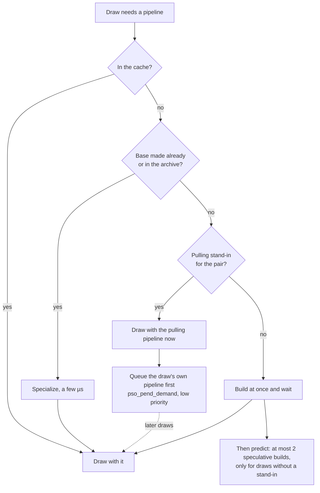

# Development

The README covers packing and playing. This page is for working on nxnative itself: how it is built, the script's options, running games on the Mac, and adding a game (per-game notes are in [dm/games](../dm/games/README.md#games)). Agent-oriented details (bring-up failure catalogue, graphics specifics, debugging recipes) are in [docs/agents](agents/README.md).

## How it works

| Part | State |
|---|---|
| Rewriter (`dm/tools/patch_nso.py`) | Runs unchanged on every module of every supported game. Per-build cuts are keyed by the module's build ID, in the profile's `patches.py` (a game's own modules) or `dm/tools/sdk_patches.py` (Nintendo's `sdk` modules). Profiles can opt verified cuts into [function matching](reference/rewriter.md#function-matched-cuts-for-unregistered-builds) across updates |
| Host (`dm/host`) | Stands in for the Horizon kernel and the system services the games call: threads and synchronization, memory, file system with transactional saves, HID, audio, movies (VP9 through libvpx, Vorbis sound through stb_vorbis), software keyboard, focus and lifecycle |
| Graphics (`dm/gfx`) | NVN on Metal. Ordinary and [tiled resolves](reference/rendering.md#tiled-multisample-resolves) share the recorded resolve path, including texture views. Shaders are extracted by `shader_split.py` from Nintendo's containers and from Unity's `Shader` objects, then translated offline. Mario: 16,266 of 16,268 shaders compile. Engage: 9,268 of 9,269. NX 18 renders NVN games only (Metal 4 only): the Vulkan and OpenGL layers (Hades, Digimon Story Cyber Sleuth and six more) were removed, and are in git at `93c34371` until they are ported ([Graphics APIs: NVN only](reference/rendering.md#graphics-apis-nvn-only)) |
| Audio | Games that carry the SDK's audio renderer (Mario) run it in-process; games that use AudioOut directly (Engage: Wwise) feed it straight. With Core Audio enabled (default on iOS, `DM_AUDIO=1` on the Mac), the [silent sink keeps releasing PCM buffers while a device starts or retries](reference/audio.md#a-blocked-audio-device-start-freezes-the-game). |
| Input | iOS: the touch gamepad (hidden while a physical controller is connected) and physical controllers; shaking the phone shakes the controller (its six-axis sensor, `hle_hid.c`; the accelerometer in `DmGamepad.m`, threshold `DM_SHAKE_G`, 1.5 G by default). Mac: scripted input (`DM_KEYS=<seconds>:<button>,…`, `Shake` for a shake, with `DM_KBD=<text>` answering the system keyboard; `DM_REC=<file>` records what the player does in that syntax, [05](agents/05-debugging.md#scripted-input-and-thread-scheduling)) or `DM_WINDOW=1` for a window with keyboard input (Space shakes) and physical controllers (face buttons by position as on the iPhone, a Nintendo pad by its labels: `pad_apple.h`). On the Mac and iOS each controller is a player of its own, for local co-op: the first one connected is player 1, together with the keyboard (iOS: the touch gamepad and the phone's gyro), the next player 2, and so on up to 8 (`pad_slots.h`); a controller that is removed frees its player and gets it back when it reconnects, and the log names each one's player and npad (`controller 'Xbox Wireless Controller' connected: player 2 (npad 1)`). Player 1 is the Handheld npad in handheld mode and No1 docked, player n is No n; the game's supported npad ids decide how many play (`hle_hid.c`): a one-player game gets every controller as player 1, and a controller past a game's last player is not used. `DM_PAD_MERGE=1` makes every controller player 1, as before (on iOS from `Documents/env.txt`); `DM_KBD_PLAYER=own` makes the keyboard player 1 on its own, with the controllers from player 2 on. The window goes fullscreen from its green button or ⌃⌘F; `DM_FULLSCREEN=1` starts it that way. In fullscreen, a screen whose refresh rate is not a multiple of the game's (144 or 165 Hz) runs at one that is (120 Hz) until the window leaves fullscreen; `DM_SCREEN_MATCH=0` keeps its rate. The drawable follows the window in pixels (fullscreen at the screen's resolution); `DM_METAL_HUD=1` shows Apple's performance HUD (on the iPhone too, from `Documents/env.txt`). The left mouse button is the touchscreen, on the 16:9 picture. Motion: a controller with a gyroscope drives its player's six-axis sensor (`motion_apple.h` → `dm_motion_set`, `hle_hid.c`; orientation from the gyro with tilt correction toward gravity, `motion_fusion.h`), and on iOS the phone's own device motion drives player 1's while no controller supplies fresh motion (`DmGamepad.m`, in the Switch frame: the pad view's own frame on iOS 27 and later (`deviceMotionBody`), turned for the screen's orientation before that ([The phone's motion in the picture's frame](reference/services.md#the-phones-motion-in-the-pictures-frame)); `DM_PHONE_MOTION=0|1|auto`; `1` selects only the phone). On the Mac, a Switch Pro Controller whose GameController motion is empty can use passive HID reports instead (`motion_pro_mac.h`; `DM_MOTION_HID=0` turns this reader off). This requires exactly one Pro in each API so it can use the same player slot without guessing; multiple Pros retain GameController input. Raw HID has its own orientation and nominal sensor scales; hardware validation of the reworked reader remains open ([Pro Controller fallback](reference/services.md#switch-pro-controller-advertises-motion-but-sends-zeroes)). An original (Switch 1) Joy-Con has no motion through GameController at all, so on the Mac the host reads each Joy-Con wholly from its HID reports and leaves GameController's controllers of them unread (`pad_jc1_mac.h`: it sends the console's handshake, reads the IMU and stick calibrations over SPI, drives HD rumble and the player lights; a left and a right one make a pad, a lone one is held sideways, and each is a device of its own to the npad layer, so the game picks dual or single; [the reference entry](reference/services.md#an-original-joy-cons-sensors-are-read-by-the-host); `DM_JC1=0` gives them back to GameController, `DM_JC1_SIDE=L|R` picks the half that feeds the merged stream, `DM_JC1_LOG=1` logs the handshake and the calibrations, `=2` adds a frame line a second). `DM_MOTION_AXES` / `DM_MOTION_ACC_SIGN` apply only to GameController. Each source keeps its own orientation. Without live motion the sensor lies flat as before. `DM_MOTION_LOG=1` logs player 1's mapped sample once a second per source; `DM_MOTION_AXES` (e.g. `x,-z,y`) and `DM_MOTION_ACC_SIGN=-1` remap a controller whose axes differ, `DM_MOTION_GAIN` sets the tilt correction (0.5), `DM_MOTION=0` turns motion off (the NSP script's `--no-motion` builds it in). The console's own sensor (`SevenSixAxisSensor`, read in handheld mode) still reports no states. In handheld mode the touches also drive `hid::GetGestureStates` (taps, presses, pans, swipes, pinches and rotations recognized by the host, `hle_touch.c`) |
| iOS app | One unsigned IPA for iPhone and iPad. The rewritten code is embedded in the executable; the shader libraries, the RomFS and the game icon (the NX 18 icon when the game has none) are inside the app. A settings screen comes before the game (`Launcher.swift`, drawn from `dm/launcher.json`, which `dm/games/settings.py` writes from `dm/games/settings.tsv`); the host's loading starts at app launch meanwhile, and the frame rate and render scale go into the frame step state when the game starts (`loader.c` `dm_fps_state_apply`) |
| Known gaps | Conditional render is always drawn; [indirect-count multi-draws](reference/rendering.md#indirect-count-multi-draws) can wait for a GPU-written count when the records need conversion, cannot be GPU-masked, or exceed the mask table capacity; geometry shaders do not translate. TBDR optimizations are off by default (they don't understand bindless textures yet). No amiibo. On the Mac, Mario's menu and dialogue text render blank (fine on the iPhone) |

## Cheats

How a Switch with Atmosphère runs cheats, and where this host differs, is in [Cheats on a Switch](reference/cheats.md).

Atmosphère-format cheat code files (`atmosphere/contents/<title ID>/cheats/<build ID>.txt` files that cheat sites share) apply to the running game (`dm/host/hle_cheats.c`): the file of the running build is chosen by the first 16 hex digits of the main NSO's build ID (FFCC 1.0.1: `DF154E1D08E39646`), from a folder holding either the flat `<build ID>.txt` layout, the Atmosphère tree under it, or both. The Mac window (`DM_WINDOW=1`) has a **Cheats** menu: each `[Name]` cheat is a checkmark row that toggles when clicked, a `{Name}` master code is always on and not toggleable, a cheat the VM cannot run shows its reason (`unsupported opcode FFF`) and stays off, and with no file of this build the menu lists `No cheats for build …` plus each other build's `.txt` in the folder as `another version of the game` (all disabled; `DM_CHEATS_ANY_BUILD=1` loads one, with a `[RED]` warning). The menu also reloads the file in place (**Reload cheats**, ⌘R) and opens the folder (creating it when missing). Which cheats are on is remembered per build in `<build ID>.enabled` (one name per line) in the folder, restored at the next launch. A cheat that writes code does so on the Mac only, and never over a word the rewriter changed or moved (`main.changed.tsv` beside the modules, written by `patch_nso.py`): such a cheat turns off with the reason ([what the host does differently](reference/cheats.md#what-this-host-does-differently)). The menu's first item **Show Cheats Window** (⌘⇧C, or `DM_CHEATS_WINDOW=1` at launch) opens a **Cheats panel** (`dm/host/front_mac.m`, `DmCheatsPanel`), a floating utility panel beside the game. A click never takes the key window from the game, so the game keeps keyboard and controllers; the panel takes the keyboard only while the player types in its search field or a value field: Return gives it back with the value applied, Escape gives it back with the typed value abandoned, and a click anywhere else in the panel never keeps it. It shows:
- a header with the build and its version ("1.0.3 (build E1D8…): 18 cheats, 5 on", or "No cheats for …"), and a line with **Restore** in safe mode;
- **Cheats On** (the master switch), **Select All** / **Deselect All** (plain cheats only: never masters, disabled cheats, "set" cheats or the off half of a pair; both off while Cheats On is off) and a search field that filters by name and section;
- the rows: section headers, labels, one row per cheat (an on / off pair is one row without its " - on"; a "set" cheat has an **Apply** button; an "ask" cheat a value field; ⓘ shows the cheat's dry run and note below the rows), then the cheats the compiler left out, the other builds' files with their versions, and, with no file of this build, the anchored sources with a **Copy Command** for compiling them;
- **Reload**, **Open Folder**, **Find Cheats…** (this game's files in Ryujinx's mods tree, the yuzu family's load trees and SD cards' Atmosphère trees, this build's first) and **Report** (the load report).

A `.txt` or `.cheats.toml` dropped on the panel (from a Finder window in the background: the panel hides while another app is in front), or picked in Find Cheats…, is copied into the cheats folder and the file reloaded: a build-ID name keeps its name, any other `.txt` (also one named after the title ID) becomes this build's after the player confirms, and a file already there is kept as `.bak` (replacing an older `.bak`). Find Cheats… lists only files named after a build ID, so Ryujinx's `enabled.txt` stays out. The menu shows the same rows in short, with Cheats On and, in safe mode, Restore Saved Cheats. Every click, a menu toggle and a ~1 s timer while the panel is visible refresh it. Closing the panel only hides it; its place and size are remembered. The enabled cheats run once per presented frame and at ~60 Hz from a host thread whenever the game is not presenting: one pass reads the keys once, then runs the masters, then the enabled cheats in file order, with the registers and the saved values reset once per pass and shared between the cheats, as dmnt's one concatenated program has them (a pointer chain compiled by `cheat_anchor.py` zeroes its register 15 behind itself for that reason); each cheat is still its own program, with its condition depth and loop tops (word indexes into its own words) starting fresh, so an unclosed block in one cannot swallow the next cheat's words, and a loop end without its start jumps to the first word of its own cheat, never into another cheat's. A failed conditional block is skipped like the reference's. An access to memory that is not mapped (a pointer the game has not set yet, at start-up or on a loading screen) is ignored as on a Switch: a load leaves the register as it was, a conditional compares against 0, a store writes nothing, and the cheat stays on and retries next pass; the first failure of a cheat logs one `[RED]` line, every one is counted, and the row shows ` (no effect: N accesses out of mapped memory)` while the cheat's latest pass had one (the note goes on the first pass without). A run of hex digits is cut into 8-digit words wherever whitespace falls, as dmnt reads it (`0400000000123456` is two words). A line that mixes code words with a token that is not one, or holds hex digits that are not whole words (`0400000`, `dead beef`), turns its cheat off (`malformed line N`): a silently dropped word could be a begin or an end whose absence leaves a body running every frame. A cheat that names the heap before the game's first `SetHeapSize` waits (logged once): it runs as soon as the game opens its heap. Writes into main's code pages go through a writable alias of the whole image (`mach_vm_remap`, same physical pages) mapped when a cheat file is picked: the game's own mapping never changes protection, so a running core cannot fetch a page mid-toggle (RWX is denied on Apple Silicon, and toggling the original page race-faults fetches, found on FFCC), and a run without a cheat file never maps one. If the alias fails to map the writes fall back to the per-page mprotect toggle with a `[RED]`, and every code-page write is passed through `sys_icache_invalidate`.

Switches:

- `DM_CHEATS=<folder>`: cheats folder. Default `<DM_ROOT>/cheats` (the game's work folder). A flat folder and the Atmosphère tree both work.
- `DM_CHEATS_ANY_BUILD=1`: with no file of this build, load the folder's single `.txt` of another build with a `[RED]` warning that addresses may be wrong.
- `DM_CHEATS_ON=<name>,…`: cheats turned on by name at launch (case-insensitive; the `<build ID>.enabled` states still apply).
- `DM_CHEATS_DEBUG=1`: log every write the cheats make (cheat name, bytes, value, guest address), every read (a pointer chain's addresses and values, so the link that leaves the game's memory shows), and with no file of this build the other-build `.txt` list. The first 600 access lines are logged, then one in 300. A refused address is named in the log (always, on a cheat's first failure): a host image, the host's malloc heap, another host mapping, or nothing mapped, since the game's memory is its modules, its heap and its reserved address block only.
- `DM_CHEATS_WINDOW=1`: open the Cheats panel at launch.

Implemented opcodes, all with the reference's word order and block-skipping (`dmnt_cheat_vm.cpp`):
- 0 store static, 1 (the six memory comparisons), 2 end/else, 3 loop, 4/5 load register (a load narrower than 8 bytes keeps the register's upper bytes, as dmnt's does), 6 store static to a register address, 7 legacy arithmetic, 8 key-press conditional (a 28-bit mask of keys held on any controller: button bits 0–15, stick directions 16–23; the Joy-Cons' SL / SR on 24–27 are never held here, no input source reports them), 9 register arithmetic (add, sub, mul, shl, shr, and, or, not, xor, move, and float add / sub / mul / div at width 4 or 8, with a register or an immediate operand; the result truncated to the width, an unknown math type storing 0, a shift count taken modulo 64 as the Switch's own core does where dmnt's C++ leaves it undefined);
- A, store register, with its six offset types and the increment;
- C0, register conditional, against memory, a static value or another register;
- C1 / C2, save and restore of registers (one by index, or by a 16-bit mask; save, restore, clear the saved value, clear the register): the 16 saved values reset once per pass like the registers and are shared by the cheats of the pass the same way;
- C3, static registers: a cheat reads 0x00–0x7F and writes 0x80–0xFF; they persist across passes and are cleared when a file is loaded. On a Switch an overlay tool fills the readable ones; nothing does here yet, so a cheat reads 0;
- C4, extended key-press conditional (a 64-bit mask; bits above 23 are never held here): with auto-repeat as 8, without it met only on the pass where the mask became fully held, against one previous-keys value shared by every C4 of the pass and set at the end of each pass that ran a VM cheat (a pass of only never-decrease cheats leaves it), as dmnt's static is (a dry run never changes it).

The others (pause/resume, the debug log) mark the whole cheat `(unsupported opcode N)`, shown disabled in the menu and never run; so does an instruction whose last words are missing (`truncated`), where dmnt would run the whole words and end the pass. An else at depth 0 turns its cheat off (dmnt aborts there); an end at depth 0 is a no-op; a loop that never ends (a counter of 0) is stopped by a step cap and turns its cheat off, where dmnt's VM thread stays blocked. The memory-type nybble selects dmnt's regions from the host's own layout: 0 main NSO, 1 heap (a cheat that names it before the game's first `SetHeapSize` waits, logged once), 2 alias (virtual address memory), 3 aslr (the whole guest block), 4 absolute, 5–F main. What an access reaches is the kernel's rule as on a Switch, restricted to the game's own memory: a read any page of the guest block or of a module (a stack, the alias region, another NSO or NRO), a write main (through its alias), the opened heap, another module's data and bss, or any other mapped guest page, never another module's code or read-only data nor the host's key page. Pages the game maps and unmaps while a pass runs (stacks, the alias region) are copied through the kernel (`vm_read_overwrite`, `vm_write`), which fail instead of faulting on a page gone in between; the heap goes through `hle_svc.c`'s map lock as before. The state files (`<build ID>.enabled`, the safe-mode flag) are written by a serial dispatch queue, never on the presenting thread, in the order they were asked.

On top of the format (`hle_cheats.c`; the `dm_cheat*` calls of `dm.h` give them to a front end, the Mac panel above):
- **Labels and sections.** An entry without code words is a label, not a broken cheat: a credits line, or EdiZon's `[--SectionStart:Name--]` / `[--SectionEnd:Name--]`, whose entries in between carry that section. A header glued to the previous code word (`00000008[Next]`, found in a cheat-site file) still starts its own entry. Code words on the header's own line belong to the entry, as in dmnt. An entry whose lines were all dropped as prose is broken (`no code words`), not a label.
- **On / off pairs.** "X - on" / "X - off" entries (also "X on", "X (off)", …, or a pair the meta file names) are one switch. Turning the on half on turns the off half off. Turning it off runs the off half, the restore, for one pass. A saved state is kept as it is.
- **Duplicate names.** `<build ID>.enabled` saves the second entry of a name as `Name #2`, and so on. A plain name, as older files have it, turns on the next entry of that name that is still off. One-pass cheats ("set", a pending restore) are never saved as on.
- **The meta file.** `<build ID>.meta.tsv` beside the file ([Cheats that survive game updates](#cheats-that-survive-game-updates)) adds per entry:
  - its section, note and type, and its on / off pair;
  - a typed value the panel may set ("ask", within its bounds, written into the program words the meta file names and kept in `<build ID>.values`);
  - "set" cheats that run one pass and turn themselves off;
  - never-decrease: a host action on a typed address that puts back the highest value seen since it was turned on (signed and float types compare as such). Atmosphère's VM keeps no state of a cheat between passes, so the `.txt` holds an empty entry that other engines show as a label.

  The meta file also gives the display versions and lists the cheats the compiler left out, with their reasons.
- **Toggles of a new build.** A compiled file (one with a meta file) of a build without `<build ID>.enabled` takes its toggles, by name, from the newest other build's `<build ID>.enabled` whose meta file names the same source.
- **Dry run.** `dm_cheat_preview` lists what a cheat would write right now (`main+0x5607AAE (2 bytes): 37 -> 999`), or why nothing (a condition not met, a patch whose code is not the original any more, an access that fails). It replays the cheats a pass runs before it, so its registers are a real pass's; it writes nothing and changes no state.
- **Master switch.** A `.cheats-off-<title ID>` file in the folder stops every cheat of that game, masters included, without touching the toggles.
- **Safe mode** (Mac only: an iOS app usually ends killed). While some cheat runs, the folder holds `.cheats-running-<title ID>`; a clean exit (`exit`, or `dm_host_exit` before its `_exit`) removes it. A launch that finds it starts with every cheat off, masters too, with a `[RED]` line. The saved toggles are kept, and come back when the player restores them or turns a cheat on.
- **Load report.** `dm_cheats_report` gives the counts, duplicate names, ignored or split lines, carried-over toggles, safe mode, the master switch, left-out cheats, and Atmosphère's limits (0x80 cheats, 0x100 words per cheat, 0x400 enabled words: a Switch refuses past them, this host does not).

`dm/host/tests/t_cheats.c` covers the opcodes and this layer on a synthetic image.

### Cheats that survive game updates

`scripts/cheat_anchor.py` carries cheats from one build of a game to another. An Atmosphère file names fixed offsets of one build. The script first converts such a file into a version-independent source, `<game>.cheats.toml`, where each address is described by the game's own code. Then it compiles that source into the plain `<build ID>.txt` of any build. It needs only the build's `ExeFS/main`, which the NSP script extracts to `<title ID>_build/extract/v<version>/ExeFS/`. The compiled file is ordinary Atmosphère text: this host, a Switch, Ryujinx and yuzu forks all run it.

```
python3 scripts/cheat_anchor.py import E1D8B399B787AE41.txt --nso <build folder>/extract/v196608/ExeFS/main -o FFCC.cheats.toml
python3 scripts/cheat_anchor.py compile FFCC.cheats.toml --nso <another build's ExeFS/main> -o <cheats folder>
python3 scripts/cheat_anchor.py check FFCC.cheats.toml --nso <ExeFS/main>    # the report only
```

- **Anchors** (written by `import`, kept at the end of the source):
  - *data*: the nearest address at or below the target that the code references, plus a field offset. The nearest keeps the offset from crossing into an unrelated variable. The anchor stores up to four adrp + add / ldr / str pairs that compute it, in functions identified as below. With `deref = true` the pairs compute `.data` slots, and the anchor is the target of their relative relocations (RELA or RELR; FFCC's stats live in the object behind such a slot). At least two references must agree on the address (one when there is only one) and none may disagree. An anchor with a single reference is reported as weak, and so is one whose agreeing references were found only among identical copies by order.
    - The anchor lies in the target's own segment (`.rodata`, `.data` or `.bss`, from the NSO header). An object never spans two segments, and an update moves them apart: a `.rodata` base for a `.data` target would land wrong once `.rodata` grows. `compile` also refuses an anchor whose field offset crosses into another segment.
  - *code*: the words one cheat writes in one contiguous run (they move together), with their original words.
  - *cave*: the zero padding between the end of the text and the read-only data, kept at the same distance before the read-only data. ASM cheats put their own code there.
- **Finding a function:**
  1. a unique function with the same length and fingerprint (its body and its direct callees): the test of the rewriter's [function-matched cuts](reference/rewriter.md#function-matched-cuts-for-unregistered-builds) (`dm/tools/nso_match.py`);
  2. this tool's first fallback: a unique function with the same body digest alone (a callee changed);
  3. its second fallback: a window of 9 to 33 relocation-masked instructions around the site that occurs once in the whole text.

  The first way that finds a candidate decides. No approximate similarity is used. A code site's original words must match at the new place, raw or, when only relocation bits moved, masked. A relocated word may be overwritten only by:
  - its restore, which writes this build's own word;
  - a branch token;
  - a word with no address bits: NOP and other hints, MOVZ / MOVN / MOVK, register-only data processing, RET, FMOV register / immediate (`carries_address_bits`). Any other word would keep the old build's address bits, so it is refused.

  The same rule holds for patches and for stores inside `code` programs, gated or not. Some more rules apply to every write into the code:
  - Each write is checked by the whole word it leaves, 1- and 2-byte writes included.
  - A new word that takes the page of an adrp up to 8 instructions before it (an add / ldr / str on the adrp's register) is bound to its build. Its low page bits hold only there, because the data can move inside its page while the code does not.
  - Only opcode 0 literals carry values into the code. A register store (opcode A) into the code, or a store offset by a register the cheat sets (r0 included: the VM always adds it), stays bound to its build.
  - An opcode 1 compare with a moved word's authored original compares with this build's word, so an "if still original" gate still opens.

  Identical copies of a function are taken in address order. The copy is confirmed when the window finds the same one, refused when the window points to another, and otherwise reported as weak (`by order: weak`). Data references are checked by decoding the adrp pair at the found place.
- **Cheats** in the source, in file order:
  - `target` + `type` (u8…u64, s8…s64, f32, f64) + `action` + `value`, where the action is one of:
    - `freeze`: written on every pass;
    - `set`: the meta file marks it to be applied once;
    - `min` / `max`: an opcode 1 comparison, which is unsigned, so only unsigned types;
    - `never-decrease`: nxnative's host only. It puts back the highest value seen (static targets; the `.txt` gets an empty entry, the meta file the type and the `address`).

    `value = "ask"` with `min`, `max` and `default` marks the value for the panel to ask for. A target can be a pointer chain, `[anchor+0x8]+0x38` (freeze and set only). The chain uses register 15 and zeroes it afterwards, because dmnt runs all enabled cheats as one program. `import` turns a single store into data into this form.
  - `patch`: stores into the code and the cave.
    - Each word is guarded with "if it still holds this build's original" (`--plain` drops the guards, for build-time baking). The optional off entry puts the originals back.
    - A B / BL to outside the run it is written in is a token (`bl:cave+0x10`), re-encoded per build.
    - A B.cond / CBZ / CBNZ / TBZ / TBNZ (the "flip b.ne to b.eq" cheat) whose target lies in the site's own function stays as written. `compile` writes it only when that function was found by fingerprint or body digest, which implies the same layout; a window match is refused. Any other PC-relative word aimed outside the cheat's own words is refused.
    - The NSP script puts the rewriter's output of the build at `<title ID>_build/patched_v<version>/main.patched.bin`. When it is there, a word the rewriter changed is reported: the guard leaves such a word alone. A patch that changes other words as well is skipped whole, because the guards would apply a partial hook (`--plain` writes all of them).
    - `import` merges an "X - on" / "X - off" pair whose off entry restores exactly the on entry's code sites. Both names, their order and their master flags stay (`master`, `off_master`), so saved toggles stay valid.
  - `code`: any other program, kept word for word with `{anchor+offset}` tokens in place of its main-relative addresses.
  - `label`: an empty entry (a credits line). `section` puts EdiZon's `[--SectionStart:Name--]` / `[--SectionEnd:Name--]` entries around a run of cheats.
  - Addresses that cannot be anchored, such as heap or alias addresses or a store into the code indexed by a register, keep their words. They come with `builds = [...]` and compile only for those builds. A program the decoder cannot read is kept the same way and written word for word on those builds.
  - Words glued together (`0400000000123456`) are split into 8-digit words, as Atmosphère reads them. A line with no code word is prose (a credits or author line) and is ignored with a warning, as the host ignores it; a token of hex digits only counts as a cut code word. Any other token on a code line makes the cheat malformed: it keeps the token, is bound to its build, is listed with its line, and never compiles. Dropping the token instead could lose an end-of-block word and let an open conditional swallow the next cheats.
- **Outputs:**
  - `compile` writes `<build ID>.txt` and `<build ID>.meta.tsv`. The meta file has one row per entry: kind, section, type, action, value, ask bounds, the program words that hold the value, on/off pair, how each anchor was resolved, and the reason a cheat was skipped. Its header names the source and the builds' display versions.
  - Only an unchanged `.txt` that this source compiled is rewritten. The meta file records the `.txt`'s SHA-256 and the source's name. A hand-made, edited or other source's `.txt` is kept: the output goes to `<build ID>.txt.new`, or with `--replace` the old file is kept as `.orig`.
  - Skipped cheats are left out of the `.txt` with a `[RED]` line in the report. Weak resolutions are listed, and so is a cheat over Atmosphère's 0x100 words, which a Switch refuses (the guards make patches longer).
  - Exit status: 0 everything resolved, 2 some cheats skipped (or, for `import`, kept bound to one build), 1 an error.
  - `import` refuses a file named after another build unless `--assume-build`; its unanchored cheats then stay bound to the file's own build. A file named after the game's title ID names no build, so it is taken as written for the NSO's build. `import` also counts the writes into the code that put back the word already there (restore entries): evidence that the file belongs to the NSO's build.
- **Not yet:** `min` / `max` and never-decrease through pointer chains, anchors by IL2CPP names. Validation on FFCC and 13 Sentinels: [Cheats carried across game updates](reference/rewriter.md#cheats-carried-across-game-updates).

## Guest memory SVCs

`dm/host/hle_svc.c` serializes heap resizing, physical map/unmap, stack
map/unmap and memory queries with one memory-state lock. The alias bitmap is
the source of committed/free runs for `QueryMemory` and of committed-byte
accounting. With `mem_map_limit`, heap growth and physical maps check the same
application-pool budget; overlapping maps charge only newly committed pages.
Unexpected host protection failures abort before publishing state, including
the `SetHeapSize` fail-fast check from PR #127.

`MapMemory` borrows opened heap memory, committed alias memory or writable
static-module data until an exact unmap copies it back. Another borrow,
decommit, heap shrink or permission/attribute request cannot invalidate that
source. Queries report its original state with borrowed attribute bit 0 and
no user permissions. The implementation still copies bytes: source permissions
are logical, and native host pages cannot isolate adjacent 4 KiB slices.
Dynamic NRO backing is rejected because reload can restore it outside this
ownership lifetime. Host-created guest threads allocate their stack backing
through SDK malloc and free it after SDK thread destruction/copyback. Physical
recommit may overlap a borrowed source: SDK allocators extend committed windows
this way, and existing committed bytes are preserved.

A host-page exposure bitmap preserves lazy zero-fill on first commitment.
Later commits clear only newly committed logical slices, preserving live
neighbors on a 16 KiB host page. GPU dirty tracking is notified when a mapping
opens a host page and before stack copyback. The SDK retains address-region
reservation ownership and its existing build patches.

`make -C dm/host/tests GAME=<id> run` includes the production-dispatcher memory
tests, real GPU dirty-tracker integration and heap-probe log compatibility.
The focused targets are `heap_size`, `memory`, `memory-dirty`, `memory-profile`
and `memory-tsan`; `memory` includes undefined-behavior and address sanitizers.
The heap-probe check imports the production profile reader and needs only the
Python standard library; LZ4 is loaded when decoding NSO files.

## Continuous integration

`.github/workflows/tests.yml` runs host and CPU graphics tests, Python tool
tests, Mac host builds for NVN profiles, and iOS source compilation.
It also runs the CPU texture layout/deswizzle test (`dm/gfx/tex/tests/t_tex`)
and the host's `tsan` and `memory-tsan` targets for audio and memory races.
The texture format test (`t_fmt_mtl`) creates Metal textures and stays local.
All five macOS jobs, including the sanitizer job, run with a toolchain the
project supports: Xcode 27.3 on GitHub's `xcode-27` image, named by path in
`DEVELOPER_DIR` so a new default Xcode on the image does not change CI. The
project supports two Xcodes, 27.2 and 27.3: NX 18 targets macOS 27.2 and
iOS 27.2, and `dmsh_chain.lock` lists both Metal compilers, Xcode 27.2's
(build 27B52, Metal Toolchain 27B47, 32023.922.4) and the Xcode 27.3 beta's
(32023.925.10). The image does not carry Xcode 27.3 yet: its newest release
(`xcode-27-arm64/20261104.0337`, checked 2026-11-11) lists Xcode 27.2 (27B52)
only, so every macOS job of `tests.yml` and `lint-c.yml` stops at its first
`xcrun` while `DEVELOPER_DIR` names 27.3. With the 27.2 targets and the lock's
27.2 compiler, pinning the image's Xcode 27.2 is now a way round (its SDK is
the deployment target and its compiler passes the build check); that switch,
and putting the triggers back, wait for the owner. Until then green CI is not
a release gate; the standard gates run locally, and `tests.yml` and
`lint-c.yml` run only by hand (`workflow_dispatch`), not on pull requests or
pushes; there is no self-hosted runner for this public repository. The macOS
jobs become a gate again, with the `pull_request` and `push` triggers each
workflow's top comment lists put back, after a check that the image's Metal
toolchain reports one of the lock's compilers: a released 27.3 may ship
another build. The build check first compares the image's Metal compiler with
`dmsh_chain.lock` (`own_compilers.py --check-metal`), and
`dm/tools/tests/test_ci_toolchain.py` keeps the workflows, the image, README,
this page and the NSP script naming the supported Xcodes, CI's among them:
raising the toolchain changes them together.

While the gates run locally, the Python GPU tests run with the shader
translator's cases on, as CI's tool-test job runs them: without
`DMSH_TEST_XLATE` about 130 cases of `dm/gfx/tests` skip, and a translator or
MSL rewrite regression passes. The local run gives them the committed
translator, the Metal compile, the GPU and the native fixtures they replay on:

```sh
make -C dm/gfx/tests GAME=<id> t_geometry t_geometry_primitive_id t_border t_transform_feedback
T=$PWD/dm/gfx/tests
DMSH_TEST_XLATE=$PWD/dm/gfx/tools/dmsh_xlate_bin/dmsh_xlate DMSH_TEST_METAL=1 DMSH_TEST_GPU=1 \
  DM_TEST_GEOMETRY=$T/t_geometry DM_TEST_GEOMETRY_PRIMITIVE_ID=$T/t_geometry_primitive_id \
  DM_TEST_BORDER=$T/t_border DM_TEST_TRANSFORM_FEEDBACK=$T/t_transform_feedback \
  DM_GAME=<id> MTL_DEBUG_LAYER=1 python3 -m unittest discover -s dm/gfx/tests
DMSH_TEST_XLATE=$PWD/dm/gfx/tools/dmsh_xlate_bin/dmsh_xlate python3 -m unittest discover -s dm/tools/tests
```

The iOS job's app link is a local gate too: run `dm/ios/tools/build_smoke.py`
(the iOS job's command, below) into a new empty folder. It
catches iOS-only link errors that `compile_check.py` cannot, since
`compile_check.py` compiles each file and never links.

A separate `sanitizers` job builds the same tests again with sanitizers, each
build in a folder of its own (`build/asan`, `build/tsan`, `asan/`): every host
unit test and the CPU texture test under AddressSanitizer and
UndefinedBehaviorSanitizer (`asan`), and the host tests that start threads under
ThreadSanitizer (`tsan-threads`). Documented exceptions live in
`dm/sanitizers/`: ASan and UBSan in `ignorelist.txt` (compile time), TSan in
`tsan.supp` (run time). These cover custom HLE sections, synthetic NRO offsets,
an intentionally unjoined test and uninstrumented CoreAudio synchronization.
The job fails on other findings. The initial header-alignment, AudioUnit
publication and thread-registration bugs were fixed and their suppressions
removed ([audio](reference/audio.md#unaligned-command-headers-during-layout-probing),
[AudioUnit publication](reference/audio.md#audiounit-construction-before-output-publication),
[thread registration](reference/threads.md#publishing-a-new-threads-scheduler-fields)). To run it
locally (about a minute on an Apple-silicon Mac):

```sh
make -C dm/host/tests GAME=010015100B514000 -j8 asan tsan-threads
make -C dm/gfx/tex/tests asan
```

A new finding is fixed, not listed, unless its cause lies outside the code under
test (an uninstrumented system framework, a test fixture); then it gets an entry
with its reason. A fix removes any existing entry in the same change: the job
then checks the repaired code. A change to `ignorelist.txt` rebuilds the ASan tests.

A `coverage` job measures which lines the tests run, and reports only: no
threshold fails it. It builds the host unit tests and the CPU texture test again
with clang's source-based coverage (`make coverage`, into `build/cov` and `cov/`;
`dm/sanitizers/coverage.mk`), and runs the tool tests (`dm/tools/tests`) under
coverage.py over `dm/tools`, `dm/gfx/tools`, `dm/games` and `scripts`
(configured in `pyproject.toml`, pinned in `.github/requirements/coverage.txt`).
`dm/tools/coverage_report.py` turns the reports into the job summary: line
coverage per area, the 15 largest files and, on a pull request, the changed lines
the tests run and those they do not. The C areas list only the files a test
compiles. The raw reports are the job's `coverage` artifact. Locally (about two
minutes on an Apple-silicon Mac, most of it the tool tests):

```sh
make -C dm/host/tests GAME=010015100B514000 -j8 coverage
make -C dm/gfx/tex/tests coverage
python3 -m pip install -r .github/requirements/coverage.txt   # in a venv
DM_GAME=010015100B514000 python3 -m coverage run -m unittest discover -s dm/tools/tests
python3 -m coverage combine && python3 -m coverage json   # writes coverage.json
python3 dm/tools/coverage_report.py --host dm/host/tests/build/cov/coverage.lcov \
    --textures dm/gfx/tex/tests/cov/coverage.lcov --python coverage.json --base main
```

A separate iOS job uses XcodeGen and the production project template to compile
`Launcher.swift`, link the complete app and stage synthetic resources. It uses
tiny zero-filled embedded modules, needs no game files or keys, and neither
signs nor installs the app. This checks build integration, not game execution.
To reproduce it with Xcode and XcodeGen installed, choose a new scratch folder:

```sh
GAME=010015100B514000 python3 dm/ios/tools/build_smoke.py --output /path/to/scratch/ios-smoke
```

Generated projects and Xcode build products stay in that folder; the host profile
header is generated under `dm/host/gen/` as usual. CI uploads failure logs.
GPU regression tests still run locally with `make -C dm/gfx/tests GAME=<id> run`.

The GPU fixtures draw through Metal 4 only, as the host does: no fixture makes a
classic command queue (`dm/tools/tests/test_mtl4_only.py` fails on one). A new
fixture uses `dm/gfx/tests/t_mtl4.h`. It has two back ends behind one API. A
fixture that includes `nvn_mtl.m` first gets the host's own: its command buffers
are the host's one-off command buffers on the Metal 4 queue. Any other fixture,
and one that defines `T4_STANDALONE`, gets a Metal 4 queue of its own. Metal 4
makes nothing resident and tracks no hazard, so a fixture passes every resource
it reads or writes to `t4_use`, keeps a pipeline or state made for one encoder
with `t4_keep` until the command buffer completes, puts `t4_barrier` between two
dispatches that depend on each other, and notes every function a pipeline uses
with `t4_fn` (or `t4_fn_cv`). The pipeline fixtures for the Metal 4-only release:
`check_t_pso_capture` runs the GPU capture profile (no archive opened, no
serializer, pipelines still built and specialized), `check_t_pso_depth_only`
draws depth-only through the empty fragment, with and without the capture
profile, and `t_pso_pending` checks concurrent pipeline builds with a fake
`MTL4Compiler` put in `g_comp4` before the first pipeline. Run them under
`MTL_DEBUG_LAYER=1`, as their make targets do.

`.github/workflows/lint-python.yml` lints `scripts/` and the Python tools under
`dm/` with ruff (rules for bugs, never reformatting) and type-checks them with
pyright in basic mode (`pyproject.toml`). It is a ratchet: today's findings are
in `dm/tools/lint_python_baseline.tsv`, so it fails only on a new finding, or on
a fixed one still listed there. Astral's ty, a faster type checker, can replace
pyright once it is stable. With the pinned tools in a new venv:

```sh
python3 -m venv /path/to/lint-venv && /path/to/lint-venv/bin/pip install -r .github/requirements/lint.txt
/path/to/lint-venv/bin/python3 dm/tools/lint_python.py            # the check CI runs
/path/to/lint-venv/bin/python3 dm/tools/lint_python.py --update   # after fixing findings: shrink the baseline
```

The same check runs before every push with the versioned pre-push hook,
`.githooks/pre-push`, once a checkout turns it on (git keeps both settings per
repository, so every worktree of it shares them):

```sh
git config core.hooksPath .githooks
git config nx18.lintPython /path/to/lint-venv/bin/python3
```

The hook reads the refs git is pushing and checks, with that Python, each
pushed commit that brings Python files or lint settings (`*.py`, `*.toml`,
`lint.txt`, the baseline) the remote side lacks (against the remote's old
commit and every remote-tracking branch). When that commit is the worktree's
`HEAD` and nothing of that scope is changed or untracked, it runs
`dm/tools/lint_python.py` from the top of the worktree; otherwise (another
branch or tag, or uncommitted work) on that commit's own files of that scope,
exported to a temporary folder, so uncommitted files neither stop nor pass a
push. A deletion, or a push with no such change, is not checked. It stops the
push when the check fails, when that Python does not run, or when it lacks a
package of the checked commit's `.github/requirements/lint.txt` at its pinned
version. It does not run the workflow's `--against` check of a pull request's
base (a baseline that grew). Without `nx18.lintPython` it prints a line saying
the check was skipped and lets the push go; a leading `~/` in it is expanded.
In an emergency, `git push --no-verify` skips it.

The baseline never gains entries: fix a new finding, or silence it on its line
(`# noqa: <rule>`, `# pyright: ignore[<rule>]`) with a reason. Only a raised tool
version in `.github/requirements/lint.txt` rewrites it (`--rebaseline`). On pull
requests, only the checker whose pinned release version increased may gain
baseline entries or counts. Comments, dependency updates and checker downgrades
do not allow growth.

`scripts/bug_report.py` (`-h`) collects the logs, versions and settings a bug report needs into one zip ([CONTRIBUTING.md](../CONTRIBUTING.md#reporting-a-problem)); it reads an allow-list of text files only.
For a Mac app, it reads the name, title ID and game version from `Info.plist`, lists the chain folders in `Contents/Resources/msl`, and includes both the player's and the bundle's `env.txt`. Recorded `DMCommit` and `DMChain` values take precedence; `dm/mac/pack_app.py` and `dm/ios/tools/build_ipa.sh` write them (the packing checkout's short hash, `+dirty` with uncommitted changes to tracked files, and the chain of the libraries the app carries), and the host logs them at start (`build: commit …, shader chain …, profile …`). An app without a commit stamp (packed before these keys) reports its commit as unknown. The collector's checkout and chain are labeled separately. An NSP build lists available chain folders under `shader/cache` (Mac), `shader/ios` (iOS) and `shader`; old cached folders do not identify the chain that ran. The 4 MB file limit and 20 MB bundle limit include `report.md` and truncation markers; space for the report is reserved before logs are collected. Explicit `.keys` inputs are refused.

`scripts/clean_metal_cache.py` (`-h`, `--dry-run`) frees the internal disk of the build folders Metal's pipeline archive compiler leaves in `getconf DARWIN_USER_CACHE_DIR`/`com.apple.gpuarchiver`, up to about 127 MB for each archive flush of a Mac run, which a host from a build cannot remove itself, and in each built app's `org.nxnative.<title ID>/com.apple.gpuarchiver`, which the app removes at its next start ([Metal's build folders left by pipeline archive flushes](reference/shaders.md#metals-build-folders-left-by-pipeline-archive-flushes)). It removes only folders idle for an hour and older than every running `dmhost`, and an app's only while no copy of it runs; `scripts/regress.py` runs it too.

`.github/workflows/fuzz.yml` fuzzes the Python parsers of files a player
supplies, nightly and by hand (never on pull requests): the RomFS image reader
(`romfs.py`), the control data (`nacp.py`), the NSO loader, the shader
containers of `shader_split.py` (BNSH, BAHS, MSHD, SARC / Yaz0, GLSLC, SDF,
ARH1 and the others `scan_blob` recognizes) and the Unreal paks and shader
archives of `uepak.py`. Each harness, `dm/tools/fuzz/fuzz_<parser>.py`, builds
its seeds in code and mutates them for 60 s; nothing comes from a game. A
finding is an exception other than the parser's declared rejection (each
harness's docstring says which), a hang or an oversized allocation. Its input
goes into `dm/tools/fuzz/corpus/<parser>/`, and `dm/tools/tests/test_fuzz_corpus.py`
replays the corpus with the tool tests (`tests.yml`, by hand until CI's Xcode is on the
image, and the local gates); an open finding
has a row in `dm/tools/fuzz/known.tsv` (its signature, its issue) and replays as
an expected failure until the parser is fixed, when the row comes out. Locally,
`python3 dm/tools/fuzz/fuzz_romfs.py --time 300` runs a harness: with atheris
(`.github/requirements/fuzz.txt`) coverage-guided, without it on a blind random
engine. atheris has no macOS wheel; it builds from source with an LLVM that
ships libFuzzer (Apple's Clang does not):

```sh
python3 -m venv /path/to/fuzz-venv && /path/to/fuzz-venv/bin/pip install lz4
SDKROOT=$(xcrun --show-sdk-path) CLANG_BIN=/path/to/llvm/bin/clang CC=/path/to/llvm/bin/clang CXX=/path/to/llvm/bin/clang++ \
  /path/to/fuzz-venv/bin/pip install 'git+https://github.com/google/atheris@e36da74cf42b5834c4e31d7cabb58d796695d29f'   # 3.1.0 (Python 3.14 support) has no source release on PyPI
/path/to/fuzz-venv/bin/python dm/tools/fuzz/fuzz_shader_split.py --time 300 --findings /path/to/scratch/findings
```

`.github/workflows/lint-c.yml` checks the C and Objective-C of `dm/host` and
`dm/gfx` on a Mac (the sources need the macOS SDK), in about five minutes. It
builds a compile database from dry runs of the Makefiles, then runs clang-tidy
with the bug-finding checks of `.clang-tidy` and clang's static analyzer. That
is a ratchet like the Python one: `dm/tools/lint_c_baseline.tsv` counts the
findings per file and check (no line numbers, so moving code changes nothing),
and the job fails when a file has more findings of a check than listed, when it
has fewer (a fixed finding still listed), and when a pull request's baseline
grew over its base's (once it runs on pull requests again: by hand until CI's Xcode
is on the image). So the baseline only shrinks: a new finding is fixed, or,
when it is a false positive, silenced on its line with `// NOLINT(<check>)` and
a reason. Apple's toolchain has no clang-tidy: use the LLVM release CI
downloads (`LLVM_VERSION` in the workflow, from
github.com/llvm/llvm-project/releases, or Homebrew's `llvm@23` at that
version), since another version finds other things:

```sh
export LLVM=/path/to/LLVM-23.1.4-macOS-ARM64   # the unpacked release (bin/clang-tidy); else Homebrew's llvm@23
python3 dm/tools/lint_c.py compdb              # dm/host/gen/compile_commands.json (GAME= picks the profile header)
python3 dm/tools/lint_c.py tidy -j 8           # the check CI runs; FILE... checks only those sources
python3 dm/tools/lint_c.py tidy --update       # after fixing findings: lowers the counts, never adds one
```

Raising `LLVM_VERSION` takes a new baseline in the same change
(`tidy --rebaseline`; `dm/tools/tests/test_lint_c.py` checks that the two name
the same release).

### Triage report

`.github/workflows/triage-report.yml` runs `dm/tools/triage_report.py` every
day and puts its report in the job summary. The report lists open pull requests
and issues by fixed rules over the GitHub API and git. It never closes, labels
or comments on anything. The maintainer decides what to do with each row.

- Merges as a no-op: merging the PR into `main` changes nothing, so its
  change is in `main` already. A change that landed reworked is missed. These
  PRs show in no other table.
- Named by a commit on `main`: a commit made after the PR was opened names it
  as "PR #N", or as "(#N)" in its subject. Such a commit often takes only part
  of the PR or just mentions it, so the PR stays in the other tables too. Read
  the commit before closing the PR.
- Likely duplicates: open PRs that add `dm/games/<title ID>/game.tsv` for the
  same game, or for a game `main` already has. An update or DLC title ID counts
  as its base game. Also PRs whose title words overlap by at least 30% and
  whose changed files overlap by at least 15%.
- Conflicts with `main`: `git merge-tree` reports a conflict. "Since" is the
  first commit on `main` after the PR's merge base that the PR no longer merges
  cleanly with, found by bisection over the commits that touch the PR's files.
  The date is that commit's date. A rebase moves it. It shows "unknown" when
  the bisection does not hold.
- Pull requests without a linked issue: GitHub links none, and the title and
  body name none after "Fixes", "Closes", "Resolves", "Part of", "Refs",
  "Related to", "See" or "Issue". A reference to a closed PR counts as a link.
- Issues with no reply and no label: no comment from anyone but the author or
  a bot, and no label but the automatic ones (`issue-areas.yml` adds area, game
  and kind labels to issues nobody has read). "Named by" lists the open PRs that
  link the issue.

The workflow checks out `main` only. It fetches each open PR's head into the object store and never
checks out or runs it. With the repository variable `TRIAGE_REPORT_ISSUE` set to
an issue number, the workflow also replaces that issue's body with the report.
It edits that one issue and never comments. To run it locally, from a clone
whose `origin` is this repository:

```sh
GH_TOKEN=$(gh auth token) python3 dm/tools/triage_report.py --fetch origin > report.md   # --limit 0 lists every row
```

## The packing script in detail

The release's two scripts wrap it for players ([Quick start with the release scripts](building.md#quick-start-with-the-release-scripts)). `scripts/release/nx18-setup.sh` checks and installs the requirements (Xcode 27.2 or 27.3 and a Metal compiler `dm/gfx/tools/dmsh_chain.lock` lists, xcodegen, zstd, the Python modules in a `.venv` virtualenv inside the checkout, which git ignores) and clones or fast-forwards the checkout, never one with local changes; `--check` changes nothing. `scripts/release/nx18-build.sh` turns the settings at its top (or `NX18_*` environment variables) into this script's options: `--platform ios` for `iphone` and `ipad`, `--platform mac-app`, `-k` only for NSPs, XCIs, NSZs and XCZs, `-o`, `--work-dir`, `--no-mods`, `--romfs separate`, `--shader-files`, `--app-name`, `--ui-font` (its `UI_FONT` setting, which must be a readable `.ttf`, `.otf` or `.ttc`), then `EXTRA_ARGS` and its own arguments as given. It checks that the virtualenv's Python has the modules, then runs the script with it under `caffeinate -i`, with `DEVELOPER_DIR` set to Xcode 27.2 or 27.3 (the first whose Metal compiler the lock lists) when `xcode-select` points elsewhere (a `DEVELOPER_DIR` that names the Command Line Tools is dropped; one that names another Xcode is kept, with a warning). Both read the Xcode version (`XCODE_VERSION` in `dm/gfx/tools/own_compilers.py`) and the Metal compiler (the lock) from the checkout; `nx18-setup.sh` keeps a copy of the lock's compiler (`FALLBACK_METAL`) for the check before the clone, to raise with the lock. Attach both files to each GitHub release.

`scripts/build_ipa_from_nsp.py` packs one game from your legally owned and acquired game files (`-h` lists every option):

```
# written to the Desktop with your own home-screen name
python3 scripts/build_ipa_from_nsp.py ~/Games/MarioWonder -k ~/keys/prod.keys -o ~/Desktop/Mario.ipa --app-name "Mario Wonder"

# pack Mario 1.0.0 instead of 1.2.1 (the folder still needs both NSPs: the shader tables cover both versions)
python3 scripts/build_ipa_from_nsp.py ~/Games/MarioWonder -k ~/keys/prod.keys -p v0

# delete the extracted game files after the IPA is built (they are kept by default, to skip extraction next time and to run the game on the Mac)
python3 scripts/build_ipa_from_nsp.py ~/Games/MarioWonder -k ~/keys/prod.keys --no-keep-extracted

# keep this game's build folder elsewhere (used as given, not extended with the title ID; WORK_DIR in Spyder); the IPA then defaults to the folder holding it
python3 scripts/build_ipa_from_nsp.py ~/Games/MarioWonder -k ~/keys/prod.keys --work-dir /Volumes/Builds/MarioWonder

# a folder of the game's files instead of NSPs (a dump: base/, updates/<version>/, dlc/; scripts/pack_dump.py lists the layout): no prod.keys; an update without base/ is the whole game, and exefs/ and romfs/ directly in the folder count as base/; a game with no profile is surveyed from the files and gets a provisional profile named after the folder; no game icon, as a dump has no control data: the app gets the NX 18 icon unless --icon <image> (ICON) gives one, or --fallback-icon <image> (FALLBACK_ICON), which a game with an icon of its own ignores; without either, the icon NX Play saved for the game (NXPLAY_ICONS) when there is one, else the NX 18 icon
python3 scripts/build_ipa_from_nsp.py ~/Games/DonkeyKongBananza --platform mac-app

# the same game in one NUP container (https://github.com/a55uka/nup; scripts/pack_nup.py): the .nup file, or a folder that holds one; no prod.keys; a game with no profile is surveyed from the container's own files (code modules, RomFS file headers, NROs), as NSPs are by nx_extract's manifest pass.
# The RomFS images are written straight from the container (each file checked against its SHA-256); the NACP and icon come from the container when it carries them, else the name comes from the profile as for a dump
# nup since its PR #20 (2026-11-04) writes every meta record's type one too low (NPDM 0 … localized icons 9): such a block is read one type up, with a line saying so (also in a build with a
# profile, which otherwise packs quietly); a block of an older nup is read as it is. Where the NACP (0x4000 bytes) or icon (JPEG or PNG) is tells them apart: type 1 or 2 (shifted), 2 or 3 (SPEC);
# only when neither tells does nup's PR #32 rule decide (a record of type 0, or one of type 7 that is not 32 bytes), and a block that rule marks but its records do not is read as it is, with a line.
# A NACP record that is not 0x4000 bytes is left out with a line, never saved as control.nacp. An icon (from any input) that is not a JPEG or PNG is not used as the app's icon, with a line
# A NUP with no base game (an empty base record, or none and standalone_update on every update) packs the selected update, which needs its own ExeFS and RomFS, as the whole game; only its update versions are selectable (no v0)
python3 scripts/build_ipa_from_nsp.py ~/Games/DonkeyKongBananza.nup --platform mac-app

# the same game in one NX archive (https://github.com/fab918/nxformat, NXFormat 1.0.x, wire versions 0.2 and 0.3; scripts/pack_nx.py, which reads the format with its own code): the .nx file, or a folder that holds one; no prod.keys.
# Each snapshot (base, update, standalone update, DLC) is a complete tree, so the selected version is packed from its own exefs/ and romfs/ alone; its NACP and icon are the ones the archive ties to that exact version
# (a version without them takes its exact base snapshot's, also one that holds only metadata, packed or not; never another update's: with no base the version has none, and the name comes from the profile).
# A NACP record that is not 0x4000 bytes (NXConvert 1.0.0 and 1.0.1 may have stored one for a NUP whose meta types were one too low) is left out with a line, and the snapshot's display title with it (such an archive took it from the NUP's publisher record).
# Without a NACP the app is named after the archive's display title for the version (nxconvert --fallback-title, or a title typed in NXConvert's sidebar; saved as extract/v<N>/title.txt, control
# characters dropped, at most 511 bytes; a title of only spaces gives way to a localized one, American English first), else the profile's name.
# A base snapshot with no game files (no exefs/main, nothing in romfs/) is no base game, as a NUP's empty base record. Every file is streamed block by block and checked against its SHA-256 (a failure names the file and the block whose CRC-32C fails).
# An NX holding decrypted NCA files (nxconvert pack from a DNSP/DXCI, your NSP/XCI decrypted with your own console's keys; Switch 1 only) is read by nx_extract --plain, with no prod.keys given again: the scan reads each snapshot's content meta (one
# nx_extract --contents run; a DLC's add-on title ID comes from there) against the catalog; a version's Meta, Program, Control and Manual NCAs are staged into <build folder>/tmp/nca/v<N>/
# (each checked against its SHA-256, deleted after the run; the disk check counts them), and an update's folder, which holds its base game's NCAs too, is given as both the base game and the
# update, so its patch Program NCA is laid over the base one (BKTR) as for a merged NSP. Its log is logs/extract_v<N>.log; its NACP and icon come from the Control NCA, else from the archive.
# An icon set in NXConvert's sidebar (the snapshot's own icon in the archive, when it differs from the Control NCA's and the snapshot's localized icons, which a new icon clears, do not hold the Control NCA's)
# is saved as extract/v<N>/icon.edited.jpg and becomes the app's icon; that file and
# title.txt are rewritten on every run, also when the extraction is kept, so editing or undoing the archive's display metadata stages nothing again.
# nx_extract is found the first time an NCA snapshot is touched (an archive of trees never starts it) and must be built from the in-repo source. Refused: a sparse base game alone (pack an
# update version), a data-only update, NCAs still encrypted or without the DNCA marker, anything but <hex>.nca files in a snapshot. One .nx or .nup per folder; --title-id picks a game from an NX that holds several,
# and --title-id <ID>:switch1 / :switch2 / :unknown one of an ID the NX holds on two platforms (its build folder is then <ID>-<platform>_build and its app gets -<platform> after its name).
# What the archive declares is bounded before it is written: main.npdm 1 MiB, a code module or a survey's NRO 1 GiB, host file names (255 bytes, no control characters, none two on APFS), and the free space.
# pack_nx.py <game.nx> --list lists its applications and snapshots, --verify checks every Media record, every block with its CRC-32C (about 17 MiB/s) and every file; --crc checks every CRC-32C when packing too
python3 scripts/build_ipa_from_nsp.py ~/Games/DonkeyKongBananza.nx --platform mac-app

# play the game in Japanese (a code or a name: ja, fr, de, es, zh-Hans, zh-Hant, ko, en-GB, ..., Japanese; English by default)
python3 scripts/build_ipa_from_nsp.py ~/Games/MarioWonder -k ~/keys/prod.keys -l ja

# show the game's frame rate on the iPhone (frames on screen per second, top left)
python3 scripts/build_ipa_from_nsp.py ~/Games/MarioWonder -k ~/keys/prod.keys --show-fps

# no motion controls, for when they misbehave: DM_MOTION=0 is built in (with --env-file's switches; also for --platform mac and mac-app); on the iPhone, DM_MOTION=1 in Documents/env.txt turns it back on
python3 scripts/build_ipa_from_nsp.py ~/Games/BreathOfTheWild -k ~/keys/prod.keys --no-motion

# a diagnostic build with environment switches baked in (one KEY=VALUE per line)
python3 scripts/build_ipa_from_nsp.py ~/Games/MarioWonder -k ~/keys/prod.keys --env-file diag_env.txt

# the game's mods (MODS in Spyder; by default the folder named mods beside the game's files): cheats (folders named cheats) packed into the app, and a High frame rate / Ultrawide mod
# (code patches, .ips, .ips32, .pchtxt for the packed build; see Switchable mods below); other code patches and RomFS files (folders named romfs) are left out, each with a line in the report.
# Atmosphère's, yuzu's and Ryujinx's layouts, a whole SD card too.
# A folder named with a title ID counts for that title and its update (+0x800), and other games' are left out; in a game of several programs (Super Mario 3D All-Stars) each program takes only
# the folders named with its own title ID (the application's + the program's index), and mods outside title folders go to every program. A DLC's folder (the application's + 0x1000 + its index)
# is not packed: the report lists it as ignored ('a DLC's folder: a DLC's RomFS is not modded'). A folder whose name starts with - is off. The stage's files are in <id>_build/mods_stage/ (never a folder named mods), the report in <id>_build/mods_stage/<version>.txt.
# A patch that changes an instruction the profile's own cuts change stops the rewrite (patch_nso.py checks their original bytes): turn that patch off. dm/tools/game_mods.py has the rules
# A patch (one @enabled block of a .pchtxt, or one .ips) that writes past the module's text, ro and data (a code cave in its bss, which only an emulator runs), whose code branches out of
# the module's text, or whose code needs a patch of its mod left out, is left out whole with a [RED] line; of a block that holds a cave and the hook into it, only those (game_mods.py
# judge_patches; docs/reference/packing.md, Mods). game_mods.py <mods folder> <title ID> <ExeFS folder> prints what would be written and left out
# Switchable mods: a mod folder named for a frame rate (60FPS) or an ultrawide shape (Ultrawide, 21.9) is never written in for good. The modules are rewritten once more with it, and where that
# rewrite differs from the base one only in bytes (the same rewriter tables, no relocated word touched), <module>.variants beside the patched modules lists them and mods.tsv the roles
# (build_variants). The launcher offers DM_MOD_FPS / DM_MOD_ULTRAWIDE for them; the host puts them in place before the game's first instruction (loader.c dm_mod_variants_apply), on the Mac by
# writing the bytes in. On iOS each code page a mod touches is embedded signed, once per combination of the roles touching it (gen_embed.py); the loader holds those pages back at load
# (anonymous holes) and at start maps into each the mod's page, or the module's own when the toggle is off (iOS refuses a remap over a mapping of the signed text), so dm_mod_variants_apply runs with
# every toggle off too. A module the jit layout places (an nn::jit game on iOS) gets none of its switchable mods (a [RED] line says so)
python3 scripts/build_ipa_from_nsp.py ~/Games/MarioWonder -k ~/keys/prod.keys --mods ~/Switch/sdcard
python3 scripts/build_ipa_from_nsp.py ~/Games/MarioWonder -k ~/keys/prod.keys --no-mods

# a damaged NSP (files failing the NCA's hash check), or a NUP, an NX or a dump whose .zs files are not zstd streams, stops the build after listing them; this packs those files as read
python3 scripts/build_ipa_from_nsp.py ~/Games/MarioWonder -k ~/keys/prod.keys --allow-damaged

# a game without a profile: survey, provisional profile (a heap check on the Mac when the game needs one), best-effort IPA
python3 scripts/build_ipa_from_nsp.py ~/Games/NewGame -k ~/keys/prod.keys

# test the guesses on a game that has a profile: build from a provisional one (the IPA is named <ipa>-provisional.ipa)
python3 scripts/build_ipa_from_nsp.py ~/Games/MarioWonder -k ~/keys/prod.keys --provisional

# the pipeline archive for another GPU too, beside the A20 / A20 Pro (applegpu_g19p) that a game gets by default ; --gpu none leaves it out
python3 scripts/build_ipa_from_nsp.py ~/Games/BreathOfTheWild -k ~/keys/prod.keys --gpu g18p,g17p

# a game of several programs is packed as one, as any game: --program N packs one of its programs alone, for bring-up. Super Mario 3D All-Stars, the one profiled, is unsupported
# since 0.5: its programs 1 and 2 render with Vulkan, so this stops with `[RED] ... renders with Vulkan; NX 18 supports NVN games only` (and the whole game stops before program 0's rewrite)
python3 scripts/build_ipa_from_nsp.py ~/Games/3DAllStars -k ~/keys/prod.keys --program 2 --platform mac

# a NUP holding a Nintendo Switch 2 Edition (the Switch 1 game as program 0, the Switch 2 one as program 1): without --program it chooses the program a game profile has,
# the Switch 2 one first, else the Switch 2 one, under that program's own title ID; --program 0 packs the Switch 1 game. A program other than program 0 builds only with
# NX18_DEV on (The developer switch, below); without it the build stops, not supported yet. pack_nup.py --list shows the programs it holds
python3 scripts/build_ipa_from_nsp.py ~/Games/XenobladeX/game.nup --program 0 --platform mac

# development: build only what running the game on this Mac needs (no iOS shaders, Xcode project or IPA) and print the command that runs it
python3 scripts/build_ipa_from_nsp.py ~/Games/MarioWonder -k ~/keys/prod.keys --platform mac

# the same, then a double-clickable Mac app of the game in the NSP folder (<game name>.app), signed with your Developer ID instead of ad-hoc
python3 scripts/build_ipa_from_nsp.py ~/Games/MarioWonder -k ~/keys/prod.keys --platform mac-app --mac-sign "Developer ID Application: <name> (<team ID>)"

# the launcher's key art and the game's logo from images of yours (ART, LOGO: a PNG or WebP with transparency) and the game's manual, a PDF of yours (MANUAL); --no-art-online (ART_ONLINE = False) keeps the build off the network
python3 scripts/build_ipa_from_nsp.py ~/Games/MarioWonder -k ~/keys/prod.keys --art ~/Pictures/wonder.png --logo ~/Pictures/wonder-logo.png --manual ~/Documents/wonder-manual.pdf --no-art-online
```

`--platform` takes `ios` (the default: the IPA, or the Xcode project with `--prepare-xcode`), `mac` ([A Mac-only build for development](#a-mac-only-build-for-development)) and `mac-app` ([A Mac app](#a-mac-app)). With either Mac platform, `--seen-shaders` builds only the shaders a game's playtests used ([Building selected Mac shaders](#building-selected-mac-shaders)).

In Spyder, open the script, fill in the settings at the top (`NSP_DIR`, `PROD_KEYS`, and optionally `PACKAGE`, `OUT_IPA`, `APP_NAME`, `BUNDLE_ID`, `ICON`, `FALLBACK_ICON`, `NXPLAY_ICONS`, `ART`, `LOGO`, `ART_ONLINE`, `STEAMGRIDDB_KEY`, `MANUAL`, `UI_FONT`, `LANGUAGE`, `KEEP_EXTRACTED`, `SHOW_FPS`, `MOTION`, `PSO_GPUS`, `PLATFORM`, `PROGRAM_INDEX`, `SEEN_SHADERS`; for a game without a profile `HEAP_CHECK`, `HEAP_CHECK_SECS`, `PROVISIONAL`), and press F5. Empty paths are asked for at run time.

What the script does:
0. Before it extracts anything it checks the environment (`check_prereqs`, `check_native_python`): the Python modules and tools, the iOS SDK for an iPhone build (a separate download in Xcode's Components), the Metal compiler, and the shader translator, which it starts once with `--source-sha`, so a translator that does not start stops it here, not as an empty `xlate_source` at the shader step. A Python under Rosetta (an Intel Homebrew's) stops it too: the tools it starts run as Intel code, the Mac host's compile among them. No .NET is needed: the translator and `nx_extract` are committed native executables, and the script checks that `nx_extract` was built from the sources beside it ([native tools](reference/packing.md#building-needed-net-and-finding-its-runtime-kept-failing)).
1. It finds the game profile from the title ID. Every package's title ID and version are its content metas', read with the keys through `nx_extract --contents`, never its file name ([An update is taken for the version in its file name](reference/packing.md#an-update-is-taken-for-the-version-in-its-file-name)). The update is optional: it packs the newest version in the folder (`-p` / `PACKAGE` picks another).
2. It extracts ExeFS and streams the merged, integrity-checked RomFS directly into `<id>_build/extract/<version>/RomFS.img`. No RomFS folder or individual resource files are written. Shader scanners, profile discovery and NRO collection read bounded file ranges from that image through `dm/tools/romfs.py`; archive readers map only the archive's range. This requires Python 3.12 or newer. An old folder extraction is replaced atomically after the new extraction succeeds. Each DLC similarly becomes `aoc/<index>.img`.
3. It rewrites the code modules, checking each build ID against the profile. A version the profile does not register (the base game alone when the profile was brought up on an update, another update, or files whose build IDs differ), or one whose shader tables need a version that is not in the folder, is built from a profile derived from it in `<id>_build/profile/<id>/` (under `--work-dir`, `<work dir>/profile/<id>/`): the profile's keys, that version's build row, and shader tables, chain header, `c1_full.tsv` and `cb_extent.tsv` made from that version's own files (as for a provisional profile, without the heap check; with the address region check below). The rewriter's cuts and the host's fixes for a registered build do not reach a module of another build; the script says which modules those are. A title ID no profile has is first looked up by build: when its `main` (of the base game with its newest update, else of the base game alone, read from a code-only extraction) is a build a profile registers, a regional release of the same build (Advance Wars 1+2: Re-Boot Camp under `0100300012FFF000`, issue #114), it packs from a profile derived from that one, with the folder's title ID and `main.npdm`'s program ID (`same_build`, `game.py` `by_build`); only otherwise is it surveyed. A provisional profile (a game without one in `dm/games`) then gets `mem_used` from the rewritten modules, and, when the game has virtual address memory and sets a heap, a heap check: the Mac host is built into `<id>_build/tools/dmhost` and the game boots in it until its first heap request (a few seconds, log `<id>_build/logs/heap_check.log`), which sizes the heap region, and boots again on the resized region to reach the app pool check behind the request (see [dm/games/README.md](../dm/games/README.md), Adding a game). For a game with virtual address memory, with a provisional or a derived profile, a second boot, the address region check, runs with a Switch-sized alias region for 15 s into `nnMain` (log `<id>_build/logs/region_check.log`, table `regions.tsv`) and reports the address regions the game takes, who asks for each and where they reach against the profile's alias region, in red when past it; when the regions made after a `StandardAllocator` region need more room than the host's cap leaves them, it sets `stdalloc_cap` in the profile ([memory.md, Measuring address regions and commits](reference/memory.md#measuring-address-regions-and-commits)).
4. For a game whose `main` holds GLSL sources and calls `glslcCompile` (Three Houses), it captures the shaders the game compiles at run time, which no game file holds. It builds the Mac host into `<id>_build/tools/dmhost` and boots the game in it, headless and silent, with `DM_GLSLC_CAPTURE` pointing at `<id>_build/extract/<version>/glslc_capture`. The save, temporary storage and log all stay in `<id>_build/`. It stops the game as soon as every capture file named in the profile's shader map is there (Three Houses: 9, about a second after launch), and gives up after 30 s. A folder that already holds them all is reused. That covers the boot only. A game that compiles a shader whenever its own shader cache lacks one (Catherine: Full Body) compiles more while it is played: the app saves each one its build lacks to `glslc_play/` beside the save (`Documents/glslc_play` on the iPhone). Put that folder into the NSP folder (or the build folder, or give `--glslc-play DIR`); the Mac run command's and the Mac app's are taken as they are. The script copies the outputs into `<version dir>/glslc_play` for the split ([Shaders compiled when the game's shader cache misses](reference/shaders.md#shaders-compiled-when-the-games-shader-cache-misses)).
5. It splits out the shaders from the game and every extracted DLC RomFS and checks them against the profile's tables. A game that renders with Vulkan or OpenGL has stopped before the rewrite: `[RED] <name> renders with Vulkan; NX 18 supports NVN games only` (the layers were removed in 0.5). Optional DLC that changes only the NVN shader union gets new tables in an external profile after the non-DLC shaders and facts have matched; registered module builds and fixes stay in use. The shaders captured in play (`/glslc_play/` rows) are optional the same way: a build without some of those the profile names, or with others, gets such a profile too.
   Captured `.glslc` and decoded Unreal `.ushaderbytecode` inputs exclude only macOS AppleDouble `._` metadata, including `DM_GLSLC_CAPTURE` and `DM_UE_SHADERS` overrides. Other hidden names remain inputs and malformed shader files still stop the build ([external shader metadata](reference/packing.md#external-shader-directories-contain-appledouble-metadata)).
6. It builds the iOS shader libraries with the in-repo SPIRV-Cross (`dm/gfx/tools/spirv_cross_bin`) and a Metal compiler `dmsh_chain.lock` lists (Xcode 27.2's or Xcode 27.3's). Another Metal compiler stops an NVN game's build before its shader steps; the compiler is the selected Xcode's, so a Mac with a newer Xcode installs 27.2 or 27.3 beside it and selects it ([Metal compiler of a newer Xcode](reference/shaders.md#metal-compiler-of-a-newer-xcode)). Issue #242 reported corruption with an untested compiler; its role remains unconfirmed. `--allow-other-metal` (`ALLOW_OTHER_METAL = True` in Spyder; `DM_ALLOW_OTHER_METAL=1` for `own_compilers.py`) permits it and reports the actual version. If a registered profile's `dmsh_chain.h` does not hold the version the source tree gives (a chain change left it behind), the script writes it again before any host is built, so it shows as changed in the checkout (`dmsh_build.py` would stop otherwise). Then the script makes the profile's `c1_full.tsv` and `cb_extent.tsv` from this build's Mac outputs when they are missing or name another chain. These two tables are not committed and git ignores them; `build_ipa.sh` stops without a current `c1_full.tsv`. Each line in the output names the file.
   It then compares the build with the game's previous one, the newest other `b-*/` in `<id>_build/shader/cache/` (the one the last chain change left: a build that succeeds removes the older chain folders and their keys, so each game keeps one) (`dm/gfx/tools/shader_regressions.py`, which reads the two `_b_build.json` reports). The translation chain is one for every game, so a translator change is tested only on the games its author owns; shaders that translated before and fail now are listed in `logs/shader_regressions.log` and stop the build ([GitHub issue #272](https://github.com/seedds/nxnative/issues/272)). Report them; `--allow-shader-regressions` (`ALLOW_SHADER_REGRESSIONS = True` in Spyder) packs the app without them.
7. It calls `build_ipa.sh`. Xcode builds the app in the game's own build folder (`<id>_build/ipa/build/ios/pkg/dd`: `build_ipa.sh` sets `SYMROOT` and `OBJROOT`, which a custom build location in Xcode's settings does not override), so a repeat build compiles only what changed and two games built at once never write the same app. Then `dm/ios/tools/pack_ipa.py` packs it with the shader libraries, the add-on content and the RomFS straight from where they are. It reads and deflates files on all cores, a file over 256 MB (the RomFS image, the shader library image, the pipeline archive) in 8 MB blocks that join into one deflate stream, as pigz makes one, and writes at about the drive's speed: Donkey Kong Bananza's 10.3 GB IPA takes 28 s instead of 290 s on one core ([The IPA pack deflated its big files on one core](reference/packing.md#the-ipa-pack-deflated-its-big-files-on-one-core)); Info-ZIP's copy and zip took 2 min 50 s for Breath of the Wild's 16 GB. A repeat pack reuses the previous IPA through `<ipa>.idx`, which records each packed file's size, times and inode: the unchanged leading entries stay in place in an APFS clone of the old IPA, and after the first changed entry, an unchanged file is copied compressed from it (both only when the source folder is on APFS; elsewhere every file is deflated again). `build_ipa.sh` passes the RomFS, the add-on content, the pipeline archive and the shader libraries before the app, so after a host fix only the app is written: Breath of the Wild repacks in 12-23 s instead of 105-163 s.

A repeat build skips work whose inputs have not changed. The extraction is kept (`extract/`). The DLC, the rewrite, the shader split and the iOS shaders each write a key beside their output: a sha256 of their inputs (the game files, the tools, the profile, Xcode's version and the in-repo spirv-cross; for the DLC, the DLC NSPs' names, sizes and times and nx_extract's sources). A long list of input files (a shader package's tens of thousands) is read and hashed on all cores (`file_digests`, an idea from MacNativeGames `f0bb4fd5394`); the keys are the same as one file at a time. An NX's NCA snapshot keeps `extract/v<N>/native.inputs.json` (nx_extract's sources, `pack_nx.py`'s `NATIVE_PACKER`, the IDs and every NCA's name, size and SHA-256 from the archive's Manifest, and the SHA-256 of what was written): when it matches, nothing is staged or run, also after an edit that appended a generation or a recompression, or an edit to `pack_nx.py` that leaves `NATIVE_PACKER` (raise it when what the NCA snapshots write changes); each DLC image's `aoc/<i>.img.inputs.json` holds the same input digest and the image's file identity (inode, size and times), not a SHA-256 of it. When the key matches, the stage line says `reused (inputs unchanged)` and the step does not run. Any change to a tool or the profile runs the step again; deleting the `.key` file forces it. The rewrite's key covers the patch files that name one of the modules' builds, the selected game's own, and always `dm/tools/sdk_patches.py`, whose SDK-wide `MATCH_CUTS` apply to builds it does not name (a new reviewed implementation was left out of a reused rewrite of Pokémon Legends: Arceus before). The iOS shaders' inputs are the shader package's content and only the tools `dmsh_build.py` loads (the modules it imports, at any depth): a split that runs again because a reader for another engine changed (a pull that touches `shader_split.py` or `unityfs.py`) writes the same package, and the iOS shaders stay reused.

The shader libraries are one file, `shader/cache/b-<chain>.img` for the Mac and `shader/ios/b-<chain>.img` for the iPhone, which the host and the tools read in place and which is never unpacked (`dm/tools/shader_lib.py`, [Shader libraries take a file per shader variant](reference/packing.md#shader-libraries-take-a-file-per-shader-variant)). `dmsh_build.py` writes the image itself: the folder `b-<chain>/` beside it holds only the shaders in flight, a finished shader's files wait in `cas.db`, and the translator's working files go when their shader is done, so a build holds a few hundred files at most and a stopped one leaves a few dozen, which the next run clears ([A shader build leaves a file per shader output](reference/packing.md#a-shader-build-leaves-a-file-per-shader-output-while-it-runs-or-after-a-stop)). Newly written images, app subsets, and repacks preserve shared data ranges from the compile cache and existing images without re-reading or hashing identical payloads ([shared image payloads](reference/packing.md#identical-shader-files-repeated-inside-library-images)). A folder from an older chain is packed at the end of the step. To look inside: `shader_lib.py cat <lib> <name>`, or `romfs.Path` in Python.

The compile cache is one file per chain version, `shader/cache/cas-<chain>.db` (`dm/tools/shader_cache.py`), which a build reads and writes in place, each blob a Zstandard frame when that is smaller ([The compile cache stored its blobs uncompressed](reference/packing.md#the-compile-cache-stored-its-blobs-uncompressed)), and into which a `cas/` or `cas.tar` from before it moves by itself. A build copies the Metal compiles it reuses from older chains' files into its own, and after it succeeds the script removes those files whole, and `cas.db`, the one file of every chain from before ([Old chains' compiles stayed in the one compile cache file](reference/packing.md#old-chains-compiles-stayed-in-the-one-compile-cache-file)): a `cas-<chain>.db` another chain left, a development build's for one, can be deleted by hand at any time and costs only the work it held. ([The compile cache was unpacked for each build](reference/packing.md#the-compile-cache-was-unpacked-for-each-build)). Xcode's derived data, which Xcode wants as a folder, is one uncompressed file between builds, `ipa/build/ios/pkg/dd.tar` (`dm/tools/tree_tar.py`): the step that runs unpacks it first and packs it at the end, and a reused step does not touch it ([Build folders of many small files](reference/packing.md#a-build-folder-holds-hundreds-of-thousands-of-small-files)).

The Python tools need one venv, for every game: `python3 -m venv <drive with the games>/venv`, then `<that>/bin/pip install -r .github/requirements/tools.txt`. A game's work folder can link to it (`ln -s <drive>/venv <NSP folder>/<id>-work/venv`), so a script keeps running `venv/bin/python`.

Derived profiles keep generated files while `<id>.derived.key` matches and every source-generated data row remains intact, including repeated rows. When only copied files the split does not read change (the game's note, the prewarm list, `geo_mesh.tsv`, the `patches.py` link), `<id>.derived.split.key` still matches: the copies are made again and the split's tables are kept, so the split is reused. Provisional and derived shader keys include their profile files and each RomFS or capture file's path, size and modification time. Re-extraction or a new capture timestamp therefore runs the split or Vulkan/GL translation again, even with identical bytes. Registered RomFS keys use paths and sizes; NVN split tables are still checked against the profile.

For `mac-app`, `pack_app.py` owns the sidecar `<game>.app.key`. It checks packed inputs, options, compiler, SDK and app files; unchanged bundles skip cloning, launcher compilation and signing. The script uses the packer's reuse message. `pack_ipa.py --no-reuse` forces a full pack; a missing or stale `.idx` also causes a full pack.

The rewrite also collects NRO modules registered by the game's NRR files, including modules inside supported archives (`nro_collect.py`). The host maps the rewritten modules at startup and activates them on `nn::ro::LoadModule`, with symbol precedence following activation order; unloading and reloading restores their initial data and bss. `DM_NRO=0` disables this loading. Epic Online Services modules are identified by their exports and refused, preserving offline play. Collection reuse includes the archive reader and symbol parser; the rewrite key includes `nro.tsv`, even when it lists only refused modules. On iOS the rewritten NROs are packed into three sections of the executable (`dm/ios/tools/gen_embed.py`: a Mach-O file has at most 255 sections, and Super Smash Bros. Ultimate's 98 NROs would take three each) with a table of their pieces, from which the host maps them at start (`loader.c` `nro_pieces`). The synthetic loader test (`make -C dm/host/tests GAME=<id> nro`) covers load order, rebinding, weak symbols, init/fini, data reset and refusal without game files.

While it runs, the console shows one line per stage: building nx_extract, extracting each version, the DLC, the rewrite, the run-time shader capture (only for such profiles), the shader split, the iOS shaders, the app build and packing the IPA. Each line shows `[k/n]`, the stage and its current step. Where the work can be counted, it adds a bar with done/total, percent, elapsed time and ETA. Counted work is bytes extracted, modules rewritten, shaders (cache check, translation, compile), files compiled by Xcode, and bytes packed into the IPA. Elsewhere a spinner shows the elapsed time. A total marked `~` is an estimate. A version's first extraction is estimated from the NSPs' size, and later extractions use the previous run's exact size. The IPA is estimated from the previous IPA, or from the files' size before compression. In a terminal or in Spyder the line is redrawn in place. When the stage ends, it becomes a `✓` line with the elapsed time and a summary:

```
[15:24:28] ✓ [2/7] extract v327680 (0:20): 9,779 files, 5.0 GB
⠸ [7/7] IPA pack · packing  ████████▍░░░░░░░░░░░  42%  1.9/~4.5 GB · 13,597 entries  0:05 · ETA 0:07
```

When the output goes to a file or a pipe, the script prints a plain line instead, every `BEAT` seconds (30). `--progress bar|lines|off` (`PROGRESS` in Spyder) overrides that choice; `off` prints only each stage's start and end. The tools' own output goes only to the logs in `<id>_build/logs/`, one per step. When a step fails, the script prints the last 40 lines of that step's log and the log's path.

`--progress json` is for a program that shows the build (a GUI): stdout carries one JSON object per line, each with `ev` and the time `t`. The events are `stage` (`k`, `n`, `name`, `step`), `step`, `progress` (`done`, `total`, `unit`, `est`, `note`, `frac`, `eta`, `elapsed`; `null` while unknown), `stage_end` (`ok`, `summary`, `elapsed`) and `say` (`msg`: every message, errors and a failed step's log tail included); a front end also gets `shaders_stale`, `game` and `art` ([Building: the NSP script](frontends.md#building-the-nsp-script)). A count change goes out at most every 0.5 s, any other change at once. This mode never asks for the NSP folder or the keys; argument errors and an unexpected error's traceback still go to stderr. `dm/tools/tests/test_nsp_progress.py` tests it without game files, keys or Xcode (`python3 -m unittest discover -s dm/tools/tests`).

A file in the NSP folder counts only when its header is an NSP's or an XCI's (whatever its name says); others are skipped with a line. Its extension may be in any letter case ([capitals](reference/packing.md#a-game-file-whose-extension-is-in-capitals-is-not-found)). The NSP folder may be on an exFAT or FAT drive: the AppleDouble `._<name>` files macOS writes there are skipped quietly, and removing a folder tolerates entries that vanish meanwhile ([exFAT drives](reference/packing.md#a-game-folder-on-an-exfat-drive-reads-one-update-as-two-or-fails-to-remove-a-folder)). Everything it writes stays in the NSP folder: intermediate files and logs in `<id>_build/`, the IPA next to the NSPs; `--work-dir <folder>` puts the build folder at that path instead, and the IPA (or Mac app) then defaults to the folder holding it (`-o` names it either way). The survey of a game without a profile still goes to the NSP folder (`<title ID>_survey/`); the NSZ conversions go to the build folder's `nsp/`. NSZ and XCZ files are converted with `nsz -D` (from the `nsz` package in the Python running the script, else an nsz 5.0 or later executable on PATH, `nsz` or the release binary `nsz-cli-macos-arm64`, given the keys with `--keys`) into the build folder's `nsp/` (`<title ID>_build/nsp/`, or under `--work-dir`), through a temporary folder so that only a conversion nsz finished is used, and reused while the source keeps its name, size and modification time; `nsz -D` reports an NCA hash mismatch but goes on, so a damaged file is caught by nx_extract's own hash check (`--allow-damaged`). The keys selected by `-k` are linked temporarily as `keys.txt` for nsz's import-time lookup ([NSZ keys](reference/packing.md#nsz-decompression-rejects---keys)). The extracted game files stay in `<id>_build/extract/` for the next build; `--no-keep-extracted` (`KEEP_EXTRACTED = False` in Spyder) deletes them at the end. It exits with 0 when done and 1 on an error. The app's bundle ID is `org.nxnative.<base game title ID>` (for example `org.nxnative.0100a6301214e000`), and its version is the game's display version: the update's when an update is packed, else the base game's (Engage 2.0.0); `--app-name` / `--bundle-id` (or `APP_NAME` / `BUNDLE_ID` in Spyder) override the name and ID, and `--icon <image>` (`ICON`; a JPEG or PNG of any size, checked before anything is extracted) the icon from the control data, which a dump never has and a NUP may lack.
The game language (`--language`, `LANGUAGE`; English by default) is what `nn::oe::GetDesiredLanguage` returns. As on the console, it must be one the game's control data lists (`SupportedLanguageFlag`, `nacp.py --languages`); the packed version's control data counts, since an update may add languages. The same language for another region stands in (`en-GB` for `en-US`, `es` for `es-419`, `fr` for `fr-CA`, `pt` for `pt-BR`, and back). A language the game lacks stops the build with the game's list; English, the default, falls back to the game's first language. Polish (`pl`) and Thai (`th`) are the two languages the Switch 2's system added ([Polish and Thai](reference/services.md#polish-and-thai-and-a-switch-2-sdks-own-language-list)).

On the device, environment switches go in `Documents/env.txt` (one `KEY=VALUE` per line), and game files are also accepted at `Documents/romfs`.

Game rumble is enabled by default (`DM_RUMBLE=0` disables it); `DM_RUMBLE_GAIN=0..3` scales its strength (default 1, zero is silent). Both are launcher settings, independent of `DM_TOUCH_HAPTICS`. `DM_RUMBLE_LOG=1` logs the game's vibration handle requests and, once a second, the values it sent, how many had no routed output and the peak amplitude. `hle_hid.c` decodes SDK vibration handles (style index / npad / motor bytes, as in libnx's `_hidGetVibrationDeviceHandles`) and routes them through the same player assignments as input. `hle_haptics.c` retains each motor's two amplitude/frequency bands, commits batches atomically and invalidates queued output on lifecycle or route changes. `haptics_apple.m` provides shared Core Haptics output for Mac controllers and iOS: left/right handle localities when available, otherwise one combined output; on iPhone, the phone is used while no controller is selected. A controller whose haptics server offers no advanced players gets plain players in 0.5 s pulses from a new engine, both motors on one engine ([Controller haptic engines without advanced players](reference/services.md#controller-haptic-engines-without-advanced-players)); on the Mac, a DualShock 4 (or a controller presenting itself as one) takes its HID effects report instead, as SDL drives it ([DualShock 4 rumble through its effects report](reference/services.md#dualshock-4-rumble-through-its-effects-report)). `DM_RUMBLE_MIN=0..0.9` (default 0) silences controller levels below it, for games whose quiet texture keeps rotating motors running. A connected controller without haptics produces no game rumble. Continuous effects keep running until the game stops them; short effects are not extended. Engine resets, focus loss and interruptions clear the old values and require a fresh game signal. The frequency-to-sharpness mapping is approximate and physical feel / controller compatibility require device testing. The headless Mac host has no output. `make -C dm/host/tests GAME=<id> run` covers state and HID routing without hardware.

Haptic engines are created on demand, after the game has activated its audio session. Stop/reset handlers are installed before starting an engine. Idle release, focus loss and engine resets stop an engine but keep it, so the next effect restarts the same one. An engine or player failure releases that connection; fresh game signals retry with a new engine after a 1–8 second backoff, without replaying effects from before the failure. If a controller advertises separate handle localities but those engines cannot be created or started, the route falls back to the controller's default locality until it is reconnected. The log names the controller, localities and output channels, and errors name the failed stage with the error domain/code and underlying service error. The Apple adapter test covers failed creation/start, player and parameter failures, default-locality fallback and stale callbacks using fake controllers and engines. It advances a virtual monotonic clock and delivers delayed callbacks on the real serial queue, so idle-release and pulse-renewal checks do not depend on wall-clock sleeps. An iOS Settings Identify response alone does not verify the app's own haptics connection.

### Launcher art, About this game and the manual

The launcher (the settings screen before the game) shows the game's key art, the game's logo in place of its name, an "About this game" text and the game's manual. The script settles them once per app, after the app name (not for `--platform mac`, which makes no app), with `scripts/game_art.py`, in the build folder's `art/`:

- `art/art.jpg`: `--art <image>` (`ART`; a JPEG or PNG of any size, checked before anything is extracted). Otherwise, with `ART_ONLINE` on (the default; `--no-art-online` turns it off), the game's banner from a public title database (the game's eShop page data), looked up by the application's title ID. When the database has no banner, a hero image from [SteamGridDB](https://www.steamgriddb.com) is used, found by the app name, if a key is set (with a key SteamGridDB is asked first: see `art/logo.png` below): `STEAMGRIDDB_KEY` in Spyder, else the `STEAMGRIDDB_KEY` environment variable. There is no command-line option for the key, so it never shows in `ps` or the shell history. The script is a tracked file, so prefer the environment variable; if you type the key into the setting, never commit the script with it (the build says so when the setting holds a key). A key with a space or a second line in it is not used. Without a key the script says SteamGridDB was skipped. The image is converted with `sips` to a JPEG whose longest side is at most 1920. Without art, the launcher blurs the app icon. `art/art.json` records where the art and the logo came from (`given`, the database's source value or `steamgriddb`, as [frontends.md](frontends.md#building-the-nsp-script) lists them; `"logo": {"source", "url"}`), their URLs, the title ID, the fetch time and the inputs that decided them. It never holds the key.
- `art/logo.png`: the game's logo (its title wordmark, transparent), which the launcher shows in place of the game's name. The title database has none (its banner has the logo painted in). With a key, the script looks up the game on SteamGridDB once: when it has both a hero image (textless by design) and a logo, that pair is the art and the logo, and the database's banner is not downloaded, as it would show the logo twice. When it has no logo, the database's banner is the art and the launcher shows the name; without a banner, SteamGridDB's hero alone. Of SteamGridDB's logos, nsfw and humor ones are left out, then style official comes first, then white, then any; a PNG before a WebP; then the highest score, then the widest. With `--art`, SteamGridDB's logo goes over your art. `--logo <image>` (`LOGO`; a PNG or WebP with transparency, checked before anything is extracted) gives your own, which goes over whatever art there is; over the database's banner the build says the banner already shows the logo. The logo is converted with `sips` to a PNG that keeps its alpha, longest side at most 1200. A logo that fails to download or convert is one line: no logo, and the art falls back to the database's banner. A SteamGridDB logo never goes over the database's banner.
- `art/about.json`: the title database's name, intro, description, publisher and release date for "About this game", when the database lists the game.
- the manual: `--manual <file.pdf>` (`MANUAL`), a PDF of your own, checked before anything is extracted. Nothing is fetched for it.
- the art's framing: `--art-focus x,y` or `--art-focus x,y,zoom` (`ART_FOCUS`) says which part of the key art the Gate shows: the point it centres on, `x` and `y` from 0 to 1 across and down (`0.5,0.5`, the default, is the middle), and a zoom from 1 to 3. It is checked before anything is extracted. It goes into the app beside the art as `dm/art_focus.json` (`build_ipa.sh`'s `DM_ART_FOCUS`; a Mac app's `Resources/dm/art_focus.json` through `pack_app.py --art-focus`), only when there is art. The player's own framing in the app ([Adjust art](settings.md#adjust-art), kept as `launcher.artFocus` in its preferences) comes first; a front end that does not pass the option leaves the middle, and the player can still frame it in the app.

The title database's list (about 90 MB) is downloaded whole, so its host is sent no title ID. It goes to a folder under `~/Library/Caches/nxnative/`, which every game shares, and is kept there as a small index. The banner itself comes from Nintendo's image server, and a hero image from SteamGridDB's, so that host does learn which game you build; those image requests carry no key and not the build's `nxnative-build` User-Agent. The list is fetched again when the index is older than 14 days, and a conditional request skips the download when the list has not changed. `art/` survives `--no-keep-extracted`. The next build with the same inputs reuses it without the network. It fetches again when the database's index was refreshed and the game had no banner before, when a SteamGridDB key is now set, or when `--art` or `--logo` was given before and is not now (or the other way round). If a new lookup fails (the network is down, a server error), the art and logo an earlier build downloaded stay, and the next build looks again. A banner or hero URL that answers 403, 404 or 410 counts as gone and is not tried again until the database's index changes. With `--no-art-online` the build makes no network request at all, and art and a logo an earlier online build downloaded into `art/` are still used (from an earlier `--art` or `--logo` they are not). A network or image failure never stops the build: the script says what failed and packs the app without that file. On iOS the files reach the app as `dm/art.jpg`, `dm/logo.png`, `dm/about.json` and `dm/manual.pdf`, through `build_ipa.sh`'s `DM_ART`, `DM_LOGO`, `DM_ABOUT` and `DM_MANUAL`. A Mac app gets them in `Resources/dm/` through `pack_app.py`'s `--art`, `--logo`, `--about` and `--manual`. `--progress json` sends the `art` event ([Building: the NSP script](frontends.md#building-the-nsp-script)).

### UI font

`--ui-font <file>` (`UI_FONT`) gives all of NX 18's own text one font: a TrueType or OpenType file of your own (`.ttf`, `.otf` or `.ttc`) on the Mac that builds. Like your keys, it stays yours: it goes only into the app built there, never into the repository (not even its ignored build folders), and the build prints only its family, PostScript name and path. An app built with it carries the font, so keep that app to your own devices and do not share it. Without it every text keeps the system font, exactly as before.

- **Checks, before anything is extracted** (`ui_font_info` in the script): the file exists and is readable, has one of the three suffixes and a TrueType, OpenType or collection header, and fontTools reads a PostScript name from it (a collection's first face). A path inside the checkout is refused unless git ignores it: keep the font outside the repository, or in `local/fonts/`, which `.gitignore` ignores (with `local/` and `*.private.ttf` / `.otf` / `.ttc`). `dm/tools/tests/test_private_fonts.py` fails when a font whose path or name records name Nintendo or Switch is tracked or about to be added (what the index holds, so a font staged and then deleted or replaced in the work tree is still found), or when a tracked text names such a font.
- **In the app**: `dm/uifont/ui.<ext>` (a fixed name, so the code says nothing of the font) with `DMUIFontFile` and `DMUIFontName` (its PostScript name) in `Info.plist`; through `build_ipa.sh`'s `DM_UI_FONT` and `DM_UI_FONT_NAME` for an IPA, `pack_app.py`'s `--ui-font` and `--ui-font-name` for a Mac app (`Resources/dm/uifont/`). It is never in `dm/font/`, the game's shared-font stand-ins. `build_ipa.sh` puts the file into the app Xcode built in the build folder, after `xcodebuild`, not through `dm/ios/Gen/` (inside the checkout); only `--prepare-xcode` copies it to its project's `Gen/dm/uifont/`, which is in the build folder too. An IPA built without it after one built with it does not keep the old file (DerivedData keeps resources, so `build_ipa.sh` removes `dm/uifont/` first). `--platform mac` passes it to the run command as `DM_UI_FONT`.
- **At start** (`dm/host/ui_font.h`): `main.m`, the Mac launcher (`launcher.c`) and the Mac host (`front_mac.m`, from the launcher's `DM_UI_FONT`) register the file for their process (`CTFontManagerRegisterFontsForURL`, process scope), after the env files, and publish its PostScript name as `DM_UI_FONT_NAME`. `DM_UI_FONT=0` in an env file turns it off, `DM_UI_FONT=<file>` names another. The log says `ui font: <name> registered`, or why the system font is used.
- **One place per language**: SwiftUI text goes through `NXFont.swift` (`.nxFont(.footnote)`, `.nxFont(size:)`, `.nxTextRoot()` on each screen's root), UIKit, AppKit and CoreText text through `ui_font.h` (`dm_ui_font`, `dm_ui_mono_digits`, `dm_ui_ctfont`, `dm_ui_label_text`). `test_private_fonts.py` fails on a system font named anywhere else, except SF Symbols' sizes (tagged `// system: symbol`) and the Cheats window's monospaced details (code and hex).
- **The font's shape**: it may have one weight, and Apple's text stacks do not make a face bold that has no bold, so every weight is its one face (no faux bold, which SwiftUI cannot draw) and headings keep their place by size and colour; with iOS's Bold Text on, the system font is used, whose weights follow it. Its lines are only as tall as its ascent and descent (UIKit, AppKit and SwiftUI ignore its line gap), so wrapped text gets 0.3 em more between lines (its descenders and accented capitals reach past its ascent and descent, by about 0.15 em each way; UIKit and AppKit labels do not clip them, but a label is that much shorter than with the system font, 11 points instead of 16 at the Cheats window's size); its letters may be larger than the system font's at one size, so every size is scaled by `DM_UI_FONT_SCALE` (default 0.9). Dynamic Type is kept (`Font.custom(_:size:relativeTo:)`). Characters it lacks come from the system font and its fallback fonts.
- **What the system draws stays in the system font**: on iOS the in-game menu only with `DM_GAME_MENU=system` (a `UIMenu`; by default it is NX 18's own panel, `GameMenuPanel.swift`, in the UI font), every menu-style picker's option list, alerts (Game files, Save failed, Share log, the software keyboard), the share sheet, the Files folder picker, home screen quick actions, notifications and the Metal performance HUD; on the Mac the menu bar and menus, pop-up menus, alerts (`NSAlert`, the launcher's `osascript` alerts before AppKit), the folder panel, window title bars, tooltips and the Metal HUD; on both, the guide's pages and the manual (the game's own content). A menu picker draws its value itself (in the system font on iOS, and under the row's note when the row has one; in an AppKit pop-up button set lower than the row's name on the Mac), so a setting's value is NX 18's own text in a `Menu`, on the right of its name, and only the option list is the system's (`LauncherRow.swift`): on the iPhone and iPad with or without the UI font (with Bold Text on, the system's menu picker, whose font follows it), on the Mac with the UI font. A bordered Mac button draws its title itself, so with the UI font Quit, Done and the Cloud saves buttons become NX 18 pills, and the guide's Game guide / Manual switch becomes chips instead of a segmented control. Replacing the alerts NX 18 raises and the software keyboard with NX 18 views would bring them into the font too; that is not done yet.

### Launcher look: the top shade, the rails and the controller hints

- **Top shade**: on the iPhone and iPad a soft black shade fades down from the top of the art for about 120 points. It sits behind the small NX 18 mark so the mark reads over bright key art (`Launcher.swift`, `topShade`). Over a white sky the shade alone leaves the cyan mark on a light grey, so a soft dark halo, a wide ellipse fading to clear, sits right behind the mark wherever there is key art (`NX18MarkShade` in `LauncherRow.swift`, also behind the mark on the Mac banner, which already has its own shade at the top).
- **Rails**: the cyan-to-coral line between the art and the settings (iPhone and iPad), and the line under the Mac banner, drift slowly between the two colours. One cycle takes 14 seconds. `NX18RailsFlowView` in `LauncherRow.swift` does this with a Core Animation slide of a gradient layer that runs in the render server, so the app does not redraw the view. It asks for at most 30 frames a second (`preferredFrameRateRange`): a drift this slow needs no ProMotion rate, and in the Simulator the render server's share of a core fell from about 7 % to about 4 % with the cap (the app itself: no change, the slide costs it nothing). The slide runs only while the line is on screen (in a window; on the Mac, in a visible window). Under Reduce Motion the line stays still. The guide's line and About's line are always still.
- **Controller hint glyphs**: these come from Zacksly's "Switch Button Icons and Controls" (CC BY 3.0). They are vendored as SVG in `dm/ios/Resources/ButtonIcons` (its README and `LICENSE.txt`) and turned into outlines by `dm/ios/tools/button_glyphs.py`, which writes `NXButtonGlyphData.swift`. They are drawn in NX 18's colours by `NXButtonGlyph.swift`.
  - Where they appear: the settings screen's "Press A / + to play", the guide button's Y, B beside the close buttons of the guide and About (on the guide's pages after its first, beside Back, as B goes back there), and the in-game menu's A Select and B Back / Close.
  - Which glyph shows: a Nintendo pad gets its printed labels. Any other pad gets the button in that position, as the game maps it (`pad_apple.h`): an Xbox pad's own letter, or a PlayStation pad's own SF Symbol.
  - The credit "Button Icons and Controls by Zacksly (CC BY 3.0 Licensed | zacksly.itch.io), modified: recoloured" appears under the settings, in About this game (with the licence's address, creativecommons.org/licenses/by/3.0), in Acknowledgements (`dm/ThirdPartyNotices.txt`, with the pack's full licence text) and in the README.
  - `dm/ios/tests/test_button_icons.py` checks that the generated file matches the SVGs, that every vendored SVG is used, and that the credit and the licence are in place.

### A Mac-only build for development

The Mac is the development host. To test or debug a game on the Mac, `--platform mac` (`PLATFORM = 'mac'` in Spyder) builds only what running it in the Mac host needs, from the same NSP folder:
- the same steps up to the shaders: extraction, rewrite, run-time shader captures and decodes, a provisional profile's heap check and the shader split;
- the Mac shader libraries only: `dmsh_build.py` without `IOSOUT` into `<id>_build/shader/cache/b-<chain>.img` (one file), which a full build stamps with the profile's inputs (`inputs.tsv`) and from which it makes the profile's `c1_full.tsv` and `cb_extent.tsv`. NX 18 builds NVN games only: a Vulkan or OpenGL game stops right after the extraction, on the Mac as for iOS;
- the Mac host for the profile into `<id>_build/tools/dmhost`: `make -C dm/host GAME=<id> gen/<id>/dmhost`, copied with its dSYM, with a provisional or derived profile through `DM_GAMES_DIR` / `DM_GAMES_FIRST` as for the script's other host builds. It is reused while its sources (the chain header `dm/gfx/nvn/dmsh_chain.h` among them), the generated profile header, libvpx and the compiler are unchanged;
- the shared-font stand-ins, one per type (`make_shared_fonts.py`), into `<id>_build/font/`, made again when the tools or the source font change.

It skips the iOS shaders, the Xcode project and the IPA. For Mario Kart 8 Deluxe that saves about 30,000 iOS shader compiles and the 12 GB IPA. It keeps the extracted files even with `--no-keep-extracted`, because the game runs from them. It needs a Mac with Apple silicon, and it cannot be combined with `--prepare-xcode`. The last line it prints is the command that runs the game, built from the run's own paths (step 5 of [Build by hand (Mac)](#build-by-hand-mac)), for example:

```
cd "<NSP folder>/<id>_build/run" && DM_ROOT="<NSP folder>/<id>_build" DM_ROMFS="<NSP folder>/<id>_build/extract/<version>/RomFS.img" DM_SAVE="<NSP folder>/<id>_build/run/save" DM_TEMP="<NSP folder>/<id>_build/run/temp" DM_MSL_DIR="<NSP folder>/<id>_build/shader/cache" DM_FONT_DIR="<NSP folder>/<id>_build/font" DM_NVN_SHMAP="<repository>/dm/games/<id>/shader_map.tsv" DM_LANG=en-US DM_WINDOW=1 DM_AUDIO=1 "<NSP folder>/<id>_build/tools/dmhost" "<NSP folder>/<id>_build/patched_<version>"
```

The save is in `<id>_build/run/save` and stays there from run to run. `DM_AOC_DIR` is added when the folder has DLC. `DM_NVN_SHMAP` is added for an NVN game; it names the profile's shader map, or the derived or provisional profile's. The switches of `--env-file` are added to the command.

Reuse works as for the IPA. Each shader output has its own key, named after the one chain version: `shader/ios/b-<chain>.key` for the iOS libraries and `shader/mac-b-<chain>.key` for the Mac's. An NVN shader key takes the profile's shader inputs (`dmsh_chain.py --inputs`, the digest the libraries' stamp records), not its other files: an edit of the game's note or prewarm list keeps the libraries. An NVN build writes only the requested target's key and compiles only its libraries, with one exception: an iOS build of a folder that holds the current chain's Mac libraries (a Mac-only build's, which its run command loads) builds them again too and writes both keys, since a full `dmsh_build.py` run removes every library of the folder before it rebuilds ([An iOS build after a Mac-only build kept no Mac libraries](reference/shaders.md#an-ios-build-after-a-mac-only-build-kept-no-mac-libraries)). The Mac sources and reflection are written and cached for either target, since paired vertex shaders, `c1_full.tsv` and `cb_extent.tsv` need them. A Mac-only build of a folder already packed as an IPA therefore translates again and compiles the Mac libraries. Either key is taken only while the Mac outputs carry a full build's stamp; `c1_full.tsv` or `cb_extent.tsv` that does not name it is made again from them, as for the IPA. Switching targets translates again because `dmsh_build.py`'s per-shader keys include the iOS compile convention; returning to a target reuses its previously compiled MSL from the Metal compile cache (`metallib/` in `shader/cache/cas-<chain>.db`, which keeps the other target's newest compiles when a build makes none for it). After a successful shader build, the script removes the libraries of other chain versions (`b-<other>` in `shader/cache` and `shader/ios`, and their keys) and logs `removed old shader libraries b-… (N GB)`. A chain change used to leave about 2 GB per update for Breath of the Wild. It then removes the compile caches of other chains, `cas-<other>.db` and the older `cas.db`, and logs `removed old shader compile caches … (X GB)`, and the per-shader entries (`shader/`) in the chain's own file that its last full build did not list, logging `removed old shader cache entries: N (X GB)`; Tears of the Kingdom kept 12 GB of them from six updates ([Old per-shader cache entries](reference/shaders.md#old-per-shader-cache-entries-grew-a-games-build-folder-with-each-chain-change)).

### A benchmark on the Mac

`scripts/bench.py <NSP folder>/<id>_build` runs a game prepared with `--platform mac` along a fixed route and reports frame-time percentiles, so two hosts or two sets of switches compare under the same conditions. The route is a line of the profile's `bench.tsv`: the button presses and stick moves at fixed seconds from the start (`DM_KEYS`), and the window that is measured, from when the scene is loaded. Each run starts from a copy of the same save (`--save`, by default `<id>_build/run/save`, which is not changed), and its numbers come from the host's per-frame rows (`DM_NVN_TSV`):
- the frame time (start to start) and the time each frame stayed on screen, at p50 / p95 / p99 / max, with the frames that stayed longer than 1.5 frame times;
- the GPU time per frame (p50 / p95), the frames the system dropped, and the game's speed against real time where the frame step logs it;
- the `[RED]` lines of the run.

`--variant 'label:KEY=VALUE,…'` adds a variant: environment switches, or another host (`host=`), other Mac shader libraries (`msl=` with `shmap=`), other rewritten modules (`patched=`) or another pipeline archive (`pso=`). Variants run in turn, `--runs` times each (2 by default), and the results are medians with their range. `--fps` and `--scale` set the frame rate target and the render scale for every variant. Each run's log, `frames.tsv` and two screenshots, taken at the same moments of the route, are in the output folder (`<id>_build/bench/<date-time>/`), with `results.md` and `results.json`. Load on the Mac moves the numbers, so compare the variants of one run of the script rather than separate runs.

Relative output and variant paths are resolved from the terminal's working directory before the host starts in its run folder. Each metric's median and range use the runs that supplied it; a missing optional GPU or game-speed reading leaves a dash when no run supplied one. A failed launch releases `--lock` so another measurement can run. A lock whose process is gone, with no game running, is stale and removed.

### The regression harness

One translation chain and one host serve every profile, but a contributor can test only the games they own, and CI has no game files and no Metal 4 (GitHub issue #272). `scripts/regress.py` compares two revisions on every game this Mac has a `--platform mac` build of, and writes a report that holds only numbers, hashes, shader keys, normalized `[RED]` texts and timings, so it can go into a pull request. It builds on the shader regression check the NSP script runs after each shader build ([packing step 6](#the-packing-script-in-detail)): that one compares one game's new build with its previous one when you rebuild it; the harness compares two revisions on every local game without touching their builds, and adds the MSL hashes, the pipeline interface and a run of the game.

```sh
python3 scripts/regress.py check --quick      # the merge base with main against this checkout (uncommitted files included): chain checks and a 60 s boot per game
python3 scripts/regress.py check              # the same with the whole route and the pipeline prebuild
python3 scripts/regress.py chain              # the static checks only, no game runs
python3 scripts/regress.py baseline --rev main --runs 2   # record a baseline (check records a missing one itself)
python3 scripts/regress.py list               # the games found, their routes and stored baselines
python3 scripts/regress.py capture --rev main  # capture each route's capture frame and measure its replay noise
python3 scripts/regress.py replay              # replay those captures against the merge base and this checkout
```

Runs set `DM_STALL_LOG=0`: they keep the game in focus (`DM_FOCUS_KEEP`), so the freeze detector would take a load that presents nothing for 5 s for a new `[RED]` kind, and the harness has its own hang check and dump. `--games <id>,…` selects games, `--baseline` / `--candidate` take any revision (`worktree` is this checkout), `--lock` (or `DM_MEASURE_LOCK`) is the measuring lock `bench.py --lock` shares, held only while a game runs, and `REGRESS_SKIP=<id>,…` leaves out a game someone else is working on. Source trees and public reports go under `--root` (`REGRESS_ROOT`), the games' NSP folders are found under `--games-dir` (`REGRESS_GAMES`); both have no default, since they depend on the machine, and go before the command (`regress.py --root <drive>/harness --games-dir <drive>/nsp check …`). All commands except `impact` require both paths; `impact` reads only git and committed manifests, prints its report without either path, and saves it with `--out` or under an existing configured root. Each revision is checked out once into `trees/`, and its chain, host and rewriter come from there. Game-derived files (shader libraries, rewritten modules, profile copies, saves, screenshots and baselines) stay in the game's NSP folder at `<id>-work/regress/`. Shader tools write generated tables only into those profile copies. The games are the NSP folders under `--games-dir` (`REGRESS_GAMES`). The exit status is 0 without a regression, 1 with one, and 2 when the harness could not check a game.

The default selection keeps every local build for the chain checks; games with a `smoke.tsv` also run its route. A game without a route does not build a host or run. Each revision runs its own `dm/games/<id>` profile; the build's `<id>_build/profile/<id>` runs instead only when it is derived (`<id>.derived.key` beside it) or the game has no profile in `dm/games` (the games line says `the build profile`), so a provisional profile left from before the game's profile was added is not tested in its place. `check --no-smoke` and `baseline --no-smoke` perform only the chain and interface checks. The chain cache includes the shader package's contents and the split's fallback `pso_pairs.tsv`. Interface checks run again with each revision's archive planner and profile even when the libraries are reused. Stored smoke baselines are reused only while the route, save bytes, build artifacts, compilers, machine and run settings match; older records are recorded again. Each candidate run must supply its scheduled screenshots, and a prebuild that crashes or times out fails the run. With repeated runs, every candidate screenshot is compared with its closest baseline screenshot.

Per game it checks:
- **Chain** (no GPU): the shaders built by each revision's `dmsh_build.py` (NVN games only), shader by shader: built or failed (newly failing by the rule of `shader_regressions.py`, which it imports; a new shader that fails is listed apart), and the SHA-256 of the MSL, of the reflection without its chain fields and of the variant libraries. A build is kept per chain version, profile inputs and compilers (`<NSP folder>/<id>-work/regress/chain/`), so a revision that did not change the chain reuses it, and the build takes the game's own shader cache (`DMSH_CAS`), so unchanged MSL is not compiled again. A changed chain still translates every shader: Breath of the Wild's 19,592 took 14 minutes on an M2 Max.
- **Interface** (no GPU): the pipeline bases `pso_offline.py` would put into the archive whose pixel shader reads a `[[user(locnN)]]` input the vertex shader does not write or writes with another type, which `metal-tt` refuses (GitHub issue #283), as each revision's own planner chooses them (run on the suspects only). The bases of the pairs of `shader_pairs.tsv` and `pso_pairs.tsv` (`plan`): a refused group of them stops the archive's build, so a new one is `NEW-FAIL`. The layout bases and stand-ins of the profile's `pso_manifest.tsv` `R` rows (`plan_layout`, `plan_standins`, with the fragment entry the row's targets call for): a group of them `metal-tt` refuses is compiled again in halves down to the base it refuses, about 12 more `metal-tt` runs for each such base, which is then left to the device, so a new one is `CHANGED`. `plan_standins`' own filter reads the locations from the libraries' AIR strings and sees no types, and `plan_layout` has none, so this is the check that names such a base before a game build. The vertex shader's outputs are read from `<key>_b.metal` for its shadow-input and pulling variants too (they change its inputs only). It read the pair lists alone until 2026-11-16, so a stand-in or layout base whose types differ was found only when `metal-tt` refused its group. Compute and task / mesh pipelines are not checked.
- **Replay** (`replay`, an NVN game with a capture; GPU, no game run): the game's current capture ([Frame capture and replay](#frame-capture-and-replay)) replayed by each revision's `nvn_replay`, built from that revision's tree, with that revision's shader libraries given on its command line, a few times each (`--repeat`, default 3), each replay compared with the live frame. A candidate replay that differs from the live frame in more pixels than the tolerance, twice the capture's measured noise (a few replays see less than the whole spread: Breath of the Wild measured 154, then gave 157), while the baseline's stay within it, is a `REGRESSION`; with both beyond it, `CHANGED` with the baseline's failure as known. A capture that replays exactly has no tolerance: any other frame is a `REGRESSION`. A capture the candidate cannot replay (the record layout changed, or a translated shader now takes other bindings or inputs than the records were made for) is an `ERROR` that asks for a new capture: the replay accepts another chain version as long as every program's bindings still match. `capture` runs the route of each game whose `smoke.tsv` has a `capture` frame with the given revision (wall clock, `DM_PSO_HYBRID=0`, no prebuild), stops once the frame is written, then replays it `--repeat` times (default 8): the largest number of pixels any of them differs from the live frame is the capture's noise, kept with it in `<NSP folder>/<id>-work/regress/captures/` (Super Mario Bros. Wonder 0, Pokemon Scarlet 7, Breath of the Wild 122: its depth-EQUAL variation, Tears of the Kingdom 163: its early fragment tests, each game's note, Open; 2026-10-30, chain `f3ceca86cac5`). A replay takes seconds where a route takes minutes, and checks the replay layer only: the guest, the host's services and frame pacing do not run.
- **Smoke** (Mac host, window, no audio): the route `dm/games/<id>/smoke.tsv` from a copy of its save, under a watchdog: the frame it must reach, a crash, a hang (no frame for `hang` seconds), the prepare step's time, `[RED]` lines the baseline did not print (numbers, addresses and paths normalized), frame times from `DM_NVN_TSV`, the peak memory footprint, and perceptual hashes of screenshots at fixed times. The full mode first runs the pipeline prebuild (`DM_PSO_PREBUILD=tool`) under a watchdog and starts the game on its archive; `--quick` skips it (`DM_PSO_PREBUILD=0`).

A route is `key <TAB> value` lines: `save` (a folder in the NSP folder, `run` for `<id>_build/run/save`, `new` for an empty one), `keys` (`DM_KEYS`, or a `DM_REC` recording joined to one line), `secs` and `quick` (the run lengths), `reach` (`<frame>@<seconds>`), `window` (start and length of the frame-time window), `shots` (seconds), `hang`, `capture` (the frame `regress.py capture` records). A game is `PASS`, `CHANGED` (MSL or numbers differ, nothing worse), `REGRESSION` (new `[RED]` lines, a screenshot, frame time, memory or prepare time beyond the tolerances at the top of the script), `NEW-FAIL` (a shader, the interface check, a crash, a hang or the frame that worked in the baseline fails) or `ERROR`. Failures the baseline has too are listed as known and do not fail the check. `report.json` (its schema is in the script's header) and `report.md` go to `<root>/reports/<date-time>-<command>/`; the screenshots, logs and frame rows stay in `<NSP folder>/<id>-work/regress/runs/`.

### Recording input (`DM_REC`)

`DM_REC=<file>` writes what the player does to the file as `DM_KEYS` steps ([05, Scripted input](agents/05-debugging.md#scripted-input-and-thread-scheduling)), so a run can be played again without the game's data: a bug report's path to the bug, or a smoke route recorded instead of written. It records player 1 as the game reads it from the physical sources: the keyboard, the mouse on the touchscreen, player 1's controller and the controllers a one-player game merges into it, taken at the game's own reads of player 1 (`hle_hid.c`, `rec_read`), so the iPhone's touch gamepad and touches are recorded too (in `Documents/env.txt` a relative path is in Documents). Scripted input (`DM_KEYS`, `DM_CTL`) has a path of its own and is never recorded.

The file holds one step per line, each one state of player 1 from the presented frame whose reads first saw it to the frame whose reads no longer did, the idle stretches left out:

```
f1520:A~f4,
f1524:A+L0.50/-0.25~f12,
f1610:T0.250x0.750~f1,
```

- **Frames, not seconds, stamped at the game's reads.** Under `DM_DETCLOCK` the guest clock follows the presents; seconds from host start drift with the machine's load. A state is stamped with the frame of the game's reads that saw it, not with the moment it arrived (a press that arrives just after a frame's read reaches the game in the next frame, and is recorded there). A list made only of frame steps held in frames, as a recording is, is applied at the game's reads too: each read of player 1 (the controller state, the touchscreen, gestures) first applies every step due in its frame, on the reading thread (`keys_sync`). So every read in frame N of the replay sees what frame N's reads saw in the recording. A list with any step in seconds is played by the `DM_KEYS` thread instead, which presses within 5 ms after a present.
- **Holds.** `~f<frames>` holds a step until that many frames after its frame, and a step that begins where the hold ends follows it without a release in between, so held buttons stay held and a dragged finger moves instead of lifting. A gap between two steps is a release that the game reads.
- **Sticks** are written in hundredths of full tilt (`L<x>/<y>`, `R<x>/<y>`), again only when an axis moves by 0.02 or leaves or returns to the centre, so a controller's drift does not fill the file. **Touch** is the first finger in thousandths of the picture (`T<x>x<y>`), again when it moves 0.005. `Shake` is recorded as held.
- Within one frame the buttons of all its reads are combined (a press that came and went between two reads reached the game through the press latch, and is recorded for that frame); the sticks and the touch are what the frame's last read saw. A stick flicked and back between two reads never reached the game and is not recorded. `~f0` steps, from recordings made before the stamps followed the reads, still play: pressed and let go before one read, which the latch hands the press to.
- The reading thread only compares and formats into memory; a writer thread appends to the file every 250 ms and at exit (`exit`, `SIGTERM`), so the game threads never wait for the disk. A killed host loses at most the last 250 ms. With `DM_REC` and `DM_KEYS` unset a read costs two branches.

To replay a run deterministically, record and replay with the same build, the same `DM_DETCLOCK` step (and `DM_DETCLOCK_PACE=1` when loading has to keep up) and the same save: copy the save folder before recording and start the replay from that copy, then `DM_KEYS=@rec.keys` (the steps read from the file; a value in the environment is capped by `ARG_MAX`, 1 MiB on macOS, about 40,000 recorded steps, and `Documents/env.txt` takes one line per switch). A reporter sends the recording, the save copy and the build they used. For a smoke route (`smoke.tsv`) or a bench route, join the recording to one line (`tr -d '\n' < rec.keys`) and put it in the route's `keys`, with the save it started from as `save`.

Limits: the replay matches the recording read for read only while the game's reads fall in the same frames in both runs; a game that reads input on a thread racing the present, or that runs differently despite `DM_DETCLOCK`, can still drift. Relative thread waits use host time, so work that races a timeout can also finish in different frames ([Relative thread waits can hold back the replay clock](reference/threads.md#relative-thread-waits-can-hold-back-the-replay-clock)). Input that changes between two reads of one frame is recorded as that frame's state (above), so a read early in the frame can see in the replay what only a later read saw live. The touchscreen is sampled at player 1's controller reads. Players 2 to 8, a second finger and a controller's live motion are not recorded (`DM_KEYS` has no syntax for them).

### GPU measurement

Frame totals, spans, and upload GPU totals omit completion feedback with missing, non-finite, reversed or future timestamps; those completions still retire normally. A frame can therefore have a partial total when some feedback is invalid. This avoids [corrupt GPU timings](reference/frame-rate.md#invalid-gpu-completion-times-inflate-frame-diagnostics) and does not resolve the GPU fault that produced them.

The benchmark gives each frame's GPU time; these switches split it by pass, on the Mac or on an iPhone (`Documents/env.txt`), and are off by default: `DM_NVN_GPUPROF=every:<n>` (each encoder's GPU time and attachment traffic in one frame of every n), `DM_NVN_PASSDUMP=every:<n>`, `DM_AB=<frames>` (switches set to `ab` alternate in phases of one run) and `DM_GPU_CAPTURE` (Metal GPU traces for Xcode, written to `DM_GPU_CAPTURE_DIR`, by default `gpu_captures/` in the working directory, which keeps the newest `DM_GPU_CAPTURE_KEEP`; an IPA built with `DM_METAL_CAPTURE=1`, or `MTL_CAPTURE_ENABLED=1` on the Mac). `dm/tools/gpuprof.py` reads their log lines. How to use them: [05, GPU time on the device](agents/05-debugging.md#gpu-time-on-the-device).

### Frame capture and replay

`DM_NVN_CAPTURE=<frame>:1:<path>` (an NVN game, Mac host) writes one frame to one file, at the boundary between recording and replay: from the frame's first `nvnQueueSubmitCommands` to its present (frames counted as `DM_NVN_SHOT` counts them). `dm/gfx/tests/nvn_replay` replays it against the replay layer of the tree it is built from (`nvn_mtl.m` and everything under it) and compares the presented frame with the live one:

Format 1 supports a single logical NVN queue without event or sync waits. The capture refuses a run that has used multiple queues or either wait operation, with a `[RED]` diagnostic and a failure marker at the requested path: physical replay order cannot represent those dependencies. The standalone replayer rejects failure markers and wait records before starting Metal. Existing captures without waits remain readable; new viewport records retain their recording device origin, and earlier captures keep their previous device-origin interpretation because the reserved origin slot is zero. Capturing logical queue dependencies is still open.

```sh
DM_NVN_CAPTURE=900:1:<NSP folder>/<id>-work/capture/frame900.nvncap DM_PSO_HYBRID=0 … dm/host/dmhost <modules>
make -C dm/gfx/tests GAME=<id> nvn_replay
dm/gfx/tests/nvn_replay <NSP folder>/<id>-work/capture/frame900.nvncap --repeat 8
```

A capture is game data: it stays in the game's work folder, never in the repository or a report (digests and timings may go there). The file (format in `dm/gfx/nvn/nvn_capture.h`) holds a header (chain, host commit, profile, `main` build ID, frame, every `DM_*` setting of the run), the record layout it was made with, every live pool's bytes, the texture and sampler registries, each program's stage keys and a fingerprint of the bindings its translated shaders had, the contents of every texture the frame can reach whose content lives only in Metal (render targets, copy destinations), each submission's records, and the presented frame's digest and pixels. Pointers in the records are written as a region and offset (an address in a pool, or in memory a record reads outside the pools, such as deferred texture handles) or as an object index (textures, programs, descriptor pools, syncs, other segments); `cap_rec_fields` in `nvn_capture.c` names every such field, and static asserts there break the build when a payload struct in `nvn_obj.h` changes. Before each later submit of the frame it adds the pool blocks that changed and the registry entries that changed. The replay runs no guest code, so the capture needs no fixed clock: `DM_DETCLOCK` only makes a frame-numbered route reach the same scene from run to run, and some games stop presenting under it, waiting for guest time that only advances with presents (Tears of the Kingdom at frame 1, Super Mario Bros. Wonder at about frame 150). Each capture step first waits for the GPU, which changes the frame's timing but not its content; unset, the hooks in `hle_nvn.c` cost a call and a branch per submit and present.

The replayer is built like the gfx tests: it includes `nvn_mtl.m` and `hle_nvn.c` in its own translation unit, so it needs no entry point in them. It applies the live run's `DM_*` settings (one given on its command line wins), so it takes the same shader map and libraries (`DM_NVN_SHMAP`, `DM_MSL_DIR`, the current chain's `b-<chain>`), maps the regions at fresh addresses, rebuilds the objects and registries (they keep the live run's serials; the replay layer's own objects take theirs from 2^61 up, [a replay's own objects take serials above a capture's](reference/nvn-objects.md#a-replays-own-objects-take-serials-above-a-captures)), fills the captured textures, decodes the records and hands them to `mtl_exec` submit by submit, then reads the presented texture back the way the capture did and prints its SHA-256 next to the live one, with the submissions' CPU time and the frame's GPU time; when they differ, it also prints how many pixels differ from the live frame, the largest difference of one byte and the box around them (a capture made before the live pixels were stored is compared by digest only). `--repeat n` replays the frame n times, each in a fresh process (replay against replay); `--warm n` replays it n times in one process, each after the one before, which also replays against the replay layer's own state from the run before (pipelines built meanwhile, caches), so those replays may differ from the first. A replay of an unchanged tree is not always the live frame bit for bit: on Breath of the Wild up to about 120 pixels differ from run to run (its note, Open; the cause is open), while a frame of Super Mario Bros. Wonder's opening course replays bit for bit in eight fresh replays of eight, with segmented submission on. So measure a capture's noise first, with `--repeat 8` on the tree the capture was made with, then check a change with `--max-pixels n` set just above the worst of those replays: a replay that differs in at most n pixels counts as a match. Exit status 0: the same frame (within `--max-pixels`); 1: different; 2: it stops with a `[RED]` line because the capture is another game's, was made with another record layout, a program's translated shaders now take other bindings or inputs than the records were made for, or the file is damaged.

`regress.py capture` and `regress.py replay` do this for every local game and compare two revisions ([The regression harness](#the-regression-harness)). By hand, a replayer built from a newer tree replays an older capture when it is given its own tree's libraries (`DM_MSL_DIR`, `DM_NVN_SHMAP` on its command line); it refuses only when a program's translated shaders take other bindings or inputs than at capture.

Tests without game files: `t_capture` (CPU only, in CI) runs synthetic records through the format and the relocation; `make -C dm/gfx/tests GAME=<id> check_t_capture_live` (GPU) captures the second of two synthetic frames and replays it with `nvn_replay`.

Diagnostics: each replay writes the presented image beside the capture (`.replay<n>.png`, the live one is `.live.png`); the first replay takes the live frame's number, so `DM_NVN_TEXDUMP=<that frame>:<path>` given to the live run and `--texdump <dir>` (every replay's colour targets) compare the frame target by target; after each replay the replayer compares every pool block with the live run's state after the frame and names the ops of the records that touch blocks that differ; `--writes` lists, per submission, the pool ranges the GPU writes and the later records that read them; `--made` lists the textures the frame made without captured content. Under `MTL_SHADER_VALIDATION=1` (and `MTL_SHADER_VALIDATION_REPORT_TO_STDERR=1`) a replay reports the undefined reads of the replay layer, such as a texture that is not resident, with where Metal made the texture.

What step 1 does not cover yet (GitHub issue #402): a replay that equals the live frame bit for bit every time (above); more than one frame (pool deltas between frames); multisampled textures and formats that are not plain texels are not captured (a `[RED]` line at capture); sparse virtual pools; addresses stored inside pool contents (the game's own pointers to GPU memory) are not relocated; textures the CPU uploads through `DM_GAME_TEX_DIRTY_UPLOAD`'s flush tracking are uploaded again from the pools in the replay; timing and synchronization (waits, the encode thread, present pacing) are not reproduced.

### A Mac app

`--platform mac-app` (`PLATFORM = 'mac-app'` in Spyder) builds everything `--platform mac` builds, then packs a Mac app of the game with `dm/mac/pack_app.py`. The app is `<NSP folder>/<game name>.app` (a `:` or `/` in the name becomes ` - `); `-o` names another path ending in `.app`. Open it from Finder, from any folder: it does not need the build folder or the drive it is on. Like the Mac host, it needs a Mac with Apple silicon. Its name, version and bundle ID are the IPA's: the game name and display version from the control data, and `org.nxnative.<title ID>`. Its icon is the game's icon as `AppIcon.icns` (`sips`, `iconutil`).

The bundle holds what the IPA holds, with the Mac's shader libraries:

```
<game name>.app/Contents/
  Info.plist                 name, version, bundle ID, the profile's app_category, LSSupportsGameMode false (reference/frame-rate.md); NSBluetoothAlwaysUsageDescription for Switch 2 controllers (reference/services.md); DMTitleID, DMRomfsMarker, DMLanguage, DMModuleFiles and DMSettings for the launcher
  MacOS/nxnative             the launcher (dm/mac/launcher.c, linked by pack_app.py with swiftc in Swift 6 mode, as the iOS app, and its settings window: dm/mac/Launcher.swift, LauncherSettings.swift and LauncherRow.swift)
  MacOS/dmhost               the Mac host built for the profile
  Resources/romfs.img        the packed version's RomFS image (a link into PlugIns/GameData.bundle, below)
  Resources/msl/b-<chain>.img   the Mac shader libraries, reflection JSON and runtime TSV tables, as one file (Resources/msl links into ShaderLibraries.bundle)
  Resources/aoc/<index>/     the DLC, when the folder has some (Resources/aoc links into AddOnContent.bundle)
  Resources/pso/             an NVN game's pipeline archive made offline for this Mac's GPU (<arch>.mtl4a, prebuilt.tsv; --gpu none leaves it out; links into PipelineArchive.bundle)
  PlugIns/<name>.bundle/     the files those links point to, each item in a signed bundle of its own (Info.plist and Contents/Resources, no executable)
  Resources/dm/              the rewritten modules and their rewriter tables, nro.tsv, the profile's shader_map.tsv, pso_manifest.tsv, c1_full.tsv, cb_extent.tsv, shader_pairs.tsv and pso_pairs.tsv, font/, env.txt (--env-file),
                             launcher.json, and when the build has them art.jpg, logo.png, about.json and manual.pdf (see Launcher art, About this game and the manual), uifont/ui.<ext> (see UI font)
  Resources/AppIcon.icns
```

The shader pairs are what the pipeline prebuild and the hybrid pipelines read ([Hybrid pipelines](#hybrid-pipelines)), as in the IPA; a profile without `pso_pairs.tsv` gets the shader split's copy (`--pso-pairs`). An app without them builds no base: [Shader-pair tables in a Mac app](reference/shaders.md#shader-pair-tables-in-a-mac-app).

An NVN game's app also carries its pipeline archive made offline ([The pipeline archive made offline](#the-pipeline-archive-made-offline)), built by `pso_offline.py --platform macos` for this Mac's GPU (`MTLDevice.architecture`, e.g. `applegpu_g14s` for an M2 Max; `--gpu` names others, `none` builds none; the `PSO_GPUS` setting, which the IPA shares, counts only when it is `none`, since its default `g19p` is an iPhone's GPU, which metal-tt refuses for macOS, and every Mac app built without `--gpu` had no archive: `mac_archive_gpus` in the NSP script) into `<id>_build/pso/mac` and made again only when its inputs change, with a compute pipeline for each compute shader and a task / mesh pipeline for each `M` row of the seed list beside the bases. The launcher hands `Resources/pso` to the host as `DM_PSO_BUNDLE`, as the iOS app's `main.m` does: the first start builds no base (`pipeline archive bundled with the app: holds the bases of the listed shader pairs (16 of 16 probed pairs from shader_pairs.tsv found …)`; older builds printed `holds the bases of every shader pair (16 of 16 probed bases found …)`), and the bases (about 615 MB for Breath of the Wild) stay in the app instead of the player's `~/Library/Application Support`. On a Mac with another GPU, or after a macOS update that changed the GPU compiler, the app builds them there as before. `--gpu` with a value that does not name this Mac's GPU (`g18p`, an iPhone's) still builds what it names, and the console says that this Mac's app will build its own bases. When every eligible pair declares function constants, `pso_offline.py` makes no archive and the app is packed without one.

The RomFS (image or folder), the rewritten modules, the shader libraries, the pipeline archive and the DLC are APFS clones (`cp -c`) of the build's files when the app is on the same APFS volume, so they take no space of their own; each is probed with a real clone on its own, and those on another volume are copied, after a check for the free space they need. The app is written as `<app>.partial` and replaces the old one only when it is complete. The large items sit in data bundles so that a pack which changes only the host does not sign the game again: the app's signature holds a nested bundle by its code hash and does not read its files, so signing Ocarina of Time's 38 GB app went from 7-8 minutes to about a second on a USB SSD (upstream's measurement, M1 Pro, nxnative PR #2673). A data bundle (an `Info.plist` and its files, no executable) of the app being replaced is cloned with its signature when the last pack made it from the same inputs and its files are still as that pack left them, both recorded in `<app>.key`; a bundle whose files changed since, which `codesign --verify --strict` of the app does not see, is made and signed again. The reuse keys take the RomFS, the DLC, the shader libraries and the pipeline archive by their size and times (a write changes a file's ctime, which nothing sets back), and every other file by its content, so such a pack reads none of the game's data. The links are relative and work on APFS and exFAT build drives. The other programs of a game of several programs have their RomFS in bundles of their own (`GameData<N>.bundle`, linked at `Resources/p<N>/romfs.img`) and their libraries in `ShaderLibraries.bundle` (`Resources/msl/p<N>`).

The shader folder includes only `.metallib`, `.json` (except `_b_build.json`) and `.tsv` files. Translated `.metal` sources, build records and the compile cache stay in the build folder and do not count toward the free-space check. Copies of many shader files are batched by encoded argument bytes, including the inherited environment, to stay below the system's `ARG_MAX` even in long NSP folder paths.

The packer records the rewritten module files and their tables in `DMModuleFiles`, and rejects a module without its fixups table. Before starting the host, the launcher checks that every recorded file is readable and is a regular file, so losing a binary and its table together still produces the missing-data alert. The alert passes the game name and message as AppleScript arguments, preserving quotes and backslashes in game names.

The launcher sets the host's environment from the bundle, as the iOS app's `main.m` does, and runs the host as a child process. The save, `pso_user.tsv` and temporary files go to `~/Library/Application Support/nxnative/<title ID>/` (`save/`, `temp/`; that folder is also `DM_ROOT` and the working folder). The host's output goes to `~/Library/Logs/nxnative/<title ID>.log`, and the previous run's is kept as `<title ID>.prev.log`. Environment switches go in `env.txt` in the Application Support folder, then in the bundle's `dm/env.txt` (one `KEY=VALUE` per line). Neither replaces a variable that is already set. Then come the player's saved choices, `launcher.<VAR>` in the app's preferences domain, each checked against `DMSettings` (the values `launcher.json` offers) ([Saved choices](frontends.md#saved-choices)); `DM_SAVED_CHOICES=0` ignores them. Before that, unless `DM_LAUNCHER=0` or `--no-launcher` says otherwise, the launcher shows the settings window in its own process (`dm/mac/Launcher.swift`, drawn from `Resources/dm/launcher.json` with the iOS launcher's model and rows), which puts the player's settings into the environment the host inherits ([The Mac settings window](settings.md#the-mac-settings-window)); the launcher's C and Swift sources and the Swift compiler are in the app's reuse key. The launcher passes SIGTERM, SIGINT and SIGHUP on to the host and returns the host's exit code. When the bundle's game data is missing, it shows an alert.

Why the host is a child process: macOS privacy checks (TCC) cover files on removable volumes. A launcher that hands its process over to the host, such as a shell script that `exec`s `dmhost`, got EPERM on every open on the external drive, with no prompt. That happened with ad-hoc and Developer ID signatures alike, and after `tccutil reset`. A compiled launcher as `CFBundleExecutable` that `posix_spawn`s `dmhost`, which sits beside it in `Contents/MacOS`, can read those files. An app that sits on the game drive needs this, and so does an env file that points at files there.

Signing: `pack_app.py` signs the inner host first, then the bundle (`codesign --force --sign <identity>`). It signs ad-hoc by default; `--mac-sign "<identity>"` (`MAC_SIGN` in Spyder) names a Developer ID or another identity. It never uses the hardened runtime: `--options runtime` refuses the executable memory the host maps for the game's code. Notarization needs the hardened runtime, so the app is not notarized. Gatekeeper blocks it on a Mac it was downloaded to until it is allowed in System Settings › Privacy & Security. The first launch of a large app can take minutes, and later launches start at once: in upstream's run, Persona 5 Royal's 34 GB app on an external volume sat about four minutes in `_dyld_start`, at tens of KB of memory, before the game started (macOS presumably checking the new bundle; not traced further). `dm/tools/tests/test_nsp_mac_app.py` tests the packer and the launcher with a stand-in host, without game files.

## Build and run on a device with Xcode

With an Apple developer account, Xcode can sign and install the app itself:

```
python3 scripts/build_ipa_from_nsp.py "<NSP folder>" -k "<prod.keys>" --prepare-xcode
open "<NSP parent folder>/NxNative.xcworkspace"
```

`--prepare-xcode` (`PREPARE_XCODE = True` in Spyder) runs the same extraction, rewrite and shader preparation, reusing unchanged outputs, then stops after generating the project. It does not build an IPA, sign, or install. It needs the extracted files, so it cannot be combined with `--no-keep-extracted`.

1. In **Xcode > Settings > Apple Accounts**, add your Apple developer account.
2. Open the **DmIOS** target's **Signing & Capabilities**, enable **Automatically manage signing**, and select your team, replacing the generated placeholder. If Xcode reports that the bundle identifier is unavailable, choose an identifier you own (or pass `--bundle-id` when preparing).
3. Connect and trust your iPhone or iPad, enable **Developer Mode** on the device, and select it as the run destination. The iOS Simulator cannot run the game's code.
4. Select the game's scheme, named **Game name (title ID)**, and press **Run**. Its Run configuration is **Release**. Xcode manages provisioning, signs the app and installs it on your device.

Each game has its own generated project at `<NSP folder>/<title ID>_build/xcode/DmIOS.xcodeproj`. Its **Copy game resources** target phase (`dm/ios/tools/stage_resources.sh`) runs before code signing: it syncs the RomFS, the iOS shader libraries and the add-on content named in the project's `Gen/resources.env` to `DmIOS.app/romfs.img`, `DmIOS.app/msl/<b-chain, vk or gl>` and `DmIOS.app/aoc`. The rewritten game code is embedded by `Gen/embed.S` at link time. No keys are copied to the device. The project links `Sources`, `tools` and the host sources to the checkout it was prepared from (relinked on each preparation), so code edits apply to every prepared game. The prepared shaders do not follow a chain change: when the profile's `dmsh_chain.h` names another chain than the prepared shader folder (after a pull, or `dmsh_chain.py --header`), the phase stops and asks to prepare the game again.

The project asks for the Increased Memory Limit capability (`Gen/DmIOS.entitlements`; without it iOS closes the bigger games: [Increased Memory Limit](../README.md#increased-memory-limit) says how each sideloading tool gets it). `DM_ENTITLEMENTS=<plist>` when preparing uses another entitlements file, and an empty `DM_ENTITLEMENTS=` none, for an account that cannot provision it.

The first Xcode build copies the complete game, so allow free space on the game's drive for another uncompressed copy; later builds sync changes. Derived data and build products go under `<NSP folder>/<title ID>_build/xcode-derived-data/`; keep that drive connected while building. The installed app holds its files and runs without the Mac.

Each prepared game is a scheme in the shared workspace (by default `NxNative.xcworkspace` beside the NSP folder; `--xcode-workspace`, `XCODE_WORKSPACE` in Spyder, collects games from different folders in one). Give each game its own bundle ID (`--bundle-id`) to keep them installed together; keep it when updating an installed game, as another ID is a separate app with separate saves. The script rejects a bundle ID that another project in the workspace uses. Preparing a game again regenerates only its project and keeps its Release bundle ID and team, including changes made in Xcode; `--bundle-id` / `--team-id` (`BUNDLE_ID` / `TEAM_ID` in Spyder, or `DM_TEAM_ID`) override them. Other manual project edits are replaced; edit `dm/ios/project.yml` for shared changes. Prepare a game again after changing its game files, profile, shaders or the project template; switching games needs only the scheme menu.

### Quick reinstalls

A full install sends the whole app, about 11 GB for Animal Crossing: New Horizons (3 to 4 minutes). The game files can stay on the phone instead:

1. Once per game, with an app built with image support installed: `scripts/push_romfs.sh <device UDID> <bundle ID> "<NSP folder>/<title ID>_build/xcode/Gen/resources.env"`. It validates and copies the extracted image directly to `Documents/romfs.img`. A legacy folder source is packed first; its `.inputs.json` stamp tracks source names and metadata, the packer and image identity, and `--repack` forces that legacy conversion again. The host reads file ranges through one descriptor, with `DM_ROMFS_OVERLAY` folders taking precedence. iOS startup and the host share the complete index validator: an invalid or interrupted image leaves the folder fallback intact. Only after validation is an old `Documents/romfs` moved aside and deleted in the background. Rerun the push after a failed transfer. The Mac also accepts `DM_ROMFS=<image>` (in `~/Library/Application Support/nxnative/<title ID>/env.txt`). See [RomFS images](reference/packing.md#romfs-folder-transfers-fail-or-leave-stale-game-files) for the format, failure modes and validation limits.
2. Build with `DM_COPY_ROMFS=NO` (a build setting read by `stage_resources.sh`, for example `xcodebuild ... DM_COPY_ROMFS=NO`). The shaders, add-on content and pipeline archive still go into the app.

PR #368 reports Animal Crossing's app shrinking from 11 GB to 1.2 GB, with reinstalls in 30 to 60 seconds. Deleting the app deletes its `Documents`, so push the game files again after a delete. The image goes over AFC with libimobiledevice's `afcclient` (`brew install libimobiledevice`), which streams it at about 30 MB/s over USB, to `Documents/romfs.img.part`, renamed once complete; without `afcclient` the script uses `devicectl` only for an image smaller than half the Mac's memory, as `devicectl` copies the whole file through the Mac's memory ([why](reference/packing.md#devicectl-copies-a-large-romfs-image-through-the-macs-memory)). The DLC set goes over AFC too: `devicectl`'s `--remove-existing-content` empties the app's whole container, saves included ([why](reference/packing.md#devicectls---remove-existing-content-empties-the-apps-whole-container)).

`build_ipa.sh` takes the same switch for the unsigned IPA: `DM_COPY_ROMFS=NO` leaves the RomFS out of the package (add-on content stays in), which keeps a large game under the size iOS extracts; the IPA is then only useful with `Documents/romfs.img` already on the phone. The IPA's executable also gets an ad-hoc signature carrying the Increased Memory Limit entitlement (the default `DM_ENTITLEMENTS`, an empty value for none): an unsigned binary has no signature for a sideloader to read entitlements from, and the packed bundle drops `_CodeSignature`, so only the executable's own signature survives. Whether iOS then grants it depends on the sideloading tool and the Apple account ([Increased Memory Limit](../README.md#increased-memory-limit)).

**The route for repeated builds: `--romfs separate`.** `python3 scripts/build_ipa_from_nsp.py <NSP folder> -k <prod.keys> --romfs separate` (`ROMFS = 'separate'` in the script's settings block) builds with `DM_COPY_ROMFS=NO` for both the unsigned IPA and the prepared Xcode project (`--prepare-xcode`; the project's `Gen/dm.xcconfig` carries the switch). The RomFS image stays where the extraction put it, `<title ID>_build/extract/<version>/RomFS.img`, and is reused with the extraction while the game files are unchanged, so a rebuild neither packs nor sends it again (Breath of the Wild: 14 of the IPA's 14.7 GB, 10.9 of a 53 minute build). The script ends by printing the command to run once per game and version, `scripts/push_romfs.sh <device UDID> <bundle ID> "<…/RomFS.img>"`, needed again only when the image changed (a new game version, a new extraction). A copy made by hand (Finder, the Files app) may keep the name `RomFS.img`: the app takes `Documents/romfs.img` in any letter case, `romfs.img` itself first, with the same checks ([why](reference/packing.md#a-hand-copied-romfsimg-is-not-found-on-ios)). `bundle`, the default, packs the game files as before.

The app never uses an image silently that its build was not made for. A `separate` build carries `romfs.id`, one ASCII line, `DMROMFSID1 title=<title ID> version=<display version> build=<package version> size=<image bytes> index=<16 hex digits>`, where `size` and `index` decide: `index` is a hash (FNV-1a 64 over 64-bit words) of the image's 32-byte header and its directory tables, so the file data is not read and the check costs milliseconds even for 14 GB (a changed file of the same size would not show; a new game version does, as sizes and offsets move). At start `main.m` computes the same two values from `Documents/romfs.img` (`dm/host/romfs_identity.h`, written by `dm/tools/romfs_image.py --identity`): on a match it uses the image; on a mismatch, or when the image is missing or cut off, it tries the existing folder fallback. If no usable files remain, it logs a `[RED]` line naming the expected and found size and index and the `push_romfs.sh` command, and shows the same text on screen in an alert. A build without `romfs.id` (the default, or a `separate` build whose extraction holds a RomFS folder) takes any complete image or folder as before. Separate deployment requires keeping the extraction: `--no-keep-extracted` is rejected before building. See [separate deployment failures](reference/packing.md#separate-romfs-deployment-loses-its-image-or-folder-fallback).

The unsigned IPA build still uses the repository's `dm/ios/DmIOS.xcodeproj`, skips the resource phase (`DM_COPY_GAME_RESOURCES=NO`) and packs the resources straight from the drive as before.

The iPhone settings list can require a verified rewrite capability (`fixups:<NAME>` in `dm/games/settings.tsv`). A game's `patches.py` declares `CAPABILITIES = {build ID: (name, ...)}`; the rewriter writes those flags only for that main build. This keeps controls that require particular rewritten instructions out of older or unsupported builds. For example, NieR's resolution control requires its native scale/UV path and configurable preset bounds.

## Port another game

Each game has a profile in `dm/games/<id>/`:
- `game.tsv` holds the title ID, known builds, code modules, RomFS marker, memory split, app name and bundle ID;
- the shader tables: `shader_map.tsv`, `shader_facts.tsv`, `shader_pairs.tsv`, `pso_pairs.tsv` (pairs used by vertex output padding and the pipeline prebuild), `pso_manifest.tsv`, and `c1_full.tsv` / `cb_extent.tsv`, which each checkout's full shader build makes (not committed);
- `patches.py` (when there are any): the rewriter's patches of the game's own builds.

The shader translation chain has one version for every game, in `dm/gfx/nvn/dmsh_chain.h`. What the shader libraries and the host must agree on, the NVN driver segment layout and the binding kinds of the reflection, is written once in `dm/gfx/nvn/dmsh_abi.h`: the host includes it, the build reads it through `dm/gfx/tools/dmsh_abi.py`, and `dm/tools/tests/test_dmsh_abi.py` guards it ([Shaders, Bindings and handles](reference/shaders.md#bindings-and-handles)).

The shader tools pick a profile with `DM_GAME=<id>`; `make -C dm/host` and `build_ipa.sh` pick it with `GAME=<id>`. Profiles are named after the base game's title ID. There is no default game: without `GAME` / `DM_GAME` the tools stop and list the profiles. `python3 dm/games/game.py list` lists the profiles. Host code that relies on one build's fixed addresses checks that build's ID.

To add a game:
1. Run `scripts/build_ipa_from_nsp.py` on your legally owned and acquired game files: its NSP folder, or a Switch 2 game's `.nup` or `.nx` file or dump folder. With no matching profile, it writes a survey to `<title ID>_survey/survey.md`. The survey covers the modules, SDK, engine, containers, rewrite sites, and the imports compared with the host's hooks. It then writes a provisional profile into `<title ID>_build/profile/<title ID>/` (with `--work-dir`, into that folder's `profile/`, so a front end that names a fresh build folder per build keeps its profile with it; a profile from an earlier run in the default `<title ID>_build/profile` is copied there once when the new folder has none, and stays; outside the repository; tools find it through `DM_GAMES_DIR`) with the keys `dm/games/profile_guess.py` reads off the game files: the graphics API, the modules to load, where the shaders come from, the memory partition, SDK and engine presets. After the rewrite it sets `mem_used` from the rewritten modules and, for a game with virtual address memory that sets a heap, boots it on the Mac until its heap request (the heap check, a few seconds) to size the heap region. A game with virtual address memory also gets the address region check, which says whether its reservations fit the iPhone's alias region and who makes those that do not. Then it generates the shader tables and chain header and packs a best-effort IPA that may not boot. `--survey-only` stops after the survey, `--no-heap-check` skips the heap check and the region check, and `--profile-out` puts the profile elsewhere (default `<build folder>/profile`). `--provisional` does all this for a game that has a profile, to test the guesses; `python3 dm/games/profile_guess.py --check` compares the static guesses with every profile. Details in [dm/games/README.md](../dm/games/README.md).
2. Add a profile as described in [dm/games/README.md](../dm/games/README.md).
3. Bring the game up following [docs/agents](agents/README.md): extraction, binary survey, a catalogue of host bring-up failures, graphics, and debugging recipes.

### The developer switch (`NX18_DEV`)

`NX18_DEV` is a local switch for trying a game NX 18 has not been tested with. It is for development only: it is left out of the player docs, the scripts' help and the launcher. `dm/tools/nx18_dev.py` holds the rule, and every script asks it:
- **On** when the environment variable `NX18_DEV` has a value other than `0` (`NX18_DEV=1`).
- **On** when the variable is unset or empty and the file `~/NX18-work/NX18_DEV` exists. What is in the file does not matter. NX Play and Beam, started from the Dock, do not see the shell's variables, so `touch ~/NX18-work/NX18_DEV` turns it on for their builds and `rm` turns it off.
- **Off** in every other case. `NX18_DEV=0` turns it off even when the file is there.
- `python3 dm/tools/nx18_dev.py` prints what turned it on and exits 0, or exits 1 when it is off.

Off, every build is as before. On, a build changes in these ways and no others:
- **Start and end warning.** The build log starts and ends with a `[RED] NX18_DEV is on (<source>)` line. `build_ipa.sh` adds its own `[RED] NX18_DEV is on` line.
- **Programs other than program 0.** A NUP, an NX or a dump folder whose program is not the application's own (a program index from 1 to 0xFF: a Nintendo Switch 2 Edition's Switch 2 program, such as Xenoblade Chronicles X: Definitive Edition's `0400453019AA8001`, or any program packed alone) builds only with the switch on. Off, `pack_nup.py`, `pack_nx.py`, `pack_dump.py` and the NSP script stop, as X1.0 did, with a red line that says the program isn't supported yet (and names program 0 with `--program 0` when the container holds it); the line never names the switch (the owner's decision of 2026-11-13, `programs.supported` / `programs.unsupported`). Which program is read, the program `--program` / `--title-id` / a game profile chooses, its DLC numbering from the application and the art's application are the same either way ([A NUP holding several programs of one application](reference/packing.md#a-nup-holding-several-programs-of-one-application)). The other programs a game profile packs as one game from program 0 (its key `programs`, which a survey never writes: a committed profile, or one written by hand under `DM_GAMES_DIR`) are part of program 0's build and do not need it. The NSPs' `--program N` is unchanged and needs no switch: it numbers the program from the application's `01` title ID and so cannot reach a Switch 2 Edition's `04` program.
- **Stale provisional profile.** A cached provisional profile that describes other versions than the selected one normally stops the build (`provisional_version`). With the switch on, that profile is kept as it is, and the selected version is surveyed into a profile folder of its own beside it, `<profile folder>-v<version>`. The next build of that version reuses it.
- **Developer app build.** The iPhone app is compiled with `DM_DEV_BUILD=1` (`build_ipa.sh` writes it into `Gen/dm.xcconfig`), and its `log.txt` starts with `boot: developer build (NX18_DEV, DM_DEV_BUILD=1)`. In a player build (`DM_PLAYER_BUILD=1`), every `DM_NVN_*` switch and `DM_SLOWFRAME` in `env.txt` then gets through the filter in `dm/ios/Sources/player_env.h`. Test switches, Metal validation switches and scripted input stay filtered.

**Checks the switch leaves in place**, because the build depends on them being right:
- the title ID asked for with `--title-id`;
- 32-bit code;
- a graphics API other than NVN;
- damaged files (`--allow-damaged` covers those);
- a provisional profile whose builds differ from the files under the same version (survey again with `--profile-out`);
- split shader tables that differ from a committed profile's;
- the Metal compiler and shader regression checks, which have their own options.

The switch costs nothing at run time. The app's only change is a compile-time define that is read once, while `env.txt` is read at boot.

## Build by hand (Mac)

`scripts/build_ipa_from_nsp.py --platform mac` does steps 1 to 4 in the game's NSP folder and prints the command of step 5 ([A Mac-only build for development](#a-mac-only-build-for-development)). The steps by hand follow. You need the same tools as the script. The shader translator is the prebuilt `dm/gfx/tools/dmsh_xlate_bin/dmsh_xlate`, the build that matches `dmsh_chain.lock`, and the extractor the prebuilt `dm/tools/nx_extract_bin/nx_extract`: native universal executables (arm64 and x86_64, NativeAOT), so neither needs .NET and an Intel Mac runs them too, with the same output. After changing either one's sources, rebuild it with `dm/tools/native_tools.sh` (the .NET SDK 10 is needed only for that; a rebuild has another fingerprint, so the translator then takes `tool_lock.py --update-lock` and `dmsh_chain.py --header`), and `dm/tools/tests/test_native_tools.py` checks both ([native tools](reference/packing.md#building-needed-net-and-finding-its-runtime-kept-failing)). spirv-cross is the prebuilt `dm/gfx/tools/spirv_cross_bin/spirv-cross`, not the one on `PATH`: a universal binary that `build.sh` beside it builds reproducibly from a pinned SPIRV-Cross commit (the same bytes for the same Xcode), with SPIRV-Cross's licences beside it; the NVN chain runs it, and the lock records its fingerprint ([GitHub issue #242](https://github.com/seedds/nxnative/issues/242): a Homebrew build is compiled from source on macOS versions without a bottle and never matched). What an Intel Mac cannot run is the Mac host, which runs the game's own arm64 code: the NSP script stops at a step that boots the game there (a run-time shader capture, a decode with the game's own Oodle or LZ5) and skips a provisional profile's heap check. The commands use three variables:
- `G`, the profile;
- `W`, the game's work folder: `<title ID>-work` inside the game's NSP folder, outside this repository and off the home folder (it grows to the size of the game files);
- `VER`, a version folder named after the NSP version.

```
G=010015100B514000; W="<NSP folder>/$G-work"; VER=v327680
# 1. extract: the base game alone (update -), or an update layered over it, directly into an image
dm/tools/nx_extract_bin/nx_extract <prod.keys> <base NSP> - $W/data/v0 --romfs-image
dm/tools/nx_extract_bin/nx_extract <prod.keys> <base NSP> <update NSP> $W/data/$VER --romfs-image
# 2. rewrite the profile's code modules
for m in $(python3 dm/games/game.py $G modules); do python3 dm/tools/patch_nso.py $W/data/$VER/ExeFS/$m $W/build/patched_$VER $m; done
# 3. shaders: extract from every version in the profile's shader_versions (comma-separated, base first), then translate into <cache>/b-<chain version>/
DM_GAME=$G python3 dm/gfx/tools/shader_split.py $W/data/v0/RomFS.img,$W/data/$VER/RomFS.img $W/data/v0/ExeFS/main,$W/data/$VER/ExeFS/main $W/shader/pkg dm/games/$G/shader_map.tsv dm/games/$G/shader_facts.tsv dm/games/$G/shader_pairs.tsv
DM_GAME=$G python3 dm/gfx/tools/dmsh_build.py $W/shader/pkg $W/build/cache/metal_shader_cache   # also writes dm/games/$G/c1_full.tsv and cb_extent.tsv
# 4. the host, and the shared-font stand-ins (one per type, the button icons among them)
make -C dm/host GAME=$G dmhost
python3 dm/tools/make_shared_fonts.py $W/build/font
# 5. run on the Mac
DM_ROOT=$W DM_ROMFS=$W/data/$VER/RomFS.img DM_SAVE=$W/run/save DM_TEMP=$W/run/temp DM_MSL_DIR=$W/build/cache/metal_shader_cache DM_FONT_DIR=$W/build/font dm/host/dmhost $W/build/patched_$VER
# 6. iOS shader libraries (about 15 min for Mario), then the IPA (default <NSP folder>/<the profile's ipa>)
IOSOUT=$W/build/ios/dmsh_b DM_GAME=$G python3 dm/gfx/tools/dmsh_build.py $W/shader/pkg $W/build/cache/metal_shader_cache
GAME=$G W=$W dm/ios/tools/build_ipa.sh [out.ipa]
```

Notes on these steps:
- `make -C dm/host` builds one object per source on every core (unless the command line sets `-j`) into `gen/<id>/obj`, one folder per game since every source reads the profile header, links them into `gen/<id>/dmhost` and copies that with its dSYM to `dm/host/dmhost`. Each object lists the headers it read (`-MMD`), so an edit rebuilds only the objects that include the file, then the link; a Makefile edit rebuilds them all. Going back to a game built before only copies its host.
- `dmsh_build.py` stops when a tool differs from `dm/gfx/tools/dmsh_chain.lock`. To try another Metal compiler, run `DM_ALLOW_OTHER_METAL=1 dm/gfx/tools/own_compilers.py` with the same arguments and environment. It reports the actual compiler and keeps its cached libraries separate from the tested compiler's; the translator and SPIRV-Cross must still match.
- After a chain change, `python3 dm/gfx/tools/shader_regressions.py $W/build/cache/metal_shader_cache` lists the shaders that translated in the previous `b-*/` there and fail in the current one (exit status 1), as the NSP script does after its shader step.
- `dmsh_build.py` compiles each shader's Metal source through a cache keyed by that source, the compile flags and the compiler (`dm/gfx/tools/dmsh_mtlcache.py`, as `metallib/` entries of `<cache>/cas-<chain>.db`; one read from an older chain's file there is copied into this chain's). A chain change that leaves a shader's MSL unchanged costs that shader no Metal compile while the cache format and compiler stay unchanged. Before building, the cache takes libraries from earlier `b-*/` folders beside its output (and beside `IOSOUT`), and from `DMSH_PREFILL=<Mac root>[=<iOS root>]` (several separated by `:`). Every imported library must record the current flags and compiler identity in its reflection; unmarked legacy libraries are rebuilt. A fresh compile of two shaders per stage also checks their bytes. The summary line `Metal cache:` shows reused, compiled and filled counts per target.
- Its Metal compiles use a precompiled header of Metal's texture classes (`dm/gfx/tools/dmsh_pch.py`), about half of a compile's CPU, with byte-identical output ([Each Metal compile instantiates Metal's texture classes again](reference/shaders.md#each-metal-compile-instantiates-metals-texture-classes-again)). `DMSH_PCH=0` compiles without it.
- It finishes the shaders (the MSL rewrites, reflection and the Metal compile each waits on) in `DMSH_PROCS` worker processes, by default as many as `J`: in threads, that Python held the GIL and the build kept 4-5 of an M3 Max's 16 cores busy. The workers are forked after the cache check, before any thread starts; the build makes their calls to `<cache>/cas.db` (a fork that opens it is killed where Python uses Apple's SQLite); their results come back in batch order, so every output is the same bytes as with threads. `DMSH_PROCS=0` finishes them in threads, and a count below `J` lowers the build's peak memory (about `J` Metal compilers run at once with the default) for some of the gain. Ocarina of Time's 42,848 shaders with an empty cache on an M3 Max: 3,506 s in threads, 1,826 s with 16 workers ([A shader build's Python finishes one shader at a time](reference/shaders.md#a-shader-builds-python-finishes-one-shader-at-a-time)).
- Each shader's cache key (`shader_key`) includes `CODE_FP`, a hash of the *code form* (`dmsh_chain.code_form`: the AST, with docstrings and the rule functions' bodies removed) of `dmsh_build.py` and its helper modules. An edit that cannot change the output (a comment, a docstring, blank lines, formatting) keeps every shader's key, so the next build restores them all instead of translating them again; any change to code, a constant, a string literal or a default argument still rebuilds all of them. The chain version is not touched by this: it still hashes whole files.
- `build_ipa.sh` takes the rewritten modules from `$W/build/patched_<package>` and the RomFS image from `$W/data/<package>/RomFS.img` (legacy folders are also accepted); `PATCHED` and `ROMFS` override them. In unsigned IPA mode, `pack_ipa.py` packs the shader libraries, RomFS and add-on content beside the app Xcode built, as `DmIOS.app/msl/b-<chain version>`, `romfs` and `aoc`. An NVN game's libraries go in as the one file `msl/b-<chain version>.img`; with `DM_SHADER_FILES=1` (the NSP script's `--shader-files`) they go in as its separate files, `msl/b-<chain version>/`, whatever its size, for install tools that cannot copy a large file ([AltServer](reference/packing.md#altserver-cannot-install-a-file-of-2-gib-or-more)). Prepared Xcode projects instead sync these resources into the app before signing.
- It also bundles the shared-font stand-ins, one per type, that `make_shared_fonts.py` cuts from macOS's Arial Unicode (`STD_FONT=` names another source font) with the generated button icons, into `Gen/dm/font`, about 7 s a build ([Shared font stand-ins sized for the game's font engines](reference/services.md#shared-font-stand-ins-sized-for-the-games-font-engines)).
- The icon is the `icon.jpg` that `nx_extract` saves next to `RomFS.img`; `DM_ICON=` points at another image (the NSP script sets it from `--icon` / `ICON`, or from `--fallback-icon` / `FALLBACK_ICON` when the game has no icon of its own, else from the icon [NX Play](https://github.com/varyform/nx-native-wrapper) saved for the game, `~/Library/Caches/com.varyform.nxplay/Banners/icons/<title ID>.jpg`; the `NXPLAY_ICONS` setting names that folder, and empty turns it off). Without any, the NX 18 icon (`docs/images/nx18/nx18-icon-square-1024.png`).
- `DM_ART=<image>` gives the launcher its key art (`dm/art.jpg`: a JPEG is copied as it is, and the NSP script's is at most 1920 pixels a side; another image is converted with `sips` to a JPEG of at most 1920 pixels a side. If it cannot be packed, the app is built without it), `DM_LOGO=<image>` the game's logo shown in place of its name (`dm/logo.png`: a PNG is copied as it is, and the NSP script's is at most 1200 pixels a side; another image, a WebP, is converted with `sips` to a PNG that keeps its alpha, at most 1200 pixels a side. If it cannot be packed, the launcher shows the name), `DM_ABOUT=<about.json>` its "About this game" text (`dm/about.json`), and `DM_MANUAL=<file.pdf>` the game's manual (`dm/manual.pdf`); once per app, not per program. The NSP script sets them from the build folder's `art/` and `--manual` ([Launcher art, About this game and the manual](#launcher-art-about-this-game-and-the-manual)).
- `DM_UI_FONT=<file>` and `DM_UI_FONT_NAME=<PostScript name>` give the app the UI font (`dm/uifont/ui.<ext>`, `DMUIFontFile` and `DMUIFontName` in `Info.plist`); without them the app has no `dm/uifont/` ([UI font](#ui-font)).
- `DM_ENV_FILE=` bakes environment switches into the app, and `DM_DISPLAY_NAME=` renames it.
- The optional compiler definition `DM_PLAYER_BUILD=1` makes the iOS app ignore saved NVN diagnostic/renderer overrides, test switches, Metal validation switches and scripted input/capture controls from environment files. It also ignores a saved shader-library path so the app uses the new bundle's libraries. FPS and Metal HUD switches, frame rate, console mode, language and controller settings remain available. `DM_NVN_ENC_THREAD` is also retained: it selects direct/deferred encoding without enabling profiling, validation or dumps. So are these, named one by one in `dm/ios/Sources/player_env.h` (`dm_player_kept_keys`), for an A/B from `Documents/env.txt` on a player build: `DM_NVN_WAITS` and `DM_SLOWFRAME` (measurement only: the wait ledger and the long-frame rows; any value of `DM_SLOWFRAME` turns it on, so leave the line out for off; a player build drops `DM_SLOWFRAME=0` or an empty value, `dm_player_env_dropped`, so a leftover `=0` line stays off there), and the switches that turn an X1.0 change off or the log back to X1.0's lines, `DM_REPLAY_RT`, `DM_REPLAY_SPARES`, `DM_FPS_HOLD_BACKOFF`, `DM_FPS_RESUME`, `DM_MOVIE_RESTART` and `DM_FIELD_LOG`, `DM_NVN_GHOST`, which takes a profile's `ghost_table` back to 512 or sets another size, `DM_NVN_MDX_PRESCAN` (`=0` turns X2's pass-split fix for indirect-count multi-draws off, `=ab` alternates it with `DM_AB`, for its on-battery A/B), and for power tests (Ocarina of Time's first) `DM_POWER_DETAIL` (measurement only: `=0` drops the power detail line) and `DM_YIELD_STORM` (the yield storm arm: `=sleep` turns a scheduling change on, for every game the build runs, not only the one under test, so remove the line after the A/B) and `DM_YIELD_PARK` (parked yields, on by default: a thread spinning on yields parks until another guest thread makes progress, for every game; `=0` the old spinning yield path; [Spin-counter yields hold a core while the threads they wait for wait for one](reference/frame-rate.md#spin-counter-yields-hold-a-core-while-the-threads-they-wait-for-wait-for-one)), and `DM_SW2_MODE`, the experimental Switch 2 answer of a game sold for both consoles (off by default; [Switch 2 mode](settings.md#switch-2-mode-experimental)), and the GPU memory switches of the M1 pack's A/Bs: `DM_NVN_BCRT_CACHE` (`=0`: render-target shadows by attachment number, as before; Luigi's Mansion 3), `DM_NVN_FAMILY_PFV` (`=0`: 32-bit integer family members without the format-view usage, upgraded out of their heap when sampled as float; Luigi's Mansion 3), `DM_NVN_FAMILY_NOCOMPRESS` (`=1`: resolution families made uncompressed, without the valid-size tracking, as before upstream NXNative 4015ce2c0's port; the GPU-time and battery A/B of keeping them compressed, [a resolution family member reads another size's compressed blocks as garbage](reference/rendering.md#a-resolution-family-member-reads-another-sizes-compressed-blocks-as-garbage)), `DM_NVN_FB_SNAP_KEEP` (`=0` or a cap in MB for the feedback snapshots kept after coming back; 13 Sentinels), `DM_NVN_FB_SNAP_IDLE` (`=0`: every feedback snapshot kept, no idle release), `DM_NVN_FB_TILE_EARLY` (`=1` turns on, where it is off by default on iOS, the tile read of a draw that samples an attachment it writes and opens its own pass, and `=0` takes a snapshot again; Breath of the Wild's battery A/B), `DM_NVN_PASS_SPLIT` with `DM_NVN_PASS_SPLIT_MAX` (`DM_NVN_PASS_SPLIT=256` turns on the long render pass split, off on iOS by default, for its Breath of the Wild and Ocarina of Time battery A/B) and `DM_NVN_MFX_DIRECT` (`=0` or `=ab`: MetalFX's input for the game's upscaler copied into RGBA16F again, for a picture and battery A/B on a game whose upscaler network has linear colour; Ocarina of Time's square-rooted network always copies), `DM_NVN_PREDICT_NEXT` (`=0` or `=ab`: the pipeline look-ahead's old bound of two builds a submission, for the battery A/B of [every later draw's pipeline handed to the background](reference/shaders.md#the-look-ahead-hands-every-later-draws-pipeline-to-the-background)), `DM_NVN_BG_LOOK` (`=0` or `=ab`: the look-ahead's predicted keys' base lookups on the submit thread again, as before upstream 9d3a58364, for Ocarina of Time's first-visit A/B of [predicted keys' bases looked up on the submit thread](reference/frame-rate.md#predicted-keys-bases-looked-up-on-the-submit-thread)), and `DM_NVN_SUB_MERGE` (`=0`: every submission committed in a command buffer of its own, as before upstream b2ae958f2's held submissions; `=ab` with `DM_AB=<frames>` alternates both in one run; Ocarina of Time's iPhone frame-rate A/B), with its two fallbacks `DM_NVN_SUB_IDLE_FB` (`=1` or `=ab`: held submissions go when the commit feedback counts the GPU's work done, not on the queue event, which has not run on a phone) and `DM_NVN_SUB_DRAIN` (`=1` or `=ab`: the replay waits for the encode thread at each submission's end, as before), `DM_NVN_CUT_HOLD` and `DM_NVN_CUT_EVENT` (`=0` or `=ab`: a segment boundary whose earlier work still runs stays open again instead of going to the encode thread to be held, and the cut reads the commit feedback's count again instead of the GPU's event; Ocarina of Time's warm-phone frame-rate A/B, [the frame's serial chain](reference/frame-rate.md#a-segment-boundary-kept-open-while-the-gpu-finishes-earlier-work)), and `DM_NVN_DISPATCH_RANGE` (`=1`: compute dispatches ordered by the memory ranges they touch, as before [compute dispatches ordered by the game's barriers](reference/rendering.md#compute-dispatches-ordered-by-the-games-barriers); `=0`: a barrier before every compute dispatch, as before [the range rule](reference/rendering.md#compute-dispatches-ordered-by-the-memory-they-touch); `=ab` with `DM_AB=<frames>` alternates `1` and the default in one run, for the iPhone frame-rate and battery A/B), and `DM_NVN_BG_PURGE` (`=0`: the host's textures stay non-volatile while the app is in the background, for the footprint and resume A/B of [the background purge](reference/memory.md#textures-kept-in-the-footprint-while-in-the-background)), and `DM_NVN_RT_DEAD` with `DM_NVN_RT_DEAD_MS` (`=0` turns off the release, on by default, of render targets another one drew over once unused for the wait, 3000 ms unless `DM_NVN_RT_DEAD_MS` gives another; `=ab` with `DM_AB=<frames>` alternates both in one run; any game's memory A/B, Ocarina of Time's first: [render targets drawn over stay while their texture objects live](reference/memory.md#render-targets-drawn-over-stay-while-their-texture-objects-live)), and `DM_NVN_RT_DEAD_PRESSURE` (`=0`: none of them released sooner at memory pressure, at a memory warning or under 2 GB of headroom; `=ab` alternates it), and `DM_NVN_DEPTH_LAZY` (`=1`: a depth texture of 64 MB or more takes memory only where the GPU writes it, for the memory and GPU-time A/B of [large depth textures backed lazily](reference/memory.md#large-depth-textures-that-are-only-sampled-take-their-whole-size); `=0` turns a profile's `depth_lazy` off), and `DM_NVN_MIP_DROP` with `DM_NVN_MIP_DROP_MIN` (`=1` or `=2`: large block-compressed textures made without their top 1 or 2 mip levels, off by default, for the phone's memory and battery A/B of [top mip levels left out on the phone](reference/memory.md#top-mip-levels-left-out-on-the-phone); `DM_NVN_MIP_DROP_MIN=<texels>` the size, 1024 by default), with `DM_NVN_MIP_DROP_COMPRESSIBLE` (`=0`: textures with the `COMPRESSIBLE` flag kept whole, as before) and `DM_NVN_MIP_DROP_PARTIAL` (`=1`: chains that stop early taken too, off by default), and `DM_NVN_SHARED_IDLE` with `DM_NVN_SHARED_IDLE_SUBS` (`=0`: shared textures kept by the sharing table alone stay, as before; `=2`: those whose content is the GPU's alone go too, for Ocarina of Time's memory A/B of [shared textures kept by the sharing table alone](reference/memory.md#shared-textures-kept-by-the-sharing-table-alone)), and `DM_NVN_TBUF_GPU_COPY` (`=0`: texel buffers below Metal's alignment copied on the CPU again, as before the GPU copy ported from S2Arm), and `DM_NVN_GPUPROF` (measurement only: `every:<n>` times each GPU pass of one frame in n, `[gpuprof]` lines that `dm/tools/gpuprof.py` sums by pass shape; for finding what to cut in a game that misses 60 at the phone's lower GPU clock), and `DM_NVN_WIN_AREA` (`=0`: passes on the window textures cover the whole texture again, the off side of the phone A/B of [the window textures' passes limited to the presented crop](reference/rendering.md#the-window-textures-passes-limited-to-the-presented-crop)), and `DM_NVN_PASS_ALT` (`=0`: a profile's `pass_alternate` pass drawn every frame, as the Quality preset sets it; [a pass drawn every other frame](reference/rendering.md#a-pass-drawn-every-other-frame)), and `DM_NVN_CUBE_ALT` (`=0`: a profile's `pass_alternate` cube passes drawn every frame, as the Quality preset sets it; [a pass drawn every other frame](reference/rendering.md#a-pass-drawn-every-other-frame)), and `DM_NVN_UP_BILINEAR` (`=0`: MetalFX draws the game's upscaler again where a profile's `upscaler_bilinear` stretches it, as the Quality preset sets it; [the game's upscaler as a bilinear stretch](reference/rendering.md#the-games-upscaler-as-a-bilinear-stretch)), and `DM_NVN_BARRIER` (`=full`: every draw pass behind the full barrier again, the off side of a profile's `draw_barriers game` for its phone A/B; Donkey Kong Bananza's), and `DM_NVN_PCM` (`=0`: one-draw colour passes keep their render pass, the off side of a profile's `pass_compute`; `=ab` with `DM_AB=<frames>` alternates both in one run; [one-draw passes as compute dispatches](reference/rendering.md#one-draw-passes-as-compute-dispatches), Breath of the Wild's phone A/B), and `DM_NVN_GEOMETRY_JOIN` (`=0`: a colour-less geometry draw ends an open pass with colours for a pass of its own again; [colour-less geometry draws join an open pass](reference/rendering.md#colour-less-geometry-draws-join-an-open-pass)), and `DM_NVN_FACE_SPLIT` with `DM_NVN_FACE_MERGE` (`=0`: upstream's face-split draws, or their merge by level, off; on by default, for a phone check of cube-map reflections), `DM_NVN_EDGE_COLD` (`=0`: a packaged texture's edges are taken even when their pages are out of memory; on by default), `DM_NVN_PREREAD` and `DM_NVN_RES_TRICKLE_MB` (`=1` / `=<MB>`: the setup read-ahead and the residency trickle, off by default since the 2026-11-22 A/B), and `DM_NVN_TRIM_FRAMES` (`=0`: the idle trims count submissions as frames again, as before b56ae61d, for Ocarina of Time's memory and frame-rate A/B), and `DM_NVN_ARGS_STATS` (measurement only: `=1` adds the `[args-stats]` lines, what makes argument blocks encode again and where their encode time goes, for Ocarina of Time's long phone run), and `DM_NVN_ARGS_PARTIAL` (`=0`: an argument block whose texture, sampler, storage or base instance changed is encoded in full again, the off side of the phone A/B of [argument blocks patched when one binding kind moved](reference/frame-rate.md#argument-blocks-encoded-in-full-when-one-binding-kind-moved)), and `DM_FPS_CTL_PROBE` (`=0`: the frame-rate controller's probe gate and early end off, the probes back to 60 as before, for Donkey Kong Bananza's phone A/B; [the probes' gate and early end](reference/frame-rate.md#a-frame-rate-controller-timed-by-clocks-that-follow-its-interval)), and `DM_NVN_DIRTY_INDEX` (`=0`: the page-fault hook scans every memory pool again, the off side of the A/B of [the write-fault hook's address index](reference/frame-rate.md#the-write-fault-hook-scanned-every-memory-pool)), and `DM_NVN_REUPLOAD_COALESCE` (`=0`: a packaged texture re-uploaded whole at every use that finds a write, as before [the banded and deferred re-uploads](reference/frame-rate.md#a-whole-atlas-re-uploaded-several-times-a-frame-for-a-few-written-pages), for Ocarina of Time's long-frame A/B), and `DM_NVN_RES_ASYNC` (`=0`: the replay commits the residency set on the spot again, where by default it hands its commits to the residency commit worker and the encode thread commits the rest just before each queue commit; `=ab` alternates both; Ocarina of Time's area-load hitch A/B), and `DM_NVN_MFX_CONTENT` (`=0`: a MetalFX scaler per input size of the game's upscaler again, where by default one scaler for the output takes each dynamic-resolution size as its content; `=ab` alternates both), and `DM_NVN_POOL_MEMO` (`=0`: every pool table lookup of a full argument encode goes through the table search and its checks again, the off side of the phone A/B of [the pool table memo](reference/frame-rate.md#pool-table-lookups-searched-again-at-each-full-encode)), and `DM_NVN_POOL_ENTRY` (`=0`: a pool table entry's storage and budget checks before its texture type, and the type asked of the texture, as before, the off side of the phone A/B of [the pool tables' patch path](reference/frame-rate.md#pool-table-patches-counted-as-table-work)), and `DM_NVN_BINDLESS` (`=1`, measurement only: stage 1's fragment slot tables built and checked beside the slot path, with `DM_NVN_ARGS_STATS=1` a line of what they would save, for the bindless stage 2 decision; [slot tables, stage 1](reference/frame-rate.md#texture-and-sampler-work-a-slot-table-would-replace-not-measured)), and `DM_NVN_ARGS_DRV` (`=0`: a c0 / c2 driver bank is made for every argument block that reads one again, the off side of the phone A/B of [driver banks shared by the blocks of a submission](reference/frame-rate.md#driver-banks-made-again-for-every-argument-block)), and `DM_NVN_ARGS_REGCHK` (`=0`: a texture or sampler registration encodes every argument block in full again, the off side of the phone A/B of [argument blocks checked by ID after a registration](reference/frame-rate.md#every-argument-block-encoded-in-full-after-a-texture-registration)), and `DM_NVN_TEX_SEQ` (`=0`: a packaged texture ID's view checked again after any guest write anywhere, as before) with `DM_NVN_TEX_ALT2` (`=0`: one type-compatible view per texture ID, as before), the off sides of the phone A/B of [texture lookups past the cached view after a write elsewhere](reference/frame-rate.md#texture-lookups-past-the-cached-view-after-a-write-elsewhere), and `DM_NVN_QUERY_POOL` (`=0`: the occlusion queries' slot list allocated and every slot retained per report, and a condition's counters found by hash, as before, for Ocarina of Time's A/B of pooled query records), and `DM_NVN_SUB_YIELD` (`=0`: the replay holds its submission lock across each whole command node again, so a game submit waits for the node's end, for Ocarina of Time's A/B of the lock lent mid-node), and `DM_NVN_SAME_CLEAR` (`=0`: every clear-only pass opens again, even when its texture already holds the clear; [clears a texture already holds](reference/rendering.md#clears-a-texture-already-holds), Donkey Kong Bananza's phone A/B), and `DM_NVN_SAME_CLEAR_TRI` (`=0`: a masked stencil clear with no pass open is drawn at once in a draw pass again, so a pass of clears with one is never left out, as `DM_NVN_SAME_CLEAR` was first made; [clears a texture already holds](reference/rendering.md#clears-a-texture-already-holds), the same A/B), and `DM_NVN_FB_DSNAP` (`=0`: a draw reading a depth plane its pass wrote ends the pass each time again; [one depth snapshot a barrier interval](reference/rendering.md#one-depth-snapshot-a-barrier-interval-for-draws-that-only-read-it), Donkey Kong Bananza's picture and GPU A/B), and `DM_NVN_UNWRITTEN_LOAD` (`=0`: colour attachments no draw of the pass writes are loaded again; [colour loads no draw of the pass needs](reference/rendering.md#colour-loads-no-draw-of-the-pass-needs), the GPU and battery A/B), and `DM_NVN_STAGE_POOL_MB` (`=0`: no upload staging pool, a batch's temporary staging blocks freed after it again; `=<MB>` its cap; [upload staging blocks freed and made again on every burst](reference/memory.md#upload-staging-blocks-freed-and-made-again-on-every-burst), the phone's load-frame and memory A/B), and `DM_NVN_IDLE_TEX_MB` (`=0`: live textures idle at low headroom kept, as before; `=<MB>` another threshold than 1536; [live textures the game keeps but no longer draws](reference/memory.md#live-textures-the-game-keeps-but-no-longer-draws), the long-session memory A/B), and `DM_NVN_I2F_NATIVE` (`=0`: 8- and 16-bit integer-read-as-float vertex formats converted on the CPU again; [integer-to-float vertex formats converted on the CPU](reference/rendering.md#integer-to-float-vertex-formats-converted-on-the-cpu), the submit-thread and battery A/B), and `DM_NVN_SHADER_SHARE` (`=0`: each shader loading path prepares its own copy of a library again, as before; [every shader loading path prepares each shader once](reference/shaders.md#every-shader-loading-path-prepares-each-shader-once)), and `DM_NVN_UP_SLOTS` (`=3`: three upload slots again, the off side of Breath of the Wild's `upload_slots 8`; [upload batches waiting for one of three slots](reference/frame-rate.md#upload-batches-waiting-for-one-of-three-slots), adapted from MacNativeGames 6ecb27c1 (MIT)), and `DM_NVN_GMEM_KEEP` (`=0`: the raw pool table is built again at every change of the pool set, as before; [the raw pool table built again for every pool the game makes](reference/frame-rate.md#the-raw-pool-table-built-again-for-every-pool-the-game-makes)), and `DM_GPU_LOST_S` (the GPU hang watchdog's limit in seconds, `=0` off; [a GPU that finishes no work is taken as lost](reference/nvn-objects.md#a-gpu-that-finishes-no-work-is-taken-as-lost)), and `DM_NVN_RES_PREWIRE` (`=0`: residency commits page their guest-file ranges in holding the residency commit lock again, as before; `DM_NVN_PREWIRE_JOBS` (`=1`: the page-in's `mlock` calls one after another, as before); `DM_NVN_TEX_READAHEAD` (`=0`: no read-ahead of a texture's storage at its setup); `DM_NVN_PF_PARTS` (`=1`: the replay's page-ins by part of its work in long-frame lines); `DM_NVN_POOL_READAHEAD` (`=1`: the pool walk's read-ahead of new textures' storage, off by default); [residency commits paged guest files in holding the lock](reference/frame-rate.md#residency-commits-paged-guest-files-in-holding-the-lock)), and `DM_NVN_IDLE_TEX_FOOT_MB` (`=0`: no footprint cap for idle live textures; `=<MB>` another cap than two fifths of the device's memory; the same frame-rate.md entry), and `DM_NVN_UNWIRE_UP` (`=1`: memory pools only texture uploads read leave the residency set once their uploads are back, so their file pages are no longer wired; `=m`, the default for now, counts what would leave and changes nothing; `=0` off; [upload-only pools kept wired after their uploads](reference/frame-rate.md#upload-only-pools-kept-wired-after-their-uploads)), and `DM_NVN_CACHE_VOLATILE` (`=0`: idle reuse-cache entries stay non-volatile, as before; [idle reuse-cache memory counted in the footprint](reference/frame-rate.md#idle-reuse-cache-memory-counted-in-the-footprint)), with `DM_NVN_IDLE_TEX_PKG` (`=0`: packaged textures kept, as before) and `DM_NVN_IDLE_TEX_FOOT_TRIM` (`=0`: no cache trim for the cap; the same entry), and `DM_NVN_PASS_REPEAT` (`=1`, measurement only: the `[pass repeat]` line, the share of render passes and draws recorded byte for byte as in the previous frame; [host spin-waits](reference/frame-rate.md#host-spin-waits-kept-a-core-running-flat-out)), `DM_NVN_LS_STATS` (`=1`, measurement only: the `[ls-stats]` lines, attachment loads and stores by pass kind and where each store's bytes went) and `DM_NVN_CLEARED_LOAD`, `DM_NVN_DS_DEAD_STORE`, `DM_NVN_MSAA_RESOLVE_ONLY` and `DM_NVN_HOST_BARRIER` (`=0` each turns that load / store or barrier reduction off; [attachment loads and stores](reference/frame-rate.md#attachment-loads-and-stores-the-next-operations-make-unneeded)), `DM_NVN_ACQ_NEXT` (`=0`: an acquired image's sync is the commits at the acquire again; [an acquired image comes back once the present after it has run](reference/frame-rate.md#an-acquired-image-comes-back-once-the-present-after-it-has-run)), and `DM_NVN_ACQ_DEFER` (`=0`: the window acquire takes its display wait itself again; [blocking inside nvnWindowAcquireTexture](reference/frame-rate.md#blocking-inside-nvnwindowacquiretexture-inflates-a-games-measured-cpu-frame-time)). A switch outside the filtered prefixes and names needs no entry there and reaches a player build as it is: `DM_NDVE_ENGINE` among them (`=1` runs Ocarina of Time's movie network as the host's kernels instead of the iPhone's default MetalFX scale, the network side of its battery A/B; `test_player_env.py` keeps it unfiltered), and `DM_PRESENT_REPEAT` (`=1`: [a present on every display-link tick](reference/rendering.md#the-present-repeat-on-every-tick-dm_present_repeat), the GPU clock A/B's rider; `test_player_env.py` keeps it unfiltered too), and `DM_DRS_GPU_TARGET` (`=0`: the game's dynamic resolution steps on its own again, without the host's GPU headroom floor; `=<percent>` another busy target than 75; [a saturated GPU caps the performance cores](reference/frame-rate.md#a-saturated-gpu-caps-the-performance-cores-while-dynamic-resolution-waits-for-late-frames); `test_player_env.py` keeps it unfiltered), and `DM_AUDREN_RT` (`=0`: the audio renderer's thread under ordinary time-sharing again, the off side of the phone A/B of [the audio producer's real-time policy](reference/audio.md#late-audio-producer-wakeups-despite-fast-rendering); `test_player_env.py` keeps it unfiltered), and `DM_PSO_LATER_START` (`=0`: every start waits for the prepare step before its first frame again, the off side of the phone check of [a later start's prepare step in the background](#the-prepare-step); `test_player_env.py` keeps it unfiltered), and `DM_NVN_SPARSE_LOG` (`=0`: a sparse texture made whole walks its page table at every check again, the off side of the phone A/B of [a whole sparse texture's check through the change log](reference/nvn-objects.md#a-whole-sparse-textures-check-walked-its-page-table-every-submission), ported from S2Arm de791716). Every other DM_NVN_* switch (`DM_NVN_PROF`, `DM_NVN_CPUPROF`, `DM_NVN_TSV` …), DM_TEST_*, the Metal validation switches and the scripted input and capture controls stay filtered; the boot lines `boot: env KEY=VALUE (env.txt)` at the top of `log.txt` show what was taken. Normal builds keep the existing environment-file behavior. This allows a player IPA to update a previously profiled installation without deleting its saved environment file or saves.
- In that player build, settings declared in `dm/launcher.json` are controlled by the launcher and its saved choices; environment files cannot lock those rows. The raw `MTL_HUD_ENABLED` override is ignored when the launcher offers the Metal HUD control. `DM_METAL_HUD` supplied to the build sets its initial launcher default, while the control stays editable.
- `DM_LANG=<code>` is the game language (`DMLanguage` in `Info.plist`, default `en-US`; `main.m` sets `DM_LANG` from it unless `Documents/env.txt` or the baked env file sets it).
- `DM_METAL_CAPTURE=1` makes a build that can write GPU frame captures (`MetalCaptureEnabled` in `Info.plist`, for `DM_GPU_CAPTURE`, [GPU measurement](#gpu-measurement)).
- `DM_SHOW_FPS=1` turns Vitals on, `2` Detailed (`DMShowFPS` in `Info.plist`, YES or NO or a number, which `front_ios.m` reads; `DM_SHOW_FPS` in `Documents/env.txt` overrides it). The present thread publishes the figures once a second only while Vitals is on or the in-game menu is open (`hle_nvn.c` `vitals_tick`, a seqlock in `nvn_vitals.h`): frames on screen from the display's presented times, CPU power and the performance-core share from `task_info`, the GPU busy time, and the frame step's cap; with frame generation on (`DM_FRAMEGEN`) also the generated pictures shown, so the field reads `60 fps, 30 rendered` (`mtl_framegen_frames`; the total at most one generated picture per frame rendered and the link's ticks, `nvn_vitals_shown10`; the reader holds it with the frame rate: it moves when the frame rate shown moves, holds within ±2 while that holds, and stays within one more than the frame rate shown and twice it, `nvn_vitals_shown_step`). `DmVitals.m` adds heat, battery and the time, fits both halves beside − / + and runs the one 1 s timer (foreground only). `make -C dm/gfx/tests GAME=<id> check_t_vitals` checks the strings, the cap rule, the drop order, the hysteresis (the shown count's through a one-frame dip too) and the seqlock.
- The unsigned build pins its build product and intermediate directories inside `$W/build/ios/pkg/dd`, independently of Xcode's Locations preference.
- hactool cannot read every update (Mario 1.2.1's patch NCA gives "Invalid BKTR layout!"), which is why `nx_extract` uses LibHac.

### Building selected Mac shaders

A full shader build of a large map takes hours (Pokopia: 131,426 shaders, an estimated 2.5 hours on an M4 Pro), while play reaches far fewer. `--seen-shaders` (`SEEN_SHADERS = True`) with `--platform mac` or `mac-app` builds only the shaders a game's playtests used, for an NVN game whose profile lists them in `shader_seen.tsv` (Pokopia: 8,157 of them; Hyrule Warriors: Age of Imprisonment: 15,449). Anything else stops with a message, and without the option the build stays the whole map, which then mentions the option for a game with a list.

```sh
python3 scripts/build_ipa_from_nsp.py "<NSP or dump folder>" --platform mac-app --seen-shaders
```

**The limit:** the rest of the map does not draw. The build says how many shaders it covers. An area the list does not cover logs `[RED] shader <key> (<stage>) failed to load` (or `failed to load shader <key>_b: cannot open`) and draws without that shader. Run the same command again to add those keys, or without `--seen-shaders` for the whole map.

- **The keys** are the profile's list, the keys of the last partial build (`shader/partial-keys.txt`) and the keys the logs report missing: `~/Library/Logs/nxnative/<title ID>.log` and `.prev.log` for the app, `run/host.log` for `--platform mac`, whose printed run command keeps it. The file keeps what earlier runs added, since a shader that now loads no longer shows in a log, and a key outside the packed version's shader map is dropped. A key that still fails did not translate, and the build's summary (`logs/dmsh_build.log`) names it. Pokopia logs one at every start, vertex shader `cc679c7b4d3e703c` (never drawn: [Pokopia's note](../dm/games/0400A3A01EE4C000/README.md#shaders)).
- **The library** is `shader/partial/b-<chain>`, emptied first, with its own reuse key that includes the list. It shares the full build's cache (`DMSH_CAS`), so a stopped full build's work is reused here and this work by a later full build, which removes `shader/partial` when it finishes. A partial build leaves the full library, its key and the cache as they are: no pruning, no regression check against the last build.
- **No stamp:** a partial library has no `inputs.tsv`, and none of the build's own `c1_full.tsv` or `cb_extent.tsv`. `c1_full.tsv` lists the shaders not proven safe, so beside a stamp a shader the partial build never saw would pass as proven. The host logs a red line for the missing stamp at each start and the game runs without the tables: every c1 gets its own 64 KiB ([as slices of a bank](reference/frame-rate.md#dedicated-c1-constants-as-slices-of-a-bank)).
- **Pipelines:** `pso_offline.py` leaves out the pairs with no library (Pokopia: 1,091 bases of 17,952 pairs). The host's probe of 16 pairs spread over the whole list skips those without a library, so it accepts this archive on what remains (Pokopia: `holds the bases of every shader pair (3 of 3 probed bases found …)`, though the archive holds only those of the listed shaders). A first start with no prewarm list runs no prebuild, so no probe. If none of the 16 had its libraries, the probe would prove nothing and log that this system does not take the bases: from the code, the host then walks the pairs once, finds what the archive holds and leaves the rest to the draws. `--platform mac` keeps these bases in `run/pso_archive_partial`, as the prebuild's stamp does not name the library.

A new list goes in the profile as `shader_seen.tsv`, one key per line in the first column (column 4 of `shader_map.tsv`). By hand, `dmsh_build.py` (and `own_compilers.py`, which the NSP script runs) takes shader keys after its two folders and builds only those, each vertex shader with the pixel shaders paired with it; with no keys it builds the whole map. `J` sets the shader workers (the NSP script uses the logical CPU count). Load average alone does not show the fastest setting: compare shaders per minute.

## Prewarm lists

Metal compiles each combination of shaders and pipeline settings for the GPU the first time it is used. Each takes tens of milliseconds, so a burst of them on entering a level is a visible freeze. The host records what it had to compile and rebuilds those pipelines on a background queue at the next launch:

- `pso_user.tsv` sits next to the save directory: `Documents/pso_user.tsv` on iOS, the parent of `DM_SAVE` on the Mac (`DM_PSO_USER=path` overrides it). It is appended while playing, one line per item built on the spot or render pipeline first demanded through a hybrid stand-in: a shader (`S`), a render pipeline (`R`, the hex of `pso_skey` in `dm/gfx/nvn/nvn_pso_skey.h`), a compute pipeline (`C`) or a native task / mesh pipeline (`M`: the task shader's key or `-`, then the `pso_skey` hex with the mesh shader in the vertex place). A game that draws with task and mesh shaders needs its `M` rows: the shader rows load the libraries but build no mesh pipeline, and one met in play is built before its draw ([Native mesh pipelines compiled at their first draw](reference/shaders.md#native-mesh-pipelines-compiled-at-their-first-draw)). The bundled list's `M` rows also put their pipelines into the archive made offline ([The pipeline archive made offline](#the-pipeline-archive-made-offline)), and its `R` rows their bases with the vertex layout. A `G` row (vertex key, geometry key) is not prewarmed: it names a passthrough geometry pair the game drew with no mesh library, and the next shader build makes that pair's library ([Passthrough geometry shaders drawn by the vertex shader](reference/shaders.md#passthrough-geometry-shaders-drawn-by-the-vertex-shader)); its rows are in the profile's input digest, the others are not.
- `dm/games/<id>/pso_manifest.tsv` is the seed list bundled with the app, prewarmed before `pso_user.tsv`.

The lines name shaders by content key and hold no compiled code and nothing personal, so a list recorded on one device works on any other. To seed the bundled list:
1. Record on the Mac with prewarm off, so everything is built on demand: `DM_PSO_MANIFEST=off DM_PSO_RECORD=<file>`, playing the scenes players reach first. Engage's list covers boot, the opening movie, the title, a save load and the prologue battle.
2. Append the recorded lines below the header comments, in the recorded order: `dm/tools/pso_seed.py add --game <id> --note '<where and how it was recorded: {S} S, {R} R, {C} C>' <recorded list>` appends the rows the list does not name yet, with the note (`G` rows too: a `G` row's vertex and geometry keys must be the map's at those stages), and refuses a row with a key the shader map does not have or has at another stage, a pointer or other bytes of the device that wrote it, or a path; `pso_seed.py check --game <id>` checks a list as it stands. A device's `pso_user.tsv` serves as well as a Mac recording: it holds the same rows ([Persona 5 Royal's](../dm/games/01005CA01580E000/README.md#pipelines-on-a-first-start), [Super Mario Odyssey's](../dm/games/0100000000010000/README.md#pipelines-on-a-first-start) and [Breath of the Wild's second part](../dm/games/01007EF00011E000/README.md#pipelines-on-a-first-start) are an iPhone's), and its `R` rows give the archive made offline its layout bases as a Mac recording's do ([The pipeline archive made offline](#the-pipeline-archive-made-offline)). Duplicates are dropped at load, and so are shaders the shader map does not have (a list of another version of the game: the bundled list packed with a version the profile was not brought up on, or a device's `pso_user.tsv` kept across a game update), which the `prewarm done` line counts.
3. Rebuild the IPA.

Record on the game version you ship. At launch the log names each list it read and its line count (`pipeline prewarm list …: N lines`), or says that `pso_user.tsv` does not exist yet.

During rendering, a pipeline miss compiles and caches the demanded pipeline before scanning subsequent draws for speculative work. The scan admits at most two new jobs, with at most two speculative compilations outstanding; completed predictions remain available by exact key. This limit does not apply to the startup warmer. `t_pso_pending` checks scheduling and ownership with a gated compiler; it does not establish that the two-job budget is optimal on every device or remove the cost of compiling an unseen pipeline.

### The prepare step

With a window (the Mac host with `DM_WINDOW`, the iOS app), the game waits for the prewarm before its first frame: the first submission (`mtl_sub_begin`) runs every line of both lists and goes on only when the shaders are loaded and the pipelines built (`warm_prepare` in `dm/gfx/nvn/nvn_mtl.m`). The workers are as many as the device has cores (`hw.activecpu`; `DM_PSO_PREPARE_THREADS=<n>`), at user-initiated QoS, since the game draws nothing meanwhile. Each task is a shader, a compute pipeline, or all render pipelines of one shader pair, which share their bases, so no two workers compile the same base. A vertex shader's pulling entry is loaded with it, so neither a listed draw nor its hybrid stand-in loads a library on the submit thread; the shaders and pipelines go into the caches the draws use, which keep them for the whole run. The step runs at the first submission and not before the game starts because the vertex entry each pipeline is built with follows the depth mode the game sets (`nvnDeviceSetDepthMode`).

It runs at every start. When the Metal shader cache and the pipeline archive hold everything it takes well under a second, and the front end shows its screen only past 0.5 s, and only when the rate so far leaves 0.3 s or more to go (no screen that flashes up and goes): a dark view over the game's with "Preparing shaders", a progress bar and a count (`front_progress` in `front_mac.m` and `front_ios.m`). A stamp saying that the step ran would skip it exactly when the system has dropped the Metal cache (an OS update, or storage pressure on iOS), which is when it is needed. The log has `pipeline prepare: N lines (… shaders, … render pipelines, … compute pipelines) in … s on N workers before the first frame, progress screen shown / not shown; bases … compiled, … from the archive, … reused`. Whether the screen shows is decided every 50 ms from the time left at the rate of real compiles (bases, compute and task / mesh pipelines not taken from an archive) once 32 have compiled, and from the lines' rate before that: archive hits run thousands of lines a second at the front of a cold start's list and made the rest look quick (`prepare_rest`; the idea from S2Arm `98fc203eb`). The line `pipeline prepare: N of M lines done after … s, K really compiled (…), the progress screen shows` gives the estimate it used. No time left is shown on the screen, only the bar and the count.

A later start does not wait. Once a start that waited has run every line and the archive has written every period it captured, the archive folder gets `pso_archive/prepared.tsv`: the shader chain, the app's build (its `LC_UUID`), the system build, the depth mode, the bundled archive (opened or not, its size) and the lists' names, lengths and SHA-256. A start whose stamp is the same hands every line to the background instead, on half the performance cores (2 at least) at utility QoS, after the shader-only lines are armed and the prebuild has run as before, and the first frame goes on (`warm_later_ready`, `warm_later_bg` in `nvn_mtl.m`; the idea from S2Arm `e899d98a1`, NX 18's own code). The step still runs every line at every start, so a pipeline the system dropped is built again, only not before the first frame. A first start waits, and so does a start after the lists changed (a line the device recorded since in `pso_user.tsv` included), after a new app build, shader chain or system build, after the crash guard left the bundled archive out, and after the archive's open removed a file (another chain's, or one Metal refused) or kept one it could not read, which also removes `prepared.tsv` (in `pso4_init`, whichever path the start then takes). A draw that needs a pipeline the background has not reached builds it as without the step: a base a worker is looking up or compiling is shared, never compiled twice, a library is shared, and a pipeline made by both is kept once. The log has `pipeline prepare: a later start: N lines this device prepared before go to the background on N workers at utility QoS, the first frame does not wait for them` and, at their end, `pipeline prepare in the background: N lines in … s on N workers; bases … compiled, … from the archive, … reused`; a waiting start says why (`this device prepared the lists for …; this start has …`). `DM_PSO_LATER_START=0` makes every start wait, as before. `t_pso_later` runs seven starts in processes of their own over one archive folder (the first waits and writes the stamp, the next hands its list on while its first library load is held, a changed list, the switch and a refused archive file each wait); `t_pso_warm` checks `prepare_rest`. Without a window, or with `DM_PSO_PREPARE=0`, the prewarm runs in the background on one worker, as before; `DM_PSO_PREPARE=1` makes a windowless run wait too.

Shader-only lines (`S`) wait for the first frame. A shader alone builds no pipeline, and the game's own loads find one the step did not load: the program's creation loads its libraries in the background (the prefetch, `mtl_prog_prefetch`), and a draw that comes first loads its own. So the step keeps only the `S` lines whose shader an `R`, `M` or `C` line of the lists also uses (that task loads it anyway), and the rest load once the first frame is presented, on two workers at utility QoS; a library the game has loaded or is loading by then is skipped, and one loaded there first is taken at the next submission (`warm_split_late`, `warm_late_start` in `nvn_mtl.m`). Persona 5 Royal's lists hold 30,357 `S` lines and Super Mario Odyssey's 15,164, where the step took 8.09 s and 7.14 s on a first start after a shader-chain change (the round of 2026-11-15). The prepare line ends with `; N shader-only lines left to after the first frame`, and once they have loaded the log has `pipeline prewarm after the first frame: N shader-only lines (…), M libraries loaded, K loaded already by the game, in … s on 2 workers at utility QoS`. A run that never presents starts them after 600 submissions. `DM_PSO_LATE_S=0` keeps every `S` line before the first frame, as before. `t_pso_warm` checks the split and the late loads, and prints a Mac model of the step with and without them (0.03-0.06 ms a line for its small fixture library on an M-series Mac; a game's libraries are larger).

The step covers what the lists name: a first start as far as the profile's `pso_manifest.tsv` covers the route (record it as above, over the scenes a new player reaches first and a save load), every later start through `pso_user.tsv`. A shader or pipeline no list names yet is built when first drawn, served meanwhile by the hybrid pipelines below. With an archive made offline in the app, the bases of the seed list's `R` rows come from it ([below](#the-pipeline-archive-made-offline)), so a first start compiles only what the archive lacks; the step's line then ends with `; N layout bases from the archive bundled with the app`.

The compiles scale with the workers only about three to seven times over one, since the Metal compiler service is shared. Breath of the Wild's starts with and without its seed list and the step: [its note](../dm/games/01007EF00011E000/README.md#pipelines-on-a-cold-start).

### Pipeline bases and the pipeline archive

Concurrent requests for the same base share its in-progress build and result; unrelated bases can compile in parallel. Metal 4 requires a fragment function when rasterization is enabled, so a rasterizing pipeline without one (a depth-only draw) takes the host's empty fragment `dm_nop` (`dm/gfx/msl/nop_frag.metal`) with every colour write mask none, and keeps its depth writes; an empty fragment and none measured the same GPU time. Transform-feedback pipelines, whose rasterization is disabled, take none.

Every pipeline, render, compute, task / mesh and the host's own, is built through the host's one Metal 4 compiler (`g_comp4`, an `MTL4Compiler`; `pso_build` in `dm/gfx/nvn/nvn_mtl.m`); no pipeline is built through the `MTLDevice`. That includes the geometry path (`nvn_geometry.inc`): its passthrough mesh pipelines, its kernels and its capture pipelines, the kernels and the capture looked up in and kept by the archive as compute pipelines are. MetalFX's temporal and spatial scalers share the same compiler, which `mtl_init` makes in every run, capture runs included, and so do the GPU deswizzle pipelines. `pso_desc` still describes each pipeline; from it the host builds a *base* whose colour attachments (format, blending, write mask) are left unspecialized, once per base, and makes every pipeline from its base by specialization, which takes a few microseconds instead of the 3–5 ms of a pipeline build. Metal 4 pipelines name no depth or stencil format, so one base serves every depth/stencil attachment. Live keys and historical prewarm rows share [normalization of unused colour state](reference/shaders.md#pipeline-keys-omit-unused-colour-state), and the warmer deduplicates parsed keys before compiling.

The bases are kept in a per-game pipeline archive in `pso_archive/` beside `pso_user.tsv`. On the iPhone and iPad the folder is left out of device and iCloud backups (`pso_archive_exclude` in `main.m` makes it at start when it is missing, so a first install's is left out too); `pso_user.tsv` stays in the backup, and the host makes the bases again from it after a restore. Each file holds what one flush captured (`NNNNN-<count>.mtl4a`; a flush of bases without a vertex layout or of task / mesh pipelines only is `pNNNNN.mtl4a`, and the prebuild's own periods are `pbNNNNN_<program ID>.mtl4a`, [below](#hybrid-pipelines)). A flush runs after the prewarm and 10 s after a burst of new bases. At start the host opens every file, and a base found in one is taken from it directly, in about 0.06 ms where building it takes 10–80 ms. Only bases no file holds are compiled, so each file holds new bases only. The serializer must capture binaries only: with descriptor capture as well, it writes no archive and reports no error. A compile must not end while its serializer writes (that crashes Metal), so each flush period has its own compiler and serializer: a flush gives the compiles after it a new period and writes the old one once its compiles have returned ([A compile that does not return stalls every flush and draw](reference/shaders.md#a-compile-that-does-not-return-stalls-every-flush-and-draw)). A period's serialization also holds new compiles back until it is written, and waits up to 2 s for those under way, as Metal crashes on the two together ([A pipeline compile crashes while an archive period is written](reference/rendering.md#a-pipeline-compile-crashes-while-an-archive-period-is-written)); with a window the timer writes only once the game has presented nothing for 10 s and no compile is under way, and looks again meanwhile ([A timed archive write stalls active presentation](reference/rendering.md#a-timed-archive-write-stalls-active-presentation)).

Every start adds a file or more: Breath of the Wild wrote 5–7 per start, and play writes one per timer flush. Each file gets an index beside it, `<file>.keys`, the keys of the pipelines in it ([Archive lookups asked every file](reference/rendering.md#archive-lookups-asked-every-file-so-a-few-files-made-a-start-compile-every-base-again)): a pipeline's key digests what its Metal 4 descriptor sets (its functions by library file, entry name and constant values; the vertex layout, the colour attachments and the other fields), and a start reads every index, so a lookup asks the one file that holds the pipeline and a miss asks none. The files are opened in parallel (about 15 ms each one at a time). A file without an index (written before it) is still asked in turn, about 0.06 ms for each one a base is not in. A run file's name holds how many pipelines it holds (`00012-6.mtl4a`), and compaction takes files by size tier, 8 times the one below (`PSO_ARCH_COMPACT`: under 8 pipelines, 64, 512, then up to a full period of 2,000, `ARCH_PERIOD_MAX`): when a tier holds more than 8 files, its files and those of every smaller tier are compacted. The prewarm takes the bases from them as any lookup does and only notes them; after the first frame, a background pass captures them again through the compiler from their original shader functions, without lookup archives, a few at a time on one utility thread, held while the device is hot, in Low Power Mode or in the background ([A compacting start captured every old base again before its first frame](reference/rendering.md#a-compacting-start-captured-every-old-base-again-before-its-first-frame)); the flushes write them into a file per 2,000, and the compacted files and their indexes are removed once the last is written (`arch_compact_finish`). A quit before it ends leaves the old files, and the next start finishes it. A full period's file is never compacted, and a base found in another file is used as it is: a capture is a full compile, and with every file compacted a start after a few files of play captured the whole archive again ([Every start after play captures the whole pipeline archive again](reference/rendering.md#every-start-after-play-captures-the-whole-pipeline-archive-again)). A file named before (`00012.mtl4a`) counts as the largest tier below a full period. Bases the prewarm did not take (no `pso_user.tsv` line names them) go with the compacted files and are built again when drawn. The log says `pipeline archive compacted: N files gave M bases …`. A compaction that does not finish leaves the old files beside the new copies; `pso_archive/compact_failed.tsv` then names the files and the system build, and a start of that build with the same files, or at most 8 more, does not compact again, so a failure that repeats does not add copies every start ([A compaction that fails is tried again every start](reference/shaders.md#a-compaction-that-fails-is-tried-again-every-start)). The prebuild's `pb` files are never compacted: the prebuild itself removes those it no longer needs (`pre_trim`; `DM_PSO_PREBUILD_TRIM=0` keeps every file, [below](#hybrid-pipelines)). Importing bases through lookup archives could crash Metal during serialization ([issue #342](reference/shaders.md#a-compaction-flush-that-crashes-then-crashes-every-start)); capturing the original functions avoids that framework defect, at the cost of more compiler work on a compaction start.

The log shows `pipeline archive …: N files, … MB, opened in … ms` at start, `pipeline archive: N new pipeline bases written to …` after each flush (`… and M compute pipelines …` when it holds compute pipelines), and after the prewarm a line counting the bases compiled, taken from the archive and reused (with an archive bundled with the app, also how many of those from the archive were layout bases from it: `; N layout bases from the archive bundled with the app`). Native task / mesh pipelines go into the same archive whole, with no base (a game has some hundred, each with functions of its own), as compute pipelines do, and the archive bundled with the app holds those of the profile's `M` rows ([below](#the-pipeline-archive-made-offline)): one no file holds is compiled by the Metal 4 compiler for its draw or the prewarm and captured into the flush period. A flush that holds only them is a `p` file, as they have no vertex layout; the flush line names them (`… and M task / mesh pipelines …`), and the prewarm's line `pipeline prewarm: N native task / mesh pipelines; so far … taken from the pipeline archive, … compiled and captured for it` counts where they came from. `DM_PSO_ARCHIVE=off` turns the archive off; `DM_PSO_ARCHIVE=<folder>` puts it elsewhere. `DM_PSO_MTL4` is retired: the archive, the hybrid pipelines and the prebuild are always on, on the Mac and on iOS, and a run that sets it logs `DM_PSO_MTL4=<v> ignored: pipelines are always built through MTL4Compiler`; a profile's `pso_mtl4` is ignored too (`game.py` warns for any value but `on`). iOS used to take this path only for a profile that set `pso_mtl4 on` (Breath of the Wild, tested on an iPhone 17 Pro Max), while the archive's memory was not measured on an iPhone. It was then, on an iPhone 18 Pro Max (iOS 27.3) with `DM_PSO_MTL4=1` and the `g19p` archive made offline: Persona 5 Royal peaked at a footprint of about 1.9 GB (1,902 MiB), prepared its 32,258 prewarm lines in 1.6 s (1,437 bases from the archive, none compiled) and compiled no base while playing; Super Mario Odyssey held 60 fps with a peak footprint of 2.87 GB (2,874 MiB). The standard on iOS is the prebuild's bases made on the Mac and shipped in the app ([The pipeline archive made offline](#the-pipeline-archive-made-offline)); the device builds them itself only as a fallback. A pipeline whose function has no Metal 4 descriptor is not built: the draw gets no pipeline and the log says `function X has no Metal 4 descriptor (fn4_note)`. The diagnostic overrides (`DM_NVN_HILITE`, `DM_NVN_MAGSCAN`, `DM_NVN_TEXDUMP`) have descriptors and build like any other pipeline. A [GPU capture run](reference/shaders.md#gpu-frame-captures-open-no-pipeline-archive) opens and writes no archive.

Timed flushes defer while the prewarm runs, compacting or not, so a cold start writes a file per 2,000 bases, not one per 10 s ([A cold start leaves a file per timer flush](reference/rendering.md#a-cold-start-leaves-a-file-per-timer-flush-and-the-next-start-compacts-them-all)); a period that reaches 2,000 captures is handed over all the same, and what the prewarm holds unwritten is written when the player quits (waiting up to 10 s) and starts writing when the app goes to the background or the window is minimized. Once the prewarm finishes, the first flush hands over its last period. A compaction's captures come after the first frame; its old files are removed once every period that may hold recaptured bases is written, and the timer's flushes wait while it captures (a period still goes once it is 60 s old, then 120 s and so on). The prepare line says how many bases a compaction noted for its captures. A prewarm the game plays through (no window, so no prepare step) that is not compacting still hands its period over once it is 60 s old, then 120 s, 240 s and so on up to 16 minutes (`DM_PSO_ARCH_WARM_FLUSH_MS`, `0` turns it off), so a run that ends during a long prewarm keeps most of what it compiled. Every end the host controls (quitting, `SIGTERM`, `oe::ExecuteProgram`'s hand-over) stops the prewarm and gives the archive's write the same 10 s, even when a draw is still under way, as long as that draw's compile returns within it ([A run that ends in its prewarm loses what it compiled](reference/rendering.md#a-run-that-ends-in-its-prewarm-loses-what-it-compiled)).

### Hybrid pipelines

A draw whose pipeline is not built yet no longer waits for the Metal compiler when a stand-in exists (`hybrid_get`, `pso_get_` in `dm/gfx/nvn/nvn_mtl.m`). On a miss the draw first takes its pipeline without compiling: its base made already or in the archive, then a specialization. Failing that, it draws with the shader pair's *pulling* pipeline (the `<key>_bp` vertex entry, [pulling vertex inputs](reference/rendering.md#pulling-vertex-inputs)). That pipeline has no vertex descriptor and reads the draw's streams through a per-draw layout block (`pull_bind`), specialized with the draw's colour state. Meanwhile the pipeline for the draw's own vertex layout is built in the background, and a later draw takes it when it is ready. Both compute the same positions (`t_pull_inv.m`), so a draw that switches between them does not flicker or z-fight. Merged passes, readable-tile and diagnostic fragments, and layer-writing or transform feedback vertex shaders have no stand-in and wait as before. A pulling stand-in is used only when its base is already made or in the archive. Otherwise the base is built in the background for the pair's next miss, and the draw waits. `DM_PSO_HYBRID=0` turns the hybrid off; it is on by default on the Mac and on iOS. `DM_PSO_HYBRID_KICK=0` (for an A/B test) leaves that background build out when the archive bundled with the app holds cover pairs only ([Bundled archive of cover pairs](reference/shaders.md#bundled-archive-of-cover-pairs)): there the base serves no real pair until the same pair misses again, and its compile meets the draw's own layout base at Metal's compiler. With real pairs, or with no bundled archive, the switch does nothing.

The hybrid keeps the demand-first order above (PR #75). A draw that gets a stand-in queues its own pipeline first (`pso_pend_demand`), before the prediction runs. Such demanded builds are outside the speculative limit and go to serial queues at utility QoS (`pp_bg_queue`), so they never wait behind speculation and speculation never waits behind them. The queues are one per two performance cores (`hw.perflevel0`), but at least half of what Metal's compiler runs at once (`maximumConcurrentCompilationTaskCount`), up to 3 (`pp_bg_count`): level 0 alone gave 1 queue on an M6 (2 Super cores) and on an iPhone 18 Pro Max (2 performance cores), where a backlog of 323 builds in Super Mario Odyssey ran one at a time, about 20 s with stand-ins drawn meanwhile ([A prebuild pool sized from the Super cores](reference/shaders.md#a-prebuild-pool-sized-from-the-super-cores)). The log says `pipeline builds in the background: N serial queues (…, Metal runs M compiles at once …)` once; `DM_PSO_BG_QUEUES=<n>` sets the count (1-8). The shader libraries a new program's prefetch loads (`mtl_prog_prefetch`) have queues of their own, one per two performance cores, so a load never waits behind these builds. The prediction's budget of two speculative builds goes only to draws that will have no stand-in, because those would wait. A draw that would wait for a build still queued makes the pipeline itself at once, instead of waiting behind the queue (`pso_pend_take`). When the table is full, the oldest finished entry no draw took is reclaimed, as for the speculative builds. The first pipeline miss of a submission also loads, in parallel, the shader libraries the rest of the submission binds (`shader_prefetch_rest`). For the frame that entered Zora's Domain in Breath of the Wild that was 248 libraries in about 210 ms, where loading them one by one on the submit thread took about 1 s.

The path of a draw whose pipeline is not in the cache:



Every 300 frames the log has a `pipelines up to frame` line. It gives the submit thread's pipeline, library and prediction time; archive lookups that found the base or none; specializations and base compiles on all threads; draws with a hybrid pipeline, with the distinct pulling bases that hybrid lookups, a draw's miss or the prediction scan, sent to the background (`pulling base builds kicked`, apart from the predictions' `background builds kicked`; `not kicked`, counted the same way, only with `DM_PSO_HYBRID_KICK=0`); background builds; and the draws that waited, by why no stand-in served them. `scripts/devlog.py` totals the kicks over the run (`pulling base builds kicked` in its comparison). `DM_PSO_WAITLOG=1` logs every wait over 20 ms with its shader pair. `DM_PSO_PULL_ALL=1` (diagnostic) draws every draw that has a pulling pipeline with it. In steady state the GPU time is the same with and without the hybrid: in Breath of the Wild, mean GPU p50 over frames 2,400–5,100 was 8.98 ms with it, 8.98 ms on the Metal 4 path without it, and 9.35 ms through the `MTLDevice`.

The **prebuild** puts the pulling base of every known shader pair into the archive (`pso_prebuild`), so a cold start's draws have stand-ins. The pairs come from the profile's `shader_pairs.tsv` and `pso_pairs.tsv`. `shader_pairs.tsv` pairs the stages of one BNSH variation (and the other readers' programs). It held none of the pairs from agl's BAHS shader archives (`.sharcb`, the agl / gsys / terrain resource packs), and in Breath of the Wild 109 of the 543 pairs drawn on entering Zora's Domain came from those. `shader_split.py` now reads the binary and program arrays of a BAHS file (`bahs_variations`) and pairs the n-th vertex binary of a program with its n-th fragment binary. Those pairs go to `pso_pairs.tsv`. The shader build reads both tables to pad every vertex output its pixel partners need ([reference](reference/shaders.md#pixel-shader-inputs-the-vertex-shader-does-not-write)); the pairs also control build order and cache dependencies. The profile's `pso_pairs.tsv` is part of its inputs digest. For Breath of the Wild that is 3,012 more pairs, and all 543 pairs drawn are now known. A profile made before the table existed still packs: the NSP script then keeps the table beside the shader package, where the shader build reads it, and hands it to the prebuild (`DM_PSO_PAIRS`). Super Mario Odyssey, Mario Bros. Wonder, Mario Kart 8 Deluxe, 3D World, Animal Crossing, Captain Toad and Tears of the Kingdom have BAHS files too; their tables are made at their next pack.

With the prepare step (a window, the iPhone) the prebuild runs right after it when the bases are not there yet, before the game's first frame, behind the same progress screen ("Preparing pipelines"), on every core, flushing every 1,000 bases; a first start waits for it once, until every pair is handed to a worker and none is put back (the compiles still under way then finish in the background). The pairs go out grouped by vertex shader, and a pair whose vertex function another capture has is put back and built once that capture returns, never beside it: two captures of one shader function crash Metal ([Two captures of one shader function crash in Metal's binary cache](reference/rendering.md#two-captures-of-one-shader-function-crash-in-metals-binary-cache)); if no pair finishes for 10 s, the step leaves the pairs put back to the background with the compile they wait for. Built in the background while playing instead, they took an iPhone 17 Pro Max's GPU from about 13 to 15–18 ms a frame in Breath of the Wild, through the compiler's load on the shared power budget. Without a prepare step it still runs in the background after the prewarm, on a utility queue on half the performance cores (`DM_PSO_PREBUILD=0` turns it off either way). On the Mac it also runs as a tool, `DM_PSO_PREBUILD=tool`: build, write, exit. The NSP script runs the tool in a `--platform mac` build, into `<id>_build/run/pso_archive` (log `pso_prebuild.log`): this is how the Mac gets its archive. It runs once per chain version, depth mode and pair list (`pso_archive/prebuilt.tsv`: the pair lists' size and SHA-256). Pairs whose base failed to build are listed in `pso_archive/prebuild_failed.tsv` with the system build they failed on; a later start of that system build leaves them to the draws, another one tries them again. `DM_PSO_PREBUILD_DEPTH=zero` serves a game that sets the near=0 depth mode (the NSP script sets it from the profile key `depth_mode`); `DM_PSO_PREBUILD_THREADS=<n>` sets the workers (default: as many as Metal's compiler runs at once; [A prebuild pool sized from the Super cores](reference/shaders.md#a-prebuild-pool-sized-from-the-super-cores)). Its bases go into flush periods of their own, written as `pbNNNNN_<program ID>.mtl4a` (a draw's bases without a vertex layout and the task / mesh pipelines go into `pNNNNN.mtl4a`); a base with a vertex layout is never looked up in either, and compaction leaves them alone. A prebuild that runs (a new stamp) removes, once every pair is done, each of its earlier `pb` files that gave no pair's base, and when the archive bundled with the app holds every pair's base and leaves none to the device, every `pb` file and `prebuilt.tsv` (when it is this program's stamp) go; only the running program's `pb` files are removed, since the programs of one application (Super Mario 3D All-Stars) share `pso_archive/` and each has its own pair list; `p` files are never removed this way, as they may hold draws' bases (`DM_PSO_PREBUILD_TRIM=0` keeps every file; [Stale prebuild files kept in the pipeline archive](reference/shaders.md#stale-prebuild-files-kept-in-the-pipeline-archive)). Breath of the Wild on an M2 Max: 15,767 bases, 910 MB in 16 files, 187 s with 7 workers for the first 12,755 and 19 s for the 3,012 more. Opening the files took 2.2 s on the first start (0.25 s from the file cache). The host's footprint is about 850 MB larger with them open (2,067 against 1,215 MiB at the title), which is why the Metal 4 path stayed off on iOS until it was measured on an iPhone (above: about 1.9 GB for Persona 5 Royal and 2.87 GB for Super Mario Odyssey with the archive made offline). On iOS the standard is the archive made on the Mac and shipped in the app (next section); the device's own prebuild is the fallback, for an app without a usable archive.

Breath of the Wild's cold starts with and without the prebuild and `pso_pairs.tsv`: [its note](../dm/games/01007EF00011E000/README.md#pipelines-on-a-cold-start).

### The pipeline archive made offline

`pso_offline.py` compiles more than 1,000 bases in sequential groups, cached under `batches.<arch>/<index>/`, and combines them with `metal-pack` into the normal single archive (`--batch-size N` sets the size, and `0` makes one compiler invocation). This is not a hard memory limit; see [Bounded groups for the offline pipeline compiler](reference/shaders.md#bounded-groups-for-the-offline-pipeline-compiler) for validation scope and open limits. When the archive cannot be made, the build warns and packs the app without it ([A failed pipeline archive stops the whole build](reference/shaders.md#a-failed-pipeline-archive-stops-the-whole-build)).

On iOS the standard is the pipeline archive made on the Mac and shipped in the app. Otherwise the device builds the bases on first start behind the "Preparing pipelines" screen; [Breath of the Wild's note](../dm/games/01007EF00011E000/README.md#pipelines-on-a-cold-start) records the build times, sizes and startup measurements. `build_ipa.sh` makes them on the Mac and puts them into the app (`dm/gfx/tools/pso_offline.py`). Every NVN game reads them (every pipeline is built through the Metal 4 compiler), so by default it does this for every NVN game:
1. It writes a Metal 4 pipelines script (`metal4-pipelines-script(5)`) with the base of every pair in `shader_pairs.tsv` and `pso_pairs.tsv`, by the prebuild's rules (`pre_desc` in `nvn_mtl.m`): the pulling vertex library `<key>_bp` (a vertex shader without stage inputs: its own `<key>_b`), the vertex entry for the depth mode, the pixel shader's entry, no vertex descriptor, one sample, every colour attachment unspecialized. Pairs the prebuild leaves to the draws are left out the same way. A depth-only pair (a line `<vertex key><TAB>` with an empty pixel key) gets the base `pre_desc` gives it: the host's empty fragment `dm_nop`, from a library `host_nop_frag` that `pso_offline.py` compiles from `dm/gfx/msl/nop_frag.metal` per build into `work/host`, with `host_msl.py`'s SDK and minimum; its archive key takes the function hashes. A list without such pairs compiles no host library, so no other archive's key changed. No tool writes such pairs yet (`shader_split.py`'s pair lists hold none). A pair whose functions declare function constants is left to the device (`rest_pairs.tsv`): `metal-tt` makes no specialized function from a library ("cannot find private metadata"), and the host specializes such functions with an empty set. If every eligible pair needs this specialization, the tool writes the remainder list without running `metal-tt` or shipping an archive, and the device builds them all.
2. `metal-tt` compiles the script into one archive per GPU architecture: `xcrun -sdk iphoneos metal-tt -arch applegpu_g18p -ios-version-min 27.2 bases.mtl4-json -o applegpu_g18p.mtl4a`. The script needs the `.mtl4-json` extension, from which `metal-tt` takes the format: as `.mtlp-json` (Metal 3's format) it rejected even the Metal 4 serializer's own capture ("expecting [ instead got {"), which it compiles under the right extension. The archive refers to the libraries by content, not by path, so the app's own copies (`msl/b-<chain>`) find their bases.
3. The archives go into the app as `pso/` with `prebuilt.tsv`, the stamp the device's prebuild would write for the same chain version, depth mode and pair lists. The IPA carries the pulling libraries (`_bp`), which the bases are made of, with or without an archive: the hybrid pipelines draw with them, and the device's prebuild builds the bases from them when the app has no archive for its GPU. `IOS_PULL=0` leaves them out of an IPA without an archive; an Xcode build copies them anyway ([Pulling vertex inputs](reference/rendering.md#pulling-vertex-inputs)).

The archive also holds a compute pipeline for every compute shader of the game, which needs no recorded play: a compute pipeline depends on its function alone (the host builds it from the function, with no threadgroup size or other option, and the dispatch gives the threadgroup size). `pso_offline.py` takes the `C` rows of the profile's `pso_manifest.tsv` in their order, then every row of stage `compute` in `shader_map.tsv` (`--shader-map`, `--manifest`; `--no-compute` leaves them out), and gives each `<key>_b` a compute pipeline descriptor that names its entry alone. Left out: a function with function constants (the host specializes it with `MTL4SpecializedFunctionDescriptor` and compiles it on the device; it is looked up in, and captured into, the device's own archive, never the bundled one) ([Compute pipelines compiled at first use](reference/shaders.md#compute-pipelines-compiled-at-first-use)). The compute pipelines are groups of their own (`batches.<arch>/c<index>/`, 16 pipelines each, `--jobs` of them at a time, half the logical CPUs by default), merged with the bases by `metal-pack`, so a change to the pairs reuses them and the reverse. The host looks a compute shader's `<key>_b` pipeline up in the bundled archive first (`cps_new` in `nvn_mtl.m`), at its first dispatch or its prewarm line, then in the device's own archive files; on a miss the Metal 4 compiler compiles it and captures it into the current flush period, so the next start takes it from the device's archive ([Compute pipelines outside the bundled archive built at every start](reference/shaders.md#compute-pipelines-outside-the-bundled-archive-built-at-every-start)). The prewarm's last lines count them (`compute pipelines so far: N from the archive bundled with the app, M from this device's archive, K built (… ms looking up, … ms building)`), and so does the `pipelines up to frame` line. The shipped `pso_manifest.tsv` is not changed: a first dispatch loads the shader's library and takes its pipeline from the archive.

The archive also holds a native task / mesh pipeline for each `M` row of the profile's `pso_manifest.tsv` (`--manifest`; `--no-mesh` leaves them out), whole, as `mtk_build` looks it up (`mtk_desc4` in `nvn_geometry.inc`): the task shader's entry or the mesh shader's own `entry_object`, the mesh shader's entry for the depth mode, the pixel shader's entry, the threads and payload of the reflection's `mesh_stage`, and the colour attachments `pso_desc` makes from the row's key, fully specialized. A fresh install so takes them from the app instead of building each one in the prepare step or at its first draw (1.9-5 s each on an iPad Pro (M5); 2.1 s for one in Ocarina of Time's play on an iPhone 18 Pro Max). A row whose descriptor the tool cannot match is left to the device as before and counted in its output (`N task / mesh rows: M task / mesh pipelines, left out: …`): a function with function constants, no pixel shader (the host's own empty fragment), the alpha test or a logic operation (side libraries), and a colour format the script cannot name. They are groups of their own (`batches.<arch>/m<index>/`, 16 each, `--jobs` at a time). A group `metal-tt` refuses is left out with a red line and the rest of the archive ships. The refusal is kept by the group's own inputs (`batches.<arch>/m<index>/refused.<arch>`) and the archive's key is written, so the next build reuses the archive with the same red line and repeats neither the refused compile nor the merge of every group (3.5 GB for Ocarina of Time's `g19p`); a group whose inputs change (new `M` rows, a new toolchain) is compiled again, and removing its `refused.<arch>` tries it again by hand: the archive's key names the groups it left out (a `refused<TAB><group>` line each after the key in `key.<arch>`), so a missing refusal makes the archive stale even though nothing else changed. A full volume or a compiler killed is no refusal: no key is written, and the next build tries the group again ([Native mesh pipelines compiled at their first draw](reference/shaders.md#native-mesh-pipelines-compiled-at-their-first-draw)). `archive.tsv` counts them (`mesh`).

The archive also holds the base of each `R` row of the profile's `pso_manifest.tsv` (`--no-layout` leaves them out): a pipeline with a vertex layout, as `pso_desc` / `pso_desc4` make its base (`plan_layout`). That is the vertex function, or its shadow-input one (`<key>_bv`); the vertex descriptor of the key's attributes and streams (`vfmt` / `vfmt_for_ct` / `VB_SLOT`, the zero buffer at slot 30, the CPU conversion's slots from 1); the fragment entry the colour targets call for (integer, mixed or dual-source); samples and alpha to coverage; the colour state unspecialized, and the host's empty fragment for a depth-only row. A fresh install so takes the layout bases of its seed list from the app instead of compiling them in the prepare step. Rows the host could not match or `metal-tt` would refuse are left to the device and counted (`N render rows: M layout bases, left out: …`, and `layout_rows` in `archive.tsv`): a merged pass, a specialized fragment or a mark (transform feedback, geometry capture, rasterizer discard, view amplification), the alpha test or a logic operation, a reflection of another chain version, a mesh shader, a vertex shader that writes the layer, a pixel shader that reads the primitive ID, a missing library or entry point, function constants other than the border corrections' `dm_border_off` (which the script specializes as `pso_build` does for a row that binds no sampler with a twin) or any constant in a row that keeps the border corrections (its key's `border`), a vertex format the script cannot name (`FloatRG11B10`), and an attribute beyond its buffer's stride (`metal-tt` refuses what the device's compiler takes: `pso_desc` gives a constant stream a stride of 4). They are groups of their own (`batches.<arch>/l<index>/`, 64 each). A group `metal-tt` refuses is compiled again in halves (`l<index>/a`, `l<index>/b`, down to one base), each kept by its own inputs as a refused task / mesh group is, so a base it refuses costs only itself; `left_out` in `archive.tsv` names what an architecture's archive left out. A game with no shader pair but `R` rows (Persona 4 Golden) gets an archive of layout bases alone ([Pipelines with a vertex layout compiled at a fresh install's prepare step](reference/shaders.md#pipelines-with-a-vertex-layout-compiled-at-a-fresh-installs-prepare-step)).

The archive also holds stand-ins for the pairs those `R` rows draw with (`plan_standins`; `--no-standins` leaves them out): for each row whose vertex shader has a pulling library, the pulling base `hybrid_get` asks for when a later draw of that pair misses its pipeline (another vertex layout or colour state), as `pso_desc_pull` describes it (the `<key>_bp` function for the depth mode, no vertex descriptor, the fragment entry of the row's targets, its samples and alpha to coverage). The pair lists of a game of single-stage programs hold cover pairs no draw makes, and other lists miss pairs made only at draw time, so without them such a miss had no stand-in and its draw waited for the compiler. The rows are not a pair list: they feed neither the shader build's padding (`vs_pad`) nor the prebuild stamp. A pair whose pixel shader reads a `[[user(locnN)]]` input the pulling library does not write is left out (GitHub issue #283), and the stand-ins are groups of their own, halved down to a base metal-tt refuses. `standins.tsv` beside the archive lists them for the host's probe, and `archive.tsv` counts them. See [Bundled archive of cover pairs](reference/shaders.md#bundled-archive-of-cover-pairs).

`main.m` hands `pso/` to the host as `DM_PSO_BUNDLE` (`off` ignores it). The host opens the file named after the device's GPU architecture (`MTLDevice.architecture`, e.g. `applegpu_g18p.mtl4a`) read only and looks it up first among the files of bases without a vertex layout (`pso_bundle_open`), and for a base with a vertex layout after the file its index names and before the device's own files (`arch_lookup_in`); it never writes or compacts it. Before the prebuild, `pso_bundle_covers` compares the bundled `prebuilt.tsv` with this run's stamp, then looks up the bases of 16 pairs spread over the list. Coverage needs at least one actual lookup and no misses; ineligible sampled pairs supply no evidence. The line says what was probed, `holds the bases of the listed shader pairs (N of N probed pairs from shader_pairs.tsv found …)` (`and pso_pairs.tsv` when that list is read too): the pairs of the lists, which the draws meet only when the game pairs its shaders as listed. When the list is the shader split's cover pairs for a game whose programs have one stage (every vertex shader with the same one or few pixel shaders, `pre_cover_only`), it adds `cover pairs only: the pairs the game draws with are not in this archive (it holds only the layout bases of the prewarm list's R rows, which the prepare line counts) …` ([Bundled archive of cover pairs](reference/shaders.md#bundled-archive-of-cover-pairs)); the line read `holds the bases of every shader pair (16 of 16 probed bases found …)` before. If both hold, the device builds no base, only the pairs in `rest_pairs.tsv`; otherwise it runs its own prebuild as before, which still takes from the bundle every base it finds there. An archive for another GPU, one the system cannot open (made for a newer system, or an OS update changed the GPU compiler), a probe that finds nothing, or a stamp of another depth mode each give an info line (`pipeline archive bundled with the app: …`), not a red one. The on-device prebuild is the fallback: it runs when the app has no archive for the device's GPU, when the system cannot open the archive or take its bases (an iOS update that changed the GPU compiler, a system older than its minimum), or when its stamp is not this run's (another depth mode, other pairs). The device's own archive (`pso_archive/`) gets only what the bundle lacks: a draw, the prewarm and the prebuild compile a base, which the serializer then captures, only after the bundle missed it, such as bases with a vertex layout of rows the seed list does not have (`t_pso_bundle` checks a covered pair's draw: no compile, nothing captured; and the seed list's layout bases: none compiled). A Mac app carries one for the Mac it was built on ([A Mac app](#a-mac-app)); a Mac-only build (`--platform mac`) builds its own archive as before, with the NSP script's prebuild tool ([Hybrid pipelines](#hybrid-pipelines)). Metal crashed (`MTL4ArchiveImpl::loadFromURL`) when handed a file that was no archive, a text file or a bare Mach-O header, so `arch_file_ok` checks the Mach-O load commands and payload ranges, universal slice bounds and the serializer's bundled Metal library ranges before opening a file; this holds for the device's own files too. It checks the container structure; the compiler's private payload remains Metal's responsibility. An archive of 256 MB or more starts opening at the game's start (`mtl_pso_bundle_preopen`, once the guest's address space is reserved: `dm_mem_ready_hook`, which `main.c` sets), beside the rest of its start, and the first submission takes it, waiting only for what is left of the open; its open line says how long it waited, and `DM_PSO_PREOPEN=0` opens it at the first submission as before ([The bundled pipeline archive opened at the first submission](reference/shaders.md#the-bundled-pipeline-archive-opened-at-the-first-submission)).

A well-formed archive can still make Metal crash as it loads or first uses it (one built for another GPU family than its name says; [LNPANDY/NX2Apple#640](https://github.com/LNPANDY/NX2Apple/issues/640), cause unknown), and since every NVN game's app carries one and every game reads it, such a game would crash at every start until the player put `DM_PSO_BUNDLE=off` in `env.txt`. On iOS a crash guard (`nvn_pso_guard.h`) records each start with the archive in `Documents/pso_bundle_guard.tsv` after `arch_file_ok` and before Metal reads the file (for an archive opened at the game's start, the record is put back once Metal's open returns and written again when the first submission takes the archive), and takes the record back once the start has presented 300 frames after the prepare step and its prebuild (1,800 frames when that end does not come). A start that ends while the app is in the background, inactive (the app switcher) or in the graceful exit does not count. When two starts in a row with the archive ended early in the foreground, the next start leaves it out with a `[RED]` line and builds the bases on the device (*Preparing pipelines*, once); if that start gets past its window, the archive stays out for that archive, app build and system build. A wrong verdict (two unrelated crashes or memory kills in a row in the first seconds) so costs a long first start and the device's own archive afterwards; and a game that needs its archive and crashes without it only after the window loses it (`skip`) and then crashes at every start (the *Open* items of the reference entry linked at the end of this paragraph). A new archive or host build, a system update, deleting the record or `DM_PSO_BUNDLE_GUARD=0` tries the archive again. On the Mac the guard is off unless `DM_PSO_BUNDLE_GUARD=1`; `0`, `off`, `false` and `no` turn it off. The rules, the limits and the checks are in [A bundled pipeline archive that crashes at boot](reference/shaders.md#a-bundled-pipeline-archive-that-crashes-at-boot).

The settings:
- `DM_PSO_GPUS` (`build_ipa.sh`; the NSP script's `--gpu` / `PSO_GPUS`): the architectures, comma-separated, with or without the `applegpu_` prefix. Unset (or `PSO_GPUS` empty), it follows the profile: its `pso_gpu` key, else `g19p`, the A20 and A20 Pro of the iPhone 18 family. A profile's retired `pso_mtl4` changes nothing. Another device's name is its `MTLDevice.architecture`, which its log names when the app has no archive for it (`pipeline archive bundled with the app: none for this GPU (…)`). `none` builds no archive. Each architecture increases build time and app size; see the measurements in the game note linked above.
- `DM_PSO_BUNDLE_GUARD`: the crash guard above. Unset, it is on on iOS and off on the Mac; `0` turns it off (the archive at every start, no record read or written), `1` turns it on on the Mac.
- `DM_PSO_IOS_MIN`: the archives' minimum iOS version. The default is the app's deployment target, `deploymentTarget` in `dm/ios/project.yml` (`27.2`), which its libraries are built for too; `pso_offline.py` falls back to the SDK's major version only when it finds no project. A changed minimum is part of each archive's key, so the archives are made again once. A device opens only an archive made for its own major version, and builds the bases itself otherwise: an iPhone on iOS 26 cannot open a 27.0 archive, nor one on iOS 27 a 26.0 archive. The Mac app's archive (`--platform mac-app`) takes the major version of the Mac that builds it, not the SDK's ([Offline pipeline archive made for another major version](reference/shaders.md#offline-pipeline-archive-made-for-another-major-version)).
- The profile key `depth_mode` (`gl`, the default, or `zero`) picks the vertex entry (`main0` or `main0_z`). The host learns the game's depth mode only when the game sets it, so the build cannot derive it. A wrong value costs only the device's own prebuild, as without the archive.

The builder streams the pipeline script into the work directory (`bases.mtl4-json.partial`, beside the previous script until they are compared) and computes the archive key incrementally. The Python descriptor table is released before `metal-tt` starts.

An archive is made again only when what `metal-tt` compiles from changes: the pipeline script without its library locations, the consumed libraries' names and bytes, the architecture, the platform, the minimum OS and `metal-tt`'s version (keys in `$W/build/ios/pso/work`). A chain update that leaves those libraries byte-identical keeps the archive; the stamp above and the other metadata are written on every run, and the reflection is still checked against the current chain first ([Offline pipeline archive rebuilt after a chain-only update](reference/shaders.md#offline-pipeline-archive-rebuilt-after-a-chain-only-update)). A shader rebuild with another Metal compiler can change the library bytes without changing the profile or chain stamp, so the stamp alone is insufficient. Archive validation and fallback regressions are recorded under [Offline pipeline archive reuse and fallback](reference/shaders.md#offline-pipeline-archive-reuse-and-fallback).

## Power

The game's own work and its frame rate stay as they are; the host avoids work of its own that the Switch never did. Every 300 frames the log has a `power` line (CPU energy in watts and per frame, CPU time, wakeups, the GPU's busy time, thermal state, the threads that yield most) and a `residency set` line; [05](agents/05-debugging.md) explains them. The GPU figure, `GPU <x> ms/s busy (the host's command buffers, overlaps merged)`, is the host's own count: iOS leaves the system's (`task_gpu_utilisation`) at 0 for an app, so it follows only where it moved, on the Mac ([The power line's GPU time on iOS](reference/frame-rate.md#the-power-lines-gpu-time-on-ios)).

- **Power detail.** After each `power` line, a `power detail up to frame N` line (`DM_POWER_DETAIL=0` drops it) splits the window by core type from `proc_pid_rusage(RUSAGE_INFO_V6)` (`nvn_power.h`): for the performance and the efficiency cores, CPU energy in watts, the clock (cycles over CPU time there) and the cores busy, then the time the process's threads were runnable but waited for a core, in ms per second (the runnable time counts running too, so it is runnable minus CPU time). Those times are Mach absolute units, not nanoseconds (`make -C dm/gfx/tests GAME=<id> t_power_detail` checks them against `getrusage`). A clock near 1.5 GHz with most CPU time on the efficiency cores is work parked there; a low performance-core clock with the time still on those cores is a held clock. The line ends with the battery level and charging state (iOS `UIDevice`, with battery monitoring turned on and the values cached on the main thread at start and on each change notification; a Mac's internal battery through IOPowerSources) and Low Power Mode; the thermal state is on the `power` line. A part the platform lacks, such as a Mac with no battery, is said once.
- **Power tick.** With the power detail on, a `power tick at T s, frame N` line follows each second of presenting, for the whole session, to time a drop of the clocks that the 300-frame lines spread over 5–10 s (`power_tick` in `hle_nvn.c`, `nvn_pd_tick_text`): CPU energy in watts, CPU time (100% = one core) and its share on performance cores, each cluster's clock, frames per second, and GPU time in ms per second two ways, both approximate: summed over each frame's command buffers (`mtl_gpu_ms`, which counts overlapping command buffers twice and arrives about 8 frames late) and as the union of the frames' spans from first GPU start to last GPU end (`mtl_gpu_span`, which counts gaps inside a frame). They are the game's frames only, each second; the `power` line's `GPU <x> ms/s busy` merges every command buffer of its window, uploads and presents too. A frame whose GPU time was not in 8 frames later is left out. The tick ends with `acquiring thread demoted in D of N frames`: once a frame the thread that acquires the window texture reads its own policy (`pthread_mach_thread_np(pthread_self())`, no port made per frame) and counts a frame where it runs as a standard thread (policy not `POLICY_RR`, as xnu's fail-safe leaves a real-time thread that ran too long without blocking) or below priority 97; the `thread policy` line gives the same count per 300 frames. Only frames on the thread the policy was set on count: a thread the acquire moved to, or one whose `thread_policy_set` failed, never had it. Not with `DM_RT=0`, which sets no policy. After more than 2 s without presents (a pause, the background) the next tick only takes a new baseline. At the first tick a `performance profile` line gives `NSProcessInfo hasPerformanceProfile:` for the default and the sustained profile and whether the device is certified for the iPhone performance gaming tier, and the line comes again on each `NSProcessInfoPerformanceProfileDidChangeNotification`. `DM_POWER_DETAIL=0` drops the tick, the demotion count and the profile line with the detail line.
- **GPU probe.** With the power detail on, every other power tick starts one fixed GPU job (one SIMD group, a dependent chain of 2,048 fused multiply-adds: `dm/gfx/msl/gpu_probe.metal`, `mtl_gpu_probe_tick` in `nvn_mtl.m`) in a one-off command buffer of its own, unordered with the work before it, and a `GPU probe up to frame N` line follows each `power` line: the window's fastest probe, their mean and slowest, and the fastest's ratio to the session's fastest. The chain's time is its latency, so it follows the GPU clock, which the power lines could not tell apart from more work (a slowdown such as Breath of the Wild's at about 40 fps after a fight). The game's work on the same GPU core lengthens a probe, so the fastest of the window is the signal, and a step that lasts several windows is a clock change. Later work waits for it: the next encoder opens with a queue barrier, which on the Metal 4 queue covers the probe too, so that encoder can wait up to one probe's time. Cost: one probe every 2 s, under 130 µs of one GPU core (the idle clock of an Apple M4 Max; 28–55 µs at its busy clock; a mean of about 295 µs under load), at most that long a wait for the next encoder, and about 15 µs of the presenting thread's CPU (`dm/gfx/tests/t_gpu_probe.m`). Its pipeline is made off the presenting thread at the first tick. Its one-off command buffer is counted in the `power` line's 30 s busy figure (its feedback handler notes the GPU interval, as every command buffer's does), at most about 0.07 ms/s. `DM_GPU_PROBE=0` turns it off. Not yet checked on an iPhone that it follows the clock there.
- **Wake sources.** The `threads up to frame N` line ends with what drives the power line's wakeups when no thread yields much, each per second. The `nanosleep` steps and the 50 µs and 1 ms polls are one host wakeup each; the sleep calls are only calls, since a sleep of 20 µs or less takes no `nanosleep` (and under the deterministic clock `SleepThread` waits in 1 ms guest-clock steps no counter sees): timed `SleepThread` calls (20 µs or more; shorter ones are yields) by length, under 1 ms, 1–5 ms and over 5 ms, with the three threads that slept most; `sleep_precise` calls (those sleeps, host hooks' sleeps, clock waits' predicted sleeps and yield storm sleeps over 20 µs, `DM_YIELD_STORM=sleep`) and the `nanosleep` steps they took (a few a sleep, [Timer slack in guest sleeps](reference/threads.md#timer-slack-in-guest-sleeps-sleep_precise)), how many ended more than 100 µs past their deadline, the mean and largest time past it, and with `DM_SLEEP_STEP` the one-step sleeps; same-core handoffs with their wait in ms/s, split into those a spin ended, those the held thread's block woke and the 50 µs timers (the backstop's expiries; only these are wakeups), then how many the held thread's host wait ended: a window texture acquire's wait for the display (`ended by a display wait`, `dm_thread_display_wait`) or the game's queue finish or sync wait for the GPU (`by a GPU wait`, `dm_thread_gpu_wait`; [A queue finish's GPU wait holds a same-core waker](reference/threads.md#a-queue-finishs-gpu-wait-holds-a-same-core-waker)), the threads that waited and held most, and how long the held thread ran before it blocked (`dm_yield_to_core_peers`, [A same-core handoff waits without a timer per handoff](reference/threads.md#a-same-core-handoff-waits-without-a-timer-per-handoff)), and the 50 µs polls of service requests waiting for their starter (`dm_thread_service_request`); the NVN queue replay's 1 ms polls for an event word written through mapped memory that ended by their timeout (`nq_worker`); the encode thread's wakes (`DM_NVN_ENC_THREAD`); and the acquires that blocked for the display and the game's queue finishes and sync waits that blocked for the GPU, whether or not a handoff was waiting on them (`nvn_acquire_block`).

- **Yield loops.** On the Switch, a yield with nothing else to run is free; a guest loop that polls the clock or a flag and yields is a busy spin on the host. Three Houses waited out each frame this way (228,000 yields a frame on an iPhone). After 2 ms of consecutive yields with no other SVC, each yield sleeps an eighth of the wait so far, from 10 to 250 µs (`DM_YIELD_BACKOFF=0` turns it off, `=<cap µs>[:<start µs>]` sets the cap and the start). A run whose passes read the system clock waits for a time, not for another thread: it backs off from its first yield, and once its waits end at a steady period (a frame limiter) each sleeps on time to just before its predicted end ([Clock waits sleep to their predicted end](reference/threads.md#clock-waits-sleep-to-their-predicted-end): Three Houses' limiter needs no cut, 59.8–60.0 fps at 0.09–0.16 W of CPU on the Mac). A wait with a timeout under 20 µs that times out is a step of such a run too, and once the run is past its start the wait's timeout becomes the sleep, ended at once by a signal ([Short timed waits are polls](reference/threads.md#short-timed-waits-are-polls): Hyrule Warriors: Definitive Edition's battles 4.6 → 1.5 W of CPU on the Mac). Three Houses on the Mac, at 30 fps before clock waits: CPU time 78% → 19% of a core, same frame times. The back-off first started after 200 µs, which also caught Tears of the Kingdom's main thread waiting for its workers on the frame's critical path: frames ran past 33 ms and the game dropped itself to 20 fps (9 times in 300 s on the Mac; on the iPhone the threads also stayed on efficiency cores). From 2 ms on it never backs off there. Not every yield loop waits, though: some yield between steps of work. A yield whose caller's callee-saved registers (x19–x28, which the SDK's `YieldThread` leaves as the loop had them) differ from the last yield's counts as progress: it returns at once with no host call, as a yield with no other thread to run does on the Switch, and the run starts again. A poll keeps its pointers and deadline in those registers; a loop that works moves its counters. Animal Crossing: New Horizons' `SaveProc` builds a new island in grid walks that yield once per cell: with the back-off the screen stayed black for 77 s after the opening movie, now about 10 s. Breath of the Wild's `PlacementMgr` and `RadarMgr` yield once per item of their batches (the back-off stretched a 94,263-item radar batch to about 30 s); outdoors on the Mac, CPU energy went from 0.35–0.74 to 0.21–0.34 W at 60 fps, CPU from 76–83% to 96–106% of a core, and the frame interval's p99 from 19 to 20–21 ms.
- **Tight runs and yield storms.** The back-off sleeps only after 2 ms of one run, and a run starts again at every other SVC and at every yield whose caller's x19–x28 moved, which returns at once. A loop that moves a register at each pass (a spin counter) therefore spins at full speed and never backs off: Ocarina of Time's main thread and ModuleSystem workers yield 5–6 million times per 300 frames each on an iPhone, with no back-off sleep in any window, about 20,000 times a frame for the main thread at 104 ns of host time a yield on cores at about 1.5 GHz, less than a `sched_yield` alone takes on a Mac's performance core at full clock (115 ns): so most of those yields return without a host call, which the new `moved on` count checks on the device. A tight run is a run of yields with no other SVC and under 2 µs of guest work between two (those passes take under 1 µs; Breath of the Wild's and Animal Crossing's working loops take 5 µs and more); a yield storm is a tight run that lasts over 500 µs (`ystorm_note` in `hle_thread.c`). A yield count means less at 4 GHz than at 1.5 GHz, so by default (`DM_YIELD_STORM=count`, the profile's `yield_storm`) nothing changes and the power line's first two top yielders are ranked by, and lead with, the CPU time their tight runs took: the guest work between the yields and each yield's host time up to 2 µs (beyond that it was off a busy core), less any sleep in it (`T ms in tight runs`; the main thread's yield time on the `translation detail` line counts only the time inside its yields). A third follows, the thread with the most yields, spin passes and short `SleepThread` calls, when it is not one of the two: spin passes and back-off yields are in no tight run. Each gives its yields (0 / -1 / -2, spin wait passes that yielded and short waits or sleeps the back-off stretched) with those that moved on (returned at once) and all its `sched_yield` calls, apart from them its `SleepThread` calls of 20.1 µs or less (yields to the host, which used to hide among them), its back-off sleeps and its storms: `T ms in tight runs (N yields: moved on Y, sched_yield Q; SleepThread ≤20.1 µs S; back-off sleeps M; yield storms R)`. The list ends with every thread's tight runs that ended in the window by length (under 10 µs, 100 µs, 500 µs, 2 ms, 10 ms, longer) and their CPU time in all. A run is counted when the thread's next yield finds it over, so in that yield's window, and the last run of a thread that then blocks for long or exits is not in the lengths. These are plain per-thread counters on fields each yield already touches. `DM_YIELD_STORM=sleep` (or `1`) is a test arm: once a storm is past 500 µs each further yield of a worker sleeps an eighth of the run so far, 50 µs at the default start, until the thread does other work, counted as `storm sleeps Z`. The thread that acquires the window texture each frame, the frame's critical path, keeps spinning (`dm_thread_acquire_mark`): a main thread that slept looked idle on Tears of the Kingdom and stayed on the efficiency cores. A yield the back-off already sleeps and a clock wait keep their own sleeps. `=<cap µs>:<start µs>` (the order of `DM_YIELD_BACKOFF`) sets both; the sleep is an eighth of the run so far when that is shorter than the cap, never under 10 µs, which only a start under 8 caps gives. A sleep over 20 µs is on time (`sleep_precise`), a shorter one a single `nanosleep`; `0` / `off` turns counting off too. The sleep risks a worker's wait ending up to 50 µs late, and Tears of the Kingdom lost frames to a back-off that started after 200 µs; judge it by the performance-core share and the clocks of the power tick, energy per frame and the main thread's frame p95 against `count` on the same route, and stop when the performance-core share falls. Ocarina of Time's profile sets `yield_storm sleep` since test 3: on an iPhone 18 Pro Max on battery, at the low clock after a save load, 1.2–1.7 s of CPU in tight runs a window against 4.1–5.3 s, 45–58 fps against 43–53, and 0.10–0.14 W in the opening movie against 0.31–0.36 W; the performance-core share was lower (9–31% against 24–39%), but with less spinning on those cores and better frame rates, so it was kept. `make -C dm/host/tests GAME=<id> build/t_yieldstorm` checks the modes on a test clock.
- **Parked yields.** A tight run whose x19–x28 move at each pass makes no host call at all, so the thread holds its core for the whole wait, and a storm sleep cannot help the thread that acquires the window texture. `DM_YIELD_PARK` (on by default since Ocarina of Time's phone run; `=0` or `off` restores the old spinning path) parks such a thread from 50 µs into a tight run: each further yield sleeps on a progress word (`os_sync_wait_on_address`, `park_yield` in `hle_thread.c`) for at most 50 µs, woken as soon as another guest thread makes progress: a thread SVC other than a yield, a host wait that blocks (a native HLE wait, the acquire's display wait, a GPU wait), a yield that continues no tight run, or an exit, and each thread SVC again at its return, after the guest words it writes itself. A pass that read the clock never parks. The thread takes its snapshot of the word as it leaves each yield, before its loop looks at its condition again, so progress between that look and the park ends the park at once; progress with no such point (a store and no SVC) ends it at the cap. Shorter waits spin as before; the acquiring thread parks too; a poll that keeps its registers parks until the back-off's start (2 ms), which then sleeps as before; clock waits keep their sleeps; `DM_YIELD_STORM=0` turns parks off too. `=<cap µs>:<start µs>` sets both. The power line's top yielders add `parks P, woken W, T ms`. On a Mac (`make -C dm/host/tests GAME=<id> build/t_yieldpark`), a 1 ms spin-counter wait for another thread costs its waiter 85 µs of CPU instead of 1,000, the wait ends 4 µs after a signal SVC or a yield after work (0.1 µs spinning) and 35–50 µs after a store alone; with twice as many spinning waiters as cores, the work they wait for took 58 ms instead of 102–122. On the phone (Ocarina of Time, warm route): the main thread's tight-run time fell from 114–678 ms to about 23 ms a 300-frame window, 80–85% of parks woken by progress: [Spin-counter yields hold a core while the threads they wait for wait for one](reference/frame-rate.md#spin-counter-yields-hold-a-core-while-the-threads-they-wait-for-wait-for-one).
- **Spin loops.** A guest loop that polls memory with no SVC at all spins on a host core. On the Switch the spin fills only its own core, and a higher-priority thread pinned there preempts it. Paper Mario: The Thousand-Year Door's three job workers (`main+0xa8e680`) poll the job list this way while a batch is pending; in Rogueport on an iPhone they took 94% of a core each and the game ran at 24 fps. The rewriter finds such loops in every module (`patch_nso.py`, "Spin waits"). A loop counts only when it provably cannot leave by itself:
  - every path from its head back to it runs only loads, register and flag arithmetic, direct branches and barriers (no store, call, SVC, system register or event wait);
  - nothing live at the head is written on the way (no counter, cursor or delay);
  - an exclusive add that every path back undoes on the same address is allowed (a worker that registers with a job, sees it finished and backs out);
  - so is a spin lock taken and released on the same address on every path back (an exclusive test-and-set retried until it stores, then an exclusive compare-and-clear or a store-release of zero), a test loop on a word inside the loop (load, compare with a constant, branch back to the load), and up to four stores whose value and address registers the loop never writes. Each such store writes a fixed value to a fixed address, so the words it writes can only hold their first value or a stored one: a loop like that changes its own state for a few hundred passes at most (a fraction of the gate's 2 ms of polling), then its passes repeat and only another thread can end it (a loop with such stores must also load something). A store of a value the pass changes ends its path, and the search runs again without it: a poll that takes its item once the wait is over stores the new cursor there;

  Such a pass leaves memory and registers as they were, so only another thread can end the loop, and a pause there changes only timing. The loop is copied into the patch area. Its original back-edges jump to the copy, so the first pass costs nothing, and the copy's back-edges go through a spin gate (`dm_spin_wait`). A wait polls on through the gate for its first 2 ms and then sleeps as a run of yields does (`DM_SPIN_POLL`, `DM_YIELD_BACKOFF`); `DM_SPIN=0` never sleeps there. The gate alone slows the poll down, and on the Mac that was the whole gain: most waits are handoffs between workers, and a `sched_yield` on every pass raised frame p95 by 2–5 ms there.

  Breath of the Wild's job queue (`main+0xef62dc`) needed the lock rule. The first item of some of its jobs is for the thread of core 0, and the threads of the other cores wait until it is taken (the queue's flag at +0x98, its cursor at +0x94), each taking and releasing the queue's lock (+0x1c) on every pass. The two workers (cores 1 and 2) polled at full speed, so the lock went back and forth between their cores, and the main thread (core 0), whose item it was, lost nearly every exclusive store to them: in 40 s of a Time Profiler trace it never once held the lock while the workers held it about 750 times each, and the three spun for 30–210 ms at a time, the CPU hitches in its notes below. Through the gate the workers leave the lock a moment between passes and the main thread takes its item at once. Zora's Domain on an M2 Max at 120 Hz, the same host, 42 s of steady play per run, three runs each, before → after: standing still, frames with more than 30 ms of CPU work 2.8 / 6.3 / 3.5 → 0 per 30 s, the frame's work p99 20–21 → 8.3–8.4 ms, frames late on screen 2.8 / 5.6 / 2.8 → 2.1 / 0.7 / 2.1 per 30 s (the rest are 120 Hz refresh slips); turning the camera, 11.9 / 13.3 / 6.3 → 0 CPU hitches, p99 21–25 → 9–15 ms, late frames 12.6 / 13.3 / 7.7 → 1.4 each. The search keeps every loop it found before and adds: Breath of the Wild's `main` 308 → 310 (this one, and a state setter at `main+0xf82230` that stores its state and returns on the second pass unless another thread changed it), its `subsdk0` one loop wider (`0x27804`, the movie library's thread loop, 6 → 23 instructions over the same back-edge and two more); Mario Kart 8 Deluxe's `main` 25 → 26 (a state setter like Breath of the Wild's, `main+0x715df8`) and its `subsdk0` one loop wider (the same movie library loop, `0x24118`). Of the 206 modules on the game drives (108 NSOs and Super Smash Bros. Ultimate's 98 NROs), 175 rewrite byte for byte as before (Hades, Super Smash Bros. Ultimate and Super Mario Odyssey among them) and 7 fail under both rewriters (every `rtld`, and New Super Mario Bros. U Deluxe, a 32-bit program); the other 24 take new loops, all through the store rule alone (only Breath of the Wild's job queue has a lock): Monster Hunter Rise's `main` 90 → 166 (72 of them one inlined countdown, `ldr w9,[x21,#0x24]; subs w9,w9,#1; b.ge; str w22,[x21,#0x24]; ldr; cbz`, whose reset makes the next pass leave), BALL x PIT 87 → 94, Animal Crossing: New Horizons 162 → 166, Balatro 9 → 12, Octopath Traveler 0 75 → 78, Pikmin 4 80 → 83, Bayonetta 3 35 → 37, and one more each in Big Brain Academy, Metroid Dread, Pokémon Legends: Z-A, Stardew Valley, Super Mario Bros. Wonder (both builds) and Tears of the Kingdom; the movie library loop is wider in the `subsdk0` of Animal Crossing, BALL x PIT, Monster Train 2 and Octopath Traveler 0 too, and one loop is wider in the `main` of AI: THE SOMNIUM FILES and of Advance Wars 1+2. No loop of the old search is lost or loses a back-edge. Each distinct shape was read in its disassembly: one-pass resets and state setters (the gate is reached only when another thread changes the word), parser states that leave on the next pass (Octopath Traveler 0 `main+0x4ebfa54`, Balatro `main+0x1f4600`), and real flag waits (Big Brain Academy `main+0x1734e0`, the movie library). Monster Hunter Rise, the module with the most new loops, runs alike on the Mac with both rewrites from a fresh save (180 s headless from the boot each, the same host: 60 fps, frame p95 about 17.5 ms, the same red lines, no hang). Searching paths through stores costs time: Breath of the Wild's `main` takes 26 s of CPU to rewrite instead of 19, all 206 modules about 4,100 s instead of 3,250.

  Results, on the Rogueport route on the Mac, side by side with the committed build under the same load: frame p95 29–37 ms → 18–22 ms, CPU 93–129% → 38–57% of a core, the workers 576–885 → 65–94 ms/s, CPU energy 22–32 → 11–17 mJ per frame. Loops found: TTYD 17 in `main`, 5 in `sdk`, 8 in `subsdk0`; Wonder's `main` 175, Breath of the Wild's 308, Tears of the Kingdom's 843. In Tears of the Kingdom, 701 of them are one inlined atomic decrement (a compare-and-swap retried after another thread changed the count), which yields only on a second retry in a row. The x18 scan now decodes in blocks without details, so the rewrite takes less time than before even with the search: TTYD `main` 20.5 → 11.7 s of CPU, Tears of the Kingdom's 101.5 → 64.2 s, Monster Hunter Rise's 507 → 342 s.
- **Waits block instead of polling:** the in-process audio renderer, upload batches, `nvnQueueFinish`. A signalled event wakes only the threads waiting on it; leaving an SVC takes the global lock only while a pause (IL2CPP's garbage collector) is pending.
- **Drawables.** The game layer's drawables are render targets only (`framebufferOnly`, `front_ios.m`, as on the Mac): a drawable is only the present pass's colour attachment (`present_encode_m4`; MetalFX writes a texture of its own, screenshots read the game's picture), which lets Core Animation and Metal keep it in the form best for display (lossless compression). The saving is not measured. `DM_DRAWABLE_SHADER_ACCESS=1` in `Documents/env.txt` restores shader access, and the log's `present: drawable WxH, usage …` line, once per run, shows which the layer has.
- **Touch controls in the frame.** While the touch controls show on the phone, the live present draws them into the game's frame, after the picture in its own render pass, and their layers stay hidden: a visible layer over the game's layer made iOS composite it, a refresh more between the present and the screen ([Touch controls over the game's layer cost a refresh of latency](reference/frame-rate.md#touch-controls-over-the-games-layer-cost-a-refresh-of-latency)). The game view is then the whole screen and its drawable the screen's pixels. `DM_TOUCH_DRAW=layer` in `Documents/env.txt` (kept in player builds) draws them on their layers as before, for an A/B; the log's `front end: touch controls …` lines say which draws them.
- **Real-time policy.** The thread that acquires the window texture declares a Mach time-constraint policy, which tells the performance controller the frame deadline. `DM_RT=0` leaves it on its QoS, for measuring. The `thread policy` line every 300 frames reads that thread, which can be another than the one presenting ([The thread policy line read the thread that presents](reference/frame-rate.md#the-thread-policy-line-read-the-thread-that-presents)).
- **Frame-step probes.** A game that waits out a longer hold (`nvn_fstep.h`, 30 fps after late frames) gets parked on the efficiency cores even though the declared period stays at 60 fps. Tears of the Kingdom on an iPhone ran 6% on performance cores at 1.6 GHz, thermal 0, where its frames never fit 60 again. While under 30% of the process's CPU time runs on performance cores, in two windows of 30 presents in a row (thermal state nominal or fair, Low Power Mode off), the frame step therefore tries 60 again after its hold-off even when the cost does not fit. The first 30 frames of such a probe may be late, so the controller has time to raise the clock. A probe whose run at 60 then ends within 8 s counts as failed, so the next one waits twice as long (1 → 8 s). The GPU clock follows the hold too: Breath of the Wild on an iPhone went from 14.4 to about 25 ms of GPU time a frame at 30 fps with the same 4,900 draws, its CPU still on the performance cores, and never tried 60 again. A GPU time at the longer hold of at least 1.3 times its time at 60 fps that alone does not fit 60 (`nvn_fstep_gpu_slowed`; the reference is not updated during a probe) also allows probes, under the same gates. A hitch starts probes too. A step up after 8 s or more at 60 fps keeps what that run's frames cost (frames on time only), and a cost at the longer hold of at most 1.1 times it means the scene costs what it did (`nvn_fstep_same`; measured, so no thermal gate). The fit trial alone did not bring such a game back: the iPhone lowers its GPU clock until the work fills most of the frame, so a GPU-bound game's cost sits near the fit line (0.85 of a vsync) at either hold. Breath of the Wild, stepped up by pipeline compiles after a cutscene, took 12.8–15.2 ms of GPU time a frame at 30 fps (p50), where 60 had held for minutes, and stayed at 30 for 36 and 46 s until the player switched out and back (the same 4,900 draws took 5.8 ms right after a trip to the background and 13.5 ms half a minute later). A run under 8 s keeps no cost, so a device that steps up every few seconds stays at 30 rather than flap. Log: `frame step: hold 2 → 1 … (probe, CPU N% on performance cores)`, `(probe, GPU 1.70× its time at hold 1)` or `(probe, cost 1.04× the cost that held hold 1)`, `the probe held / failed`, and on a step up `hold 1 held at 0.86`. `DM_TEST_PRESENT_LAG=1,10;1200,30,3` imitates such a hitch on the Mac.
- **Thread classes.** Every guest thread runs at QoS user-interactive, whatever its Switch priority. `DM_QOS_MAP=1` (off by default, for a phone A/B) maps priority ≤ 44 to user-interactive, 45–59 to user-initiated and the rest to utility (`DM_QOS_EDGES=44,59` moves the edges). `SetThreadPriority` moves a thread's class too, and a thread waiting on a lock lends its class to the owner until the lock is handed over. Host helper threads then set their own class (audio notify, silent sink and vsync user-interactive, movie decode user-initiated) instead of inheriting it from the guest thread that made them.
- **Replay CPU.** Memory-pool addresses are cached per thread; per-encoder draw state is sent only when it changes; texture IDs of GPU-only textures stay cached when the game writes other memory; upload staging blocks are reused (Breath of the Wild used to allocate, make resident and free a 32 MB block for each re-upload of a small CPU-written texture, about 3 GB/s) and the residency set is committed only when it changed.
- **Vertex bindings.** Normal and transform-feedback draws reuse resolved stream addresses until the guest address or memory-pool generation changes. The vertex argument table skips unchanged addresses, including slot 30's zero buffer; converted streams and shader-argument writes update the same table cache. `DM_NVN_VBUF_CACHE=0` restores repeated lookups and table writes for an A/B run. Every 300 frames, `vertex bindings` reports per-frame lookups/reuse and table writes/skips (the table counts include vertex shader arguments). Compare the existing submit CPU/instruction and onscreen interval logs as well: fewer binding calls alone do not establish a frame-rate gain. `make -C dm/gfx/tests GAME=<id> t_vbuf` builds the GPU-readback regression; run it with `MTL_DEBUG_LAYER=1`, both with the cache enabled and with `DM_NVN_VBUF_CACHE=0`. The fragment argument table skips unchanged addresses the same way (a shader's argument block reused within a pass, the alpha-test and logic-operation blocks); the passes that bind a table of their own (the clear triangle, format-converting copies, DrawTexture) start its cache again. `DM_NVN_FT_CACHE=0` writes every one for an A/B run, and the `vertex bindings` line reports its writes/skips per frame.
- **GPU.** An inline uniform update inside a render pass no longer ends the pass (Metroid Dread ended about 246 passes a frame this way, each one storing and reloading its attachments): the update lands when the pass ends, and the draws after it read a copy of the updated data (`DM_NVN_UB_DEFER=0` restores the old behaviour). When the update covers only part of what a draw's shader reads of the block, the rest of the copy comes from memory and the other inline updates queued in the submission, unless a copy, fill, storage write or an earlier submission still running may have written it (`DM_NVN_UB_PARTIAL=0` ends the pass instead; `DM_NVN_UBP_CHECK=1` checks every such copy against the GPU's memory). Attachment loads and stores per frame on the Mac, old → new: Fire Emblem Engage's battles about 1,850 → 360 MB (88 → 38 passes), Tears of the Kingdom 1,100 → 700 MB, Link's Awakening and 13 Sentinels about 15% less, Super Mario 3D World 5%; Breath of the Wild 386 → 158 passes; Mario Wonder and Metroid Dread unchanged (their updates already covered what the draws read). Clears with no draw after them no longer open a pass of their own when the game sets other targets: the next pass that attaches the same target clears it as its load action (`DM_NVN_LAZY_CLEAR=0` restores the old behaviour). A format-changing texture copy that covers the whole destination level does not load it first. `DM_NVN_BARRIER=game` lets a pass's vertex work overlap the previous pass ([04](agents/04-graphics.md) section 7); it is off by default, as the games issue their own barriers before most passes anyway.

### Shared variables and 128-byte cache lines

Apple silicon's shared last-level cache moves data in 128-byte lines (L1 in 64-byte lines), and a line written on one core is taken away from every other core; across core clusters that costs about ten times a transfer within one (Apple Silicon CPU Optimization Guide, "Improving Cache Hierarchy Performance" and "Thread Communication Tradeoffs"). So a variable that one thread writes often must not share a 128-byte line with one another thread writes or reads often. The hot shared variables are declared `_Alignas(128)` so each starts a line of its own: the dirty tracker's clock, range count, index and fault, mprotect and range-epoch counters and its slot lock (`nvn_dirty.c`); the uniform copies' queue words (`nvn_rec.h`, with the copy thread storing `g_ubc_sleeping` only when it is set); the residency sequence words, `g_fence`, `g_done`, the per-draw Metal draw count, `g_cur_frame` and the pool, registration and serial generations (`nvn_mtl.m`); and the scheduler's park words, handoff and sleep counters, `g_core_preempt`, `g_wake_unlocked` and the lock `G` (`hle_thread.c`). A new counter written per draw, per fault, per SVC or per submission by one thread, beside something another thread uses as often, gets the same treatment. Static layout is the compiler's: check with `nm -n` on a test binary that such a symbol's address ends in `00` or `80`.

## Game notes

Each game's notes are in its profile folder, `dm/games/<id>/README.md`: what the profile needs and why, what was found on the game, Mac routes and open items. The [games table](../dm/games/README.md#games) lists them.

## Tools (`dm/tools`)

| Tool | What it does |
|---|---|
| `nx_extract/` | NSP → ExeFS / RomFS image / icon with LibHac, merging an update over the base game (C#, committed as the native `nx_extract_bin/nx_extract`, which `native_tools.sh` builds; `--romfs-image`). `--manifest` writes ExeFS and a RomFS file list only, for surveys; omitting both options retains legacy folder extraction. `--plain` in place of `prod.keys` reads a folder of decrypted NCAs (an NX made by `nxconvert pack`, staged by `pack_nx.py`) with no keys, each through a checked in-memory header, with bounds on entries, a RomFS's hash chains, compression tables, output bytes (`--max-bytes`) and names; exit codes 7 (refused) and 8 (unreadable). `tests/dnca_writer.py` makes synthetic DNCAs for its tests |
| `native_tools.sh` | Builds the two C# tools, the shader translator and `nx_extract`, as native universal executables (NativeAOT) into `dm/gfx/tools/dmsh_xlate_bin/` and `nx_extract_bin/`, after a change to their sources; the only step that needs the .NET SDK |
| `nso.py` | The one loader of code modules (NSO and NRO), which every tool that reads a module's code uses: it checks a module as Horizon does (the loader's layout rules and segment hashes for an NSO, nn::ro's for an NRO), and against the file's size before allocating, so a damaged or truncated module stops the tool with a `[RED]` line. On its own, `nso.py <module> <out.bin>` writes the whole memory image (bss as a zero tail) |
| `nso_fnmap.py` | Carries offsets from one build to another (function matching with addresses masked; globals via their references) |
| `nso2elf.py` | Converts NSO to ELF for Ghidra / REA |
| `env_switches.py` | Writes [docs/env_switches.tsv](env_switches.tsv): every `DM_*` environment switch the code reads, with its class and a one-line meaning. The classes: player (a launcher setting, `dm/games/settings.tsv`), path (names a file or folder), switch (changes what the host or a tool does), diagnostic (logs, dumps, probes, measurements), test (read only by tests). It keeps the class and meaning of each row and adds a row for a new switch, whose meaning its author writes; `test_env_switches.py` fails until they do, and when a row names a switch nothing reads. It also lists the names the docs quote that nothing reads |
| `gpuprof.py` | Sums the host's `[gpuprof]` lines (`DM_NVN_GPUPROF`) by pass shape or size class, lists one frame's encoders in GPU order, and gives the medians of the `[ab]` phases (`DM_AB`) |
| `insn_census.py` | Counts the instruction sites the rewriter must handle |
| `nso_code.py` | Function ranges from `.eh_frame` and the data blocks in a text segment, which the rewriter and the census leave out |
| `nso_syms.py` | Compares the SDK import surface of two games, or of one game (`-` for the reference) with the host hooks |
| `il2cpp_sym.py` | Original NSO/NRO + matching Il2CppDumper `script.json` → the managed method whose function (`.eh_frame`) holds each module-relative offset; `--dis START[:END]` / `--count N` annotates direct branch targets ([IL2CPP names](#il2cpp-method-lookup)) |
| `nro_collect.py` | The NRO modules a game registers in its NRRs, found as loose files, among an indexed archive's current files (`data.arc`) or by a scan, written out for the rewriter with `nro.tsv`; online SDKs are listed as refused |
| `nvn_slots_got.py` | Builds the NVN fetch table and call sites (GOT-indirect loaders) |
| `loader_census.py` | Which of the functions a name loader fetches (glad's GL loader over `eglGetProcAddress`, NVN's C proc loader) the code really calls: the GOT slots or globals the loader stores, loaded by other code (followed through registers, relocated GOT entries and `csel`, for LÖVE's glad) |

### IL2CPP method lookup

Run [Il2CppDumper](https://github.com/Perfare/Il2CppDumper) on the original module and its matching `global-metadata.dat` to produce `script.json`, then use:

```bash
python3 dm/tools/il2cpp_sym.py "$W/extract/exefs/main" "$W/il2cpp/script.json" 0x40c47c 0x40c478
python3 dm/tools/il2cpp_sym.py "$W/extract/exefs/main" "$W/il2cpp/script.json" --dis 0x40c440 --count 24
# An exclusive end offset can replace the count: --dis 0x40c440:0x40c4a0
```

The tool loads NSO/NRO segments with `nso.py`, prints the `ScriptMethod` name plus the offset into it, and annotates direct `b`/`bl` targets with Capstone. Aliases at one address are sorted and shown together. The table has no method sizes and leaves out native code, so the tool bounds each name by the module's `.eh_frame` functions (`nso_code.fde_ranges`; IL2CPP keeps unwind tables for its C++ exceptions, and they cover 98% of BALL x PIT's text): the nearest preceding method is named only when it starts in the function that holds the address. An address in a function no method starts prints `unknown (function 0x…+0x…)`, and one outside every function `unknown`; a module without `.eh_frame` ranges is an error. Use the exact original module/build that produced the table: inputs and `ScriptMethod.Address` must be module-relative offsets, not compressed-file offsets or absolute guest/Ghidra addresses. It rejects out-of-text addresses.

For NSOs with separate file and memory offsets, Il2CppDumper's [NSO reader](https://github.com/Perfare/Il2CppDumper/blob/master/Il2CppDumper/ExecutableFormats/NSO.cs) may fail with `Sequence contains no matching element` while mapping MOD0. If its source still has `Position = header.TextSegment.FileOffset + modOffset + 4;`, change that line to `Position = MapVATR(modOffset) + 4;` and rebuild the dumper with the SDK its project targets. The correction is conditional and applies to the external dumper; it is not vendored here. Keep metadata, dumper output and all extracted files in the game's NSP work folder.

## Changes ported from upstream

NX 18 takes some fixes from [nxnative](https://github.com/seedds/nxnative) by hand, adapted to this tree. Rows that name S2Arm come from [S2Arm](https://github.com/jhaizhou-ops/S2Arm) (Apache-2.0), a fork of the same codebase. Each port names its upstream commit in its message. The people who wrote them upstream are listed below.

How to credit upstream work in a commit:

- NX 18's own work is committed under NX 18's identity ([AGENTS.md](../AGENTS.md)), never under a personal email.
- A cherry-pick keeps the upstream author: `git cherry-pick -x`.
- A hand port keeps or adds a `Co-authored-by:` trailer for the upstream author and each upstream co-author, names the upstream commit, and says what NX 18 changed. It also gets a row in the table below.
- Whoever reported or diagnosed the problem gets a thanks line in the message, not a trailer.

| NX 18 commit | Upstream commit | Upstream authors | What it changed |
|---|---|---|---|
| `79c10803` | `9f3963d02` | Atomsk | A feedback GPU time read in its own clock tick no longer counts as in the future |
| `fbfa6f3e` | `1f35a05b` | seedds, with computerguy526 and uncraftablexd | 1D array textures upload one row per layer |
| `fca0b01a` | `1f35a05b` (follow-up) | seedds, with computerguy526 and uncraftablexd | The partial upload test checks each 1D array case |
| `4861a2b1` | `2fb82008` | seedds, with secretlemur28 | Each stencil face tests its own reference value |
| `b42e61a3` | `2fb82008` (follow-up) | seedds, with secretlemur28 | The stencil test checks two-sided references through the replay |
| `96fa5f4a` | `b5150895` | seedds, with Stan Bono | The visibility ring holds a buffer for every submission in flight |
| `6a6abced` | `90b7cefd` | seedds, with Rob Young and computerguy526 | A shader in both the game and a DLC is the game's row |
| `2d9c8044` | `4cdd5577` | seedds, with AmateurWizrd | Depth textures zeroed by copies, not a clear pass (`depth_zero_copy`) |
| `2392184a` | `034e91a8` (its pool limit alone) | seedds, with Roan de Graaf (the pool limit, from PR #2389); thanks to devMlGUE for the mechanism and reproduction in upstream issue #2213 | A pool table's list of IDs holds 8,192 (`pool_ids_8k`) |
| `af7adfdc` | `0c078130` | seedds, with bymaxmarc | Residency changes are queued; commits hold a lock of their own |
| `6e0b093f` | `53cbb993` | seedds | Pipeline prediction runs only at a submission's first new miss |
| `67e0a06e` | `9ef08c89` | seedds | Each cloud save fetch writes a file of its own |
| `2471e6ad` | `3b102271` | seedds | "This device's save" names the cloud save it replaces |
| `f2c1c5d8` | `a780d2cd` | seedds | A called command piece recorded over runs the records that fit, with a red line, instead of aborting (Advance Wars 1+2) |
| `26848de6` | `a9005a51` | seedds, with Volkan Aydın | ReadTexels off the submit thread reads the storage and never uploads (`tex_mtl_timed` keeps NX 18's ghost-miss timing) |
| `c40006a5` | `3084f7a2` | seedds | A rename between two mounts is refused before either is touched, as Horizon refuses it (without upstream's SDK-mount path) |
| `08ec769f` | `cc63f3c5` | seedds | A folder whose reading fails is a failure, not the end of its listing |
| `2d1b2528` | `1960e281` | seedds, with thehobbit85 | Offline web pages start on the host's big stack (Mario Kart 8 Deluxe's Info screen) |
| `e610c8d4` | `d677760f` | seedds, with Levi Schoonover and mee-nora | The LCD backlight calls are answered without an applet proxy (Super Smash Bros. Ultimate's Vault > Sounds and My Music) |
| `85a9a6e3` | `b65b9b0f` | seedds, with enjoyerofslop | A pool registered over memory an earlier pool held counts older dirty-page stamps as written |
| `52daa653` | `c1653f59` | seedds | Every crash and abort logs the address space by class, its largest free gaps and the thread count |
| `5906f928` | `4af27524` | seedds | A uniform slot the game binds empty is noted once, not red |
| `fafcd819` | `b1e44c17` | seedds, with enjoyerofslop | Device items 0x5F to 0x68 answer the X1 driver's own values |
| `1b3e690b` | `cff287b8` | seedds | Device item 0x62 answers 32 on the Switch 1 |
| `967b3d9a` | `05b635c6` | seedds, with akratch | A pending GPU store into storage holds the bytes, not the serial (t_readback on the Metal 4 test helpers) |
| `6de47848` | `e452a190` | seedds, with ComicBit | A feedback snapshot entry handed to a draw is not taken for another key of that draw |
| `702d7096` | `41acde7a` | seedds, with Adam Kratch | A handle table is read again after a write over its handles or in a new submission |
| `b677f7ab` | `2371ba90` | seedds | Thread handle queries hold G (a GetThreadId use-after-free) |
| `4c003a31` | `2261a388` | seedds | File pages under a buffer joining the residency set are wired before the commit (Ocarina of Time froze in it with the guest in files) |
| `9fffe742` | `2261a388` (follow-up) | seedds | The commit wires those pages itself, after the pool table's lock, inside its freeze mark |
| `823ebe90` | `68d5d081` | seedds | A pause holds its target until it returns (NX 18's handoff pins use the same `refs`) |
| `01f97ba7` | `f43284e7` | seedds | A thread closed before it starts ends |
| `15e3645c` | `b1cc043c` | seedds | `pack_nup.py` refuses a NUP whose folder contains itself |
| `dd61336b` | `f63ecbd4` | seedds, with Stan Bono and Puca | A submission's commit reads only the storage-write pages it noted (`g_sbw_list`) |
| `97233c82` | `a4705fe1` | seedds, with aksmith-git | Indirect-count multi-draws are copied when their pass opens (`DM_NVN_MDX_PRESCAN`) |
| `85a249c9` | `b25b651b` | seedds | MetalFX's DLSS and upscaler scalers wait behind a real blit (`mfx_order`) |
| `763534d0` | `b1cc043c` (the same port again, on item 5a's branch; its code equals `15e3645c`'s) | seedds | A NUP whose folder contains itself is refused |
| `a3466a29` | `de2018e01` | seedds, with akratch | Dirty-page tracking sets up its page size, timebase and both hooks when the host loads (`dirty_init`), not behind an unlocked flag at the first pool (`t_dirty_init`) |
| `88f50258` | `259f4a556` | seedds, with dean0396 | A retired pool buffer waits for exactly the open submission's fence: the open flag holds that fence (`g_sub_open`) and is read before `g_fence` |
| `36839b24` | `5b71bf9bd` | seedds, with computerguy526 and uncraftablexd | A pipeline specialized from a base keeps its base's fixed state in its descriptor (`pso_fixed4`), so Metal's API validation passes multisampled pipelines (`t_pso_msaa`) |
| `810baa83` | `f31276ada` | seedds, with Pedro Nascimento | Argument blocks are valid by binding generation (`g_args_gen`, `g_args_ugen`), and a new combined program never takes the bound one's ring slot (`bind_stages`; NX 18's patch-path address `ag` and `ub_bound` kept) |
| `1b1852ae` | `edc5701e1` | seedds, with stan69b | The same-pass feedback checks read a texture ID's serial from the lock-free copy (`tid_ser`, `g_tser`); `fb_tile_plan` takes `g_rmu` only for an attachment this pass wrote |
| `c332a76d` | `854cdc0ba` | seedds, with Xipz | A draw that samples an attachment it writes and opens its own pass reads the tile too, with the pass formats learned per program and targets (`fb_early_after`, `DM_NVN_FB_TILE_EARLY`, kept in player builds); NX 18 has it on by default on the Mac only, off on iOS until a Breath of the Wild battery A/B |
| `679368bd` | `18313129d` | seedds, with Xipzer | A long render pass is ended and its segment committed while the GPU idles (`pass_split_try`, `DM_NVN_PASS_SPLIT`, at most `DM_NVN_PASS_SPLIT_MAX` per pass); NX 18 keeps it off on iOS until a battery A/B |
| `b986eb77` | `228ddb408` | seedds, with devMlGUE | A pipeline archive file Metal refuses (or whose container `arch_container_ok` rejects, or that is empty) is removed with its index, and a refused `p` / `pb` file takes `prebuilt.tsv` with it, so the prebuild runs again after a major OS update; a file that cannot be opened is kept, and `g_arch_unusable` keeps such a plain file out of `compact_failed.tsv` (`test_unusable_file_removed`, `t_pso_archive`) |
| `e347a190` | `b010f2b83` | seedds, with padsiwono | A frame the display link paced (or present interval 0) restarts the present pacer's beat at its present (`win_t.follow`, `nvn_pace_follow`), so the fallback for a silent or timed-out link cannot sleep a lead it built up (`t_pace`); the acquire's branches in `hle_nvn.c` by hand |
| `17dcf7f4` | `23af62839` | seedds | A frame the present queue handed on counts as shown in the VI frame history even when the host dropped it (in NX 18 also display-link merges, stall drops and the drop before an iPhone suspend), timed from when it was first seen handed on (`t_vi_history`) |
| `eaaa612f` | `f31d6074d` | seedds, with Adya | With `DM_UPSCALER=metalfx`, MetalFX reads the game's whole input texture in its own format (`DM_NVN_MFX_DIRECT`, kept in player builds), and the scaler's own input and output textures are made only for a side that copies (`up_mfx_scratch`); NX 18 keeps 4 scaler slots, not 8, so scratch memory never grows |
| `6236c914` | `9e0ddeebd` | seedds, with PromethOps | Every NDSR pack's compute shaders are the game's upscaler (`UPSCALER_SOURCE` matches `#NDSR@<offset>`: Ocarina of Time 22 → 61 keys, Star Fox 0 → 20), and a network that reads square-rooted colour (`UP_COLOR_ROOT`, `up_mfx_squares`, `up_mfx_has_pow`) has its input squared on the copy into MetalFX (`COPY_T2T_SQUARE`, `copy.metal` `fsq`), never taken straight; NX 18 masks the guest's copy flags to the mirror bits. The root shape is checked before the curves, so a network read as kept could now read as root: Mario Kart World's 30 were classified by the new rule upstream (none root), Donkey Kong Bananza's 24 were not, so compare the `upscaler <key>:` lines of a `DM_UPSCALER=metalfx` run of both with the old build before any preset uses MetalFX |
| `ef7c9448` | `4b10c73ff` | seedds, with enjoyerofslop | The network clock is the host's clock, as the user clock (`DM_FIXED_TIME` included), in all three readers: `StandardNetworkSystemClock::GetCurrentTime` (moved to `hle_time.c`), its `now()` and the clock snapshot's network fields, so saves dated by it are no longer dated 1969 (`t_time`) |
| `cf447298` | `e19bcd692` | seedds, with lucaszhongsj | Handheld touch reads share one complete 16-finger sample per presented frame (on a 120 Hz grid before the first present), copied into each reader's capacity with the same sampling number, so a second reader in a frame sees the Start and End too (`touch_read`, `t_hid`); upstream's game offset left out of the docs |
| `550f792b` | `f0dba3b4a` | seedds, with FifteenPen | `nn::pl::GetBuiltInFontDataSet` is taken over in both forms (Switch 2 types, at most 6; Switch 1 types, at most 7), each type filled as `GetBuiltInFontData` fills it, so an SDK 21 game does not abort on `pl:u` at boot (`pl_builtin_font_set`, `t_shared_font`) |
| `15d99a36` | `ce370e123` | seedds, with Jules | A Switch 2 controller's stick has a round dead zone of its own, read from its factory block's stick parameters (160 counts on a Pro Controller 2, 147 on a Joy-Con 2; 10 % when blank or out of range), and past it the deflection is scaled from 0 (`s2_cal_apply`, `s2_cal_from_flash`); the Pro Controller 2 takes the Joy-Con 2 pair's motion map (`s2_map_pro`, `t_switch2`); not yet played with a Switch 2 controller |
| `16cd07d3` | `38b06cec1` | seedds, with sa-mi | The spin-wait rule's lock case (`spin_lock`) also takes the acquire and release written without `clrex` (Breath of the Wild 1.6.0's job queue poll), and a lock sequence that heads no poll keeps its own retry loop as a spin wait (`spin_region`, `test_spin_waits`); upstream's 1.6.0 numbers, not measured on NX 18. A lock that heads no poll keeps the spin wait it had (old against new on hand-assembled locks of both forms), but in any module a poll that holds a lock written without `clrex` can now become a spin wait, and Tears of the Kingdom's main has 32 such locks: not run on a game module yet, so before an IPA from this branch rewrite the owner games' main modules (at least Tears of the Kingdom, Breath of the Wild 1.9.0, Wonder, Ocarina of Time, Mario Kart World, Luigi's Mansion 3) old against new and compare the rewrite and its spin gates, and give Tears of the Kingdom a CPU and battery A/B if it changes |
| `c3e1fbc4` | `8e7b9bf09` | seedds, with gxt43 | A CRI CPK's file offsets count from the smaller of ContentOffset and TocOffset, with TocOffset capped at 0x800, so a CPK with its table of contents at the end is read from each file's own bytes (`cpk.files`, `test_cpk_offsets`); no change for CPKs with the table after the header |
| `1be02f4c` | `5b086b77c` | seedds, with Nochul Park | The NSP script never takes its own provisional or derived profile for a registered one: `own_profile_folders` (with NX 18's `NX18_DEV` `<folder>-v<version>` folders) is left out of `by_title` and of both `by_build` calls in `same_build` (`game.py`'s `skip`), so a provisional profile keeps its heap check, and `derive_profile` refuses to derive a profile onto its own folder (`test_nsp_work_dir`, `test_nsp_incremental`); upstream's Chained Echoes README hunk dropped |
| `ba5626cc` | `dd0f2ef27` | seedds | `t_save_sync`'s conflict check expects this machine's model (`hw.model`) as the cloud's device, not a `Mac` prefix, so it passes on a GitHub runner (`VirtualMac2,1`); test only |
| `98654794` | `f713ee3c8` | seedds, with Nochul Park | Docs: Persona 5 Royal's base game 1.0.0 played from a Mac app in upstream's run (not yet checked on NX 18 or iOS), and a large Mac app's first launch on an external volume can take minutes; upstream's `--allow-other-metal` / 27.2 clause dropped (27.3 is NX 18's tested compiler) |
| `3bea9f8d` | `225b0f181` | seedds, with padsiwono | A host with a bundle ID asks Metal for its build-folder path (`MTLGetGPUArchiverCachePath`), holds a shared lock on `gpuarchiver.lock` for its run and, only when no other copy holds it, removes earlier runs' `gpuarchiver-*` folders (`ga_claim`); `clean_metal_cache.py` also cleans the apps' folders. NX 18's `ep_new(int pre)` kept |
| `94286bd0` | `34856df46` | seedds, with jonareyess | A lookup of unknown length in a large pool takes one buffer of the whole pool (`big_full`) instead of a 64 MB-guess chunk per stride; `t_pool_chunks`' GPU check rewritten for NX 18's Metal 4 fixtures |
| `0c04fafc` | `3e628a0d8` | seedds, with computerguy526 and uncraftablexd | Every end of the process stops the prewarm and prebuild (`mtl_warm_stop`), starts the archive's write first (`dm_gfx_quit_begin`) and gives it 10 s (`DM_QUIT_ARCH_MS`); a stuck exit still starts the next program; the age flush during a background prewarm (`DM_PSO_ARCH_WARM_FLUSH_MS`) counts the draws' period only. NX 18 keeps `dm_gfx_exiting()` first, `g_ep_pre` and its ten-minute `.tmp` rule; `dm_gfx_enter`/`leave` exported for the test |
| `66f432ab` | `1df3182f8` | seedds | The dirty-page tracker's readers pin a slot before reading it, and a fault no range claims is re-executed when the page is writable by now (`t_dirty_reuse`, TSan); without upstream's `own_note`, `in` flag and `nvn_dirty_describe` |
| `f545c401` | `678481d28` | seedds | Provisional Unreal profiles take the 5 GB block an iPhone can reserve, not a 64 GB alias region; Minecraft Dungeons II's profile likewise |
| `a6d82ac8` | `2ad01cb47` | seedds, with Oleh Khomei | The network clock's context and both adjustable clocks read the user clock in every reader, so `AdjustableNetworkSystemClock::Adjust` no longer aborts |
| `80dcdd21` | `7d4fb31fb` | seedds, with Paolo Moretti | A derived profile keeps the split's tables when only files the split does not read change (`<id>.derived.split.key`, `SPLIT_TABLES`) |
| `6830b408` | `91d9a1aa4` | seedds, with Paolo Moretti | The shader step's key takes the profile's shader inputs (`dmsh_chain.py --inputs`), so a note or prewarm-list edit keeps the libraries (`shader_profile_key`) |
| `10109c79` | `ebf75c9e4` | seedds, with Gabriel Tran | Same-pass feedback snapshots a texture named by one uniform-buffer handle (TEXU) too (`fb_prepare`); FFXII's profile not taken |
| `cd672a70` | `f226affd2` | seedds, with UserDerezzed | `c1_guard.py` and `cb_extent.py` keep each shader's answer in a memo (`DMSH_TABLE_MEMO`, set by the NSP script), so a reuse build makes the tables in seconds; chain unchanged |
| `cb343727` | `d5bd9463d` | seedds, with mrpap | The shader step keys the translator by its bytes alone (`translator_key`), replacing NX 18's relative-path key (018f7527) |
| `37038392` | `d9f053980` | seedds, with NicoPV94 | Metal's open of a pipeline archive finds its libraries already read: the ranges it hashes are collected during the container check (`arch_file_state_rd`) and read ahead in 8 MB pieces with `MADV_WILLNEED` (`arch_open_read`), for the bundled archive (after its crash guard) and the device's files; upstream's numbers (Ocarina of Time's cold bundled open 8-10 s → 1.5-1.6 s on an M4 Max), not measured on NX 18 or an iPhone |
| `1fbf7abf` | `70a03c196` | seedds | An alpha-test pipeline is chosen only when the fragment program exports output-0 alpha (`atest_key`, `rf.omap` bit 3); NEVER stays unconditional |
| `4c7d2862` | `fd81a1e06` | seedds, with akratch | ReadTexels of a CPU-written block-linear IMAGE texture deswizzles it (`linear_gpu_may_write` needs LINEAR) |
| `72b09b62` | `c4aa24c57` | seedds, with bymaxmarc | Counter timestamp reports follow one GPU timeline (`sub_place`, `place_back`, `mtl_sub_ready`), so the GPU's wait for the host's translation between submissions is not read as GPU time by agl's dynamic resolution; `DM_NVN_GPU_TS=segment_submit_gaps` keeps the old reports. Not yet run on Ocarina of Time, Mario Kart World or Bananza |
| `58fc5b54` | `73f6cbbbd` | seedds, with Eliran Zach and AmateurWizrd | A host error in a save path change (lookup, open for writing, create, delete, mkdir, rmdir, clean, rename) refuses the save's next commit (`save_path_error`, `save_poison_path`, `t_fs_mutation`); without upstream's SDK-mount path |
| `bc4c468a` | `1fc17bbcf` | seedds | Every commit of the submission's command buffer ends through `cb_commit` (`cb_seal`: the blit encoder, the upload batch, the raw pool table words; then the residency set), NX 18's load-skip probe (`lp_finish`) included, which now counts in `g_cbgen`; no transform feedback step (NX 18 has none), `mdi_wait` keeps its feedback handler |
| `db6ea8a9` | `b2ae958f2` | seedds, with Stan Bono | On the encode thread a submission that ends while the GPU still has work is held, and the held ones go to the queue in one commit, each in its own command buffer with its own feedback and part of the GPU time (`rx_commit`, `DmCommitFB`); the replay no longer drains the encode thread at a submission's end, and a present of the game's own texture waits for its note (`g_sub_cmt`, `sub_commit_wait`); `DM_NVN_SUB_MERGE`, `DM_NVN_SUB_IDLE_FB`, `DM_NVN_SUB_DRAIN` (all three kept in player builds); the DM_AB table holds only `ab` switches. Upstream's iPhone 17 and M6 numbers; not yet run on NX 18 or the owner's iPhone |
| `00e9b681` | `5facb9cb5` | seedds, with dandelion711 | `notif:a`, the reminder alarms' service, is served by `hle_sf.c` with success and zeroed output: no alarms listed, a registration that never fires, a parameter of 0 bytes |
| `41e76bd7` | `5e62b189d` | seedds, with BalkrishanSingh | `oe::SetPerformanceConfiguration(int)` is hooked, logged and ignored, as the two-argument overload is; the services.md entry becomes "oe calls through apm without an apm session". Only the host part: upstream's Warhammer Survivors profile is not taken (NX 18 lacks the game) |
| `097d76f0` | `6336a359a` | seedds, with dandelion711 | `oe::EnableStartupLogoDisappearedMessage` queues message 95 at once through the notification queue, which keeps it as a per-occurrence message |
| `06ac1225` | `0ace41d42` | seedds, with CatPawPrint | Touch samples on a 4 ms grid with a history of 16 (`touch_read`, `g_touch_hist`): `GetTouchScreenStates<N>(s, n)` returns the newest min(n, 16), newest first; `t_touch_sampling` and services.md's two touch entries taken whole from upstream |
| `d102e9cf` | `409be9416` | seedds, with Xipzer | Guest thread wakes are signalled after `G` is let go (`g_lock`, `g_unlock`, `g_cond_wait`, `wake_queue`, `sig_pend`; `DM_WAKE_UNLOCKED=0` signals under `G`). NX 18's same-core handoff wait goes through a new `g_cond_wait_rel`; `hand_signal` still signals handoff waiters under `G`; NX 18's `t_handoff_wait` and `t_yieldstorm` use the wrappers |
| `753fc86a` | `c365e59f6` | seedds, with thehobbit85 | The font engines' enlarged work buffers are a list keyed by engine, freed by a successful `Finalize`, with the game's pointer kept for `GetPointerToWorkBuffer` (`t_font_work`) |
| `d898d880` | `815a4980d` | seedds | `t_pollwait` observes sleep requests without waiting on its frozen clock |
| `37dff908` | `34d862912` | seedds, with NicoPV94 | `nn::codec`'s VP8 and VP9 decoders open libvpx through `md_vpx_open`, as the movie path does (4 threads on 8 cores or more, else 2, so 2 on an iPhone; VP9 row threading). NX 18 has not ported upstream's `nn::codec` decoder thread (PR #2240), so movies.md's entry does not link it |
| `f94a6b5d` | `e251e168e` | seedds, with Stephen Schloesser | `nn::audio::AudioOutBuffer` is the SDK's 40-byte object (`aout_buf`, `hle.h`), and its descriptor functions run in the sdk; NX 18's own block re-queue test in `t_audio_device.c` fills `aout_buf` directly |
| `037fac9b` | `a68978a72` | seedds, with UserDerezzed | An `--allow-damaged` build keys its RomFS by its files' times and `check_formats`' list (`RomFS.img.formats`), so the same extraction reuses the shader split and shaders; NX 18 has no Vulkan / OpenGL shader steps, so their hunks are not taken |
| `e16b81d7` | `f91979ba4` | seedds, with sanmons | Free-space checks before a build writes (the NSP script's `free_gb`, `pack_app.py`, `pso_offline.py`) count what APFS frees on demand (`dm/tools/vol_space.py`, the capacity for important usage); NX 18's `pack_nx.py` keeps statvfs |
| `7acd7eb1` | `03039baaa` | seedds, with Eliran Zach and hada0127 | `nvnCommandBufferTiledDownsample` and its texture-view form record the ordinary resolve (`rec_downsample`) instead of reaching the unimplemented stub (`t_tiled_resolve`) |
| `21289434` | `3fabafc80` | seedds, with Leandro Piccione | An ID marked gone (`treg_gone`) releases every view it caches (`treg_drop_views`) behind the open submission's fence; NX 18 has no per-ID pool table views (`pool_fit`), so only the compatible-type view is new (`t_tex_fit_root`) |
| `0c5df78d` | `b1ba6570f` | seedds, with DeathKhan | A failed frame-step probe measures how much the longer hold slows the GPU (`nvn_fgpu.ratio_at`); once two have, the GPU counts as slowed only when the scene fits hold 1 by that ratio. NX 18 still probes once each 32 s by the reference there (`DM_FSTEP_GPU_RETRY=0` is upstream's rule, kept in player builds as a non-NVN key) |
| `7bedfc71` | `960d203ec` | seedds, with DarkDelacroix-hash | The pipeline look-ahead admits every later draw that would wait (`pso_pend_kick_next`), not two; NX 18 starts the first two on the global queue as before and the rest on its utility queues (`pp_bg_queue`), not upstream's global queue; `DM_NVN_PREDICT_NEXT=0` keeps the bound of two (kept in player builds) |
| `afc2ba28` | `75758b940` (PR #2758) | seedds, with Suraj Mandal and Aeonitis | Captures of one vertex-stage function never compile at once (`fn_claim`): the prebuild puts such a pair back and hands its pairs out grouped by vertex shader (`pre_order`), and every other capture waits up to 2 s, then builds without the archive. NX 18 claims across its prebuild's own flush period and the draws'; its prepare step stops waiting for pairs put back once none has finished for 10 s (a compile that does not return), and a prebuild cut short removes none of its earlier files; `pre_order` sorts integers (the same order) |
| `e1e77661` | `d33e51527` | seedds, with Paolo Moretti | Mesh geometry runs take fragment shaders that write no memory, a fragment table address change drawing the waiting run first (`geo_mesh_ft_change`, beside NX 18's table cache `g_ft_cache`); the log's `geometry compute path` line; a lean pair with no mesh library is recorded as a `G` row, and `dmsh_chain.mesh_pairs` builds libraries for those rows and `geo_mesh.tsv`. NX 18 keeps its depth bounds refusal, and its `pso_seed.py` checks and counts `G` rows |
| `d83c2a4c` | `d7877c500` | seedds, with AmateurWizrd | A mesh stage array of 6,000 to 16,384 bytes lives in a leased 16 KiB device slice (`dmsh_meshstage.to_stage`, `mesh_scratch`, `DMSH_MESH_SCRATCH_*`, red line 173); NX 18 gives an iPhone's A-series GPU 1024 slices (16 MiB) instead of upstream's 2048 for every iOS device (an iPad keeps 2048) |
| `258bc9d1` | `04ba572dc` | seedds, with Chemi25 | A vertex shader with z = w (`dmsh_reflect.far_plane`, `pos_far`) is drawn with a depth bias of 16 units past the far value and depth clamping when the far value is above the near one (Mario Kart 8 Deluxe's Sky-High Sundae); NX 18 has no wide lines, so the game's own bias is its fill enable alone |
| `10270692` | `bac9f821f` | seedds | Shared fonts are one unhinted stand-in per type cut from Arial Unicode (`make_shared_fonts.py`: standard, both Simplified Chinese sets, Traditional Chinese, Korean, with kerning only), served from `DM_FONT_DIR` by type (`font_file`), so every font engine runs on the game's own buffer; the work-buffer take-over of `753fc86a` and `t_font_work` are removed. About 21 MB less host memory for a game that uses the standard font only, 13.6 MB of fonts in the app instead of 23.3 MB; NX 18's `build_ipa.sh`, `development.md` and `env_switches.tsv` lines merged by hand |
| `4bd31386` | `ad1ee5bfa` | seedds | The TBDR mode (`DM_NVN_TBDR` with `DM_NVN_DEFER`, `DEFER_AB`, `RT_RANGE`, `XV`, `DM_XV_FILE`, `ZSKIP`) and its probes (`DM_NVN_FUSE_CHECK`, `DM_NVN_LOADPROBE`) are removed with `DM_NVN_BLIT_ORDER`, `DM_NVN_UDC_AB` and `DM_TEST_UP_LEAK` (`env_switches.tsv` 494 → 482); NX 18 keeps `DM_NVN_DISPATCH_OWN` (no `DM_NVN_PASSGPU` here to reach the own-encoder path) and also removes its own TBDR-only depth-bounds rules and `t_load_probe` |
| `235bcb7b` | `23790f8dc` (PR #1904) | seedds, with Mathias | NVN2 DLSS's bias mask is MetalFX's reactive mask: the scaler is made for its format and given its texture and corner, a mask too small for the input is not used, and a format MetalFX refuses is dropped with a red line; NX 18 keys the scaler on the input content size as before (no input box) and sets the mask's offset and usage without the pre-27 fallbacks (`t_dlss_mfx`, `t_dlss_scaler`) |
| `1bbf59c0` | `7b586ac6c` | seedds | The DLSS scaler test checks that a bias mask makes a scaler with a reactive mask and holds the one without (test only; NX 18 already had the parameter, 235bcb7b) |
| `1d5499a3` | `0def324d5` (PR #1004) | seedds, with Leandro Piccione (ComicBit) | A feedback draw gets the levels its sampler's clamp reads (`fb_reach`): one other level a view of it alone, a clamp from below the attachment's the levels below (no copy), a range above the view as it is, and a clamp from the attachment's level or a base-level or layer pass a snapshot of the whole view (`fb_snap_shape`, levels copied as draws reach them); NX 18's kept-snapshot shapes (`g_fb_gone`) take the full shape, and the sampler is asked only for a view of several levels, after the direct-read check |
| `ff159cd8` | `293b1d4db` | seedds | On the Mac only (`FSTEP_FIT_WIDE`), the frame step's fit is 0.95, a fit trial that held is judged by its run (`nvn_fstep.tpend`), and the GPU counts as slowed only when it does not fit kmin; the iPhone keeps 0.85 and the old rules until an A/B (`t_fstep` the iPhone's rule, `t_fstep_wide` the Mac's) |
| `06b11a02` | `fb4da077a` (PR #2745) | seedds, with Gu-BRA | The memory line gives the count, size, writable part and oldest idle age of the shared textures only the sharing table keeps; NX 18 has no `nvn_owner.m`, so the walk is `alias_unheld_locked` beside its in-file table (`entry_holds`, `tex_object_pinned`, `g_alias_seen`), log line only (`t_alias_takeover`) |
| `0e00e05b` | `fb26adfc9` | seedds | On iOS the guest goes in files when its memory pool and a margin of half the pool for the host's own memory (`guest_host_margin`, `DM_GUEST_FILE_HOST`) do not fit the room to the memory limit, so a 9 GB pool no longer stays anonymous on a 12 GB iPad (`file_rule`); not yet run on a phone |
| `734a21d9` | `addbe8d62` | seedds | `DM_MEMSTAT` and `DM_THRCPU` start from the host's loading (`dm_diag_samplers_start` in `host_preload`), not from constructors, so `Documents/env.txt` turns them on on iOS (`test_diag_samplers_wiring`, NX 18's own) |
| `f2502f1c` | `94a094475` | seedds, with Eliran Zach | `nvnSamplerBuilderGetLodBias`, `GetCompare`, `GetBorderColor`, `GetMaxAnisotropy` and `GetReductionFilter` return what the setters stored (`t_nvn`) |
| `88f89180` | `1c92e400`, by way of [MacNativeGames](https://github.com/ly05010419/MacNativeGames) `32c3ef13b` (MIT; its shader-code pool part alone) | seedds; Yong Li (MacNativeGames) | A shader-code pool's own address (`nvnMemoryPoolGetBufferAddress`) keeps it out of the raw pool table, so nothing wires it for the table's sake (`mtl_pool_code_address`, `t_addr_known`); gated on the pool flag for every game, not on Ocarina of Time as in MacNativeGames; not yet measured on the iPhone |
| `28dbd136` | MacNativeGames `b87be2a6f` | Enzo Ferronha (MacNativeGames); cause and cure found by Phosquitos for SavageWindRecomp (its PR #312, issue #209) | Breath of the Wild 1.9.0: the moving platforms' turn angle is 2 atan2(\|xyz\|, \|w\|) instead of 2 acos(\|w\|), so small turns above 30 fps are kept and Link no longer hops on a tilting Vah Medoh; a `FRAME_STEP` stub at the `hkQuaternion::getAngle` call (main `cd57b23f…` only, nine original words asserted), off at `DM_FPS_TARGET=0` instead of upstream's `TOTK_KF_ANGLE` (`test_botw_kf_angle`) |
| `074e80a8` | `885768440` | seedds, with Zard-Studios | The Mac app's RomFS, shader libraries, pipeline archive and DLC are signed data bundles in `Contents/PlugIns` behind relative links in `Resources`, reused with their signatures while the last pack's inputs and files hold, so a pack that changes only the host signs in about a second; the libraries and archive are keyed by stat |
| `b3e63b58` | `86afb6244` | seedds, with Paolo Moretti | `dm/host`'s Makefile compiles one object per source on every core into `gen/<id>/obj` with `-MMD`, links `gen/<id>/dmhost` and copies it to `dm/host/dmhost`; the NSP script, `gen_build.py`, `compile_check.py` and `lint_c.py` follow |
| `9fe11c1e` | `049f8e0e9` | seedds | `cra.narc_members` bounds the sections by the file, the member table by its `BTAF` section and each member by `GMIF` before reading (NX 18 already turned a damaged NARC into a red line, `0c380a4b`) |
| `98b1afa1` | `6229bbd11` | seedds, with magicwang1111 | A profile derived under another title ID keeps a RomFS marker its files hold, else takes its largest file; `extract` reuses another edition's image by its index alone (NX 18 has no extraction key: its own titles still need the marker) |
| `b6e5203a` | `0d103787` and `0e409ed8a` (together) | seedds, with Harald Striepe | A host-lent command memory segment is freed when another recording writes over its list, or tries to write a record there that does not fit (`hostseg_written`, `cmd_t.rec_id`, `own_back`), not when the game grants memory over it; NX 18's grant-time `hostseg_release` removed. Upstream's Pokémon runs; not yet run on NX 18 |
| `f68b0695` | `5c3f90524` (PR #2746) | seedds, with adidalal | Hardware Opus class members, constructors and destructors bind to the software class's by guest alias (`HLE_FORCE_ALIAS`, 32 rows); NX 18's two C1 `HLE_FORCE` hooks go. Of the owner's games, Super Mario RPG's `main` now binds the multi-stream `D1` to the software destructor; Wonder has neither class |
| `f766b372` | `7b5d63104` (PR #2108) and `40270c089` (PR #1937) | seedds, with Eliran Zach, PikaMan80 and JS-banana | One recognizer for guarded jump-table dispatch tails (`jump_guarded_tail`, `guarded_run`), with bases proved over control flow where `copied_base` fails (`jump_guarded_cfg`); 77 modules of 19 owner game builds rewrite byte-identically |
| `551f77bb` | `a3b5230f2` (PR #2594) and `a44ca5e76` | seedds, with kaicherry | On the Mac, original Joy-Cons are read wholly from their HID reports (`pad_jc1.h`, `pad_jc1_mac.h`: buttons, sticks, motion, HD rumble, lights; each Joy-Con a device of its own) and GameController's Joy-Con controllers stay unread; `hle_hid.c` untouched (the two upstream changes cancel there). Not yet run on Joy-Con hardware |
| `b2059ce8` | `c3afe786698` (PR #2780) | seedds, with Gabriel Tran | Every render pass that opens takes the waiting lazy clears of its attachments as load actions and lands the rest first (`rp_begin_ex_` calls `lc_take_rt`, `lc_take` without the program check), and a scissored zero clear's copy (`clear_rect_zero`) lands them first, so a waiting whole clear no longer lands after a scissored triangle clear and its draws (`t_lazy_clear_order`, NX 18's Metal 4 fixture style). Upstream's FINAL FANTASY IX report; not run on a game here |
| `3f230f9a` | `84e63860acf` (from PR #1129) | seedds, with codeVerine | `account::GetUserId` copies the Uid of any handle and returns 0, as the SDK does, instead of stopping on a handle the host did not open (`t_account`); upstream's FC 27 README line and services.md found-on line not taken |
| `ca2339ec` | `a0cad7e06a0` | seedds | `env_switches.py` leaves enum constants out as it does `#define` macros, so `DM_QUIT_ARCH_MS` is no longer listed as quoted but unread |
| `0ae6e229` | `fa20b6a1afe` (its two host fixes; reported in PRs #2723 and #2729) | seedds, with Gabriel Tran | An AudioOut opened at a rate other than 0 or 48000 is refused with 0x699 (`ResultInvalidSampleRate`) and a red line instead of stopping the game, and `time::StandardSteadyClock::now()` is the host's monotonic seconds instead of the SDK's 0 (`t_audio`, `t_time`). Upstream's Mega Man Legacy Collection profile, GL layer and shader tool changes not taken; not run on a game here |
| `b7eb3a89` | `6dad34067ce` (issue #2786) | seedds | SPIRV-Cross writes every shader at MSL 3.2 (`dmsh_chain.MSL_VERSION` / `CROSS_MSL`, plain constants here), so a MEMBAR is a fence of its own scope and the BAR.SYNC right after one is kept; `membar_fence` and `dmsh_atomic.cross_args` are gone. NX 18 has no `SharedMemoryFence.cs`: its older `tg_fence` text rule stays, with a spilled-kernel test of the 3.2 fence and barrier. Measured on Mario Kart World's and Ocarina of Time's shaders: 14 compute kernels get 28 lost barriers back, 11 sources change only by a comment, nothing else changes in those two games, and no MEMBAR changes scope (every Ampere MEMBAR is device scope in this translator). 3.2 also writes an image the translator decorates Coherent (a Maxwell SULD / SUST .CG) as a device-coherent texture (`memory_coherence_device`; `access::read` where only read), not yet timed on the iPhone. `7aef5a1e`: `dmsh_atomic.wide_atomics` reads that declaration too; of 88,748 Maxwell shaders (every one of Super Mario RPG, Luigi's Mansion 3 and NieR:Automata, the compute and geometry ones of Odyssey, Breath of the Wild and Mario Kart 8 Deluxe) none has a Coherent image or a MEMBAR, and none changes |
| `ffd6e983` | `13c35e90aec` (PR #2775) | seedds, with Stan Bono | A memory pool's Finalize ends every texture made on its storage: the pool's live texture objects are indexed from initialization to Finalize (`g_pool_tex`), their entries go whatever they hold, and so does every live or ghost entry naming one of its textures, a package of the pool (`g_pkg_share`) or a part of one, each a note (`pool_finalize_locked`, `drop_entries_naming_locked`, shared with `alias_dead_locked`); the memory line counts them. NX 18 has no `nvn_owner.m`, so it sits beside the in-file serial tables; upstream's `t_serial_owner` cases are `t_pool_finalize`, with NX 18's render-target release in both orders. NX 18 then closed a race the port has upstream too (`5f7ee174`): the Finalize clears the magic first, marks the IDs gone and ends the entries in one hold of `g_rmu`, and a resolution that read the magic before keeps nothing (`g_pool_ended`, and, for a serial finalized before its pool or between, the count of Finalizes it read first, `pool_fin_since`). Upstream's Mac numbers; not yet run on NX 18 or the owner's iPhone |
| `99e4430b` | `8b830abb102` (PR #2681) | seedds, with Stan Bono | The memory census retains each texture it reads under the lock that names it, until it returns (`mem_census`); NX 18's census reads three views a descriptor, not seven |
| `deb2497e` | `d8cfcf278d3` (follows PR #2681) | seedds | The census's formats line says none when no texture of the set has an allocation of its own, and `t_rt_recycle` runs the census with a live, a ghost and a queued texture |
| `93792b81` | `3ce43e2ae58` (PR #2681) | seedds, with Stan Bono | Docs: upstream's iPhone 17 measurement that held submissions do not raise memory at an area load, in Ocarina of Time's held-submissions port note (not run on NX 18) |
| `a3555ab5` | `5cb0806bfe5` (issue #2784) | seedds | The guest C library's `localtime`, `localtime_r` and `mktime` are no longer taken over with the host's local time: the SDK's own run, UTC as on a Switch, and the pass-through table maps `mktime` to `timegm` and `localtime_r` to `gmtime_r`; `nn::time` keeps the host's zone (`t_time`, 65 checks). Upstream's Hades II case, not run on NX 18 |
| `45b0f49d` | `25cb950ed0f` (PR #1199) | seedds, with keanu-stitch8 | `nsd::GetApplicationServerEnvironmentType` answers 1, retail `lp1`, without the nsd service, which also answers `oe::GetServerEnvironmentType` through the `sdk`'s PLT (`t_server_environment`, its socket stubs cut to the two NX 18 calls). Upstream's Hogwarts Legacy case, not run here |
| `7c1a0d88` | [MacNativeGames](https://github.com/ly05010419/MacNativeGames) `0cedee77d7c` (MIT, its PR #2219; the idea only, no code) | bryanjeal (MacNativeGames PR #2219), merged by Yong Li | The present wait reads the display link's tick before its clock, and a tick newer than the clock is a running link, so a tick stamped between the two reads no longer wraps `now - last` into a stall that drops queued presents (`present_wait_at`, `t_present_rescue`'s `raced_tick`) |
| `e50a6f2a` | `a82d66e2c` | seedds | NVN2 task and mesh shaders' 8- and 16-bit payload accesses (ISBERD / ISBEWR) translate through the unsigned byte and halfword lowering; a subword vertex-record access keeps its byte within an AoS-to-SoA word (Fast Fusion's 62 task and mesh shaders) |
| `3c30ecc8` | `174f1e922` | seedds | An indexed texture handle read from NVN2 compute c0 maps into the combined or separate-texture table in c2 instead of a uniform-buffer texture table the replay cannot bind (Fast Fusion's volumetric fog, `cded8d0899ba4a6d`) |
| `ecb1c83a` | `40ff3d318` | seedds | `shader_split.py` reads Shin'en's `SHN!` resources (raw or LZ4 blocks) and the `SHDROUNC` programs in scene objects, with range checks; without it 2,948 of Fast Fusion's 2,976 stages were missing |
| `ce0e47cb` | `b16693b3d` | seedds | Fast Fusion's profile (`040041E0212AE000`, update v262144): shader map, pairs, compute facts, the first race's pipeline rows and README; upstream's Mac run only, no iOS test |
| `379c60c5` | `43e816d818b` (PR #2769) | seedds, with dpadr | A raw global access's pool table search is one `noinline` function per shader (`dmsh_raw_find`, `GlobalToStorage.GetRawFindFunction`, `dmsh_rewrite.raw_noinline`) instead of inlined at every access |
| `1dd1391b` | `2da2c1456d0` (PR #2800) | seedds, with YubiSmart Labs | A lone LDC immediate (Maxwell Ra = RZ, Ampere's fixed forms) is read unsigned as the address; beside a register it stays signed |
| `666b2916` | `c8c58e6c519` | seedds | The pulling vertex variant's layout block holds all 32 attribute words, so shaders with NVN2 inputs at attributes 16 to 31 get one (shadow inputs still stop at 16) |
| `7ca0b687` | `8d62601f3` (its shared translator fixes only) | seedds | Goto elimination puts a jump's entry condition in a temporary so it never reads a condition the jump bypassed; the AST optimizer's call/effect propagation (`XLATE_DEBUG=0` only); indexed Ampere patch outputs (`AST.P` with an offset register). Not the ray tracing runtime, the Welcome Tour profile or main's duplicate selection |
| `3597fc8e` | `87d3a47aa` | seedds | A constant jump-entry condition keeps its direct form, with no temporary (`GotoElimination.GuardEntryCondition`) |
| `440afa1e` | `bb574c70f` (PRs #2254, #2709) | seedds, with FifteenPen, computerguy526 and uncraftablexd | Compute kernels and their helpers get a loop budget of 2^18 checks per call, a GPU-written abort word per submission and a hit record per kernel (`dmsh_rewrite.compute_loops`, `DMSH_LOOP_SLOT`, `loop_state`), logged once as `[RED] loop cap hit`; the iPhone cost is not measured |
| `3f4ef0d6` | `97a19f21f` | seedds | The fill pattern buffer's size is written `64 << 10` (same value) |
| `e7dd0bc2` | `d6bb5894ce6` | seedds | NVN2 (Switch 2) counter reports record nanoseconds (`nvn_timestamp_ns` from `dm_sdk_ounce`): raw readers saw 0.6144 of each GPU interval. The heat ladder's GPU time stretch is linear, so its k gives the same span ratio in either unit (`t_counter_clock` checks both); the Bananza and Mario Kart World notes say their k values need a recheck |
| `b668b7c9` | `9bd8bb386c3` (PR #2901) | seedds, with David Padron-Harris | A flush period the compiler service died in, or one made before the latest death, is not written (`arch_died`, `compile_done`, `crashed`, `g_arch_deaths`); adapted to NX 18's archive (no serialization gate, so upstream's drop on unresolved plain compiles is not ported) |
| `e73d571d` | `1db4bcb28b5` (PR #2898) | seedds, with Mathias | NVN2 DLSS keeps the input's alpha through MetalFX: an alpha-only pass (`copy.metal` `fsa`, clamped to the content) over MetalFX's RGB, at the scaler's own output extent; built through `host_rps` |
| `03383558` | `015fed3a175` | seedds, with Oliver Ames, Adam Kratch and DSi | A pipeline a hybrid draw stands in for goes into `pso_user.tsv` when first asked for (`demand_record`, `DM_PSO_DEMAND_RECORD=0` for the old order); `t_pso_demand_record` adapted to NX 18's `pso_get` |
| `ec67c433` | `d6585a2de86` (PR #2663) | seedds, with Adya | A patched pool table takes a finished spare of its own table brought up to date from its log (`g_plog`, `pool_patch_take`) instead of a whole copy; merged into NX 18's spare count and `replay_spares` budget |
| `87f9e325` | `1073e98b2bd` | seedds | An arena allocation returns its own CPU and GPU addresses (`arena_take`, `arena_at`); no caller outside the allocator reads `g_cur_arena` (the full argument block wrote and bound it after other allocations) |
| `dce5b623` | `3fe574dfe06` (PR #2862) | seedds, with Oliver Ames and kenCalx | A shader's last argument block is borrowed from its arena (`__unsafe_unretained ab_buf`), so it no longer pins blocks `arena_trim` retired; the rest of upstream's commit was already in NX 18 (63c4e8d6) |
| `eb9ea45e` | `f67a9e88d4e` (PR #2230) | seedds, with Adam Kratch | Private buffers are recognized by `storageMode` before `contents` in `tbuf_shadow` and `tbuf_rows_copy` (Metal validation aborts on the query); `t_tbuf_access` adapted |
| `fbad9cf6` | `d664d3172d9` (PR #2677) | seedds, with Stan Bono | A storage takeover looks at an overlapping alias in the first cell of the overlap only (`alias_take_over`) |
| `2681a93b` | `422ec240950` (PR #2674) | seedds, with Stan Bono | Ocarina of Time's seed list gained the 8,493 rows of upstream's iPhone 17 recording that it did not name; taken out again the same day (the prepare step 1.6 s → 39.7 s on the iPhone 18 Pro Max); the `--prewarm-host` packing is not ported (NX 18's `pso_offline.py` builds R-row bases and M pipelines itself) |
| `72adbe47` | `0c13464168e` (PR #1706) | seedds, with Eliran Zach | `build_ipa.sh` packs a profile without `pso_manifest.tsv` (`test_ipa_tables.py`, NVN only) |
| `d4db3fa8` | `c3efaa90008` | seedds | `nn::gs::sdk::QueryApplicationGpuTimeSpan` answers the whole interval (it faulted on a null gsv context) |
| `33bc4b6f` | `60896b35726` (PR #2903) | seedds, with Alex | `nn::friends::UserPresence` Initialize, SetDescription and Commit succeed offline (`t_friends`) |
| `b4feaff6` | `b04c42b0dda` | seedds | Recursive deletes and cleanups return a child's failure with its own errno before touching the parent |
| `00941817` | `c75f0126625` (issue #2760, PR #2807) | seedds, with YubiSmart Labs | Every pixel shader of a known shape gets the typed-output entry point `main0_u`: each colour a float, unsigned or signed vector of the same bits by function constants (`DMSH_UINT_FC`, `DMSH_SINT_FC`), with the alpha test and logic operation in it (`DMSH_TYPED_ALPHA_FC`, `DMSH_TYPED_LOGIC_FC`), cut into the side library `<key>_bx`; the host specializes it per pipeline (`pso_cls`, `typed_fn`, through `fn_spec` for MTL4Compiler; `lmap` kept for a merged pass). Replaces NX 18's older `main0_u` / `main0_m` (upstream's `c398ff35b` and `4245f9b4d` were never ported); `pso_offline.py` leaves rows that need it to the device |
| `5394a07a` | `27ae7736780` | seedds | The six profiles' hand-written integer output rows go (Breath of the Wild's and Tears of the Kingdom's BC4 encoders and the Ultrahand mask, Legends: Z-A, DRAGON QUEST VII Reimagined, FINAL FANTASY RESONANCE); `pso_fout_hint` only for a shader without `main0_u`. Never without `00941817` |
| `a48ed566` | `20b59b6e5` (issue #928) | seedds, with applejacks638 and Leonardo Bai | A draw binds the logic operation state for a typed-output shader (`u_logic`) as for `has_logic`: `main0_u` read an unbound `dm_lop`; `t_logic`'s shader says `has_logic` 0 as the build does (upstream's fixture rebuild not taken) |
| `df537652` | `2a67900bf` (PR #2912, issue #2605) | seedds, with Arthur tinseau and Grenadine08 | The queue's command copy checks its size addition before growing (NX 18 already doubled it) |
| `710c95f7` | `cd8c97e46` (PR #2771) | seedds, with David Padron-Harris | Colour stores follow the draw's physical write mask, so a masked-off depth prepass stores no colour (Ocarina of Time) |
| `afcf9b7e` | `efd1bddd8` (PR #1467) | seedds, with Xipz | Metal texture conformance is cached per thread (`obj_is_tex`) |
| `434dc9c7` | `4f4bfb6a7` | seedds | Metal initialization runs once under `dispatch_once` (`t_mtl_init`, without upstream's classic-device case) |
| `b3e6a4b7` | `a2c731e32` (PR #1227) | seedds, with Riccardo Calì | Dirty-range lookups keep the first containing pool, cached per thread with exclusion bounds |
| `aaa81314` | `fa2ed14d7` (PR #1285) | seedds, with Michael Straßburger | `BufferFlushMappedRange` publishes through the pool flush; builder queries, NVN defaults and CPU-mapping rules as NVN has them |
| `218305cb` | `8f51289db` (PR #1763) | seedds, with Eliran Zach and hada0127 | Viewport records keep their recording device's origin (format-1 captures keep their tails) |
| `d79e3f73` | `6dbccfc97` (PR #2733) | seedds, with Mitchell | An empty `DM_NVN_TSV` is off |
| `8794e987` | `a739027a6` (issue #2806) | seedds, with settobox-crypto | Same-pass depth / stencil feedback by plane, and identical depth-only bindings continue their pass (without upstream's vertex-handle rule and deferred unbind; `t_ds_planes`) |
| `cbfb954e` | `5916c3b5e` (PR #2912) | seedds, with Arthur tinseau | The slice-merge look-ahead passes compact uniform and vertex buffer binds |
| `ad99e215` | `30d892158` (PR #2912) | seedds, with Arthur tinseau | Face-split draws and their merge by level (`DM_NVN_FACE_SPLIT`, `DM_NVN_FACE_MERGE`) |
| `0bce6230` | `7124b0ad2` (PR #2877) | seedds, with Oliver Ames and kenCalx | A VideoToolbox movie session iOS invalidated in the background is rebuilt by replaying the units since the last key frame, for every game; X1.0's `movie_restart` is the fallback, and `nn::codec`'s in-submission decode cancels the wait at Flush, Stop and Finalize |
| `fdae38d3` | `1af88aad6` | seedds, with Max Davidson | Six-channel outputs and the DeviceSink reach a six-channel route as 5.1 and the game is told the route's channel count; the channel check joins NX 18's route-change restart |
| `cddd4342` | `631ceb39c` (PR #2872) | seedds, with Oliver Ames and kenCalx | A handoff's notification wakes only a waker still in that handoff (NX 18 keeps its 20 µs spin by default) |
| `074ecf86` | `3ec5b785f` (PR #2831) | seedds, with computerguy526 | Runtime per-texel gather offsets (`TLD4.PTP`) wider than Metal's four-bit gather argument are lowered to gathers at shifted coordinates, depth-compare gathers too (`TexturePass.cs`, `QueryHostSupportsNonConstantTextureGatherOffsets`) |
| `d678893a` | `33b0cf51e` (PR #3072) | seedds, with Eliran Zach | Maxwell PRMT in all four encodings and seven modes (`InstEmitPermute.cs`); upstream's GPU runtime-operand test not ported (no Orin runner here) |
| `287df703` | `596d719c8` (PR #1399) | seedds, with Faris Benhaddou | Buffer images below Metal's alignment: coordinates moved by a per-shader offset table (`TranslationFlags.MetalBufferImageBias`, bank `DMSH_TBIAS_BANK`) |
| `287df703` | `3c4de03c7` | seedds | Every buffer texture viewed from the aligned boundary below it (`tbuf_lead`), texture buffers and arrays read in place through the table; NX 18 keeps its GPU copies (`tba_prepare`) for bindings with no entry |
| `e2b088ad` | `2e6f6fd0c` (PR #3074) | seedds, with Eliran Zach and PikaMan80 | A draw-uniform vertex viewport mask (builtin 5253) becomes a viewport-zero cull in the raster entries only; capture, feedback and layer entries keep the unculled body; such shaders stay off the lean geometry path |
| `225cd97b` | `224ecb186` | seedds | Ampere IPA at an offset (centre plus screen derivatives) and the barycentric inputs; translator half |
| `55c3f179` | `224ecb186` | seedds | NVN2's sample position table signed from the pixel centre; `SetFloatBlendClamp` logs a red line for mode 1; host half |
| `c9888f2f` | `529cf68cf` (PR #2487) | seedds, with computerguy526 and uncraftablexd | Compute kernels above 384 threads carry `max_total_threads_per_threadgroup` (OoT haze on M1/M2) |
| `cb26f5ba` | `c409041ea` (PR #1775) | seedds | The translator fences only shared loads a store can reach (`SharedMemoryFence.cs`); `tg_fence` sets the helper's body |
| `af2621b7` | `44b8ab17b` | seedds | Reflection keeps the second word of buffer-texture handles |
| `97825d98` | `44b8ab17b` | seedds | Buffer-texture handles in uniform buffers keep both words (`encode_args_`, and NX 18's `tba_collect`) |
| `a4835a56` | `6f7e196f3` | seedds | Compute texture handle words loaded through c0's uniform-address table keep their uniform slots |
| `de20fdde` | `7c8dc0e6e` | seedds | One compile cache file per chain (`cas-<chain>.db`); without upstream's read-only fallback, `regress.py` gives a `for_chain` tree the player's cache folder |
| `eeda93db` | `d20e9e7eb` (PR #684) | seedds, with Eliran Zach | Maxwell ATOM.CAS; signed displacements of 40-bit global addresses and RED |
| `94d6a3da` | `fbf08e7bc` | seedds, with NSONG | The rewriter accepts NOP or mixed NOP+udf padding after unframed pointer tail calls |
| `b9e38a7d` | `fb18e83ac` (PR #2044) | seedds, with Know-It-All-Brother | SHFL register lane masks |
| `32c6a532` | `7eaf79116` (PR #2510) | seedds, with secretlemur28 | Lines wider than a pixel drawn as quads (`nvn_wline.inc`, `dmsh_pull.py` `<entry>_wl`); `OP_LINE_WIDTH` = 59 |
| `e9f4ce7e` | `7eaf79116` (follow-up) | seedds, with secretlemur28 | Pass-as-compute leaves the wide-line entries out |
| `a9ee24c0` | `0bd40f9fe` (PR #2048) | seedds, with Know-It-All-Brother | Half subnormals flushed for FTZ; the Orin comparison harness and fixture, not its capture tools |
| `1e2a183b` | `6212f018f` (PR #2912) | seedds, with Arthur tinseau | Proven uniform bounds compared by row; the guard pattern takes the row form |
| `35ae2be1` | `3d687bf6b` (PR #2431) | seedds, with computerguy526 and uncraftablexd | A tested bit 0's mask written from the bit (compiler "Failed to encode" on `g15`+ and `g18p`) |
| `09e29b7c` | `529c5faa9` (PR #2431) | seedds | The geometry kernel and reader take `bit0_mask` too |
| `53746df7` | `10f6666c1` (PR #1930) | seedds, with FeReuss | A float atomic add with an unused result runs as one native Metal atomic add |
| `db7ecadc` | `19d159c0b` | seedds | The float-add loop's retry flag is kept |
| `9dd29a7e` | `73150dd93` | seedds, with Joaquim and Manuel Pérez Mayol | The float atomic add goes through a noinline helper (compiler abort on M5 / iPhone 17) |
| `3c06beae` | `c4c1ffdab` | seedds, with Daniel Rijavec and Manuel Pérez Mayol | Mesh-stage raw searches inline in the Mac library only; the iPhone library stays noinline |
| `475b7620` | `083c5e4f3` (PR #2889) | seedds, with David Padron-Harris | Read-only fragment storage buffers in Metal's constant address space (`DMSH_SCONST`) |
| `d30b1228` | `461a5f9f9` (PR #2897) | seedds, with Eric Liu | Rewrite scans that cannot match are skipped; the same output |
| `9953b8ce` | `c311523c6` (PR #2970) | seedds, with Eric Liu | Impossible guard scan positions skipped; `select_guards` moves into `dmsh_rewrite` and the cache key |
| `a3cba3af` | `391c68f9e` (PR #2049) | seedds, with Know-It-All-Brother | HFMA2.MMA; RELU keeps NaNs |
| `e9738acd` | `be4c103c0` (PR #1902) | seedds, with Mariano Abad | Packed HFMA2 rounded once to half |
| `e0e8dca1` | `b989137a5` (PR #2951) | seedds, with Eric Liu | A vertex shader's `_b`/`_bp`/`_bv` from one Metal compile (`dmsh_side.vs_unit`); the host names side entries by reflection (`side_entry`, `wlentry` in the merge) |
| `fbe93f0f` | `c22f30a3f` (PR #2051) | seedds, with Know-It-All-Brother | Directed f32 rounding (.RZ/.RM/.RP) |
| `4d577370` | `02614c264` | seedds, with Stephen Schloesser | UE3 packages zero-padded after the last chunk; paired VertexA/B constants; the Borderlands GOTY profile not taken |
| `eacba9f3` | `6a4e3215b` (PR #2045) | seedds, with Know-It-All-Brother | I2F of 64-bit inputs rounded once |
| `2bba5af9` | `d9a70339a` (PR #3135) | seedds, with Eriksrevenge1 | The shader split reads Monolith DMPA (.wimdo) packages and NDSR packs |
| `4b9df4bd` | `c379a903f` (PR #2046) | seedds, with Know-It-All-Brother | F2FP packing modifiers |
| `0cd03660` | `a4b590976` | seedds | Float colours rounded into normalized targets as NVIDIA's colour unit does (`DM_NVN_ROP_ROUND=0` turns it off) |
| `65015eb2` | `2dacca8d0` (PR #2052) | seedds, with Know-It-All-Brother | IDP dot products |
| `6082f242` | `6b3529346` (PR #1764) | seedds, with Eliran Zach and zatteogit | The shader split decodes nested zstd archive members, with scan budgets per subtree |
| `2c01d8f6` | `a36636593` (PR #2053) | seedds, with Know-It-All-Brother | VABSDIFF |
| `627115a6` | `48c1154d9` (PR #1548) | seedds, with Amost | UIMAD.WIDE carry-out to a uniform predicate |
| `96ad8b6a` | `b89b2feed` (PR #2397) | seedds, with computerguy526 | Metal compiler workarounds: the divergent ballot (KK3) by deployment target, off on the Mac and on for the iPhone; the loop break (KK9) everywhere |
| `abdde5eb` | `f15d65850` (PR #1585) | seedds, with nafields | Raw pointer pools discovered at binding time, host and reflection half; sources in a malloc'd block |
| `df144329` | `f15d65850` (PR #1585) | seedds, with nafields | Raw pointer sources noted for binding-time pool discovery, translator half |
| `399332a7` | `62bcfd204` | seedds, with Eliran Zach | Library images keep one copy of identical files |
| `8c77e569` | `ef8b25d2c` (PR #3237) | seedds, with kaz3tt | Absent vertex attributes read (0, 0, 0, 1); the zero buffer's stride is 32 for metal-tt |
| `0bd7a2c8` | `5ca161f26` | seedds, with Arthur tinseau | NVN2 mesh stages normalized during prewarm |
| `1d8e65a7` | `736a2ecbb` (PR #1833) | seedds, with MartinBouteruche | Raw loads reuse their last pool entry by its span, translator half; span 0 takes the full check |
| `be7d6ee4` | `736a2ecbb` (PR #1833) | seedds, with MartinBouteruche | Pool table entries carry the span in word 7, host half |
| `76462c11` | `c70c242da` (test half) | seedds, with 528z4b2kgc-ux | `mesh_finish`'s test fixture gets `dmsh_rewrite` |
| `7e2b56e4` | `0834cb6ae` | seedds | Xenoblade Chronicles X: Definitive Edition – Nintendo Switch 2 Edition's profile (`0400453019AA8001` 2.0.0, Mac only, builds with `NX18_DEV`); `MountRom` with the program's own index logs no red line; `mem_map_limit on` in its profile; upstream's sibling program images (`52ca101d0`) and `geo_pairs.tsv` not taken; not yet run on NX 18 |
| `388d6f15` | `67495b458` | seedds | Xenoblade Chronicles 2 – Nintendo Switch 2 Edition's profile (`0400E95004038001` 3.0.1, builds with `NX18_DEV`), `mem_map_limit on`; does not start on NX 18 yet: it needs upstream's 128 GB Switch 2 alias region on the Mac (`a694f1799`), not taken |
| `6203f983` | `f35ebba74` (PR #2957) | seedds, with Josh Haines | Super Mario Bros. Wonder – Nintendo Switch 2 Edition's profile (`040015100B514001` 1.2.1, program 1, builds with `NX18_DEV`), with `mem_map_limit on` and `render_cond on`; the profile note of `c17a54984`; upstream's `romfs_programs/0.img` layout, shader tables (split from the two-program layout by a newer reader) and `validated.tsv` not taken: `tables_from split` takes each build's own; seeded from the owner's two iPhone runs |
| `e457379d` | S2Arm `05b91f86c` (Apache-2.0) | 姜海舟 (jhaizhou) | A null memory pool's flags, size, address and mapping are 0 / NULL with the game's call site in a red line, not read |
| `f36edf8c` | S2Arm `1655fd83b` (Apache-2.0) | 姜海舟 (jhaizhou) | A draw texture copy whose source level or layers are past the source is not drawn, instead of aborting in Metal's view validation |
| `aba8f675` | S2Arm `022b03353` (Apache-2.0) | 姜海舟 (jhaizhou) | The heat ladder's "60 not holding" window leaves out one-off compile and first-upload hitch frames while they are at most 2.5% of its frames |
| `bd32c1e8` | S2Arm `048214892` (Apache-2.0) | 姜海舟 (jhaizhou) | A texture upgraded a third time logs one red line naming the path that lost its upgrade (`tex_upgrade_diag`); S2Arm `70dd12655`'s creation-time usages were already NX 18's `tbuf_usage` |
| `18d5c8d9` | S2Arm `1b229450c` (Apache-2.0) | 姜海舟 (jhaizhou) | A 3D texture left in a 2D slot is a plain `texture type mismatch` line, not a red one (`tex_mis_3d_in_2d`); its binding is unchanged |
| `bb0ff66d` | S2Arm `e1a06ced1` (Apache-2.0) | JudeYang | A task / mesh draw binds its stages' arguments before `draw()`'s ended-pass retry (`mtk_bind`), so a binding that ends the pass draws again in a new one |
| `8606e99b` | S2Arm `98fc203eb` (Apache-2.0; the idea only, no code) | 姜海舟 (jhaizhou) | The prepare screen's show decision uses the rate of real compiles once 32 have compiled, not lines done over time, which archive hits at the front made look quick (`prepare_rest`); NX 18 shows no time left |
| `60fab5fd` | S2Arm `e899d98a1` (Apache-2.0; the idea only, no code) | 姜海舟 (jhaizhou) | A start whose prewarm lists this device prepared before (`pso_archive/prepared.tsv`: lists, chain, app, system, depth mode, bundled archive) hands them to the background at utility QoS and the first frame does not wait (`warm_later_bg`, `DM_PSO_LATER_START=0` waits) |
| `1190eba6` | S2Arm `29a5b1463` (Apache-2.0; the idea only, no code) | 姜海舟 (jhaizhou) | Observation gates placed by their function on builds without `OBS` (`MATCH_OBS`, `nso_match.resolve_gates`, `nso_match.py --gates`), and the rule recipes refuse a rule that does not give back its own build's rows; NX 18 already matched cuts and frame steps by function fingerprint |
| `58f23afd` | [MacNativeGames](https://github.com/ly05010419/MacNativeGames) `c9fb354b` (MIT) | Luís Zimmermann (MacNativeGames); cause and cure found by Savage Wind Recomp (its #144) | Breath of the Wild 1.9.0: a falling arrow's gravity per update is scaled by the VFR's ratio, so an arrow turns down at the 30 fps rate at 60 fps too; a `FRAME_STEP` stub at `main+0x5ee734` (main `cd57b23f…` only, eight original words asserted) reading the VFR's ratio, on every device, instead of upstream's Mac-only runtime veneer and its measured ratio (`test_botw_arrow_gravity`); not yet checked in a game |
| `bffdc35c` | [MacNativeGames](https://github.com/ly05010419/MacNativeGames) `99e42bc8` (MIT; its command-allocator part alone) | Yong Li (MacNativeGames) | A main-submission command allocator past the three made at start is released once the GPU is done with it and none has taken it for 600 frames (upstream: 4,000 submissions), so a burst no longer keeps up to eight allocators' command memory for the session; `DM_NVN_ALLOC_TRIM=0` keeps them (`t_wait_event`); the render-target region-heap part needs MacNativeGames' storage-alias heaps and is not ported; not measured on a phone |
| `909ee68a` | [MacNativeGames](https://github.com/ly05010419/MacNativeGames) `8831b5d2` (MIT; its answer alone) | MD5Visual (MacNativeGames) | A periodic benefit claim (`time::ClaimPeriodicBenefitWithUserSystemClock`) on an `sdk` with no `detail::` implementation to call answers 1, "nothing claimed", with the context untouched, instead of stopping the host; upstream answers so for Xenoblade Chronicles X DE's daily bonus at Continue. NX 18 already took the claim and the network-clock task over for every game (`hle_time.c`, `hle_sdk16.c`), so the rest is not needed; `t_time` checks both paths; not run in a game |
| `cf9bd638` | [MacNativeGames](https://github.com/ly05010419/MacNativeGames) `c13d32f2` (MIT) | Takagivegeta (MacNativeGames) | Ocarina of Time v131072: the water surface's substeps are round(6 × frame ratio), at least 1 when positive, instead of 6 × the ratio truncated, which froze the ripples under a ratio of 1; a `STUBS` entry at `main+0x4760c` (main `e0f3ccfa…` only, eight original words asserted) instead of upstream's Mac-only runtime veneer (`test_oot_water_substeps`, run natively on arm64); at NX 18's 60 fps the ratio is whole at base 60, so only base 30 at one vsync changes; not yet checked in a game |
| `f4183e04` | `473c90dea` (PR #1847) | seedds, with VladimirRIS-23-2 | Geometry mesh draws keep their last built pipeline (`geo_mesh_pso_for`, by `pso_key`) and their mesh function's run twin (`geo_mesh_take`, until `g_geo_mesh_runfn_gen` moves) instead of a lock, hash and `NSValue` lookup each draw |
| `c9cb284d` | `9016bbe52` (refs issue #3350) | seedds, with 苏业钦 (HougeLangley) | Only two yields in a row make a clock wait (`yrun_yield`), so zero-timeout waits and short sleeps between them no longer reach `clock_wait`; a zero-timeout poll's run signature mixes in its target (SVC, address / handles, caller `lr`). NX 18's storm and park bookkeeping in `thr_yield` unchanged |
| `74223159` | `1999cbd1f` (PR #3372) | seedds, with Will Varner | An acquired window image's sync is the GPU end of the present after its last one (`next_ticket`, `nvn_sync_set_present`: fenced 2 once replayed, else the receipt), not `mtl_last_fence()` at the acquire; `DM_NVN_ACQ_NEXT=0` (kept in a player build) restores it. Upstream's `acq_wait_t` came later as NX 18's own deferred acquire (`c17a54984`, below) |
| `4eb3bb2f` | `c17a54984` | seedds | The window acquire with a sync returns at once and its display wait (link or slot pacing, the image's last present) runs in the first `nvnSyncWait` on that sync, or at the window's next acquire when none comes; queue waits on it wait for the texture and the next present on the queue (`acq_defer_t`, fenced 4). NX 18 arms it only once a game waits on an acquire's sync on the CPU, and a poll on a pending one runs it whole instead of upstream's non-blocking readiness checks; `DM_NVN_ACQ_DEFER=0` (kept in a player build) turns it off. Found on Super Mario Bros. Wonder – Nintendo Switch 2 Edition, held at 30 fps |
| `82b17b49` | `e9bcc5f35` (PR #3373) | seedds, with Will Varner | DLSS's MetalFX scalers are built synchronously, kept per network and key in `DLSS_KEEP` LRU slots (12 on the Mac, 6 on an iPhone) with a history reset on going back to one, and retired on `nvnDlssNetworkFinalize` (`mtl_dlss_forget`). NX 18 keys on the input content size (upstream's input-box keying, from `0a759de78`, not ported) |
| `cd3e6432` | `0a554d79f` (PR #3339) | seedds, with Stephen Schloesser | `fps_hold off` is honoured at 120 fps: the frame step's longest hold (`fstep_kmax`) asks it first, so off keeps the cap's ticks. NX 18 offers 120 on the Mac only |
| `75231f76` | `d75a2157a` (PR #3140) | seedds, with Jesus Aragon | A non-compressible float texture in a `CPU_NO_ACCESS` pool whose storage holds a NaN or infinity starts from zeros (`storage_has_nonfinite`, read through `tex_src`); `DM_NVN_STALE_FLOAT=1` keeps the old fill |
| `92f34e58` | `0c932bc95` | seedds | A save's guest-name read that fails with anything but `ENOATTR` fails `ss_scan` / `ss_pack`, and their errno survives the cleanup; NX 18's metadata case checks scan and pack directly |
| `2dc10d75` | `7886d3038` | seedds | The cloud's save kept before this device's replaces it is unpacked into `.cloud-stage.*`, published whole under a dated name, then the older cloud backups pruned (`backup_cloud_restore`); a killed start's staging goes at the next mount (`clean_backup_staging`) |
| `92858093` | `9a4a3c5f8` | seedds | A save file opened before a rollback reclone is refused for writes and resizes (`work_gen`, `g_fgen`, `txn_write_enter`); the directory-name index serves immutable mounts only, so a save that fell back to read-only is looked up live |
| `186ff19c` | `e8ac733c4` (PR #2448) | seedds, with Puca | `build_ipa.sh` stops when `sips` writes no icon PNG (an empty or non-image icon), before NX 18's dark and tinted variants (`test_app_icon.py`) |
| `22f86832` | `401c7b09c` | seedds | The stale-float check scans only a float texture's addressable texels (`nvn_deswizzle_visit`: levels, layers, slices; a linear texture's rows), so NaN in GOB, mip, layer or row padding no longer zeroes a finite texture; still read through `tex_src`, the GOB order from `nvn_gob_switch2` |
| `e223bcff` | `396441a92` (PR #2295) | seedds, with chayan aggarwal | The present viewport's size is rounded before it is centred (1600x900 on 1710x1112 had put the picture at x = -1) |
| `77d948e1` | `6c3f27a1d` (PR #2158) | seedds, with Adam Kratch | `copy_b2t` and `copy_t2t_enc` refuse a missing texture object at entry, before a pass flush or the pass dump's serials (`t_copy_missing`) |
| `d4308169` | `e8f9c8381` | seedds | A packed DLC image's file identity is part of the shader split's key (`dlc_inputs`); only the split part, as NX 18 has no GL or Vulkan layer shaders |
| `d236d9bd` | `5572329f3` (PR #2232) | seedds, with Adam Kratch | The checkout's commit is part of the Mac app's reuse key, read once with `DMCommit` (`pack_app.py`) |
| `662efbb3` | `dbfe1d814` (PR #2231) | seedds, with Adam Kratch | `DM_YIELD_BACKOFF` is parsed whole (`backoff_us`; an invalid value takes the default 250:2000), and a back-off sleep of 1 s or more is a valid `timespec` |
| `5df9a11f` | `96b0cc329` (PR #2968) | seedds, with reetyo | Right Stick Motion on the Mac (Controls menu, ⌘⇧G, `DM_STICK_MOTION=1`): player 1's right stick turns a virtual six-axis sensor for controllers with no gyro; without upstream's single-Joy-Con folding case |
| `374a91ea` | `96f1f0766` and `92cc26f0a` | seedds | Alien: Isolation's profile (`010075D00E8BA000`, 1.1.5_64113) with its shaders, at 60 fps through `present_interval display` and `fps_target 60`; upstream's Mac run only, not run on NX 18 |
| `b5402ecf` | `325b9973a` (PR #3334) | seedds, with lasscat | Save data sizes from `control.nacp` (`DM_CONTROL_NACP`, else beside `DM_ROMFS`; the packed apps carry none, so 256 MB / 16 MB there), and `ExtendSaveData` / `ExtendDeviceSaveData` recorded as `<save>.size` / `<save>_device.size` with Horizon's result codes; one player, so no per-user records or UID checks |
| `6b2b7dd8` | `60f0fe506` | seedds | The size records go with the cloud save (type-3 entries in `save.dmsync`, in its hash, through the pull, its journal and `recover`), an extension wakes the sender, and the 256 MB / 16 MB fallback is the extension limit too; NX 18 has no start-of-session backups, so their part is not ported |
| `857691c3` | `1a636be90` | seedds, with Eliran Zach and dationguyen | `hid::EnableSixAxisSensorPassthrough` and `IsSixAxisSensorPassthroughEnabled` are answered, kept per sensor (device 2 under device 0, `six_cal_dev`) with the SDK's refusals, so Nintendo Switch Sports 1.5.0 does not read hid's null service at boot (`t_hid`) |
| `5ee57ccc` | `a383253ae` | seedds | `oe::EnableGamePlayRecording(void *, size_t)` is a no-op beside the other recording switches, leaving the work buffer alone (Splatoon 2 5.5.2; `t_oe`) |
| `d4bbb929` | S2Arm `22988d434` (Apache-2.0), the idea only | 姜海舟 (jhaizhou) | A drawable `present_now` took whose present pass then failed to encode logs "present ticket N: drawable taken but not presented", the first 8 times (`present_dropped`, `t_present_alloc`) |
| `e188ebe6` | S2Arm `0d4e4c702` (Apache-2.0), the idea only | eateeer | A Betop Kunpeng 20 in NS mode over USB, which GameController reads with dead sticks, has its sticks from its report 0x30 when the pairing is unambiguous (`pad_hid_kp20`, `hidpad_kp20_pair`; no private GameController API; `t_pad_hid`, `t_pad_hid_mac`) |
| `53b17954` | `ffe0d357b`, `84731b379` and `d0122edf4`'s seed rows | seedds | Thronebreaker: The Witcher Tales' profile (`0100E910103B4000`, 1.0.2) with its shaders, at 60 fps through `fps_target 60` (Unity's limiter found by `unity_fps.py`), and its writer-sleep fingerprint in the Unity 2018 `ThreadedStreamBuffer` rule (`engine_patches.py`); upstream's Mac run only, not run on NX 18 |
| `db561c37` | `037b869d6` | seedds, with bymaxmarc | `nn::audio::GetVirtualOutputDeviceProperties` answers the host's one virtual output device (name, a 10 ms shortest stream, 0 at +0x108) and the `OpenOutputStream` overload with an event and no flags opens, so Super Mario Bros. Wonder's Switch 2 Edition no longer aborts in `auddmg:u` as its first movie starts; the release half was already in with `1af88aad6`; `ListVirtualOutputDevices` is NX 18's own |
| `f2778d25` | `b32d0bf3b` (its shader split alone) | seedds | The shader split reads Monolith HCPS programs with NVN2 controls, also mixed with Maxwell ones in one asset, and ARH2 archive indexes (Xenoblade Chronicles X: Definitive Edition – Nintendo Switch 2 Edition stopped at `main#SLCT@… HCPS: truncated control`); upstream's shader map header label not taken |
