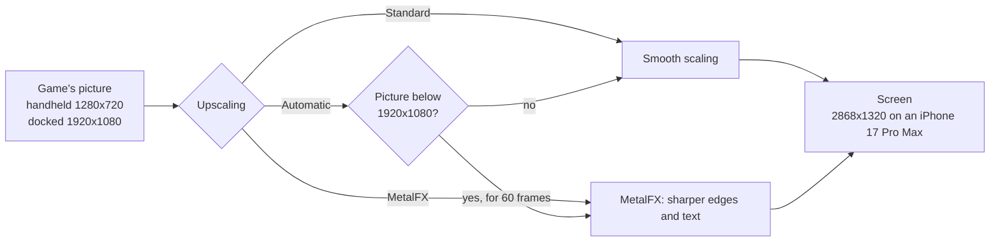
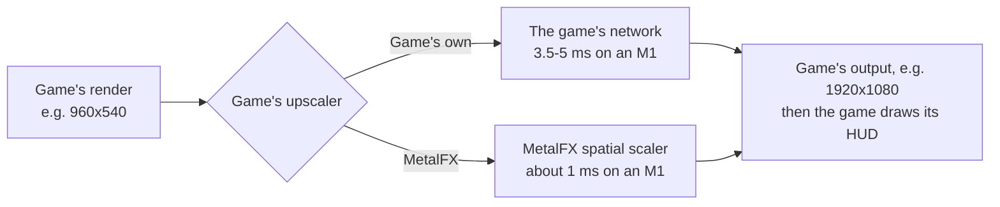
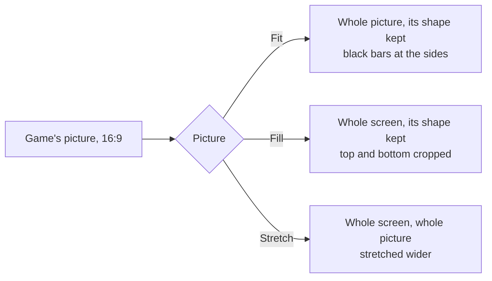
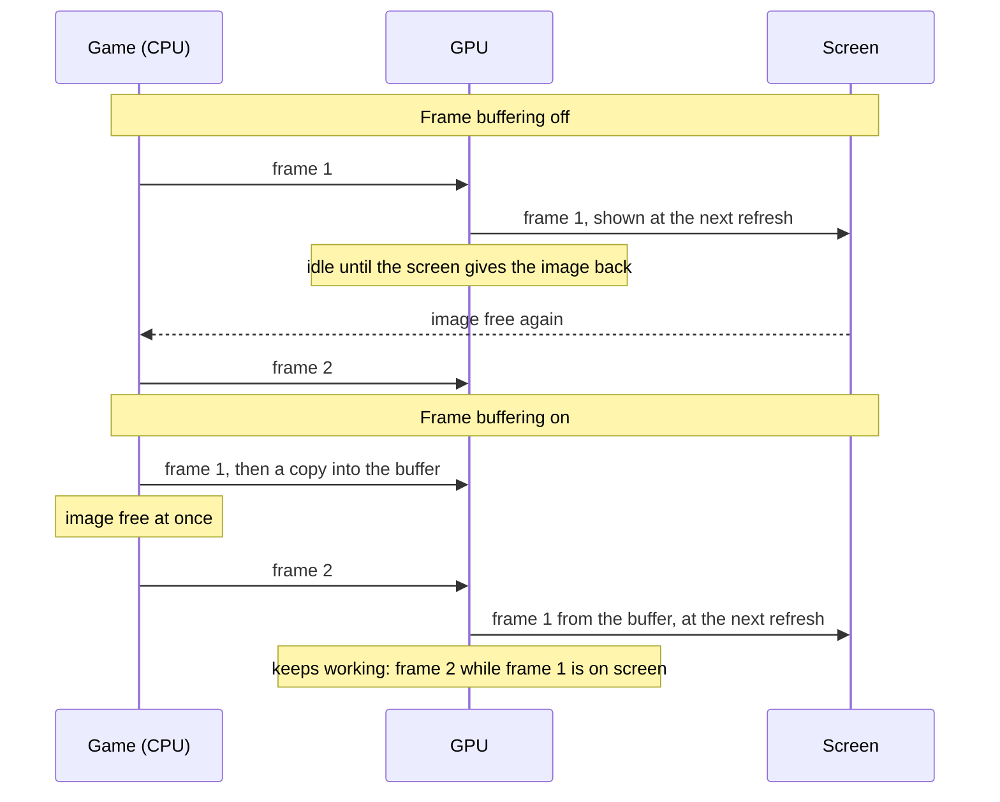
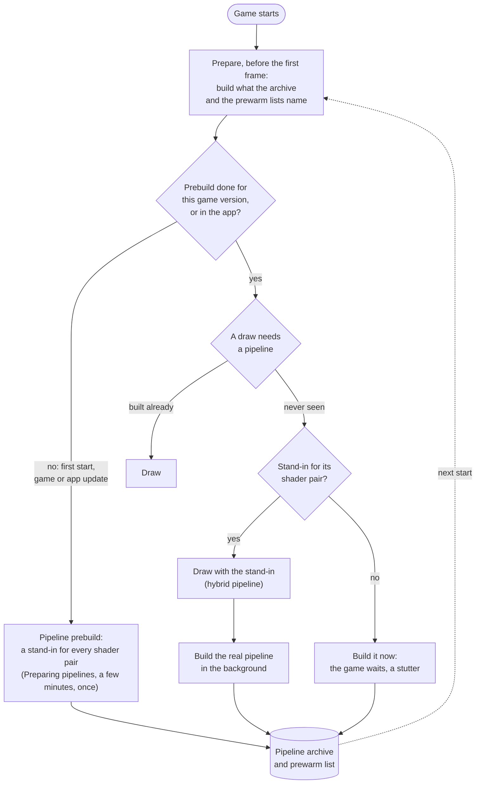
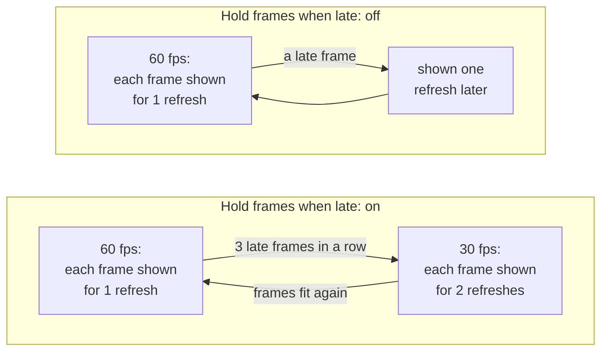

# Settings

The screen before the game starts shows the settings the game supports. A setting that only matters while another is on appears under it and disappears when that one is turned off. Tap **Play** to start; the app remembers your choices for the next start. All settings are on one scrollable screen, under **Game**, **Controls** and **Performance**. Tap a menu or move a slider there; no settings page needs opening. **Upscaling** is in **Game**, beside **Console mode**. A Mac app shows the same settings in a [window of its own](#the-mac-settings-window).

- [Tested defaults](#tested-defaults)
- [Game](#game): [Frame rate](#frame-rate), [High frame rate and Ultrawide](#high-frame-rate-and-ultrawide), [Render scale](#render-scale), [Console mode](#console-mode), [Upscaling](#upscaling), [Game's upscaler](#games-upscaler), [Game language](#game-language), [Picture](#picture), [Frame-rate counter](#frame-rate-counter)
- [Controls](#controls): [Touch control size](#touch-control-size), [Touch control opacity](#touch-control-opacity), [Touch feedback](#touch-feedback), [Game rumble](#game-rumble), [Rumble strength](#rumble-strength), [Rumble cutoff](#rumble-cutoff)
- [Performance](#performance): [Frame buffering](#frame-buffering), [Metal 4 pipelines](#metal-4-pipelines), [Pipeline prebuild](#pipeline-prebuild), [Encode thread](#encode-thread), [Hold frames when late](#hold-frames-when-late), [Performance HUD](#performance-hud), [Reset to tested defaults](#reset-to-tested-defaults)
- [The Mac settings window](#the-mac-settings-window): [Display mode](#display-mode)
- [In-game menu](#in-game-menu)
- [TV](#tv)
- [Settings in a file](#settings-in-a-file)

## Tested defaults

Each game comes with the settings it was tested with: its profile in this repository says, for example, that Breath of the Wild runs with Frame buffering and Metal 4 pipelines on, because that combination held a steady 60 fps on an iPhone 17 Pro Max. Those are the defaults the settings screen shows the first time.

When you change a setting and tap **Play**, the app keeps your choice, also when a later build of the app ships other defaults. A setting you leave at its default is not stored: it follows the defaults of the build you have, so a newer build's tested settings reach you without doing anything. **Reset to tested defaults** at the bottom sets every setting back to its default, and **Play** then forgets your choices, so the game's defaults apply again. For testing, a line in `Documents/env.txt` overrides any setting ([Settings in a file](#settings-in-a-file)).

A Mac app carries the same list (`Contents/Resources/dm/launcher.json`), without the iPhone's own Frame-rate counter, Touch control size and opacity and Touch feedback, for a front end that starts the app with the chosen values ([Front ends](frontends.md)).

## Game

### Frame rate

Games whose speed the app controls (Breath of the Wild, Tears of the Kingdom and a few others) offer **30 fps** or **60 fps**. 60 is smoother; 30 is what the Switch ran and uses less power, so the phone stays cooler and the battery lasts longer. The game runs at real speed either way. On an iPhone or iPad, Breath of the Wild, Tears of the Kingdom, Age of Calamity, Paper Mario: The Thousand-Year Door and Astral Chain hold 30 fps while the device is hot or in Low Power Mode, and go back to your choice after 30 s without either (`DM_LOW_POWER_CAP=0` in `Documents/env.txt` keeps your choice in Low Power Mode, [Settings in a file](#settings-in-a-file)); the other games keep the rate you chose.

Some games choose their own frame rate and time their gameplay by the clock (Persona 5 Royal). Their **Frame rate** offers **30 fps**, the game's own pace, or **60 fps**, where a new frame is shown on every refresh whatever the game asks for. The game runs at the same speed either way; 60 uses more power and heat.

On a Mac, a game checked at that speed (Fire Emblem Fortune's Weave, Mario & Luigi: Brothership) also offers **120 fps**. It needs a screen that shows 120 Hz, and uses more GPU and power. When frames do not fit, during movies, or on a slower screen, the game drops to 60 for a while, so it keeps its real speed. If you see the frame rate move between 60 and 120 and would rather it stayed still, choose 60.

### High frame rate and Ultrawide

Shown only for a game packed with such a mod in its [mods folder](playing.md#mods-and-patches). A mod whose folder name says it changes the frame rate (`60FPS`, `60 fps`, `Frame rate`) or the picture's shape (`Ultrawide`, `21.9`, `21:9`) is packed so you can turn it on and off here, without repacking: **High frame rate** and **Ultrawide**. Both are off by default, and a change applies at the next start. Of several mods of one kind in the folder, the packing script takes one: 60 fps, and the ultrawide shape nearest the iPhone's screen; its report names the others it left out. A game with its own **Frame rate** setting takes no frame-rate mod.

**Ultrawide** is for the iPhone, whose screen is wider than 16:9. It renders a wider view, sets the mod's shape to the iPhone's screen where the mod keeps it as a number, and shows the picture as [Stretch](#picture) does, filling the screen. While it does, the [in-game menu](#in-game-menu) has no **Picture** row: the picture stays at Stretch until Ultrawide is turned off at the next start. On an iPad, whose screen is taller than 16:9, it stays off, and an iPad-only build (`--device ipad`) does not pack the Ultrawide mod at all (the build says `mods: Ultrawide left out`). A wider view draws more of the world, so it can run slower and warmer; a frame-rate mod doubles the work per second, so it uses more power and heat.

A mod that changes code the app's own fixes for the game also change can't be switched. The packing script then leaves it out and says why. A mod with a patch only an emulator runs ([Mods and patches](playing.md#mods-and-patches)) is offered without that patch, with a red line in the report; with nothing else left to write, it is not offered.

### Render scale

The size of the 3D picture, from 50 to 100 %. Below 100 % the size is fixed there and the game's own dynamic resolution is off; 100 % keeps the game's own. Lower can be lighter on the GPU but is blurrier; the HUD and text keep their sharpness. Only games the app can scale offer it.

### Console mode

**Docked** renders at the Switch's TV resolution, **Handheld** at its lower handheld resolution, which is lighter on the phone and can give a higher frame rate.

### Upscaling

A game that renders below the screen's resolution is scaled up to the screen. **Standard**, the default, scales smoothly; **MetalFX** uses Apple's MetalFX upscaler, which sharpens edges and text as it scales; **Automatic** uses MetalFX only when the game's picture is smaller than 1920x1080 (narrower than 1920 or shorter than 1080: handheld mode's 1280x720, a game presenting 1600x900), and scales a picture of 1080p or more smoothly: on a phone or an iPad such a picture is enlarged only a little, where MetalFX adds little sharpness for its GPU time.

Breath of the Wild renders 1280x720 in handheld mode. Docked it renders its world at 900p and scales that to 1080p itself, before the app sees the picture. MetalFX works in either mode: handheld saves the most GPU time and heat, docked looks sharper than smooth scaling. Rendering at the screen's resolution stays the sharpest picture, where the GPU can afford it.

- **When to change it:** turn it on if the picture looks soft and the device has GPU time to spare: on a Mac, or on an iPhone in handheld mode at 30 fps. For long sessions at 60 fps on an iPhone leave it at Standard. **Automatic** suits a game you play both docked and handheld: MetalFX where the picture is smallest, smooth scaling at 1080p.
- **What Automatic looks at:** the picture the game presents. A game that renders its world below 1080p and scales it to 1920x1080 itself (Breath of the Wild docked) presents 1080p, so Automatic scales it smoothly. A picture of 1080p or more is scaled smoothly at once; MetalFX starts once the picture has stayed below 1080p for 60 frames in a row. So switching between docked and handheld never prepares MetalFX for a 1080p picture (preparing it is a short pause), MetalFX's setup for the smaller picture is kept for the next switch, and a game whose resolution moves around 1080p stays smooth instead of flickering between the two.
- **Cost:** more GPU time each frame, which can increase heat on an iPhone. While the device is hot (iOS's thermal state serious or worse) or in Low Power Mode, the app scales smoothly instead, and MetalFX comes back after 30 s of calm (`DM_THERMAL_CAP=0` keeps MetalFX). [Breath of the Wild's measurements](../dm/games/01007EF00011E000/README.md#upscaling-current) cover Mac and iPhone; the matching iPhone Standard run and MetalFX's share of the thermal cost remain unmeasured. Nothing changes while the game's picture is as large as the screen. Unsupported devices and sizes use Standard scaling.
- **While you play** (iPhone and iPad): the [in-game menu](#in-game-menu) has **Upscaling** too, and a pick takes effect at the next frame. **Automatic** then counts its 60 frames again; switching back to a mode you used keeps MetalFX's setup, so it does not pause again for the same picture size.
- **On the Mac:** choose **MetalFX** or **Automatic** under **Upscaling** in the [settings window](#the-mac-settings-window)'s Advanced settings, or set `DM_PRESENT_UPSCALE=metalfx` or `auto` in its `env.txt` (off by default). MetalFX helps in a large window or on a 4K screen; there only **MetalFX** sharpens a docked game's 1080p picture, as **Automatic** leaves pictures of 1080p or more to smooth scaling.

### Game's upscaler

Shown only for games that upscale their own picture with a network of their own before the app sees it: agl's NDSR network, in Donkey Kong Bananza and Splatoon Raiders. **Game's own**, the default, keeps the game's upscaler. **MetalFX** replaces it with Apple's MetalFX spatial scaler: the same input and output sizes, at a fraction of the GPU time, but Apple's scaler's picture rather than the game's.

- **When to change it:** when the game falls short of its frame rate in busy scenes because of GPU time: Donkey Kong Bananza's upscaler is the largest single piece of a heavy frame on an M1 (3.5-5 ms of about 24 in handheld mode). Compare the look side by side before keeping it.
- **Cost:** none in GPU time (it saves 2.5-4 ms a frame in that case); the picture is Apple's scaler's rather than the game's. Frames where the game renders at its output size are not upscaled and keep the game's shader either way. Devices without MetalFX keep the game's upscaler.
- **Not the same as [Upscaling](#upscaling):** that one scales the finished picture, HUD included, to the screen; this one replaces the game's own step inside the frame. Both can be on.

### Game language

The game's own languages. The app was packed with one of them; pick another here without repacking. A game packed from a dump or a NUP may come without its list: every language is offered then, with a note, and a game that lacks the one you pick may show another.

### Picture

iPhone and iPad. **Fit**, the default, shows the game's picture (16:9, or the taller one of [Picture shape](#picture-shape)) as large as it fits, with black bars where the screen has another shape. **Fill** enlarges it until it covers the whole screen and crops what lies outside; nothing is stretched. An iPhone loses some of the top and bottom, an iPad some of each side, so health bars, subtitles or maps near the edges can be cut off. **Stretch** covers the whole screen without cropping anything: the picture is stretched to the screen's shape, so on an iPhone (about 19.5:9) everything looks about a fifth wider, and on a 4:3 iPad a third taller; the whole HUD stays on screen. A picture that fills the screen without cropping or stretching needs a patch for each game that renders a wider view. Fill and Stretch apply in landscape; in portrait the picture stays fitted above the controls, and on a TV it is always fitted.

Touches on the game's touch screen follow the picture in all three. With Stretch the app draws the picture once, straight at the screen's resolution; **Upscaling**'s MetalFX applies only to a picture that keeps its shape, so a stretched picture is scaled smoothly (Standard).

### Picture shape

Games whose profile supports it (Breath of the Wild, Animal Crossing: New Horizons). **iPhone Duo screen (1.43:1)** renders a taller picture of the Duo's own shape: the sides of 16:9 with more above and below, and the HUD at the screen's edges. **16:9** is the Switch's picture. The taller picture has about a quarter more pixels, so it runs a little slower and warmer.

The default follows your screen: the shape nearest it. An iPhone wider than 16:9 (the iPhone 18 Pro Max is about 2.17:1) starts at **16:9**, which there is about a quarter larger than the taller picture in Fit; a 4:3 iPad and an iPhone Duo start at **1.43:1**, which fills more of their screens. It follows the whole screen, not the app's window, so an iPad window in Stage Manager or Split View starts at the full screen's shape. A shape you pick is kept. Only a shape other than the default is saved, so on an iPhone a 1.43:1 you chose before this default came in was not saved (it was the default then): choose it again. A Mac starts at 16:9.

### Frame-rate counter

Shows the frames per second at the top left. While heat or Low Power Mode holds something back, a line under the count says what: a thermometer and **Hot**, or a battery and **Low Power**, then **30 fps cap** (the frame rate held at 30, or at 60 for a game running at 120: only games whose speed the app controls, and only above a 30 fps choice), **no MetalFX** ([Upscaling](#upscaling) scaling smoothly instead), or both. It goes when the device has been calm, or out of Low Power Mode, for 30 seconds.

## Controls

### Touch control size

iPhone and iPad. **Large**, the default, is the size the touch controls always had; **Medium** and **Small** draw them smaller and closer to the edges and corners, leaving more of the picture free. What a touch takes shrinks with them, the left stick's ring too, so its full tilt is a shorter swipe; the right stick, which is not drawn, keeps its swipe length. On an iPad the controls are already about one and a half times as large as on an iPhone, so **Small** there is about an iPhone's **Large**. It also changes in the [in-game menu](#in-game-menu), at once.

### Touch control opacity

iPhone and iPad. **Normal**, the default, is the look the controls always had; **Faint** and **Light** make them see-through, **Strong** easier to see over a bright picture. The gear keeps its normal look, so the menu stays easy to find. It also changes in the [in-game menu](#in-game-menu), at once.

### Touch feedback

A light tap from the phone when you press an on-screen button.

### Game rumble

The game's vibration, on the phone or on a connected controller.

### Rumble strength

How strong the game's vibration is, from 0 to 300 %.

### Rumble cutoff

A controller's vibration weaker than this stays off, and the rest is spread over the full range. Off (0 %) by default. A controller with rotating motors can rumble all the time in a game that sends a quiet texture: Mario Kart 8 Deluxe needs about 45 % to rumble only on crashes and drifts. The phone's own vibration is not affected.

## Performance

These settings change how the app hands frames to the screen and how it prepares the GPU's work. The game's tested defaults are a good start; change them when a game stutters, runs hot, or you want less latency.

### Frame buffering

Each finished frame is copied into a buffer of two images that the screen shows from, so the game can start its next frame at once instead of waiting for the screen to give its image back.

Without it the GPU idles between frames, and iOS reads that idle time as room to spare: it lowers the GPU's clock, and the frames take longer still. On an iPhone 17 Pro Max, Breath of the Wild fell to 30 fps without frame buffering and held 60 with it.

- **When to change it:** turn it off if you notice the controls lag behind and the game holds its frame rate without it.
- **Cost:** up to one frame more latency between your input and the screen (about 28 ms more on an iPhone 17 Pro Max), and two more frame-sized images in memory.

### Metal 4 pipelines

Before the GPU can draw something, the app has to build a *pipeline* for it: the game's shaders compiled for the iPhone's GPU, with the drawing settings. Building one takes tens of milliseconds, so a scene full of new ones stutters. With Metal 4 pipelines the app keeps what it built in a pipeline archive on the phone, and builds most pipelines in a few microseconds from a shared base.

Metal 4 pipelines are on by default for every game, on the iPhone and iPad as on the Mac. At start, before the game's first frame, the app prepares what it already knows: the pipelines in the archive and those the prewarm lists name (one comes with the game, one grows on the phone as you play); with a warm archive that takes well under a second. A pipeline never seen before is drawn meanwhile with a stand-in for its pair of shaders, a *hybrid* pipeline that reads the draw's vertices in a general way and draws the same picture, while the real pipeline is built in the background and archived for the next start.

- **When to change it:** turn it off only if a game crashes or runs out of memory with it.
- **Cost:** memory for the archive while the game runs, and storage on the phone.

### Pipeline prebuild

Builds a stand-in for every pair of shaders the game has (15,767 for Breath of the Wild) and puts them into the pipeline archive, so that a scene you have never seen has a stand-in for each of its draws instead of a stutter. It runs before the game's first frame, behind a **Preparing pipelines** screen: the first start waits a few minutes for it, once, and so does the first start after a game update or an app update that brings new shaders. Every other start skips it. An app that carries these stand-ins already built for its device's GPU skips it at its first start too: in Nintanium every NVN game's app does by default (unless built with `--gpu none`, or after the app's crash guard left them out: [NINTANIUM.md](../NINTANIUM.md#tuned-for-iphone-18-pro-max-and-ipad-pro-m4-on-ios-27)). It needs Metal 4 pipelines, and its row shows only while that option is on.

Built in the background while playing instead, the stand-ins took an iPhone 17 Pro Max's GPU from about 13 to 15–18 ms a frame in Breath of the Wild, so the app does the work up front.

- **When to change it:** turn it off if you don't want to wait at that first start (an app that carries the stand-ins does not wait).
- **Cost:** on, a wait of a few minutes once, unless the app carries them. Off, no wait, but a pipeline seen for the first time makes the game stall briefly while it is built, until the archive holds it.

### Encode thread

The app turns the game's graphics commands into Metal commands on a thread of its own instead of the game's submitting thread, so the game's thread can go on sooner (in Breath of the Wild about 4 ms per frame instead of 8). Frame buffering needs it for games that present their frames from another thread than the one that draws them. It is on by default on the iPhone; on the Mac it is off, where it lowered the typical frame time but made the slowest frames slower.

- **When to change it:** leave it on unless a game misbehaves with it; turning it off is a diagnostic step.

### Hold frames when late

For games whose frame rate the app controls ([Frame rate](#frame-rate)). With 60 fps chosen, each frame is meant to stay on screen for one refresh. When a frame comes late, the app can either slow the game down to 30 fps for a while, or keep 60 and show late frames as they come.

- **On** (the default for most games): an even 30 fps (or 20) in heavy scenes instead of a mix of 30 and 60.
- **Off:** the game keeps aiming at 60; a late frame is shown one refresh later and the next one goes on as usual, so heavy scenes look less even but stay closer to 60 on average.
- **When to change it:** turn it off if the game often falls to 30 fps although it is only slightly late.

### Performance HUD

Apple's performance overlay over the game: frame rate, frame and GPU times, memory. Useful to see what a setting changes; leave it off for play.

### Reset to tested defaults

Sets every setting back to the game's tested default; **Play** then forgets your choices, so those defaults apply, and those of later builds too ([Tested defaults](#tested-defaults)). Settings fixed by `Documents/env.txt` stay as the file says.

## The Mac settings window

A Mac app ([A Mac app](development.md#a-mac-app)) shows its settings in a window before the game starts. They are the same settings as on the iPhone, with the same defaults. The window shows the most used ones first: **Frame rate**, **Render scale**, **Console mode**, **Game language**, **Display mode** and **Game rumble**, when the game has them. **Render scale** shows the picture's size in pixels beside the percentage for the chosen **Console mode**, when the game's profile has it (Breath of the Wild: 1600 × 900 docked, 1280 × 720 handheld at 100 %). The others are under **Advanced settings**, in the usual sections, with **Reset to tested defaults**. The window remembers whether Advanced settings is open. **Frame-rate counter**, **Touch control size**, **Touch control opacity** and **Touch feedback** are only on the iPhone and iPad.

Click **Play** (or press Return) to start the game. **Quit**, ⌘Q or closing the window ends the app without the game. The app remembers your choices for that game, and a game started without the window, from a front end or with the window turned off, uses them too ([Saved choices](frontends.md#saved-choices)). A setting fixed by an `env.txt` or by the program that started the app is shown greyed out.

Turn off **Show this window at launch** to start the game at once with your choices. Hold Option while the app opens to see the window again. `DM_LAUNCHER=0` in the app's `env.txt` (`~/Library/Application Support/nxnative/<title ID>/env.txt`) or in its environment, or opening it with `open <app> --args --no-launcher`, also skips the window; your choices still apply. `DM_SAVED_CHOICES=0` starts with the tested defaults instead.

### Display mode

**Window** or **Fullscreen**: how the game's window opens. ⌃⌘F or the green button changes it while you play. In an `env.txt`: `DM_FULLSCREEN=1` or `0`.

### Cloud saves folder

**Choose a folder…** picks the iCloud Drive folder the game's save is synced through, the one the iPhone app chose in its launcher's **Cloud saves**, or the game's own folder inside it, named after its title ID ([Cloud saves](#cloud-saves)); **Turn off** stops it. Off by default. macOS may ask once whether the app may open iCloud Drive; if the game log says `this app may not open iCloud Drive`, allow it in System Settings › Privacy & Security › Files and Folders. In an `env.txt`: `DM_SAVE_SYNC=<folder>`, or `DM_SAVE_SYNC=icloud` for iCloud Drive › nxnative Saves; the window then shows it fixed.

## Cloud saves

The Mac app and the iPhone app of one game can share a save through iCloud Drive. Choose the same iCloud Drive folder on both: **Cloud saves** › **Choose a folder…** in the Mac settings window, and **Cloud saves** in the iPhone launcher (any folder, for instance one named **nxnative Saves**). Each game keeps one file there, `<title ID>/save.dmsync`, which holds the whole save.

When the game starts, it brings the save from iCloud Drive in if that one is the one to keep; a few seconds after the game saves, it sends its save. The iPhone app also sends when it goes to the background, and the Mac app once the game has quit. If you played on both without the save getting across in between, the newer save wins.

After you choose another folder, the next start treats it as a first sync: if the folder has no save of the game yet, this device's goes there at once; if it has one that differs, the newer one wins and the other is kept (below). The same start sends the save again if its file was removed from iCloud Drive. A game that has not synced since you updated the app is the exception: the first time, a save it finds in the new folder still comes in over its own unchanged one, which is kept (below).

A save that is replaced, on the device or in iCloud Drive, is kept first, beside the save in a folder named after it with `-backups` (on the iPhone `save-backups` in the Files app, under the app's name; on the Mac `~/Library/Application Support/nxnative/<title ID>/save-backups`): `<date> local` holds this device's save, `<date> cloud` the one that was in iCloud Drive. The newest 10 of each kind stay, and older ones are removed; other folders you put there are left alone.

iCloud Drive takes a moment to carry a file from one device to the other. Quit the game on one device and give it a few seconds before you start it on the other. Without a connection the game plays on with the save it has and sends it later. The game log says what came in and what went out (lines starting with `save sync:`).

## In-game menu

On the iPhone and iPad the gear at the top centre of the touch controls opens a menu while the game runs; it stays when a controller hides the other controls. The gear is hidden while you play: **double-tap** anywhere except on a button, the D-pad or the left stick to show it. It fades out again after 5 seconds if you don't touch it, and stays while its menu is open. It also shows when the game starts, until 5 seconds after its first picture (and after the **Preparing shaders** or **Preparing pipelines** screen of a first start); it stays while VoiceOver or Switch Control is on (turning either on shows it), and while the game shows an offline web page. It holds **Console mode**, **Upscaling**, **Picture** (not while [Ultrawide](#high-frame-rate-and-ultrawide) stretches the picture) and the **Frame-rate counter**, then **Controller layout** (**2D**, **3D**, and **Tap**, no controls and every touch to the game, in handheld mode), **Touch control size**, **Touch control opacity**, **Touch feedback** and **Game rumble**: the settings that take effect at once. At the bottom, **Share log** sends `log.txt`, the previous run's `log.prev.txt` and the newest crash and performance reports (`metrics/`) in one share sheet, as the settings screen's **Share log** button does ([Playing](playing.md)). A choice opens to show its options, the current one ticked. The menu's text keeps one size whatever the system text size, so it stays short over the game. A change is remembered as on the settings screen, which shows it at the next start; a setting `Documents/env.txt` fixes is shown, not changed. The other settings need the game to start again, so they are only on the settings screen: close the app fully and open it again.

Console mode changes as on a Switch put in or taken out of its dock. While a TV shows the game it stays **Docked**, and the mode you pick applies when the TV is disconnected. **Docked** removes the Tap layout, as a docked Switch reads no touch screen.

## TV

Connect a TV or monitor by cable, or start Screen Mirroring to an Apple TV or AirPlay TV. The game fills it in 16:9 at up to 1080p and switches to **Docked**; the iPhone or iPad keeps the controls. Disconnect to bring the game back to the device in its earlier mode. AirPlay adds some delay; a cable has almost none.

## Settings in a file

A line like `DM_PRESENT_SNAP=0` in `Documents/env.txt` (in the Files app, under the app's name) sets a setting from the file: the settings screen shows it greyed out, and the file wins over your choice and the game's default. Fully close and reopen the app after editing the file. The variables:

| Setting | Variable | Values |
|---|---|---|
| Frame rate (games whose speed the app controls) | `DM_FPS_TARGET` | `30`, `60`, `120` (Mac, games with `fps_max 120`) |
| Frame rate (games that keep their own pace, such as Persona 5 Royal) | `DM_PRESENT_INTERVAL` | `game` 30 fps, the game's own interval; `display` 60 fps, a new frame on every refresh |
| High frame rate | `DM_MOD_FPS` | `1`, `0` |
| Ultrawide (iPhone) | `DM_MOD_ULTRAWIDE` | `1`, `0` |
| Render scale | `DM_RENDER_SCALE` | `0.5` to `1.0` |
| Console mode | `DM_OPMODE` | `1` docked, `0` handheld |
| Game language | `DM_LANG` | a language code, such as `ja` |
| Display mode (Mac) | `DM_FULLSCREEN` | `1` fullscreen, `0` a window |
| Cloud saves folder (Mac) | `DM_SAVE_SYNC` | a folder; `icloud`: iCloud Drive › nxnative Saves; `0`: off |
| Picture (iPhone and iPad) | `DM_PICTURE_FIT` | `fit` 16:9 with black bars, `fill` covers the screen, cropped, `stretch` covers the screen, stretched |
| Picture shape | `DM_SCREEN_ASPECT` | `1.43` the iPhone Duo's shape, `0` 16:9 (default: the shape nearest the screen) |
| Frame-rate counter | `DM_SHOW_FPS` | `1`, `0` |
| Touch control size | `DM_TOUCH_SIZE` | `1` Large, `0.85` Medium, `0.7` Small (`0.5` to `1`) |
| Touch control opacity | `DM_TOUCH_OPACITY` | `1` Normal, `0.4` Faint, `0.7` Light, `1.5` Strong (`0.1` to `2`) |
| Touch feedback | `DM_TOUCH_HAPTICS` | `1`, `0` |
| Game rumble | `DM_RUMBLE` | `1`, `0` |
| Rumble strength | `DM_RUMBLE_GAIN` | `0` to `3` |
| Rumble cutoff | `DM_RUMBLE_MIN` | `0` to `0.9` |
| Upscaling | `DM_PRESENT_UPSCALE` | `off`, `auto` (MetalFX for a picture smaller than 1920x1080), `metalfx` |
| Game's upscaler | `DM_UPSCALER` | `game`, `metalfx` |
| Frame buffering | `DM_PRESENT_SNAP` | `1`, `0` |
| Metal 4 pipelines | `DM_PSO_MTL4` | `1`, `0` |
| Pipeline prebuild | `DM_PSO_PREBUILD` | `1`, `0` |
| Encode thread | `DM_NVN_ENC_THREAD` | `1`, `0` |
| Hold frames when late | `DM_FPS_HOLD` | `on`, `off` |
| Performance HUD | `DM_METAL_HUD` | `1`, `0` |

`DM_LAUNCHER=0` skips the settings screen; the choices you saved there still apply. `DM_SAVED_CHOICES=0` starts with the tested defaults and keeps your saved choices for later. How the settings are listed for each game: [dm/games/settings.tsv](../dm/games/settings.tsv).
