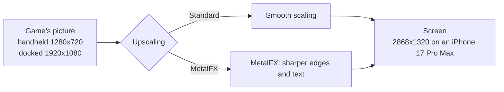
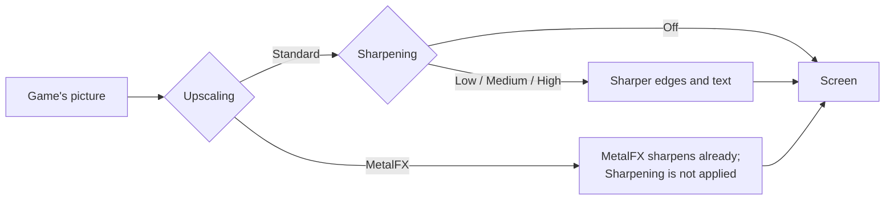
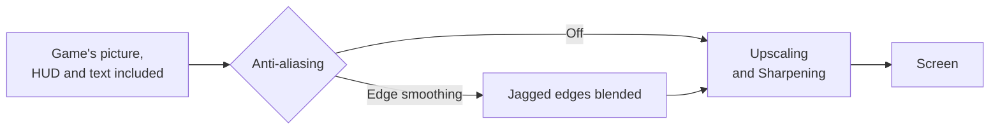
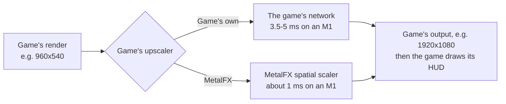
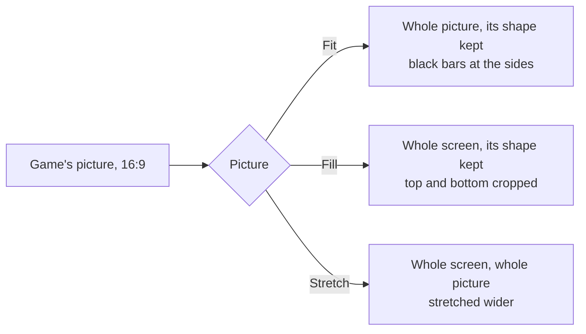
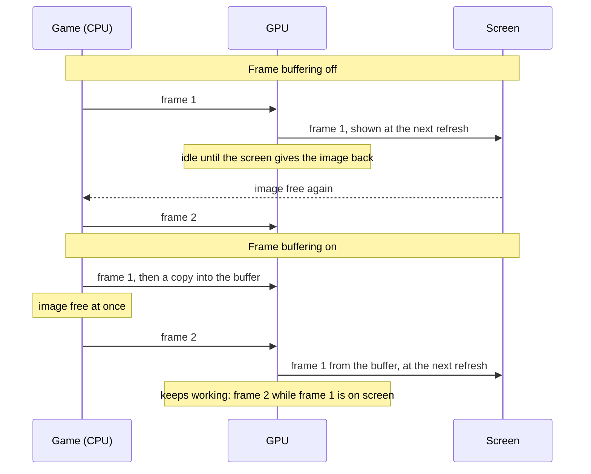
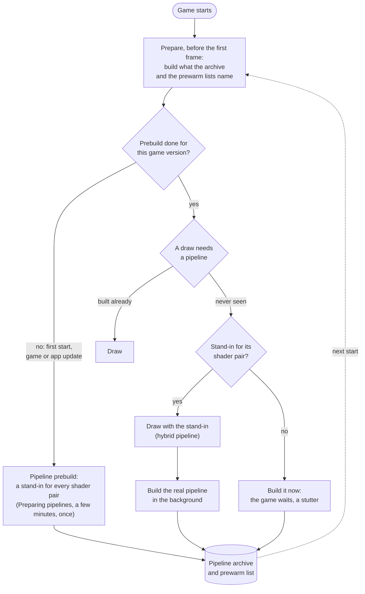
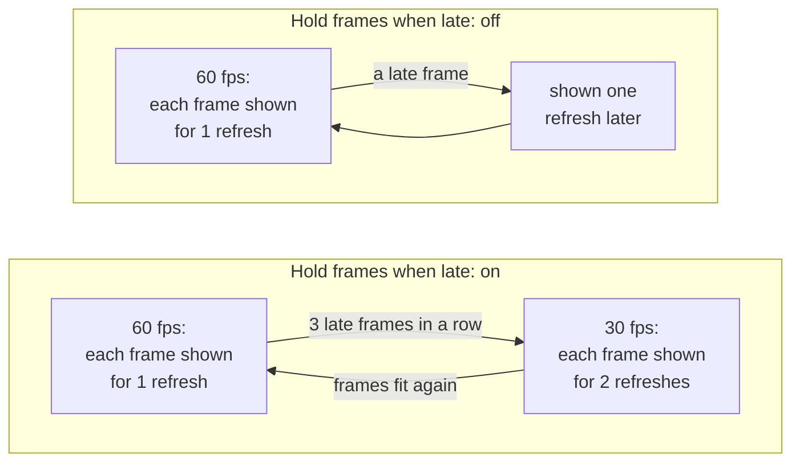

# Settings

The screen before the game starts shows the settings the game supports. A setting that only matters while another is on appears under it and disappears when that one is turned off. Tap **Play** to start; the app remembers your choices for the next start. All settings are on one scrollable screen, under **Game**, **Controls** and **Performance**. Tap a menu or move a slider there; no settings page needs opening. **Upscaling**, **Sharpening** and **Anti-aliasing** are in **Game**, beside **Console mode**. A Mac app shows the same settings in a [window of its own](#the-mac-settings-window).

- [Tested defaults](#tested-defaults)
- [Greyed-out settings](#greyed-out-settings)
- [Game](#game): [Frame rate](#frame-rate), [High frame rate and Ultrawide](#high-frame-rate-and-ultrawide), [Render scale](#render-scale), [Console mode](#console-mode), [Upscaling](#upscaling), [Sharpening](#sharpening), [Anti-aliasing](#anti-aliasing), [Game's upscaler](#games-upscaler), [Game language](#game-language), [Picture](#picture), [Frame-rate counter](#frame-rate-counter)
- [Controls](#controls): [Touch control size](#touch-control-size), [Touch control opacity](#touch-control-opacity), [Touch feedback](#touch-feedback), [Game rumble](#game-rumble), [Rumble strength](#rumble-strength), [Rumble cutoff](#rumble-cutoff), [Press a button to join](#press-a-button-to-join)
- [Performance](#performance): [Frame buffering](#frame-buffering), [Metal 4 pipelines](#metal-4-pipelines), [Pipeline prebuild](#pipeline-prebuild), [Encode thread](#encode-thread), [Hold frames when late](#hold-frames-when-late), [Performance HUD](#performance-hud), [Reset to tested defaults](#reset-to-tested-defaults)
- [Presets, the guide and a controller](#presets-the-guide-and-a-controller): [Skip this screen next time](#skip-this-screen-next-time)
- [The Mac settings window](#the-mac-settings-window): [Display mode](#display-mode)
- [In-game menu](#in-game-menu)
- [TV](#tv)
- [Settings in a file](#settings-in-a-file)

## Tested defaults

Each game comes with the settings it was tested with: its profile in this repository says, for example, that Breath of the Wild runs with Frame buffering on, because that, with Metal 4 pipelines (on for every game), held a steady 60 fps on an iPhone 17 Pro Max. Those are the defaults the settings screen shows the first time.

When you change a setting and tap **Play**, the app keeps your choice, also when a later build of the app ships other defaults. A setting you leave at its default is not stored: it follows the defaults of the build you have, so a newer build's tested settings reach you without doing anything. **Reset to tested defaults** at the bottom sets every setting back to its default, and **Play** then forgets your choices, so the game's defaults apply again. For testing, a line in `Documents/env.txt` overrides any setting ([Settings in a file](#settings-in-a-file)).

A Mac app carries the same list (`Contents/Resources/dm/launcher.json`), without the iPhone's own Frame-rate counter, Touch control size and opacity and Touch feedback, for a front end that starts the app with the chosen values ([Front ends](frontends.md)).

## Greyed-out settings

A setting that another setting or the device makes do nothing is shown greyed, with the reason under its name, and comes back as soon as the reason goes. A single choice in a menu can be greyed the same way, with its reason beside it; the others stay selectable. A setting that can never do anything on the device is not shown at all: **Ultrawide** on an iPad, and **Touch feedback** on a device without a vibration motor (an iPad). Greying and hiding never change your choice: it is kept, used again when the reason goes, and **Reset to tested defaults** resets it as any other. A greyed setting that the game is held at another value shows that value while it is greyed (Picture shows Stretch under Ultrawide), and your own choice again when the reason goes.

| Setting | Greyed while | Reason shown |
|---|---|---|
| Upscaling: MetalFX | the device has no MetalFX scaler | This device has no MetalFX scaler |
| Picture | Ultrawide is on, on a screen wider than 16:9; it shows Stretch, the picture the game has then | Ultrawide always stretches the picture |
| Picture shape | Ultrawide is on, on a screen wider than 16:9; it shows 16:9 (Switch), the shape the game has then | Ultrawide keeps the 16:9 picture |
| Ultrawide | the iPhone's screen is not wider than 16:9 | This screen isn't wider than 16:9 |
| Frame rate: 120 fps (Mac) | no connected screen shows 120 Hz | This display can't show 120 Hz |
| Hold frames when late | Frame rate is 30 fps | Only matters at 60 fps |
| Rumble cutoff | Rumble strength is 0 % | Rumble strength is 0 % |
| Press a button to join | `DM_PAD_MERGE=1` in `env.txt` | All controllers are player 1 (env.txt) |
| Metal 4 pipelines, Pipeline prebuild | `DM_GPU_CAPTURE` or `MTL_CAPTURE_ENABLED` is set | Off while GPU capture is on |

Some settings work only in some situations. They stay selectable, and the reason is added under the name:

| Setting | When | Reason shown |
|---|---|---|
| Upscaling: MetalFX | Ultrawide is on, on a screen wider than 16:9, or Picture is Stretch where it changes the picture's shape (no TV connected; with [Picture shape](#picture-shape) on Match screen, only on a screen 16:9 or wider). MetalFX then runs only while the game shows a picture smaller than its frame, such as Breath of the Wild's handheld 1280x720; the [in-game menu](#in-game-menu) says whether it does | With Ultrawide, only when the game draws a smaller picture, or With Stretch, … |
| Sharpening | Game's upscaler is MetalFX | Off while MetalFX runs the game's upscaler |
| Picture shape: Match screen | the window is 16:9 or wider (an iPhone in landscape) | 16:9 on this screen |
| Frame-rate counter | Performance HUD is on | The Performance HUD shows the frame rate too |
| Game rumble, Rumble strength | no controller is connected to a device without a vibration motor (an iPad, a Mac) | Rumble needs a controller on this device |

While the game runs, the [in-game menu](#in-game-menu) adds what only the running game knows: *Not upscaling: picture is stretched*, *Not upscaling: picture isn't shown larger* or *Not upscaling: MetalFX can't take this size* under **Upscaling**; *Off while MetalFX upscales* under **Sharpening**; *Not supported for this game's picture* under **Sharpening** or **Anti-aliasing**, and *Couldn't start: see Share log* when one failed to start; *Applies in landscape only* or *The TV shows the whole picture* under **Picture**; *Held at Docked while a TV is connected* under **Console mode**; *Touch controls are hidden* under the touch control rows, and *Only sizes the menu button now* under **Touch control size**, while a controller or the Tap layout hides the controls.

## Game

### Frame rate

Games whose speed the app controls (Breath of the Wild, Tears of the Kingdom and a few others) offer **30 fps** or **60 fps**. 60 is smoother; 30 is what the Switch ran and uses less power, so the phone stays cooler and the battery lasts longer. The game runs at real speed either way. On an iPhone or iPad, Breath of the Wild, Tears of the Kingdom, Age of Calamity, Paper Mario: The Thousand-Year Door and Astral Chain hold 30 fps while the device is hot or in Low Power Mode, and go back to your choice after 30 s without either (`DM_LOW_POWER_CAP=0` in `Documents/env.txt` keeps your choice in Low Power Mode, [Settings in a file](#settings-in-a-file)); the other games keep the rate you chose.

Some games choose their own frame rate and time their gameplay by the clock (Persona 5 Royal). Their **Frame rate** offers **30 fps**, the game's own pace, or **60 fps**, where a new frame is shown on every refresh whatever the game asks for. The game runs at the same speed either way; 60 uses more power and heat.

On a Mac, a game checked at that speed (Fire Emblem Fortune's Weave, Mario & Luigi: Brothership) also offers **120 fps**. It needs a screen that shows 120 Hz, and uses more GPU and power. When frames do not fit, during movies, or on a slower screen, the game drops to 60 for a while, so it keeps its real speed. If you see the frame rate move between 60 and 120 and would rather it stayed still, choose 60.

### High frame rate and Ultrawide

Shown only for a game packed with such a mod in its [mods folder](playing.md#mods-and-patches). A mod whose folder name says it changes the frame rate (`60FPS`, `60 fps`, `Frame rate`) or the picture's shape (`Ultrawide`, `21.9`, `21:9`) is packed so you can turn it on and off here, without repacking: **High frame rate** and **Ultrawide**. Both are off by default, and a change applies at the next start. Of several mods of one kind in the folder, the packing script takes one: 60 fps, and the ultrawide shape nearest the iPhone's screen; its report names the others it left out. A game with its own **Frame rate** setting takes no frame-rate mod.

**Ultrawide** is for the iPhone, whose screen is wider than 16:9. It renders a wider view, sets the mod's shape to the iPhone's screen where the build finds it in the mod (a ratio such as 2.33, a scale of the 16:9 view such as 0.744, or a width and height in pixels such as 3440×1440; the build's console says which it set, or that it found none and the picture keeps the mod's shape, slightly squeezed), and shows the picture as [Stretch](#picture) does, filling the screen. While it does, the settings screen and the [in-game menu](#in-game-menu) show **Picture** greyed at Stretch, with the reason: the picture stays at Stretch until Ultrawide is turned off at the next start, and your Picture choice (Fit or Fill) is kept for then, shown again once Ultrawide is off. It also keeps the game's 16:9 picture: a taller **Picture shape** (such as the iPhone Duo one) is set back to 16:9 for that start. On an iPad, whose screen is taller than 16:9, it stays off. A wider view draws more of the world, so it can run slower and warmer; a frame-rate mod doubles the work per second, so it uses more power and heat.

A mod that changes code the app's own fixes for the game also change can't be switched. The packing script then leaves it out and says why. A mod with a patch only an emulator runs ([Mods and patches](playing.md#mods-and-patches)) is offered without that patch, with a red line in the report; with nothing else left to write, it is not offered.

### Dynamic resolution

Off, the default, keeps the 3D picture at full size. On lets the game lower its resolution when frames run heavy and raise it again when they fit, as on the Switch: steadier frame rate, at times a softer picture. Only games whose resolution control the app can hold offer it (NieR:Automata, Ocarina of Time).

### Render scale

The size of the 3D picture, from 50 to 100 %. Below 100 % the size is fixed there and the game's own dynamic resolution is off; 100 % keeps the game's own. Lower can be lighter on the GPU but is blurrier; the HUD and text keep their sharpness. Only games the app can scale offer it.

### Console mode

**Docked** renders at the Switch's TV resolution, **Handheld** at its lower handheld resolution, which is lighter on the phone and can give a higher frame rate.

### Upscaling

A game that renders below the screen's resolution is scaled up to the screen. **Standard**, the default, scales smoothly; **MetalFX** uses Apple's MetalFX upscaler, which sharpens edges and text as it scales.

Breath of the Wild renders 1280x720 in handheld mode. Docked it renders its world at 900p and scales that to 1080p itself, before the app sees the picture. MetalFX works in either mode: handheld saves the most GPU time and heat, docked looks sharper than smooth scaling. Rendering at the screen's resolution stays the sharpest picture, where the GPU can afford it.

- **When to change it:** turn it on if the picture looks soft and the device has GPU time to spare: on a Mac, or on an iPhone in handheld mode at 30 fps. For long sessions at 60 fps on an iPhone leave it at Standard.
- **Cost:** more GPU time each frame, which can increase heat on an iPhone. [Breath of the Wild's measurements](../dm/games/01007EF00011E000/README.md#upscaling-current) cover Mac and iPhone; the matching iPhone Standard run and MetalFX's share of the thermal cost remain unmeasured. Nothing changes while the game's picture is as large as the screen. Unsupported devices and sizes use Standard scaling.
- **On the Mac:** choose **MetalFX** under **Upscaling** in the [settings window](#the-mac-settings-window)'s Advanced settings, or set `DM_PRESENT_UPSCALE=metalfx` in its `env.txt` (off by default). It helps in a large window or on a 4K screen.
- **While you play** (iPhone and iPad): the [in-game menu](#in-game-menu) has **Upscaling** too, and a pick takes effect at the next frame. Switching back to MetalFX keeps its setup, so it does not pause again for the same picture size.

### Sharpening

Sharpens the edges and text of the game's picture as the app draws it, for almost no GPU time. **Off**, the default, draws the picture as before; **Low**, **Medium** and **High** sharpen more each step. It uses AMD's FidelityFX sharpening (RCAS), and works for every game and with every **Picture** mode, Stretch and Ultrawide included, where MetalFX usually does not run. MetalFX still runs there while the game shows a picture smaller than its frame: Breath of the Wild in handheld mode (1280x720 in a 1920x1080 frame), or a game whose own dynamic resolution shrinks the whole picture, as Super Mario Odyssey's does. [Render scale](#render-scale) and [Dynamic resolution](#dynamic-resolution) do not count: they shrink only the 3D view inside the game's full-size picture. A game whose settings were tested with it sharpened starts with that level instead of Off.

- **When to change it:** a soft picture: Breath of the Wild in handheld mode (1280x720), or a game shown much larger than it renders. Try **Low** first. Leave it **Off** for games that already sharpen their own picture, and for pixel-art games, whose hard edges get thin light rims.
- **Cost:** a little more work in the frame's last draw: about 0.01 ms on a Mac; estimated at under 0.1 ms on an iPhone 18 Pro Max, not yet measured there. No memory.
- **Text and HUD:** in a synthetic test the brightest 1 % of halo around white text was about 0.2-0.7/255 at Low and 2/255 at Medium, both when the game's picture is drawn at its own size and when it is scaled up first (Breath of the Wild handheld, a game lowering its resolution). High reaches 4-5/255, with single pixels up to 14-28/255: light rims on text can show ([measurements](reference/rendering.md#sharpening-in-the-present)).
- **With MetalFX:** not applied while MetalFX upscales the picture (**Upscaling** MetalFX) or replaces the game's own upscaler (**Game's upscaler** MetalFX): MetalFX sharpens already, and sharpening on top of it makes text look crunchy.
- **On the Mac:** under **Sharpening** in the [settings window](#the-mac-settings-window)'s Advanced settings, or `DM_PRESENT_SHARPEN=1` (Low), `2` (Medium) or `3` (High) in its `env.txt`.
- **While you play** (iPhone and iPad): the [in-game menu](#in-game-menu) has **Sharpening** too, and a pick takes effect at the next frame.

### Anti-aliasing

Smooths the jagged, stair-stepped edges of games that draw without anti-aliasing of their own. **Off**, the default for every game, draws the picture as before. **Edge smoothing** finds the hard edges in the game's picture and blends the pixels along them (Intel's CMAA2, a conservative edge filter), before the picture is scaled to the screen, so MetalFX and Sharpening work on the smoothed picture. **Edge smoothing (sharp)** holds back on small shapes, keeping text crisper at the cost of less smoothing.

- **When to change it:** a game whose edges crawl and stair-step, such as a game rendering at native resolution with no anti-aliasing. Leave it **Off** for games that smooth their edges already (Breath of the Wild is believed to), where a second pass only blurs.
- **Text and HUD:** the game's HUD and text are part of the picture the app gets, so they are smoothed too. On thin white strokes in a synthetic test, Edge smoothing changed about 45 % of the strokes' pixels by 10/255 on average, the sharp setting by 5/255. If text looks soft, use the sharp setting or turn it off. Shimmering foliage and fences flicker from frame to frame; this setting works on one frame at a time and does not calm that.
- **Cost:** the GPU work runs after the game's frame, in the same queue, so in a game the GPU struggles with it adds to the frame time: about 0.07-0.17 ms at 1920x1080 on an M4 Max Mac, and estimated at several times that on an iPhone 18 Pro Max, not yet measured there. About 33 MB of memory for a game with 1920x1080 window textures.
- **On the Mac:** under **Anti-aliasing** in the [settings window](#the-mac-settings-window)'s Advanced settings, or `DM_POST_AA=edge` or `edge-sharp` in its `env.txt`.
- **While you play** (iPhone and iPad): the [in-game menu](#in-game-menu) has **Anti-aliasing** too, and a pick takes effect at the next frame. The first time it is turned on in a run, its shaders are prepared in the background first, so smoothing starts a moment later, without a pause.

### Game's upscaler

Shown only for games that upscale their own picture with a network of their own before the app sees it: agl's NDSR network, in Donkey Kong Bananza and Splatoon Raiders. **Game's own**, the default, keeps the game's upscaler. **MetalFX** replaces it with Apple's MetalFX spatial scaler: the same input and output sizes, at a fraction of the GPU time, but Apple's scaler's picture rather than the game's.

- **When to change it:** when the game falls short of its frame rate in busy scenes because of GPU time: Donkey Kong Bananza's upscaler is the largest single piece of a heavy frame on an M1 (3.5-5 ms of about 24 in handheld mode). Compare the look side by side before keeping it.
- **Cost:** none in GPU time (it saves 2.5-4 ms a frame in that case); the picture is Apple's scaler's rather than the game's. Frames where the game renders at its output size are not upscaled and keep the game's shader either way. Devices without MetalFX keep the game's upscaler.
- **Not the same as [Upscaling](#upscaling):** that one scales the finished picture, HUD included, to the screen; this one replaces the game's own step inside the frame. Both can be on.

### Game language

The game's own languages. The app was packed with one of them; pick another here without repacking. A game packed from a dump or a NUP may come without its list: every language is offered then, with a note, and a game that lacks the one you pick may show another.

### Picture

iPhone and iPad. **Fit**, the default, shows the game's picture (16:9, or the taller one of [Picture shape](#picture-shape)) as large as it fits, with black bars where the screen has another shape. **Fill** enlarges it until it covers the whole screen and crops what lies outside; nothing is stretched. An iPhone loses some of the top and bottom, an iPad some of each side, so health bars, subtitles or maps near the edges can be cut off. **Stretch** covers the whole screen without cropping anything: the picture is stretched to the screen's shape, so on an iPhone (about 19.5:9) everything looks about a fifth wider, and on a 4:3 iPad a third taller; the whole HUD stays on screen. A picture that fills the screen without cropping or stretching needs a patch for each game that renders a wider view. Fill and Stretch apply in landscape; in portrait the picture stays fitted above the controls, and on a TV it is always fitted.

Touches on the game's touch screen follow the picture in all three. With Stretch (and with [Ultrawide](#high-frame-rate-and-ultrawide), which stretches the picture) the app draws the picture at the size the game renders it, and the system stretches that over the screen. **Upscaling**'s MetalFX keeps a picture's shape, so the stretch is a smooth scale (Standard). The exception is a game that shows a picture smaller than its frame (Breath of the Wild's 1280x720 handheld picture, or Super Mario Odyssey while its dynamic resolution lowers it; not [Render scale](#render-scale) or [Dynamic resolution](#dynamic-resolution), which shrink only the 3D view inside a full-size picture): MetalFX scales that picture up to the frame first, and the system stretches the result. Where Stretch changes nothing (portrait, a TV, or [Picture shape](#picture-shape) Match screen on a screen taller than 16:9, whose picture already has the screen's shape), MetalFX works as with Fit.

### Picture shape

Games whose profile supports it (Breath of the Wild, Animal Crossing: New Horizons). **iPhone Duo screen (1.43:1)** renders a taller picture of the Duo's own shape: the sides of 16:9 with more above and below, and the HUD at the screen's edges. **16:9** is the Switch's picture. The taller picture has about a quarter more pixels, so it runs a little slower and warmer.

### Frame-rate counter

Shows the frames per second at the top left.

## Controls

### Touch control size

iPhone and iPad. **Large**, the default, is the size the touch controls always had; **Medium** and **Small** draw them smaller and closer to the edges and corners, leaving more of the picture free. What a touch takes shrinks with them, the left stick's ring too, so its full tilt is a shorter swipe; the right stick, which is not drawn, keeps its swipe length. On an iPad the controls are already about one and a half times as large as on an iPhone, so **Small** there is about an iPhone's **Large**. It also changes in the [in-game menu](#in-game-menu), at once.

### Touch control opacity

iPhone and iPad. **Normal**, the default, is the look the controls always had; **Faint** and **Light** make them see-through, **Strong** easier to see over a bright picture. The menu button keeps its normal look, so the menu stays easy to find. It also changes in the [in-game menu](#in-game-menu), at once.

### Touch feedback

A light tap from the phone when you press an on-screen button.

### Game rumble

The game's vibration, on the phone or on a connected controller.

### Rumble strength

How strong the game's vibration is, from 0 to 300 %.

### Rumble cutoff

A controller's vibration weaker than this stays off, and the rest is spread over the full range. Off (0 %) by default. A controller with rotating motors can rumble all the time in a game that sends a quiet texture: Mario Kart 8 Deluxe needs about 45 % to rumble only on crashes and drifts. The phone's own vibration is not affected.

### Press a button to join

Off by default: each controller is a player as soon as it connects, in the order the system lists them. On: a controller becomes a player only when you press one of its buttons, as the lowest player free, so the players choose their order and how many play. That press also reaches the game. When a game asks for more players than have joined, a prompt over the game waits for the others to press a button; B closes it.

## Performance

These settings change how the app hands frames to the screen and how it prepares the GPU's work. The game's tested defaults are a good start; change them when a game stutters, runs hot, or you want less latency.

### Frame buffering

Each finished frame is copied into a buffer of two images that the screen shows from, so the game can start its next frame at once instead of waiting for the screen to give its image back.

Without it the GPU idles between frames, and iOS reads that idle time as room to spare: it lowers the GPU's clock, and the frames take longer still. On an iPhone 17 Pro Max, Breath of the Wild fell to 30 fps without frame buffering and held 60 with it.

- **When to change it:** turn it off if you notice the controls lag behind and the game holds its frame rate without it.
- **Cost:** up to one frame more latency between your input and the screen (about 28 ms more on an iPhone 17 Pro Max), and two more frame-sized images in memory.

### Metal 4 pipelines

Before the GPU can draw something, the app has to build a *pipeline* for it: the game's shaders compiled for the iPhone's GPU, with the drawing settings. Building one takes tens of milliseconds, so a scene full of new ones stutters. With Metal 4 pipelines the app keeps what it built in a pipeline archive on the phone, and builds most pipelines in a few microseconds from a shared base.

At start, before the game's first frame, the app prepares what it already knows: the pipelines in the archive and those the prewarm lists name (one comes with the game, one grows on the phone as you play); with a warm archive that takes well under a second. A pipeline never seen before is drawn meanwhile with a stand-in for its pair of shaders, a *hybrid* pipeline that reads the draw's vertices in a general way and draws the same picture, while the real pipeline is built in the background and archived for the next start.

- **Default:** on for every game, unless its profile was found to need it off. On an iPhone 18 Pro Max, Persona 5 Royal used about 1.9 GB of memory with it and Super Mario Odyssey at most 2.87 GB, both at 60 fps.
- **When to change it:** turn it off only if a game crashes or runs out of memory with it.
- **Cost:** memory for the archive while the game runs, and storage on the phone.

### Pipeline prebuild

Builds a stand-in for every pair of shaders the game has (15,767 for Breath of the Wild) and puts them into the pipeline archive, so that a scene you have never seen has a stand-in for each of its draws instead of a stutter. It runs before the game's first frame, behind a **Preparing pipelines** screen: the first start waits a few minutes for it, once, and so does the first start after a game update or an app update that brings new shaders. Every other start skips it. It needs Metal 4 pipelines, and its row shows only while that option is on.

Built in the background while playing instead, the stand-ins took an iPhone 17 Pro Max's GPU from about 13 to 15–18 ms a frame in Breath of the Wild, so the app does the work up front.

- **When to change it:** turn it off if you don't want to wait at that first start.
- **Cost:** on, a wait of a few minutes once. Off, no wait, but a pipeline seen for the first time makes the game stall briefly while it is built, until the archive holds it.

### Encode thread

The app turns the game's graphics commands into Metal commands on a thread of its own instead of the game's submitting thread, so the game's thread can go on sooner (in Breath of the Wild about 4 ms per frame instead of 8). Frame buffering needs it for games that present their frames from another thread than the one that draws them. It is on by default on the iPhone; on the Mac it is off, where it lowered the typical frame time but made the slowest frames slower.

- **When to change it:** leave it on unless a game misbehaves with it; turning it off is a diagnostic step.

### Hold frames when late

For games whose frame rate the app controls ([Frame rate](#frame-rate)). With 60 fps chosen, each frame is meant to stay on screen for one refresh. When a frame comes late, the app can either slow the game down to 30 fps for a while, or keep 60 and show late frames as they come.

- **On** (the default for most games): an even 30 fps (or 20) in heavy scenes instead of a mix of 30 and 60.
- **Off:** the game keeps aiming at 60; a late frame is shown one refresh later and the next one goes on as usual, so heavy scenes look less even but stay closer to 60 on average.
- **When to change it:** turn it off if the game often falls to 30 fps although it is only slightly late.

### Performance HUD

Apple's performance overlay over the game: frame rate, frame and GPU times, memory. Useful to see what a setting changes; leave it off for play.

### Reset to tested defaults

Sets every setting back to the game's tested default; **Play** then forgets your choices, so those defaults apply, and those of later builds too ([Tested defaults](#tested-defaults)). Settings fixed by `Documents/env.txt` stay as the file says.

## Presets, the guide and a controller

On the iPhone and iPad the game's art fills the left of the screen (the app icon when the app has no art), with the game's logo in place of its name when the app has one (from SteamGridDB, when the build has a SteamGridDB key, or your own with `--logo`; [Development](development.md)), else its name, a line saying whether it is a Switch 1 or Switch 2 game, when you last played, whether cloud saves are on and the free memory, and **Play**. **Game guide** opens the game's own guide or its manual, and **About this game** its description, when the app has them; the close button or a controller's B closes them. The guide is read from the app's own files and never goes to the internet. In a narrow or portrait window the art is on top. The [Mac settings window](#the-mac-settings-window) has the same art, buttons and presets.

On the iPhone, iPad and Mac, above the settings, **Battery**, **Balanced** and **Quality** set several settings at once: **Battery** 30 fps, dynamic resolution, a lower render scale and no MetalFX upscaling, sharpening or anti-aliasing; **Quality** MetalFX upscaling, full render scale and edge smoothing; **Balanced** the tested defaults of those settings. The chip whose settings you have is filled; none is when you changed one by hand. A preset leaves alone what `Documents/env.txt` fixes and what is greyed out. The most used settings come first; the others are under **Advanced settings**, which remembers whether it is open.

On the iPhone and iPad a game controller works on the screen: the D-pad or left stick moves the cyan outline, left and right change the outlined setting, A presses or switches, + starts the game and Y opens the guide.

### Skip this screen next time

On, the game starts at once with your choices the next time the app opens, as `DM_LAUNCHER=0` in `Documents/env.txt` does. To see the screen again, turn on **Settings screen at start** in the [in-game menu](#in-game-menu). Holding a button of a controller that is already connected while the app opens usually shows the screen too: the app watches for one for a moment (a third of a second) before it starts the game, but a controller that takes longer to wake up is missed, so the in-game menu is the sure way. `DM_LAUNCHER` in `Documents/env.txt` wins both ways: `0` skips the screen, any other value shows it, and the switch and the menu row are then greyed out. A game of several programs that hands over to another one starts it without the screen, whatever the switch says.

### Home screen shortcuts

On the iPhone and iPad, touching and holding the app's icon on the Home Screen offers three shortcuts, each for this one time: your choices, **Skip this screen next time** included, stay as they are.

- **Game** starts the game at once with your saved choices, without the settings screen, as **Play** would.
- **Launcher** shows the settings screen, even with **Skip this screen next time** on.
- **Guide** shows the settings screen with the game's guide open, or its manual when the app has one instead, or **About this game** when it has neither. Closing it leaves you on the settings screen. An app with none of the three has no Guide shortcut.

On the settings screen, **Game** starts the game, **Launcher** closes the guide or About and stays, and **Guide** opens the guide, closing About or the iCloud Drive folder picker first. Once the game is running the app cannot go back to the settings screen without being closed and opened again, so **Game** just returns to the game, and **Launcher** and **Guide** open the [in-game menu](#in-game-menu) over it: its **Settings screen at start** brings the screen back at the next start, where the guide is. The guide does not open over a running game, as the in-game menu does not pause the game and the guide would add its memory beside the game's. `DM_LAUNCHER` in `Documents/env.txt` wins over a shortcut (`0` starts the game, any other value shows the screen, with the guide open for Guide), and a game of several programs handing over to another starts it without the screen, whatever the shortcut; `log.txt` says so on a line starting with `launcher: shortcut`.

## The Mac settings window

A Mac app ([A Mac app](development.md#a-mac-app)) shows its settings in a window before the game starts. They are the same settings as on the iPhone, with the same defaults. The window shows the most used ones first: **Frame rate**, **Render scale**, **Console mode**, **Game language**, **Display mode** and **Game rumble**, when the game has them. **Render scale** shows the picture's size in pixels beside the percentage for the chosen **Console mode**, when the game's profile has it (Breath of the Wild: 1600 × 900 docked, 1280 × 720 handheld at 100 %). The others are under **Advanced settings**, in the usual sections, with **Reset to tested defaults**. The window remembers whether Advanced settings is open. **Frame-rate counter**, **Touch control size**, **Touch control opacity** and **Touch feedback** are only on the iPhone and iPad.

A banner across the top shows the game's art (the app icon, blurred, when the app has none) with the game's logo in place of its name when the app has one, as on the iPhone, a line with the version, whether it is a Switch 1 or Switch 2 game, when you last played and whether cloud saves are on, and the coral **Play** button. Beside it, when the app has them: **Game guide**, which opens the game's own guide in your web browser (or its PDF manual when it has no guide), **Manual**, the PDF manual beside the guide, and **About this game**, its description, publisher and release date. Under the banner the **Battery**, **Balanced** and **Quality** presets work as on the iPhone ([Presets, the guide and a controller](#presets-the-guide-and-a-controller)). In a narrow window the buttons shorten their names, then show icons only.

Click **Play** (or press Return) to start the game. **Quit**, ⌘Q or closing the window ends the app without the game. The app remembers your choices for that game, and a game started without the window, from a front end or with the window turned off, uses them too ([Saved choices](frontends.md#saved-choices)). A setting fixed by an `env.txt` or by the program that started the app is shown greyed out.

Turn off **Show this window at launch** to start the game at once with your choices. Hold Option while the app opens to see the window again. `DM_LAUNCHER=0` in the app's `env.txt` (`~/Library/Application Support/nxnative/<title ID>/env.txt`) or in its environment, or opening it with `open <app> --args --no-launcher`, also skips the window; your choices still apply. `DM_SAVED_CHOICES=0` starts with the tested defaults instead.

### Display mode

**Window** or **Fullscreen**: how the game's window opens. ⌃⌘F or the green button changes it while you play. In an `env.txt`: `DM_FULLSCREEN=1` or `0`.

### Switch 2 controllers

**Off** by default. On, the game takes Joy-Con 2 and Pro Controller 2 over Bluetooth: hold the small Sync button on one during the game, until its player lights sweep, to pair it with this Mac; after that a press of any of its buttons connects it ([Switch 2 controllers](playing.md#switch-2-controllers-mac)). macOS asks for Bluetooth access the first time, and again after the app is packed again. In an `env.txt`: `DM_SW2=1`.

### Cloud saves folder

**Choose a folder…** picks the iCloud Drive folder the game's save is synced through, the one the iPhone app chose in its launcher's **Cloud saves**, or the game's own folder inside it, named after its title ID ([Cloud saves](#cloud-saves)); **Turn off** stops it. Off by default. macOS may ask once whether the app may open iCloud Drive; if the game log says `this app may not open iCloud Drive`, allow it in System Settings › Privacy & Security › Files and Folders. In an `env.txt`: `DM_SAVE_SYNC=<folder>`, or `DM_SAVE_SYNC=icloud` for iCloud Drive › nxnative Saves; the window then shows it fixed.

## Cloud saves

The Mac app and the iPhone app of one game can share a save through iCloud Drive. Choose the same iCloud Drive folder on both: **Cloud saves** › **Choose a folder…** in the Mac settings window, and **Cloud saves** in the iPhone launcher (any folder, for instance one named **nxnative Saves**). Each game keeps one file there, `<title ID>/save.dmsync`, which holds the whole save.

When the game starts, it brings the save from iCloud Drive in if only that one changed since the last sync; a few seconds after the game saves, it sends its save if only this one changed. The iPhone app also sends when it goes to the background, and the Mac app once the game has quit. If you played on both without the save getting across in between, the newer save wins.

A save that is replaced, on the device or in iCloud Drive, is kept first, beside the save in a folder named after it with `-backups` (on the iPhone `save-backups` in the Files app, under the app's name; on the Mac `~/Library/Application Support/nxnative/<title ID>/save-backups`): `<date> local` holds this device's save, `<date> cloud` the one that was in iCloud Drive. The newest 10 of each kind stay, and older ones are removed; other folders you put there are left alone.

iCloud Drive takes a moment to carry a file from one device to the other. Quit the game on one device and give it a few seconds before you start it on the other. Without a connection, or when the save in iCloud Drive has not arrived in time, the game plays on with the save it has and sends it later. If the save in iCloud Drive changed meanwhile, the game sends nothing that session, and the next start decides between the two as above. The game log says what came in and what went out (lines starting with `save sync:`).

## In-game menu

On the iPhone and iPad the menu button at the top centre of the touch controls (a cyan ring with eight rays) opens a menu while the game runs; it stays when a controller hides the other controls. The button is hidden while you play: **double-tap** anywhere except on a button, the D-pad or the left stick to show it. It fades out again after 5 seconds if you don't touch it, and stays while its menu is open. It also shows when the game starts, until 5 seconds after its first picture (and after the **Preparing shaders** or **Preparing pipelines** screen of a first start); it stays while VoiceOver or Switch Control is on (turning either on shows it), and while the game shows an offline web page. It holds **Console mode**, **Upscaling**, **Sharpening**, **Anti-aliasing**, **Picture** (greyed at Stretch while [Ultrawide](#high-frame-rate-and-ultrawide) stretches the picture) and the **Frame-rate counter**, then **Controller layout** (**2D**, **3D**, and **Tap**, no controls and every touch to the game, in handheld mode), **Touch control size**, **Touch control opacity**, **Touch feedback** and **Game rumble**: the settings that take effect at once. Then **Cheats** ([Playing](playing.md#cheats)), and at the bottom **Settings screen at start** (ticked while the settings screen shows when the app opens; see [Skip this screen next time](#skip-this-screen-next-time)) and **Share log**, which sends `log.txt` and the previous run's `log.prev.txt` in one share sheet. A choice opens to show its options, the current one ticked. The menu's text keeps one size whatever the system text size, so it stays short over the game. A change is remembered as on the settings screen, which shows it at the next start; a setting `Documents/env.txt` fixes is shown, not changed. A setting that does nothing at the moment says why under its name, from what the game is doing right now: **Upscaling** says *Not upscaling: picture is stretched* when MetalFX is chosen but the picture is stretched (Stretch or Ultrawide, unless the game shows a picture smaller than its frame), or *Not upscaling: picture isn't shown larger* when it is shown at the size the game renders it or smaller (in portrait on an iPhone, or on a TV at 1080p), and leaves out the settings screen's Stretch hint while MetalFX upscales; **Sharpening** says it is off while MetalFX upscales; **Picture** says Fill and Stretch apply in landscape only, or that the TV shows the whole picture; **Console mode** that a TV holds it at Docked; the touch control rows that a controller (or the Tap layout) hides the controls. Such a row stays selectable, as your choice can apply again a moment later. A row greyed out cannot be changed while the reason holds (Picture under Ultrawide). Either way your choice is kept. The other settings need the game to start again, so they are only on the settings screen: close the app fully and open it again.

Console mode changes as on a Switch put in or taken out of its dock. While a TV shows the game it stays **Docked**, and the mode you pick applies when the TV is disconnected. **Docked** removes the Tap layout, as a docked Switch reads no touch screen.

## TV

Connect a TV or monitor by cable, or start Screen Mirroring to an Apple TV or AirPlay TV. The game fills it in 16:9 at up to 1080p and switches to **Docked**; the iPhone or iPad keeps the controls. Disconnect to bring the game back to the device in its earlier mode. AirPlay adds some delay; a cable has almost none.

## Settings in a file

A line like `DM_PRESENT_SNAP=0` in `Documents/env.txt` (in the Files app, under the app's name) sets a setting from the file: the settings screen shows it greyed out, and the file wins over your choice and the game's default. Fully close and reopen the app after editing the file. The variables:

| Setting | Variable | Values |
|---|---|---|
| Frame rate (games whose speed the app controls) | `DM_FPS_TARGET` | `30`, `60`, `120` (Mac, games with `fps_max 120`) |
| Frame rate (games that keep their own pace, such as Persona 5 Royal) | `DM_PRESENT_INTERVAL` | `game` 30 fps, the game's own interval; `display` 60 fps, a new frame on every refresh |
| High frame rate | `DM_MOD_FPS` | `1`, `0` |
| Ultrawide (iPhone) | `DM_MOD_ULTRAWIDE` | `1`, `0` |
| Render scale | `DM_RENDER_SCALE` | `0.5` to `1.0` |
| Console mode | `DM_OPMODE` | `1` docked, `0` handheld |
| Game language | `DM_LANG` | a language code, such as `ja` |
| Display mode (Mac) | `DM_FULLSCREEN` | `1` fullscreen, `0` a window |
| Cloud saves folder (Mac) | `DM_SAVE_SYNC` | a folder; `icloud`: iCloud Drive › nxnative Saves; `0`: off |
| Picture (iPhone and iPad) | `DM_PICTURE_FIT` | `fit` 16:9 with black bars, `fill` covers the screen, cropped, `stretch` covers the screen, stretched |
| Picture shape | `DM_SCREEN_ASPECT` | `auto` the app window's own shape where it is taller than 16:9 (iPad 4:3, iPhone Duo 1.43:1), else 16:9 (iOS only); `1.43` the iPhone Duo's shape, `0` 16:9 |
| Frame-rate counter | `DM_SHOW_FPS` | `1`, `0` |
| Touch control size | `DM_TOUCH_SIZE` | `1` Large, `0.85` Medium, `0.7` Small (`0.5` to `1`) |
| Touch control opacity | `DM_TOUCH_OPACITY` | `1` Normal, `0.4` Faint, `0.7` Light, `1.5` Strong (`0.1` to `2`) |
| Touch feedback | `DM_TOUCH_HAPTICS` | `1`, `0` |
| Game rumble | `DM_RUMBLE` | `1`, `0` |
| Rumble strength | `DM_RUMBLE_GAIN` | `0` to `3` |
| Rumble cutoff | `DM_RUMBLE_MIN` | `0` to `0.9` |
| Press a button to join | `DM_PAD_PRESS_TO_JOIN` | `1`, `0` |
| Upscaling | `DM_PRESENT_UPSCALE` | `off`, `metalfx` |
| Sharpening | `DM_PRESENT_SHARPEN` | `0` Off, `1` Low, `2` Medium, `3` High (default: the game's `present_sharpen`, Off without it) |
| Anti-aliasing | `DM_POST_AA` | `off`, `edge`, `edge-sharp` (default: the game's `post_aa`, Off without it); `ab` with `DM_AB` alternates `off` and `edge` for a measurement |
| Game's upscaler | `DM_UPSCALER` | `game`, `metalfx` |
| Frame buffering | `DM_PRESENT_SNAP` | `1`, `0` |
| Metal 4 pipelines | `DM_PSO_MTL4` | `1`, `0` |
| Pipeline prebuild | `DM_PSO_PREBUILD` | `1`, `0` |
| Encode thread | `DM_NVN_ENC_THREAD` | `1`, `0` |
| Hold frames when late | `DM_FPS_HOLD` | `on`, `off` |
| Performance HUD | `DM_METAL_HUD` | `1`, `0` |

`DM_LAUNCHER=0` skips the settings screen; the choices you saved there still apply. `DM_SAVED_CHOICES=0` starts with the tested defaults and keeps your saved choices for later. How the settings are listed for each game: [dm/games/settings.tsv](../dm/games/settings.tsv).
